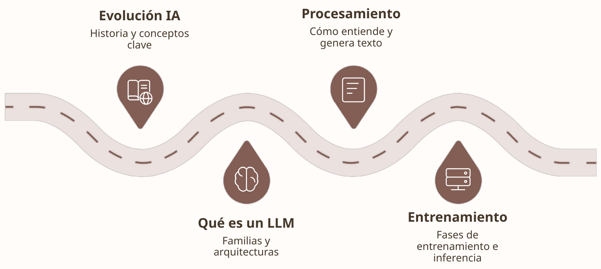

[← Anterior](00-objetivos-del-modulo.md) · [Índice del módulo](README.md) · [Siguiente →](02-que-es-un-llm.md)

# 1 · Objetivos y contexto de la IA

*Módulo 01: Introducción a los Modelos de Lenguaje Grandes (LLM)*

## 1.1 Mapa del módulo

La comprensión avanza desde el contexto amplio de la IA, hacia el funcionamiento interno del modelo y, finalmente, hacia sus capacidades y limitaciones prácticas. El módulo [02](../02-fundamentos-del-prompt-engineering/README.md) utilizará estos fundamentos para diseñar instrucciones eficaces.

Descripción del diagrama en texto

1. Evolución IA — Historia y conceptos clave
2. Qué es un LLM — Familias y arquitecturas
3. Procesamiento — Cómo entiende y genera texto
4. Entrenamiento — Fases de entrenamiento e inferencia

**Explicación**

El mapa organiza el contenido en tres movimientos: el contexto general de la IA, el funcionamiento interno del modelo y sus capacidades y límites prácticos. Se recorren así la evolución de la IA, la definición y las familias de LLM, el modo en que el modelo procesa y genera texto y, por último, las fases de entrenamiento e inferencia.

Todo lo que se explica aquí es la base del módulo [02](../02-fundamentos-del-prompt-engineering/README.md). Las recomendaciones para diseñar instrucciones, como delimitar los datos o prever qué hacer cuando falta información, tienen su razón de ser en cómo funciona el modelo, y por eso se empieza por entenderlo.

---

## 1.2 De la IA tradicional a la IA generativa

Las categorías de IA se relacionan entre sí; no son sinónimos ni niveles completamente independientes. El siguiente diagrama es una simplificación didáctica que sitúa cada concepto en su ámbito.

- **IA**: (campo amplio de sistemas con capacidades inteligentes)
- **Machine Learning**: (métodos que aprenden patrones de datos)
- **Deep Learning**: (redes neuronales profundas)
- **IA Generativa**: (modelos que producen texto, imágenes, audio, vídeo, código)

Ejemplo: clasificador de correo (spam / no spam)

Ejemplo: modelo que redacta una respuesta nueva a un correo

**Explicación**

**Inteligencia artificial**, **aprendizaje automático**, **aprendizaje profundo** e **IA generativa** son conceptos relacionados, pero no equivalentes. La IA es el campo más amplio: cualquier sistema con capacidades que se consideran inteligentes. Dentro de ella, el aprendizaje automático agrupa los métodos que aprenden patrones a partir de datos en lugar de seguir reglas escritas a mano, y el aprendizaje profundo es la parte de este que usa redes neuronales de muchas capas. Un filtro de spam es un buen ejemplo: no tiene reglas explícitas, sino que aprendió de muchos mensajes etiquetados.

La IA generativa se distingue por su resultado: produce contenido nuevo (texto, imágenes, audio, vídeo o código) en lugar de limitarse a clasificar lo existente. Los LLM pertenecen a esta familia. En la práctica actual, la IA generativa forma parte del aprendizaje profundo: los LLM, los modelos de difusión y las redes generativas adversarias son redes neuronales profundas, y por eso el esquema las anida dentro de él.

El encaje no es, sin embargo, perfecto, porque ambos conceptos se definen con criterios distintos: el aprendizaje profundo, por la técnica empleada, y la IA generativa, por la función que cumple. Por eso no todo el aprendizaje profundo genera contenido (una red profunda que clasifica correo como spam o no spam no lo hace), y existieron modelos generativos anteriores al aprendizaje profundo, como los modelos de lenguaje basados en el recuento de palabras. El esquema es una simplificación; conviene evitar expresiones como «la IA hace esto» sin precisar de qué tipo de sistema se habla.

---

## 1.3 Evolución de los sistemas generativos

Los LLM son resultado de avances acumulativos en datos, arquitectura, capacidad computacional y técnicas de entrenamiento. La evolución no fue lineal ni causada por un único avance.

- **Reglas y estadística**: Sistemas basados en reglas y modelos estadísticos de lenguaje.
- **Seq2Seq y atención**: Arquitecturas secuencia-a-secuencia con mecanismos de atención.
- **Asistentes y multimodal**: Modelos instruidos, asistentes conversacionales y capacidades multimodales.
- **Redes neuronales**: Modelos de lenguaje neuronales y representaciones distribuidas.
- **Transformers y escalado**: Arquitectura Transformer y escalado masivo de modelos.

**Explicación**

Los LLM actuales no surgieron de un único descubrimiento, sino de la suma de avances en datos, arquitecturas, capacidad de cálculo y técnicas de entrenamiento. La historia se resume en cinco etapas: primero, sistemas basados en reglas y modelos estadísticos que predecían palabras por recuento; después, modelos neuronales, que representan las palabras como números que capturan relaciones; a continuación, modelos secuencia a secuencia con atención, que mejoraron la traducción; luego, la arquitectura **Transformer** y el escalado masivo, punto de inflexión de los modelos actuales; y, por último, los modelos instruidos, los asistentes conversacionales y las capacidades **multimodales**.

Entender que la evolución no fue lineal ayuda a comprender que estas capacidades tienen causas concretas y, por tanto, también límites concretos.

---

[← Anterior](00-objetivos-del-modulo.md) · [Índice del módulo](README.md) · [Siguiente →](02-que-es-un-llm.md)
