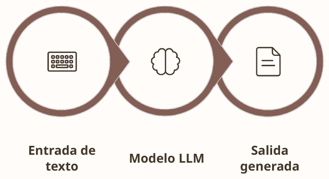
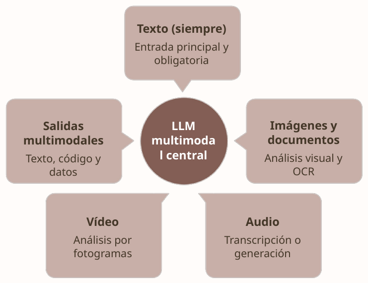

[← Anterior](01-objetivos-y-contexto-de-la-ia.md) · [Índice del módulo](README.md) · [Siguiente →](03-como-funciona-un-llm.md)

# 2 · Qué es un LLM

*Módulo 01: Introducción a los Modelos de Lenguaje Grandes (LLM)*

## 2.1 ¿Qué es un Modelo de Lenguaje Grande (LLM)?

**Definición de trabajo**

Un **LLM** es un modelo entrenado con grandes volúmenes de datos para modelar secuencias de lenguaje y generar o transformar contenido mediante instrucciones.

- «Modelo de lenguaje»: estima distribuciones de probabilidad sobre secuencias de tokens.
- «Grande»: alude a escala de datos, parámetros y capacidad computacional; no existe una definición única.
- Puede realizar generación, continuación, transformación, clasificación y extracción.
- El comportamiento depende de arquitectura, entrenamiento, ajuste, contexto y configuración.

**Esquema conceptual**

Descripción del diagrama en texto

1. **Entrada de texto**
2. **Modelo LLM**
3. **Salida generada**

*Ejemplo: «Resume este texto en tres puntos» → el modelo genera una continuación condicionada por el texto y la instrucción.*

> Un LLM no es una base de datos ni un buscador. Genera secuencias y el conocimiento no equivale a una consulta determinista a una tabla.

**Explicación**

Un **LLM** es un modelo entrenado con grandes volúmenes de datos para modelar secuencias de lenguaje y para generar o transformar contenido a partir de instrucciones. «Modelo de lenguaje» significa que estima probabilidades sobre secuencias de tokens: dado un texto, calcula qué es probable que venga después. «Grande» se refiere a la escala de datos, parámetros y cómputo, sin un umbral único. Un mismo modelo puede generar, continuar, transformar, clasificar o extraer información, y su comportamiento depende también del ajuste, del contexto y de la configuración.

Un LLM no es una base de datos ni un buscador. No consulta una tabla donde el dato está guardado: genera la continuación más plausible. Por eso puede acertar una fecha cuando era una continuación muy probable y fallar cuando no lo era. Esta idea explica muchos de los riesgos que se estudian en el módulo [08](../08-fiabilidad-alucinaciones-y-sesgos/README.md).

---

## 2.2 LLM, chatbot y aplicación: no son lo mismo

El modelo es un componente; el asistente visible incorpora instrucciones, interfaz, herramientas, controles y servicios adicionales. No atribuyas automáticamente al modelo todas las funciones de una plataforma.

*Ejemplo ilustrativo: un mismo modelo invocado desde una interfaz web y desde una API puede tener instrucciones y capacidades disponibles diferentes.*

**Explicación**

Conviene distinguir tres cosas: el modelo, el **chatbot** y la aplicación. El modelo es un componente. Lo que se ve en pantalla es una aplicación que añade interfaz, instrucciones ocultas, memoria, búsqueda, archivos, herramientas y controles. El esquema de cinco capas muestra esa estructura: usuario, interfaz conversacional, orquestación y aplicación, modelo y, en la base, herramientas y fuentes de datos externas.

Una consecuencia práctica: el mismo modelo puede comportarse de forma distinta según la aplicación que lo rodee. Antes de atribuir al modelo capacidades como buscar en internet, recordar conversaciones o leer archivos, hay que preguntarse si las aporta el modelo o la aplicación.

<!-- labs-seccion -->
> **Para practicar esta sección:** [Laboratorio 01B · Mapa de capacidades y límites de un LLM](../../laboratorios/01B/README.md)
<!-- /labs-seccion -->

---

## 2.3 Modelos propietarios y modelos de pesos abiertos

La elección entre un modelo propietario y uno de pesos abiertos depende de los requisitos concretos de control, despliegue, coste, privacidad, rendimiento y mantenimiento. Revisar siempre las licencias, restricciones y condiciones de uso.

> ⚠️ «Open source» y «open weights» no son equivalentes. La licencia concreta determina los usos permitidos. Leer siempre los términos antes de desplegar.

**Explicación**

Los modelos pueden ser propietarios o de **pesos abiertos**. Los pesos son los números que el modelo aprendió al entrenarse; quien dispone de ellos puede ejecutarlo. En un **modelo propietario**, los pesos no se distribuyen y se accede por servicio: el proveedor se encarga de la infraestructura y de las actualizaciones, a cambio de ofrecer menos control. En uno de pesos abiertos, los pesos se publican bajo una licencia concreta y pueden desplegarse en infraestructura propia, lo que da más control, pero exige asumir operación, seguridad y mantenimiento.

La elección depende de requisitos de control, coste, privacidad, rendimiento y mantenimiento; ninguna opción es mejor en abstracto. Además, «código abierto» y «pesos abiertos» no son lo mismo: publicar los pesos no implica publicar los datos de entrenamiento, y la licencia determina los usos permitidos, por lo que debe leerse antes de desplegar.

---

## 2.4 Tareas habituales que pueden realizar los LLM

Un mismo modelo puede abordar numerosas tareas lingüísticas mediante instrucciones y contexto adecuados. Capacidad aparente no equivale a fiabilidad garantizada. Cada uso requiere criterios de validación propios.

- **Generación y reformulación**: Redactar borradores, reformular según audiencia o tono.
- **Resumen y síntesis**: Condensar textos extensos manteniendo los puntos clave.
- **Clasificación y extracción**: Etiquetar textos y extraer entidades, fechas o conceptos.
- **Traducción y localización**: Traducir y adaptar contenido a contextos culturales específicos.
- **Código y documentación**: Generar, explicar y revisar fragmentos de código y su documentación.
- **Análisis e ideación**: Explorar alternativas, apoyar resolución de problemas y tutoría.

*Ejemplo: dado un correo largo, un LLM puede resumirlo, extraer fechas relevantes, clasificar su urgencia y proponer una respuesta — en una sola interacción.*

**Explicación**

Un mismo modelo puede abordar muchas tareas de lenguaje con solo cambiar las instrucciones y el contexto. Las seis familias de tareas son: generación y reformulación, resumen y síntesis, clasificación y extracción, traducción y localización, código y documentación, y análisis e ideación. Ante un correo largo, por ejemplo, puede resumirlo, extraer fechas, valorar su urgencia y proponer una respuesta en una sola interacción.

La salvedad importante es que poder hacer algo no equivale a hacerlo con fiabilidad. Cada uso necesita sus propios criterios de validación.

---

## 2.5 Multimodalidad: más allá del texto

Algunos modelos pueden procesar o generar diferentes modalidades, aunque las capacidades concretas dependen de la versión y del producto. Verificar qué modalidades admite la herramienta utilizada antes de diseñar una solución.

Descripción del diagrama en texto

1. Salidas multimodales — Texto, código y datos
2. Vídeo — Análisis por fotogramas
3. Texto (siempre) — Entrada principal y obligatoria
4. **LLM multimodal central**
5. Audio — Transcripción o generación
6. Imágenes y documentos — Análisis visual y OCR

**Consideraciones clave**

- Texto: modalidad central de los modelos de lenguaje.
- Imágenes y documentos visuales: en modelos con capacidad de visión.
- Audio: transcripción, comprensión o generación, según el sistema.
- Vídeo: análisis de secuencias o fotogramas en sistemas compatibles.
- Multimodal no significa que todos los modelos soporten todas las modalidades.

Ejemplo ilustrativo: solicitar la descripción de un gráfico incluido en una imagen, si la herramienta admite esa entrada.

**Explicación**

Algunos modelos aceptan o producen modalidades distintas del texto: imágenes y documentos (con análisis visual y lectura de texto en imágenes), audio (transcripción o generación) y vídeo. El texto sigue siendo la modalidad central y, normalmente, el canal por el que se da la instrucción. Las salidas pueden ser texto, código o datos estructurados, y en algunos productos también imágenes o audio.

Que un modelo sea multimodal no significa que lo sea cualquier modelo o producto. Antes de diseñar una solución basada en imágenes o audio hay que comprobar qué admite el entorno concreto, con qué calidad y con qué límites, y validar igualmente los resultados: un modelo puede leer mal una cifra de un gráfico.

---

[← Anterior](01-objetivos-y-contexto-de-la-ia.md) · [Índice del módulo](README.md) · [Siguiente →](03-como-funciona-un-llm.md)
