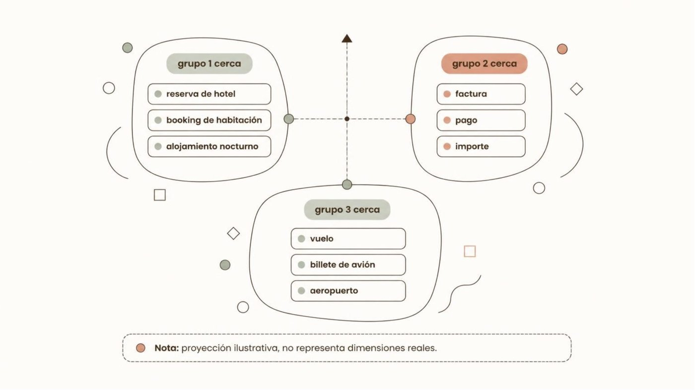
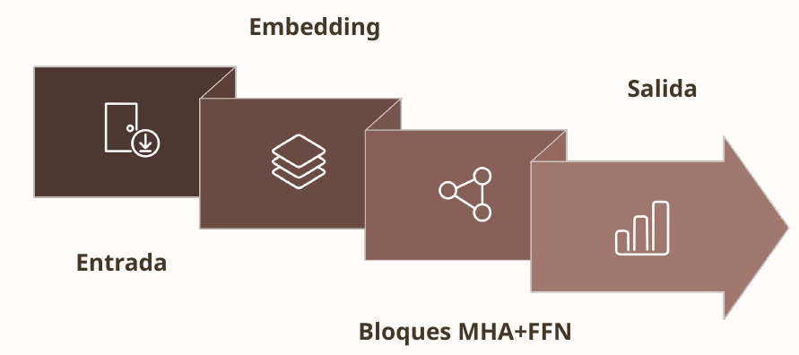
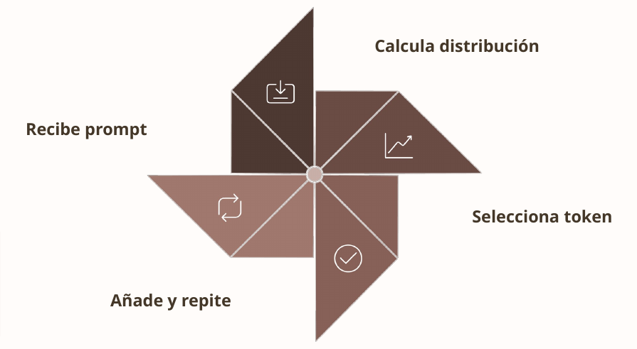

[← Anterior](02-que-es-un-llm.md) · [Índice del módulo](README.md) · [Siguiente →](04-entrenamiento-contexto-y-generacion.md)

# 3 · Cómo funciona un LLM

*Módulo 01: Introducción a los Modelos de Lenguaje Grandes (LLM)*

## 3.1 Concepto de tokenización

Los modelos no procesan palabras completas tal como las leemos: dividen el texto en unidades llamadas tokens. La segmentación depende del tokenizador y del modelo concreto.

**Qué es un token**

- Un token puede representar una palabra, parte de una palabra, un signo o un fragmento de caracteres.
- La segmentación depende del tokenizador y del modelo.
- La cantidad de tokens influye en los límites de contexto, el coste y la longitud de la entrada o salida.
- Idiomas, código y caracteres especiales pueden tokenizarse de manera diferente.
- No existe una equivalencia fija entre tokens y palabras.

**Ejemplo ilustrativo**

La frase *«tokenización»* podría segmentarse en varios fragmentos: token + ización

Una palabra frecuente como *«el»* puede representarse por una única unidad.

Una misma palabra en distintos idiomas puede ocupar diferente número de tokens.

Este ejemplo es ilustrativo. No representa la segmentación de un tokenizador real concreto.

**Explicación**

Los modelos no leen palabras completas, sino tokens: unidades que pueden ser una palabra, parte de una palabra, un signo o un fragmento de caracteres, según el tokenizador. La cantidad de tokens determina el límite de contexto, el coste y la longitud máxima de la entrada y la salida. El mismo contenido puede ocupar más o menos tokens según el idioma, y no existe una equivalencia fija entre tokens y palabras.

El ejemplo de segmentación del recuadro es solo ilustrativo y no corresponde a ningún tokenizador real. Lo relevante es que el modelo trabaja con fragmentos, no con letras, lo que explica por qué a veces falla al contar letras o al manejar ciertos nombres poco frecuentes.

<!-- labs-seccion -->
> **Para practicar esta sección:** [Laboratorio 01A · Tokens, ventana de contexto y coste](../../laboratorios/01A/README.md)
<!-- /labs-seccion -->

---

## 3.2 Del texto a las representaciones vectoriales: embeddings

Los embeddings (representaciones vectoriales) codifican elementos de lenguaje en espacios numéricos donde ciertas relaciones semánticas pueden reflejarse como proximidades. No son una explicación literal del significado ni garantizan comprensión humana.

**Conceptos clave**

- Una representación vectorial codifica información en números de múltiples dimensiones.
- Los embeddings permiten representar palabras, fragmentos, frases o documentos, según el sistema.
- La proximidad vectorial puede aproximar similitud semántica.
- Se utilizan en búsqueda semántica, recuperación de información y sistemas RAG (Retrieval-Augmented Generation).

**Proyección didáctica simplificada**

> Distinguir embeddings de tokens y de estados internos del modelo. No todos los LLM utilizan exactamente el mismo mecanismo de embeddings.

**Explicación**

Los embeddings son representaciones numéricas de elementos del lenguaje (palabras, frases o documentos) en un espacio de muchas dimensiones, donde los elementos de significado parecido tienden a quedar próximos. Es como un mapa: en lugar de ciudades, se sitúan textos, y la cercanía aproxima la similitud de significado. Se usan en búsqueda semántica, recuperación de información y sistemas RAG.

En el diagrama, «reserva de hotel», «booking de habitación» y «alojamiento nocturno» quedan juntos aunque no compartan palabras. Es una proyección didáctica, no un espacio real. No hay que confundir embeddings, tokens y estados internos del modelo: el token es la pieza de texto, el embedding su representación numérica y los estados internos lo que el modelo construye capa a capa.

---

## 3.3 Arquitectura Transformer: visión general

La arquitectura Transformer utiliza mecanismos de atención para procesar relaciones entre elementos de una secuencia. Muchos LLM generativos utilizan variantes basadas en decoder, aunque existen variantes encoder, decoder y encoder-decoder.

Descripción del diagrama en texto

1. **Entrada**
2. **Embedding**
3. **Bloques MHA+FFN**
4. **Salida**

**Componentes conceptuales**

- Los Transformers sustituyeron enfoques recurrentes en numerosas tareas de secuencia.
- La atención permite ponderar relaciones entre tokens de la secuencia.
- Los bloques incluyen operaciones de atención y redes *feed-forward*, entre otros componentes.
- No todos los modelos tienen arquitecturas idénticas.

Este diagrama es esquemático y didáctico. Las arquitecturas reales varían entre modelos y versiones.

**Explicación**

La arquitectura Transformer procesa las relaciones entre los elementos de una secuencia mediante mecanismos de atención. El esquema mínimo es: entrada, conversión en embeddings, una pila de bloques que combinan atención multicabeza y redes feed-forward, y salida. Cada bloque refina la representación de cada token teniendo en cuenta a los demás, de modo que el contexto se va entendiendo mejor capa a capa.

Frente a los enfoques recurrentes, que procesaban el texto palabra a palabra, el Transformer permite trabajar en paralelo. Muchos LLM generativos usan variantes de tipo decoder. El diagrama es esquemático: las arquitecturas reales varían entre modelos y versiones, y los proveedores no siempre las detallan.

---

## 3.4 Mecanismo de atención (Attention)

La atención permite que la representación de un token incorpore información relevante de otros tokens de la secuencia. No equivale a atención humana consciente; es una operación matemática que pondera relaciones.

**Ejemplo de resolución de referencia**

En la frase:

«María dejó el libro en la mesa porque estaba cansada»

¿A qué o quién se refiere «cansada»? El mecanismo de atención pondera los tokens relevantes para resolver la ambigüedad contextualmente.

**Propiedades del mecanismo**

- Cada posición puede atender a otras posiciones según puntuaciones calculadas.
- Las relaciones relevantes reciben mayor peso relativo.
- La atención puede operar sobre diferentes *cabezas* (multi-head) y capas.
- Contextualiza las representaciones internas del modelo.
- Es una pieza del sistema, no una explicación completa de todas sus capacidades.

> La analogía «el modelo presta atención» es útil para explicar relaciones matemáticas, pero no implica intención ni comprensión consciente.

**Explicación**

Gracias a la atención, la representación de cada token integra la información relevante de los demás tokens de la secuencia. No equivale a la atención humana consciente: es una operación matemática que pondera relaciones. En la frase «María dejó el libro en la mesa porque estaba cansada», el mecanismo asigna más peso a la relación entre «cansada» y «María» que a la que hay con «libro» o «mesa», y así resuelve a qué se refiere la palabra.

La atención puede operar con varias cabezas y en varias capas, y contextualiza cada representación: la misma palabra se representa de forma distinta según la frase. Es una pieza del sistema, no la explicación completa de sus capacidades, y la expresión «el modelo presta atención» no implica intención ni comprensión consciente.

---

## 3.5 Predicción del siguiente token

En generación autoregresiva, el modelo estima posibles siguientes tokens condicionados por el contexto disponible. La salida completa emerge de múltiples pasos sucesivos — no se genera toda de una vez.

Descripción del diagrama en texto

1. **Recibe prompt**
2. **Añade y repite**
3. **Calcula distribución**
4. **Selecciona token**

**Ejemplo ilustrativo**

Entrada: «*La capital de Francia es…*»

El modelo calcula probabilidades sobre posibles continuaciones. La selección depende de la estrategia de decodificación, no únicamente de elegir siempre la palabra más probable.

La estrategia de decodificación (temperatura, top-p, etc.) condiciona la variabilidad de la respuesta. No siempre se selecciona el token de mayor probabilidad.

**Explicación**

En la generación autorregresiva el modelo produce la respuesta paso a paso. Recibe el prompt, calcula una distribución de probabilidad sobre los posibles siguientes tokens, selecciona uno, lo añade al texto y repite el proceso. Ante «La capital de Francia es…», una continuación será muy probable y otras mucho menos, pero la elección final depende de la estrategia de decodificación: no se elige siempre la más probable. Parámetros como la **temperatura** o top-p influyen en la variabilidad, y por eso la misma pregunta puede recibir respuestas algo distintas.

Dos consecuencias: como se escribe un token cada vez sin volver atrás, una pequeña desviación inicial puede arrastrar el resto, y el modelo no conoce la respuesta completa antes de empezar. Por eso pedirle que razone o revise puede cambiar el resultado.

---

## 3.6 Generación condicionada por el contexto

La generación depende de todo el contexto que el modelo recibe y de cómo se configura la tarea. El orden y la claridad de las instrucciones pueden influir significativamente en la respuesta obtenida.

**Qué puede incluir el contexto**

- Instrucciones del sistema o del usuario.
- Conversación o historial previo.
- Ejemplos aportados (*few-shot*).
- Datos, documentos o fragmentos de texto.
- Información irrelevante o contradictoria — el modelo no la filtra automáticamente.

**Comparación de formulación**

- **Ambiguo**: Resume
- **Especificado**: Resume el texto siguiente en cinco puntos para una dirección ejecutiva, priorizando implicaciones económicas.

La segunda formulación reduce la ambigüedad y condiciona mejor la salida esperada.

> Conexión con módulo [02](../02-fundamentos-del-prompt-engineering/README.md): diseñar prompts consiste, entre otras cosas, en construir el contexto y las instrucciones de forma deliberada.

**Explicación**

La respuesta está condicionada por todo el contexto recibido: instrucciones del sistema o del usuario, historial de la conversación, ejemplos (few-shot) y datos o documentos aportados. También forma parte del contexto la información irrelevante o contradictoria, que el modelo no filtra por sí mismo.

La comparación lo muestra: «Resume» deja todas las decisiones al modelo (extensión, audiencia, prioridades) y suele producir algo genérico, mientras que «Resume el texto en cinco puntos para una dirección ejecutiva, priorizando implicaciones económicas» las fija. No se trata de trucos, sino de aportar información. Por eso diseñar prompts consiste, en gran parte, en construir de forma deliberada el contexto y las instrucciones, tema del módulo [02](../02-fundamentos-del-prompt-engineering/README.md).

---

[← Anterior](02-que-es-un-llm.md) · [Índice del módulo](README.md) · [Siguiente →](04-entrenamiento-contexto-y-generacion.md)
