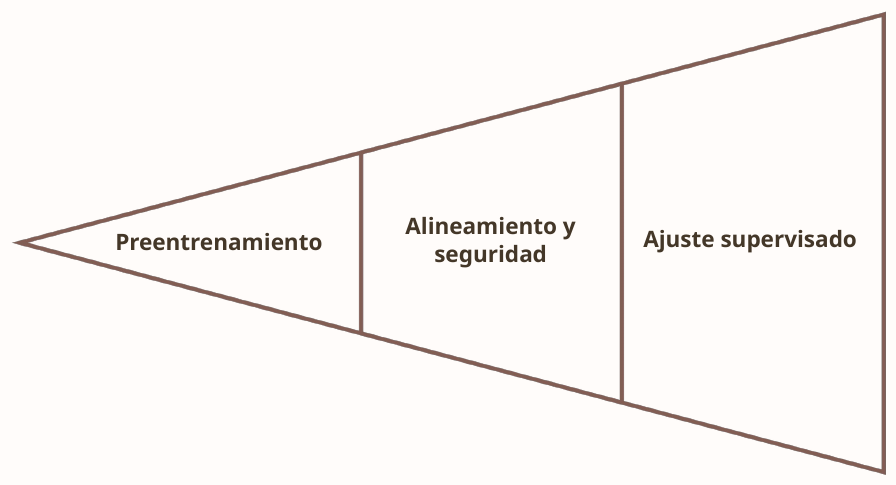
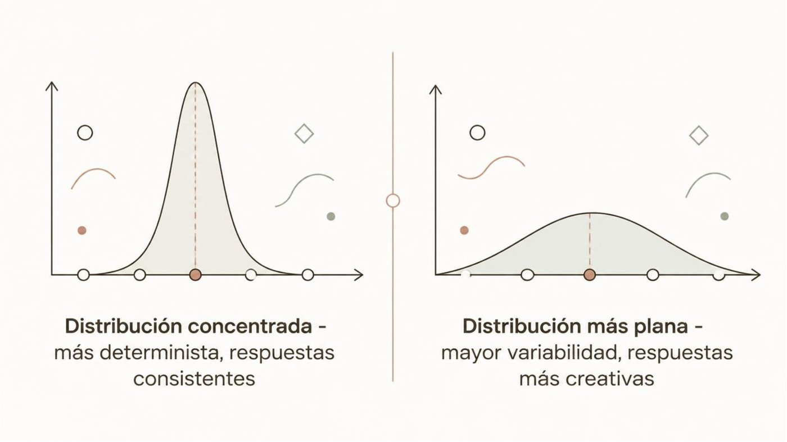

[← Anterior](03-como-funciona-un-llm.md) · [Índice del módulo](README.md) · [Siguiente →](05-capacidades-y-limitaciones.md)

# 4 · Entrenamiento, contexto y generación

*Módulo 01: Introducción a los Modelos de Lenguaje Grandes (LLM)*

## 4.1 Entrenamiento e inferencia

Entrenamiento y inferencia son dos procesos distintos del ciclo de vida del modelo. El usuario de un asistente normalmente interactúa durante inferencia, no reentrena el modelo con cada mensaje.

**🎓 Entrenamiento**

- Exposición a grandes volúmenes de datos.
- Optimización iterativa de parámetros.
- Proceso largo y computacionalmente costoso.
- Realizado por los equipos de los proveedores.

**⚡ Inferencia**

- Procesamiento de una entrada concreta.
- Generación de una salida usando los parámetros ya aprendidos.
- Proceso rápido (segundos o menos).
- Es lo que ocurre cuando envías un mensaje al asistente.

*Analogía: aprender una disciplina durante años (entrenamiento) frente a resolver un ejercicio concreto utilizando lo aprendido (inferencia).*

> Los productos pueden tener mecanismos de memoria o mejora de servicio separados; no confundirlos con reentrenamiento inmediato del modelo en cada conversación.

**Explicación**

El entrenamiento y la inferencia son dos procesos distintos. En el entrenamiento, los proveedores exponen al modelo a grandes volúmenes de datos y ajustan sus parámetros de forma iterativa; es largo y costoso. En la inferencia, el modelo genera una salida para una entrada concreta usando los parámetros ya aprendidos, que no cambian; es rápido y es lo que ocurre al enviar un mensaje.

Por eso, al conversar con un asistente se está normalmente en inferencia y no se reentrena el modelo con cada mensaje. Corregir al modelo sirve dentro de la conversación porque la corrección pasa a formar parte del contexto, pero el modelo no ha cambiado. Los productos pueden tener memoria o mecanismos de mejora del servicio, pero son procesos separados de un reentrenamiento inmediato.

---

## 4.2 Preentrenamiento y ajuste posterior

El comportamiento de un asistente suele resultar de varias etapas de entrenamiento y ajuste. Las recetas concretas varían entre proveedores y modelos; lo que se muestra aquí es un esquema conceptual general.

Descripción del diagrama en texto

1. **Preentrenamiento**
2. **Alineamiento y seguridad**
3. **Ajuste supervisado**

**Qué aporta cada etapa**

- Preentrenamiento: el modelo aprende patrones del lenguaje a gran escala.
- Ajuste supervisado: aprende a seguir instrucciones con ejemplos etiquetados.
- Alineamiento: se ajustan las preferencias y el comportamiento deseado.

**Qué varía**

- Las etapas aplicadas y su orden pueden diferir entre modelos.
- No todos los modelos exponen información detallada sobre su proceso de entrenamiento.
- Nunca asumir que todos los proveedores utilizan el mismo proceso.

**Explicación**

Un asistente suele ser el resultado de varias etapas, aunque las recetas concretas varían entre proveedores. En el **preentrenamiento** el modelo aprende patrones del lenguaje a gran escala y adquiere la capacidad de continuar textos; todavía no se comporta como asistente. En el ajuste supervisado aprende a seguir instrucciones a partir de pares de instrucción y respuesta deseada. En el alineamiento y la seguridad se ajustan sus preferencias y su comportamiento, por ejemplo para que sea útil y evite respuestas dañinas.

Las etapas, su orden y la información disponible varían entre modelos, de modo que no debe asumirse que todos se entrenan igual. En la práctica, dos modelos pueden reaccionar de forma distinta a la misma instrucción, y conviene probar siempre en el modelo concreto que se va a usar.

<!-- labs-seccion -->
> **Para practicar esta sección:** [Laboratorio 01A · Tokens, ventana de contexto y coste](../../laboratorios/01A/README.md)
<!-- /labs-seccion -->

---

## 4.3 Ventana de contexto (Context Window)

La ventana de contexto limita la cantidad de tokens que el modelo puede considerar en una solicitud concreta. Una ventana amplia no garantiza que toda la información disponible se utilice correctamente.

**Qué incluye la ventana**

**Instrucciones del sistema**

(inicio)

**Implicaciones prácticas**

- Los límites se expresan normalmente en tokens.
- Una conversación larga puede requerir truncamiento, resumen o gestión activa del contexto.
- El límite efectivo puede depender del modelo, producto y configuración concreta.
- Información fuera de la ventana no está disponible para esa interacción.

- **Historial de conversación**: (sección media amplia)
- **Documento o datos aportados**: (sección grande)
- **Respuesta generada**: (final)

El total (entrada + respuesta) comparte un límite en tokens

No publicar cifras de ventanas de contexto sin verificar la versión exacta del modelo y la fecha de consulta.

**Explicación**

La ventana de contexto limita cuántos tokens puede considerar el modelo en una solicitud. Entrada y respuesta comparten ese límite: instrucciones del sistema, historial, documentos aportados y respuesta generada. Una conversación larga puede requerir truncar, resumir o gestionar activamente el contexto, y lo que queda fuera de la ventana no está disponible para esa interacción.

Una ventana amplia no garantiza que toda la información se aproveche bien: en textos muy largos el modelo puede usar peor lo que queda en medio. El límite efectivo depende además del modelo, del producto y de la configuración. Las cifras de ventanas cambian con frecuencia, así que no deben citarse sin verificar la versión y la fecha de consulta.

---

## 4.4 Temperatura y selección de tokens: intuición

La estrategia de selección de tokens influye en la variabilidad de las respuestas. Los controles disponibles dependen del modelo y la plataforma. La configuración no sustituye a instrucciones claras ni a validación.

**Parámetros habituales**

- Temperature: modifica la distribución de selección en sistemas que exponen este parámetro.
- Top-p: limita la selección a un conjunto acumulado de probabilidad.
- No todos los productos exponen los mismos controles.

**Cuándo importa**

- Generación creativa → mayor variabilidad.
- Extracción estructurada → mayor consistencia.

Los detalles operativos se desarrollan en el módulo [06](../06-formato-de-salida-y-parametros/README.md).3. Aquí solo se establece la intuición y el vocabulario.

**Explicación**

La temperatura y otros parámetros de selección de tokens influyen en la variabilidad de las respuestas. Con una distribución concentrada, el modelo es más determinista y consistente; con una más plana, reparte la probabilidad entre más opciones y resulta más variado y creativo, pero también arriesga más. La temperatura reescala la distribución y top-p limita la elección a los tokens que acumulan cierta probabilidad. No todos los productos permiten modificarlos.

Para generación creativa interesa más variabilidad; para extracción o clasificación, más consistencia. Aun así, bajar la temperatura hace al modelo más repetible, no más verdadero: un error consistente sigue siendo un error. Los detalles se ven en el módulo [06](../06-formato-de-salida-y-parametros/README.md).

---

[← Anterior](03-como-funciona-un-llm.md) · [Índice del módulo](README.md) · [Siguiente →](05-capacidades-y-limitaciones.md)
