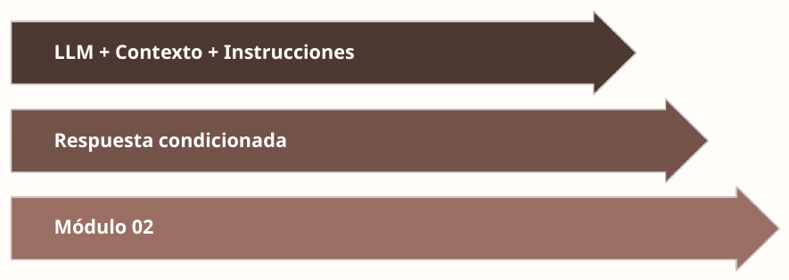

[← Anterior](05-capacidades-y-limitaciones.md) · [Índice del módulo](README.md) · [Siguiente →](07-anexo-familias-de-modelos.md)

# 6 · Resumen, comprobación y transición

*Módulo 01: Introducción a los Modelos de Lenguaje Grandes (LLM)*

## 6.1 Resumen: modelo mental para trabajar con LLM

Un LLM genera respuestas condicionadas por tokens y contexto. Sus capacidades son amplias, pero sus resultados necesitan especificación clara y validación adecuada al riesgo.

- **LLM ≠ chatbot ≠ buscador**: Es un componente que genera secuencias — la aplicación añade capas y funciones.
- **Capacidad ≠ fiabilidad**: Un modelo puede generar texto fluido y convincente sobre algo incorrecto.
- **Selección y supervisión**: Deben ajustarse al riesgo real de la tarea y al impacto de un posible error.

**Explicación**

El modelo mental del módulo es un flujo: el prompt y su contexto se convierten en tokens, el modelo construye representaciones internas con embeddings y atención, genera la respuesta token a token, produce una salida y se completa con una validación humana proporcional al riesgo. Además, el entrenamiento es distinto de la inferencia, las capacidades son amplias pero no infalibles y las limitaciones incluyen alucinaciones, fallos de razonamiento, desactualización y sesgos.

Tres ideas finales: un LLM no es un chatbot ni un buscador, sino un componente que genera secuencias; capacidad no es fiabilidad; y la elección del modelo y su supervisión deben ajustarse al riesgo real de la tarea.

---

## 6.2 Comprobación de comprensión

Piensa cada respuesta, de forma oral o por escrito, antes de ver las respuestas orientativas, que aparecen a continuación.

**1. ¿Qué diferencia hay entre un LLM y una aplicación conversacional?**

**2. ¿Qué es un token y por qué importa para entender los límites del modelo?**

**3. ¿Qué función cumple el mecanismo de atención en la generación de texto?**

**4. ¿Qué diferencia hay entre entrenamiento e inferencia? ¿En cuál participa el usuario?**

**5. ¿Por qué una ventana de contexto amplia no garantiza una respuesta correcta?**

**6. ¿Qué dimensiones de riesgo deben considerarse antes de utilizar un LLM?**

> Para cerrar, retoma la pregunta inicial del módulo: «*¿Por qué un modelo puede equivocarse siendo convincente?*»

---

## 6.3 Comprobación de comprensión: respuestas

Contrasta tus respuestas con estas. Son orientativas: lo importante es que cubran las ideas clave del módulo.

1. **¿Qué diferencia hay entre un LLM y una aplicación conversacional?** El LLM es un componente que genera secuencias; la aplicación añade interfaz, instrucciones, herramientas, controles y servicios.
2. **¿Qué es un token y por qué importa para entender los límites del modelo?** Una unidad de texto (palabra, parte de palabra o signo); los límites de contexto, el coste y la longitud se miden en tokens.
3. **¿Qué función cumple el mecanismo de atención en la generación de texto?** Pondera las relaciones entre los tokens de la secuencia para contextualizar cada representación; es una operación matemática, no atención consciente.
4. **¿Qué diferencia hay entre entrenamiento e inferencia? ¿En cuál participa el usuario?** El entrenamiento ajusta los parámetros con grandes volúmenes de datos; la inferencia genera una salida con lo ya aprendido. El usuario participa en la inferencia.
5. **¿Por qué una ventana de contexto amplia no garantiza una respuesta correcta?** Porque el modelo puede no usar bien toda la información disponible: también importan el límite efectivo y la calidad del contexto.
6. **¿Qué dimensiones de riesgo deben considerarse antes de utilizar un LLM?** Fiabilidad (alucinaciones), sesgos, privacidad, seguridad (inyección de prompts) y supervisión proporcional al impacto de un error.

> Para cerrar, retoma la pregunta inicial del módulo: «*¿Por qué un modelo puede equivocarse siendo convincente?*»

**Explicación**

La comprobación de comprensión permite repasar el módulo con las propias palabras, de forma oral o escrita, sin carácter evaluativo. Las respuestas orientativas resumen lo esencial: el LLM es un componente y la aplicación añade interfaz, herramientas y controles; los tokens son unidades de texto y en ellos se miden límites, coste y longitud; la atención pondera relaciones entre tokens; el usuario participa en la inferencia, no en el entrenamiento; una ventana amplia no garantiza buenas respuestas; y los riesgos a considerar son fiabilidad, sesgos, privacidad, seguridad y supervisión.

Con ello se puede responder a la pregunta inicial: un modelo puede equivocarse siendo convincente porque genera texto probable, no verdad verificada, y la fluidez no es señal de exactitud.

---

## 6.4 Transición: del modelo al prompt

Conocer cómo funciona el modelo permite diseñar mejor las instrucciones, el contexto y los criterios de salida. El Prompt Engineering no elimina las limitaciones del modelo — pero permite orientar y controlar mejor la interacción.

Descripción del diagrama en texto

1. **LLM + Contexto + Instrucciones**
2. **Respuesta condicionada**
3. **Módulo 02**

- **Lo que hemos visto**: Qué es un LLM, cómo procesa texto, cómo genera y cuáles son sus límites.
- **Lo que sigue**: Módulo 02: fundamentos y anatomía del Prompt Engineering — cómo construir instrucciones eficaces sobre esta base.

**Explicación**

Conocer el funcionamiento del modelo permite diseñar mejor instrucciones, contexto y criterios de salida. El Prompt Engineering no elimina las limitaciones del modelo, pero permite orientar y controlar mejor la interacción: reduce la ambigüedad, mejora la consistencia y facilita la comprobación. Las alucinaciones, los errores de razonamiento y los sesgos se gestionan con diseño, verificación y supervisión, no solo escribiendo bien.

La fórmula de trabajo es un LLM más un contexto más unas instrucciones, que dan una respuesta condicionada. El modelo viene dado; lo que se puede diseñar es el contexto y las instrucciones, objeto del módulo [02](../02-fundamentos-del-prompt-engineering/README.md).

---

[← Anterior](05-capacidades-y-limitaciones.md) · [Índice del módulo](README.md) · [Siguiente →](07-anexo-familias-de-modelos.md)
