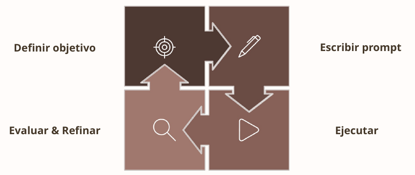

[← Anterior](00-objetivos-del-modulo.md) · [Índice del módulo](README.md) · [Siguiente →](02-anatomia-de-un-prompt.md)

# 1 · Introducción: qué es Prompt Engineering

*Módulo 02: Fundamentos del Prompt Engineering*

## 1.1 Recorrido del módulo

El diseño de prompts se aprende de forma progresiva: comprendiendo primero qué es, después cómo se estructura y finalmente cómo se revisa y mejora sistemáticamente.

- **Qué es Prompt Engineering**: Definición, objetivos y propósito de la disciplina.
- **De la petición a la especificación**: Del lenguaje casual al diseño operativo de instrucciones.
- **Anatomía de un prompt**: Los siete componentes y cómo se interrelacionan.
- **Claridad, precisión y contexto**: Principios fundamentales de diseño.
- **Restricciones y tareas complejas**: Ambigüedades, contradicciones y descomposición.
- **Método de revisión**: Checklist para evaluar la calidad antes de ejecutar.

*Nota: las técnicas Zero-shot y Few-shot se desarrollan en el módulo [04](../04-tecnicas-avanzadas-de-prompting/README.md).*

**Explicación**

El recorrido va de qué es la disciplina a cómo se estructura un prompt y, por último, cómo se revisa. Los seis bloques son: definición y propósito, paso de la petición a la especificación, **anatomía** con sus siete componentes, principios de claridad, precisión y **contexto**, tratamiento de restricciones y tareas complejas, y un método de revisión previo a la ejecución. Las técnicas zero-shot y few-shot se desarrollan en el módulo [04](../04-tecnicas-avanzadas-de-prompting/README.md).

Los tres primeros bloques construyen el vocabulario para hablar de un prompt; los tres últimos, la capacidad de juzgarlo y mejorarlo.

---

## 1.2 Qué es Prompt Engineering

Definición: Prompt Engineering es el diseño y refinamiento sistemático de instrucciones y contexto para orientar el comportamiento de un modelo de lenguaje hacia un resultado deseado, útil y verificable.

Descripción del diagrama en texto

1. **Definir objetivo**
2. **Evaluar & Refinar**
3. **Ejecutar**
4. **Escribir prompt**

No es una fórmula mágica: es un proceso iterativo de especificación y experimentación. Comparativa: pedir «haz un resumen» frente a especificar audiencia, extensión, enfoque y formato produce resultados radicalmente distintos.

**Explicación**

**Prompt Engineering** es el diseño y refinamiento sistemático de instrucciones y contexto para orientar a un modelo de lenguaje hacia un resultado deseado, útil y verificable. Cada término importa: es diseño y no improvisación, se refina porque el primer intento rara vez es el definitivo, es sistemático y no tanteo, y busca resultados que sirvan y se puedan comprobar.

El proceso es un ciclo: definir el objetivo, escribir el prompt, ejecutar, evaluar y refinar. No existe una fórmula mágica. La diferencia entre pedir «haz un resumen» y especificar audiencia, extensión, enfoque y formato es enorme: en el primer caso el modelo decide todo, en el segundo la persona decide lo importante.

---

## 1.3 Más allá de hacer preguntas

Una pregunta busca información; un prompt profesional define una tarea con entradas, condiciones y salida esperada. La precisión requerida crece con la complejidad y el impacto del caso de uso.

**Petición vaga**

«*Analiza este texto*.»

- Deja implícito el objetivo
- No define el criterio de análisis
- El modelo decide el enfoque
- Resultado impredecible

**Especificación operativa**

«*Identifica las tres causas principales, cita el fragmento de apoyo de cada una y separa hechos de inferencias.*»

- Objetivo explícito
- Criterio de análisis definido
- Formato de salida claro
- Resultado reproducible

> La longitud del prompt no es indicador de calidad. Una instrucción breve puede ser excelente si el contexto es claro y completo.

**Explicación**

Una pregunta se limita a buscar información, mientras que un prompt profesional especifica una tarea: qué entra, bajo qué condiciones y qué debe salir. La precisión necesaria crece con la complejidad y el impacto del caso. «Analiza este texto» deja implícitos el objetivo y el criterio, así que el modelo elige el enfoque y el resultado es impredecible. «Identifica las tres causas principales, cita el fragmento de apoyo de cada una y separa hechos de inferencias» fija objetivo, criterio y formato y produce un resultado reproducible.

La longitud no mide la calidad: una instrucción breve puede ser excelente si el contexto es claro, y una larga puede ser mala si acumula reglas confusas. Lo que cuenta es cuántas decisiones relevantes deja resueltas.

---

## 1.4 Prompt como contrato de tarea

Un buen prompt alinea objetivo, entradas, operación esperada y criterios de salida. Puede pensarse como una especificación de tarea con seis campos (resumen de los siete componentes):

1. **Objetivo**: Qué resultado se necesita.
2. **Entrada**: Sobre qué información se trabajará.
3. **Operación**: Qué debe hacer el modelo exactamente.
4. **Condiciones**: Qué debe respetar o evitar.
5. **Salida**: Cómo debe presentar el resultado.
6. **Validación**: Cómo reconocer una respuesta aceptable.

*Ejemplo ilustrativo: extracción de datos de una factura ficticia con campos esperados, formato y tratamiento de campos ausentes.*

**Explicación**

Un prompt puede verse como un **contrato de tarea** con seis campos: objetivo (qué resultado se necesita), entrada (sobre qué información se trabaja), operación (qué debe hacer el modelo), condiciones (qué debe respetar o evitar), salida (cómo presentar el resultado) y validación (cómo reconocer una respuesta aceptable). Se corresponden con los siete componentes que se estudian a continuación.

En el ejemplo de la extracción de datos de una factura ficticia, cada campo resuelve una duda que, de no especificarse, el modelo tendría que adivinar: qué campos extraer, en qué formato y qué hacer con los ausentes. Una buena prueba es preguntarse si alguien ajeno al proyecto podría ejecutar la tarea con solo ese texto, sin hacer preguntas.

<!-- labs-seccion -->
> **Para practicar esta sección:** [Laboratorio 02A · Del prompt vago al contrato de tarea](../../laboratorios/02A/README.md) · [Laboratorio 14 · Proyecto integrador: asistente de gestión de reclamaciones de Altanoria](../../laboratorios/14/README.md)
<!-- /labs-seccion -->

---

## 1.5 Cuándo merece la pena estructurar un prompt

Cuanto más compleja, repetitiva o sensible sea una tarea, más importante resulta hacer explícitas todas sus condiciones. El esfuerzo de diseño debe ser proporcional al problema.

**No imponer plantillas pesadas a tareas triviales.**

Comparativa: pedir tres ideas para una reunión vs. clasificar solicitudes de clientes según prioridad y reglas internas son escenarios con necesidades de especificación muy diferentes.

**Explicación**

El esfuerzo de diseño debe ser proporcional a la complejidad, la repetición y la sensibilidad de la tarea. La matriz relaciona el riesgo con el nivel de especificación: las tareas simples admiten instrucciones breves; las repetitivas exigen consistencia; las que tienen múltiples restricciones necesitan especificaciones explícitas; y las que manejan datos sensibles requieren controles adicionales.

Pedir tres ideas para una reunión es una tarea de bajo riesgo; clasificar solicitudes de clientes según reglas internas exige criterios exactos y resultados reproducibles. Imponer plantillas pesadas a tareas triviales es un error frecuente: el prompt resulta desproporcionado respecto de la tarea.

<!-- labs-seccion -->
> **Para practicar esta sección:** [Laboratorio 02A · Del prompt vago al contrato de tarea](../../laboratorios/02A/README.md)
<!-- /labs-seccion -->

---

[← Anterior](00-objetivos-del-modulo.md) · [Índice del módulo](README.md) · [Siguiente →](02-anatomia-de-un-prompt.md)
