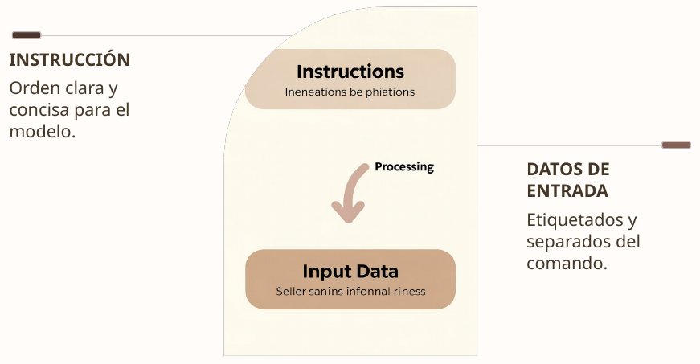

[← Anterior](01-introduccion-que-es-prompt-engineering.md) · [Índice del módulo](README.md) · [Siguiente →](03-principios-de-diseno.md)

# 2 · Anatomía de un prompt

*Módulo 02: Fundamentos del Prompt Engineering*

## 2.1 Anatomía general de un prompt

Los componentes principales de un prompt permiten reducir supuestos implícitos y orientar la respuesta con precisión. No todos los prompts necesitan todos los bloques: el diseño depende siempre de la tarea concreta.

- **🎭 Rol**: Perspectiva o especialización
- **🗺 Contexto**: Antecedentes y situación
- **⚡ Instrucción**: Acción concreta solicitada
- **📄 Datos**: Material de entrada
- **🚧 Restricciones**: Límites y condiciones
- **📐 Formato**: Presentación del resultado
- **✅ Calidad**: Criterios de aceptación

Esta plantilla modular sirve de punto de partida: se adapta al caso de uso y nunca debe aplicarse de forma rígida.

**Explicación**

Un prompt tiene siete componentes principales: **rol**, contexto, instrucción, datos, restricciones, formato y calidad. Cada uno responde a una pregunta: desde qué punto de vista, en qué situación y para quién, qué hay que hacer, sobre qué, dentro de qué límites, cómo presentarlo y cómo se sabrá que está bien.

No todos los prompts necesitan todos los bloques: una traducción sencilla puede prescindir del rol y de los criterios, mientras que una clasificación automática de reclamaciones probablemente use casi todos. La **plantilla** es un punto de partida modular que se adapta a la tarea, nunca un formulario rígido.

<!-- labs-seccion -->
> **Para practicar esta sección:** [Laboratorio 02B · Anatomía de un prompt: ablación de componentes](../../laboratorios/02B/README.md)
<!-- /labs-seccion -->

---

## 2.2 Componente 1: Rol o perspectiva

El rol orienta el enfoque, el vocabulario y la perspectiva desde la que se aborda la tarea. Asignar un rol relevante permite que el modelo adopte criterios propios de esa especialización sin necesidad de explicarlos desde cero.

**Qué aporta el rol**

- Especialización relevante para la tarea
- Perspectiva profesional o funcional definida
- Vocabulario y nivel de detalle apropiados
- Responsabilidades y límites cuando sean necesarios

- **Ejemplo ilustrativo**: «*Actúa como analista de operaciones y revisa el proceso buscando cuellos de botella y riesgos.*»
- **Precaución**: Evitar títulos grandilocuentes sin criterios concretos. El rol no crea conocimientos garantizados ni credenciales reales.

*El desarrollo avanzado de personas y control de estilo se amplía en el módulo [05](../05-roles-personas-y-comportamiento/README.md).*

**Explicación**

El rol orienta el enfoque, el vocabulario y la perspectiva desde la que se aborda la tarea, de modo que el modelo adopte criterios propios de una especialización sin que haya que explicarlos desde cero. Aporta una especialización relevante, una perspectiva funcional, un vocabulario y nivel de detalle apropiados y, si hace falta, responsabilidades y límites. Un ejemplo es «Actúa como analista de operaciones y revisa el proceso buscando cuellos de botella y riesgos».

Hay que evitar títulos grandilocuentes sin criterios concretos, porque el rol no crea conocimientos ni credenciales reales: un modelo que actúa como médico no es médico y sus afirmaciones siguen necesitando verificación. El rol complementa la tarea, no la sustituye. El desarrollo avanzado se verá en el módulo [05](../05-roles-personas-y-comportamiento/README.md).

---

## 2.3 Componente 2: Contexto

El contexto aporta los antecedentes, el propósito, la audiencia y las circunstancias necesarias para que el modelo interprete correctamente la tarea. Sin contexto suficiente, el modelo completa los huecos con supuestos que pueden no coincidir con la intención real.

- **Antecedentes**: Situación previa o problema de partida.
- **Objetivo**: Propósito de negocio o de comunicación.
- **Audiencia**: A quién va dirigida la respuesta.
- **Entorno**: Contexto técnico o funcional relevante.
- **Supuestos y referencias**: Información de partida que debe respetarse.

> Un resumen para un equipo técnico no tiene el mismo nivel de detalle que uno para dirección. El exceso de contexto puede distraer tanto como su ausencia.

**Explicación**

El contexto reúne antecedentes, propósito, audiencia y circunstancias para que el modelo interprete bien la tarea. Sin él, rellena los huecos con supuestos que pueden no coincidir con la intención real. Incluye los antecedentes, el objetivo de negocio o comunicación, la audiencia, el entorno técnico o funcional y los supuestos o referencias que deben respetarse.

La audiencia es especialmente decisiva: un resumen para un equipo técnico y otro para la dirección tienen niveles de detalle distintos, y si no se declara, el modelo elige un nivel intermedio que probablemente no sirva a nadie. El exceso de contexto distrae tanto como su ausencia: cada dato debe cambiar realmente la forma de ejecutar la tarea.

---

## 2.4 Componente 3: Instrucción o tarea

La instrucción debe indicar con claridad qué operación debe realizar el modelo. El uso de verbos de acción concretos es la palanca más eficaz para reducir interpretaciones no deseadas.

**Instrucción vaga → Instrucción accionable**

**Verbos de acción recomendados**

- Clasifica — asigna categorías
- Extrae — recupera campos
- Compara — identifica diferencias
- Verifica — contrasta con fuente real
- Transforma — cambia formato
- Prioriza — ordena según reglas

| Vago | Accionable |
|---|---|
| Analiza | Compara las dos propuestas según coste, plazo, riesgo y dependencia |
| Revisa | Extrae obligaciones, fechas límite y responsables |
| Mejora | Reduce redundancias, conserva los datos, usa tono formal |

Separar tareas diferentes cuando requieran criterios distintos. Un verbo preciso reduce interpretaciones aunque no elimina toda ambigüedad.

**Explicación**

La instrucción indica qué operación debe realizar el modelo, y los **verbos de acción** concretos son la palanca más eficaz para reducir interpretaciones no deseadas. La tabla muestra tres transformaciones: «Analiza» pasa a comparar propuestas según coste, plazo, riesgo y dependencia; «Revisa» pasa a extraer obligaciones, fechas límite y responsables; «Mejora» pasa a reducir redundancias, conservar datos y usar tono formal.

Los verbos recomendados son clasifica, extrae, compara, verifica, transforma y prioriza. «Verifica» solo tiene sentido si se aporta una fuente real; sin ella el modelo solo valora la plausibilidad. Cuando una petición reúne tareas con criterios distintos, conviene separarlas. Un verbo preciso reduce la **ambigüedad**, pero no sustituye al criterio, al alcance ni al formato.

---

## 2.5 Componente 4: Datos de entrada

Los datos de entrada son el material sobre el que el modelo debe operar. Deben estar claramente separados de las instrucciones para evitar confusión de roles y vulnerabilidades de seguridad.



<details>
<summary>Descripción del diagrama en texto</summary>

1. INSTRUCCIÓN — Orden clara y concisa para el modelo.
2. DATOS DE ENTRADA — Etiquetados y separados del comando.

</details>

- **Tipos de entrada**: Texto, tablas, registros, código o contenido documental.
- **Delimitación**: Identificar claramente dónde empiezan y terminan los datos.
- **Separación**: No mezclar datos con órdenes que puedan cambiar el objetivo.
- **Gestión de huecos**: Indicar qué hacer si faltan campos o hay valores contradictorios.

> **Privacidad**
>
> Respetar permisos de uso y confidencialidad de los datos.

**Explicación**

Los **datos de entrada** son el material sobre el que opera el modelo y deben estar claramente separados de las instrucciones. Para el modelo todo llega como una única secuencia de texto: si los datos contienen una frase del tipo «ignora lo anterior», puede tratarla como una orden. Delimitarlos ayuda, aunque no basta por sí solo.

Conviene identificar el tipo de entrada (texto, tablas, registros, código), marcar dónde empieza y acaba, no mezclarla con órdenes que puedan cambiar el objetivo, indicar qué hacer si faltan campos o hay valores contradictorios y respetar la privacidad y los permisos de uso. Lo que se pega en un prompt sale del entorno propio, por lo que no deben incluirse datos personales o confidenciales sin garantías (módulo [09](../09-seguridad-privacidad-y-uso-responsable/README.md)).

---

## 2.6 Componente 5: Restricciones y condiciones

Las restricciones reducen el espacio de respuestas aceptables y ayudan a adecuar el resultado a las necesidades reales. Deben ser coherentes entre sí y realizables.

- **Extensión y alcance**: Límites de longitud o profundidad de la respuesta.
- **Fuentes**: Permitidas o prohibidas para fundamentar la respuesta.
- **Inclusión/exclusión**: Qué debe y qué no debe aparecer en el resultado.
- **Idioma y nivel**: Audiencia, registro y tecnicidad de la respuesta.
- **Incertidumbre**: Reglas para datos ausentes o no concluyentes.

> Ejemplo: «*Resume solo el texto proporcionado; no añadas datos externos; si falta información, indícalo explícitamente.*» Una lista extensa de restricciones contradictorias empeora la especificación.

**Explicación**

Las restricciones reducen el espacio de respuestas aceptables y deben ser coherentes y realizables. Pueden referirse a la extensión y el alcance, a las fuentes permitidas o prohibidas, a lo que debe o no aparecer, al idioma y el nivel, y al tratamiento de la incertidumbre. El ejemplo «Resume solo el texto proporcionado; no añadas datos externos; si falta información, indícalo» reúne alcance, fuentes e incertidumbre en una sola frase y elimina buena parte del riesgo de invención.

Sin restricciones, el modelo puede responder con cualquier extensión, fuente o tono. Pero acumular reglas contradictorias empeora la especificación: cada restricción nueva debe revisarse frente a las anteriores, y las que no cambian el resultado deben eliminarse.

---

## 2.7 Componente 6: Formato de salida

Un formato explícito facilita la lectura, la comparación y el procesamiento posterior de las respuestas. Definir la presentación del resultado evita que el modelo elija un formato inadecuado por defecto.

**Opciones de formato**

- Párrafos narrativos
- Listas con viñetas u ordenadas
- Tablas con columnas definidas
- Pasos numerados
- Campos estructurados para extracción
- Resumen ejecutivo vs. explicación técnica

**Ejemplo ilustrativo**

«*Devuelve una tabla con columnas:* *Riesgo | Probabilidad | Impacto | Mitigación*»

El mismo contenido presentado como párrafo, como lista o como tabla estructura ofrece lecturas muy distintas según el caso de uso.

*El control avanzado de JSON, XML y YAML se desarrolla en el módulo [06](../06-formato-de-salida-y-parametros/README.md).*

**Explicación**

Un formato explícito facilita la lectura, la comparación y el procesamiento posterior, y evita que el modelo elija uno inadecuado por defecto. Las opciones son párrafos, listas, tablas, pasos numerados, campos estructurados para extracción y la distinción entre resumen ejecutivo y explicación técnica. «Devuelve una tabla con columnas: Riesgo, Probabilidad, Impacto, Mitigación» fija en una frase el tipo de presentación, las columnas y su orden.

La elección depende de quién usará el resultado: una persona con prisa agradece listas y tablas, un programa necesita campos estables y una publicación pide prosa. El control avanzado de JSON, XML y YAML se trata en el módulo [06](../06-formato-de-salida-y-parametros/README.md).

---

## 2.8 Componente 7: Criterios de calidad

Los criterios de calidad convierten expectativas implícitas en condiciones observables. Sin ellos, no hay forma objetiva de saber si una respuesta es aceptable o debe mejorarse.

- **Completitud**: Cubrir todos los puntos solicitados en la instrucción.
- **Precisión**: No inventar datos ni alterar la fuente proporcionada.
- **Relevancia**: Responder al objetivo declarado, sin desviarse.
- **Trazabilidad**: Indicar el origen cuando se requiera citar fuentes.
- **Consistencia**: No contradecir las condiciones establecidas en el prompt.
- **Utilidad**: Permitir la acción o decisión prevista por el usuario.

Ejemplo: para un resumen ejecutivo → máximo cinco puntos, incluir decisiones y riesgos, no introducir información externa.

**Explicación**

Los **criterios de calidad** convierten expectativas implícitas en condiciones observables; sin ellos no hay forma objetiva de decidir si una respuesta es aceptable. Los habituales son completitud, precisión, relevancia, trazabilidad, consistencia y utilidad, y se eligen los que correspondan a la tarea.

Lo importante es formularlos de modo que se puedan comprobar. «Que sea de buena calidad» no es un criterio; «máximo cinco puntos, incluir decisiones y riesgos y no introducir información externa» sí lo es. Los criterios orientan al modelo y a quien evalúa, y son la base para automatizar la evaluación más adelante (módulo [07](../07-ciclo-de-vida-y-evaluacion/README.md)).

---

## 2.9 Cómo se relacionan los componentes

Los componentes de un prompt se refuerzan mutuamente. Una instrucción precisa puede fallar si faltan datos o el formato no está definido. El conjunto forma una especificación integrada.

- **🎭 Rol → Perspectiva**: Orienta el enfoque y el vocabulario empleado.
- **🗺 Contexto → Situación**: Explica el entorno y el propósito de la tarea.
- **⚡ Instrucción → Acción**: Define qué operación debe ejecutar el modelo.
- **📄 Datos → Material**: Proporciona el contenido sobre el que se opera.
- **🚧 Restricciones → Límites**: Delimitan el espacio de respuestas válidas.
- **📐+✅ Formato y criterios → Verificación**: Hacen la respuesta comparable y evaluable.

Ejemplo integrado: prompt para resumir incidencias de soporte en una tabla priorizada — cada componente resuelve una ambigüedad diferente.

**Explicación**

Los componentes se refuerzan entre sí: el rol orienta la perspectiva, el contexto explica la situación, la instrucción define la acción, los datos aportan el material, las restricciones delimitan lo válido y el formato y los criterios permiten verificar. Una instrucción precisa puede fallar si faltan datos o no se definió el formato.

Ante un mal resultado, conviene buscar la causa en el componente que falló, que muchas veces no es la instrucción sino el contexto, los datos o los criterios. En el ejemplo de resumir incidencias de soporte en una tabla priorizada, cada componente resuelve una ambigüedad diferente.

---

## 2.10 Plantilla reutilizable de prompt

Una plantilla ayuda a no olvidar elementos importantes, pero debe adaptarse al caso de uso concreto. No es una sintaxis obligatoria, sino una ayuda de diseño que puede usarse completa o parcialmente.

```text
ROL: [perspectiva o especialización relevante para la tarea]

CONTEXTO: [antecedentes, objetivo, audiencia y circunstancias]

TAREA: [verbo de acción + objeto + alcance y resultado esperado]

ENTRADA: [datos o documento delimitado sobre el que operar]

RESTRICCIONES:
- [límite 1]
- [regla 2]
- [condición 3]

SALIDA: [formato, estructura y longitud aproximada]

CRITERIOS: [condiciones observables de calidad y aceptación]
```

> No es necesario rellenar todos los campos en cada prompt. La plantilla es una guía de diseño: aplica solo los bloques que aporten valor real a la tarea concreta.

**Explicación**

La plantilla reutilizable reúne los siete bloques: ROL, CONTEXTO, TAREA, ENTRADA, RESTRICCIONES, SALIDA y CRITERIOS. Sirve como lista de control para no olvidar decisiones y ofrece al modelo una organización clara.

No es una sintaxis obligatoria ni hay que rellenar todos los campos siempre: una tarea sencilla puede reducirse a tarea y salida, y una tarea crítica o repetitiva usará casi todos. Resulta útil guardar las plantillas que funcionan, con una nota sobre cuándo usarlas, y mejorarlas con la experiencia.

---

[← Anterior](01-introduccion-que-es-prompt-engineering.md) · [Índice del módulo](README.md) · [Siguiente →](03-principios-de-diseno.md)
