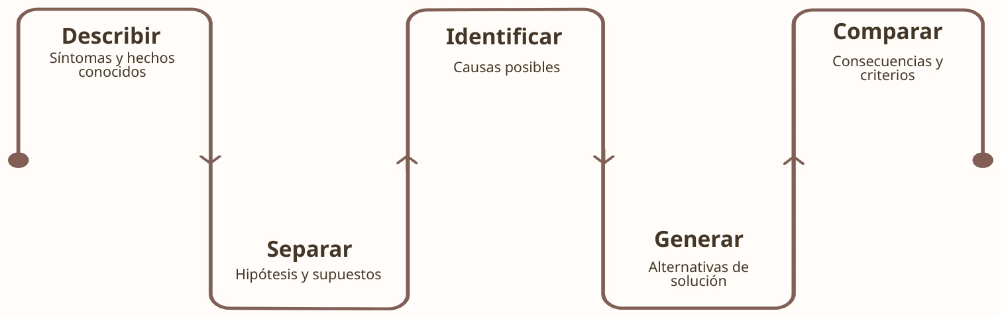

[← Anterior](01-clasificacion-instruccion-y-transformacion.md) · [Índice del módulo](README.md) · [Siguiente →](03-simulacion-y-combinacion-de-funciones.md)

# 2 · Creatividad y resolución de problemas

*Módulo 03: Tipos funcionales de prompts*

## 2.1 Prompts de generación creativa

Los prompts creativos buscan producir alternativas diversas dentro de un marco definido. La calidad no se mide por exactitud factual, sino por la variedad real de propuestas y su adecuación al objetivo y al público.

- **Objetivo y público**: Definir para qué sirve el contenido generado y quién lo recibirá.
- **Formato, tono y extensión**: Especificar si se esperan titulares, eslóganes, párrafos o guiones, y el registro adecuado.
- **Diversidad real**: Pedir explícitamente enfoques distintos: emocional, racional, humorístico, etc. No paráfrasis.
- **Restricciones de marca**: Indicar palabras prohibidas, territorios de comunicación vedados o guías de estilo corporativas.
- **Criterios de selección**: Pedir que el modelo agrupe o priorice las propuestas según criterios explícitos en un paso posterior a la generación.

> Ejemplo ilustrativo: «*Genera diez conceptos de campaña para el lanzamiento del producto X. Que cubran tres enfoques distintos: emocional, racional y experiencial. No repitas el nombre de la marca en todos los titulares.*»

**Explicación**

Los prompts creativos buscan alternativas diversas dentro de un marco. Su calidad no se mide por la exactitud, sino por la variedad real y la adecuación al objetivo y al público. Se especifican el objetivo y el público, el formato, el tono y la extensión, la diversidad real (enfoques distintos, no paráfrasis), las restricciones de marca y los criterios de selección, que se aplican en un paso posterior.

El ejemplo pide diez conceptos de campaña con tres enfoques (emocional, racional y experiencial) y sin repetir la marca en todos los titulares. En tipos **informativos** la creatividad es un defecto porque se traduce en invención; aquí es el objetivo, pero dentro de un marco, y nunca debe usarse para rellenar datos desconocidos.

---

## 2.2 Brainstorming divergente

El brainstorming divergente maximiza la cantidad y variedad de ideas antes de cualquier filtrado. El error más frecuente es pedir creatividad y obtener paráfrasis porque el prompt no solicita explícitamente perspectivas distintas.

**Principios del brainstorming efectivo**

**Límites que sí se deben fijar**

- Viabilidad mínima: descartar ideas técnicamente imposibles
- Horizonte temporal relevante para el contexto
- Restricciones regulatorias o de marca que no pueden ignorarse

- **Solicitar variedad, no paráfrasis**: «*Dame diez enfoques distintos*» en lugar de «*Dame ideas*».
- **Explorar perspectivas alternativas**: Pedir que el modelo adopte puntos de vista de distintos perfiles: cliente, operador, directivo.
- **Ejemplo ilustrativo**: «*Propón quince formas distintas de reducir el tiempo de atención al cliente.» En un segundo prompt: «Agrupa las propuestas en: tecnológicas, de proceso y de personas.*»
- **Agrupar después de generar**: Primero volumen, luego organización. No mezclar generación y filtrado en el mismo prompt.

**Explicación**

El **brainstorming** divergente busca cantidad y variedad antes de filtrar. El error habitual es pedir creatividad y recibir paráfrasis, porque no se pidieron perspectivas distintas. Tres principios: solicitar variedad («dame diez enfoques distintos» en lugar de «dame ideas»), explorar perspectivas alternativas (cliente, operador, directivo) y agrupar después de generar, sin mezclar generación y filtrado en el mismo prompt.

La separación importa: si se pide generar y evaluar a la vez, el modelo tiende a autocensurarse y a proponer ideas seguras. Conviene fijar solo los límites que importan: viabilidad mínima, horizonte temporal y restricciones regulatorias o de marca. El ejemplo lo hace en dos pasos: primero quince formas de reducir el tiempo de atención al cliente y, después, agruparlas en tecnológicas, de proceso y de personas.

---

## 2.3 Narrativa e historias

Los prompts narrativos producen contenido de ficción o storytelling. Para obtener resultados coherentes, es necesario especificar todos los elementos estructurales de la historia antes de que el modelo comience a escribir.

> Ejemplo ilustrativo: «*Escribe una escena de 300 palabras en tercera persona. Protagonista: directora de producto. Objetivo: convencer al comité de invertir en IA. Obstáculo: un miembro escéptico con datos contrarios. Tono profesional con ligero humor. Sin resolución final.*»

**Explicación**

Un prompt narrativo debe especificar los elementos de la historia antes de que el modelo escriba: género y tono, personajes con objetivos y motivaciones, escenario y reglas del mundo, conflicto central y obstáculos, desenlace (cerrado o abierto), y extensión y punto de vista. Cada elemento evita una decisión arbitraria del modelo: sin conflicto no hay tensión, sin desenlace llegará la resolución más convencional.

El ejemplo concreta una escena de 300 palabras en tercera persona sobre una directora de producto que quiere convencer a un comité de invertir en IA, con un miembro escéptico, tono profesional con humor ligero y sin resolución final. La ficción debe presentarse como tal y no confundirse con información factual.

---

## 2.4 Prompts de comunicación profesional

Los prompts de comunicación profesional adaptan mensajes a destinatarios y propósitos corporativos concretos: correos, anuncios internos, propuestas o comunicados a clientes. Requieren especial atención a la formalidad y a las promesas no autorizadas.

- **Tipo de documento**: Correo, anuncio, propuesta comercial o comunicación interna. Cada formato tiene convenciones propias.
- **Tono y formalidad**: Ajustar según el destinatario: corporativo formal, cercano profesional o directo y conciso.
- **Mensaje y CTA**: Definir el mensaje principal y la llamada a la acción esperada del destinatario.
- **Restricciones corporativas**: Revisar que la salida no incluya promesas, garantías o datos no autorizados por la organización.

> Ejemplo ilustrativo: «*Convierte las siguientes notas internas sobre el incidente del sistema en un comunicado para clientes. Tono tranquilizador y profesional. No menciones causas técnicas. Incluye fecha de resolución y contacto de soporte.*»

**Explicación**

Estos prompts adaptan mensajes (correos, anuncios, propuestas o comunicados) a destinatarios y propósitos corporativos. Hay que fijar el tipo de documento, el tono y la formalidad, el mensaje principal y la llamada a la acción, y las restricciones corporativas, es decir, que no se incluyan promesas, garantías o datos no autorizados.

El ejemplo convierte notas internas sobre un incidente en un comunicado a clientes: tono tranquilizador, sin causas técnicas, con fecha de resolución y contacto de soporte. El riesgo propio de este tipo es el compromiso involuntario: un texto fluido puede añadir frases como «garantizamos que no volverá a ocurrir» que nadie autorizó. Toda comunicación externa debe pasar por revisión humana, con atención a compromisos, cifras y fechas, y hay que indicar qué información interna no debe salir.

---

## 2.5 Prompts de resolución de problemas

Los prompts de resolución de problemas guían al modelo para analizar una situación compleja, identificar causas posibles y proponer alternativas evaluadas.

La clave está en separar síntomas, hipótesis y hechos desde el primer momento.

Descripción del diagrama en texto

1. Describir — Síntomas y hechos conocidos
2. Separar — Hipótesis y supuestos
3. Identificar — Causas posibles
4. Generar — Alternativas de solución
5. Comparar — Consecuencias y criterios

**Qué incluir en el prompt**

- Contexto operativo y datos disponibles
- Lo que ya se ha descartado y por qué
- Criterios de éxito para la solución

> Ejemplo ilustrativo: «*Analiza la siguiente incidencia tecnológica [datos ficticios adjuntos]. Identifica las tres causas más probables, ordénalas por probabilidad e impacto, y propón una comprobación inicial para cada una.*»

**Explicación**

Los prompts de **resolución de problemas** guían el análisis de una situación compleja, la identificación de causas y la propuesta de alternativas evaluadas. La clave es separar desde el inicio síntomas, hipótesis y hechos. El proceso es describir síntomas y hechos, identificar causas posibles, separar hipótesis y supuestos, generar alternativas y comparar consecuencias.

El prompt debe incluir el contexto y los datos disponibles, lo ya descartado y los criterios de éxito. En el ejemplo no se pide «la solución», sino las tres causas más probables ordenadas y una comprobación inicial para cada una, porque el modelo no accede al sistema real. Sus causas son hipótesis plausibles, no diagnósticos, y las comprobaciones propuestas sirven para confirmarlas o descartarlas.

---

## 2.6 Descomposición de problemas

Cuando un problema es demasiado complejo para abordarse en un único prompt, la descomposición permite dividirlo en subtareas manejables, ordenadas por dependencias y con salidas intermedias verificables.

- **Definir el resultado final**: Qué debe producirse al completar todas las subtareas: documento, decisión, plan o código.
- **Separar subtareas**: Identificar operaciones independientes que pueden ejecutarse de forma autónoma o secuencial.
- **Ordenar dependencias**: Establecer qué subtarea necesita la salida de otra antes de poder ejecutarse.
- **Definir salidas intermedias**: Especificar el formato exacto de cada entrega parcial para facilitar la validación.
- **Validar cada etapa**: Revisar cada salida antes de usarla como entrada de la siguiente subtarea.

> Ejemplo ilustrativo: Para analizar una incidencia compleja: (1) recopilar hechos → (2) clasificar por impacto → (3) proponer comprobaciones → (4) redactar informe ejecutivo.

**Explicación**

Cuando un problema es demasiado complejo para un solo prompt, se descompone en subtareas ordenadas por dependencias y con salidas intermedias verificables: definir el resultado final, separar subtareas, ordenar dependencias, definir el formato de cada entrega parcial y validar cada etapa antes de usarla en la siguiente.

El ejemplo divide una incidencia compleja en recopilar hechos, clasificar por impacto, proponer comprobaciones y redactar un informe ejecutivo. Descomponer ayuda porque el rendimiento baja cuando una instrucción acumula operaciones heterogéneas y porque permite localizar dónde se originó un error. Un fallo en la primera etapa se arrastra a las demás, de ahí la importancia de validar cada una (se generaliza en el módulo [13](../13-diseno-de-sistemas-de-prompts/README.md)).

---

## 2.7 Prompts de comparación

Los prompts de comparación evalúan alternativas usando criterios comunes. Para que la comparación sea útil y honesta, los criterios deben definirse antes de solicitar la evaluación, y el modelo debe separar datos conocidos de supuestos.

**Estructura de un prompt de comparación**

1. Identificar las opciones a comparar
1. Definir los criterios y su ponderación si procede
1. Separar datos reales de supuestos
1. Pedir ventajas y riesgos de cada opción
1. Prohibir inventar puntuaciones sin evidencia

**Formatos de salida recomendados**

- **Tabla comparativa**: Opciones en filas, criterios en columnas. Ideal para decisiones rápidas.
- **Análisis narrativo**: Párrafo por criterio destacando diferencias clave. Mejor para audiencias no técnicas.
- **Ranking razonado**: Ordenación con justificación explícita de cada posición.

Ejemplo ilustrativo: «*Compara las tres soluciones adjuntas según coste, plazo de implantación, riesgo técnico y coste de mantenimiento. Usa una tabla. Señala qué valores son estimaciones.*»

**Explicación**

Los prompts de comparación evalúan alternativas con criterios comunes, definidos antes de pedir la evaluación. Deben identificar las opciones, definir criterios y ponderaciones, separar datos reales de supuestos, pedir ventajas y riesgos de cada opción y prohibir inventar puntuaciones sin evidencia.

Los formatos recomendados son la tabla comparativa (para decisiones rápidas), el análisis narrativo (más adecuado para públicos no técnicos) y el ranking razonado. En el ejemplo se comparan tres soluciones según coste, plazo, riesgo técnico y coste de mantenimiento en una tabla, señalando qué valores son estimaciones. Resumir cada opción por separado no es comparar, y dejar que el modelo elija los criterios orienta el resultado de forma no controlada.

<!-- labs-seccion -->
> **Para practicar esta sección:** [Laboratorio 03A · Catálogo de prompts por tipo funcional](../../laboratorios/03A/README.md)
<!-- /labs-seccion -->

---

## 2.8 Prompts de planificación

Los prompts de planificación traducen un objetivo en un conjunto ordenado de actividades con responsables, dependencias y criterios de prioridad. El modelo no conoce el contexto organizativo, por lo que cuanto más detalle se aporte, más útil será el plan generado.

1. **Objetivo y horizonte**: Definir qué debe lograrse y en qué plazo máximo.
2. **Tareas y dependencias**: Listar actividades e indicar cuáles bloquean a otras.
3. **Recursos y restricciones**: Indicar presupuesto, equipo disponible y limitaciones conocidas.
4. **Reglas de priorización**: Establecer qué criterio prevalece si hay conflicto: coste, plazo o riesgo.
5. **Riesgos y supuestos**: Pedir que el plan incluya los supuestos en que se basa y los riesgos identificados.

> Ejemplo ilustrativo: «*Planifica el despliegue de la aplicación en tres fases. Incluye hitos, responsables y criterios de paso entre fases. Señala los riesgos principales de cada fase.*»

**Explicación**

Los prompts de **planificación** traducen un objetivo en actividades ordenadas con responsables, dependencias y criterios de prioridad. Como el modelo no conoce el contexto de la organización, cuanto más detalle se aporte, más útil será el plan. Hay que indicar el objetivo y el horizonte, las tareas y sus dependencias, los recursos y restricciones, las reglas de priorización y que el plan incluya sus supuestos y riesgos.

En el ejemplo se planifica un despliegue en tres fases con hitos, responsables, criterios de paso entre fases y riesgos de cada una. Un plan generado sin datos reales será genérico y probablemente inviable; su valor es ofrecer una estructura que las personas que conocen el contexto ajustan. Declarar los supuestos permite comprobarlos antes de ejecutar el plan.

---

[← Anterior](01-clasificacion-instruccion-y-transformacion.md) · [Índice del módulo](README.md) · [Siguiente →](03-simulacion-y-combinacion-de-funciones.md)
