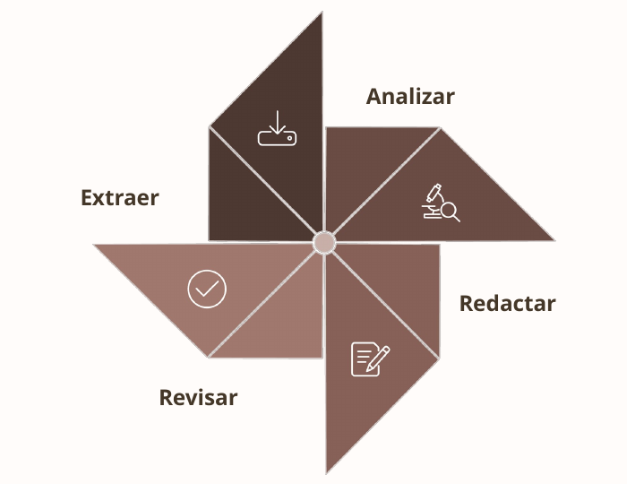

[← Anterior](01-tecnicas-basadas-en-ejemplos.md) · [Índice del módulo](README.md) · [Siguiente →](03-herramientas-revision-y-seleccion-de-tecnica.md)

# 2 · Razonamiento y descomposición

*Módulo 04: Técnicas avanzadas de prompting*

## 2.1 Chain-of-Thought: razonamiento paso a paso

La técnica Chain-of-Thought (CoT) solicita al modelo que resuelva una tarea exponiendo los pasos intermedios de forma estructurada. Esta explicación visible puede favorecer la descomposición de tareas complejas y facilitar la detección de errores.

- Solicita una resolución explícita y estructurada, no una respuesta directa.
- Puede favorecer la descomposición de problemas en pasos manejables.
- La explicación generada puede contener errores; no es evidencia de razonamiento interno.
- Siempre verifica el resultado final de forma independiente.

**Ejemplo ilustrativo**

*"Un equipo trabaja 8 horas/día. Tiene 3 tareas: A requiere 5 h, B requiere 3 h, C requiere 4 h. ¿Cuántos días necesita?*

*Muestra los cálculos paso a paso antes de dar la respuesta."*

Salida esperada: Total horas = 12. Días = 12 / 8 = 1,5 → 2 días completos.

Pedir explicación verificable no equivale a acceder al razonamiento privado del modelo.

**Explicación**

El chain-of-thought (CoT, cadena de pensamiento) pide al modelo que resuelva una tarea exponiendo pasos intermedios de forma estructurada. Esa explicación visible puede favorecer la descomposición de tareas complejas y facilitar la detección de errores. Pero no es evidencia del razonamiento interno del modelo, puede contener errores y, en cualquier caso, el resultado final debe verificarse de forma independiente.

En el ejemplo (un equipo con 8 horas diarias y tres tareas de 5, 3 y 4 horas) los pasos permiten comprobar la suma (12 horas) y la división (1,5, es decir, 2 días completos): si el modelo hubiera sumado mal, el error se vería. Una explicación bien redactada no demuestra que el resultado sea correcto; es una ayuda para auditar.

<!-- labs-seccion -->
> **Para practicar esta sección:** [Laboratorio 04B · Razonamiento paso a paso y autoconsistencia](../../laboratorios/04B/README.md)
<!-- /labs-seccion -->

---

## 2.2 Solicitar pasos verificables: diseño práctico

La utilidad de CoT depende de cómo se formula la solicitud. Un prompt bien diseñado produce una explicación estructurada que se puede auditar; uno mal diseñado genera texto fluido pero inútil para verificar.

- **Pedir etapas resumidas**: «*Muestra los pasos, no más de uno por línea.*»
- **Datos y supuestos explícitos**: «*Lista los datos que usas y los supuestos que aplicas.*»
- **Definir comprobaciones**: «*Verifica el resultado aplicando la regla X antes de responder.*»
- **Conclusión con evidencia**: «*Finaliza con una conclusión que cite los pasos que la respaldan.*»
- **Evitar cadenas internas**: En lugar de pedir un «*piensa en voz alta*» libre, indica qué pasos y qué formato de razonamiento mostrar.

**Explicación**

La utilidad del CoT depende de cómo se pida: un prompt bien diseñado produce una explicación estructurada y auditable, y uno mal diseñado, texto fluido pero inútil para verificar. Fórmulas útiles son pedir etapas resumidas (un paso por línea), listar los datos y supuestos empleados, definir comprobaciones antes de responder y exigir una conclusión que cite los pasos que la respaldan.

También conviene evitar el «piensa en voz alta» libre y, en su lugar, indicar qué pasos y qué formato de razonamiento mostrar. El razonamiento visible debe diseñarse para que lo lea quien lo audita; con un formato fijo (datos, pasos, comprobación, conclusión) es comparable entre ejecuciones y fácil de revisar.

---

## 2.3 Zero-shot CoT y Few-shot CoT: variantes comparadas

**Zero-shot CoT**

Solicita una estructura de razonamiento sin incluir un ejemplo resuelto. La fórmula canónica añade al prompt: **«*Piensa paso a paso*»** o una instrucción equivalente (en modelos con razonamiento integrado suele ser innecesaria: consulta su documentación).

- Rápido de implementar; sin coste de curación.
- El modelo decide la estructura de los pasos.
- Adecuado como punto de partida para tareas multietapa.

**Few-shot CoT**

Incluye varios ejemplos donde cada par entrada-salida muestra el razonamiento explícito completo, no solo la respuesta.

- Ofrece mayor control sobre el estilo y la profundidad del razonamiento.
- Los ejemplos de razonamiento deben ser correctos; errores en ejemplos se propagan.
- Evalúa siempre el resultado final, no la calidad aparente de la explicación.

> La salida explicativa no demuestra exactitud interna del modelo. Verifica el resultado final de forma independiente.

**Explicación**

El CoT tiene dos variantes. El zero-shot CoT solicita una estructura de razonamiento sin ejemplo resuelto, con una fórmula como «Piensa paso a paso»; es rápido de implementar, deja al modelo decidir la estructura y sirve como punto de partida en tareas multietapa. En modelos con razonamiento integrado suele ser innecesario. El few-shot CoT incluye varios ejemplos con el razonamiento completo, lo que da más control sobre el estilo y la profundidad, siempre que los ejemplos sean correctos.

La diferencia práctica es el control: el primero deja la forma del razonamiento al modelo; el segundo permite imponer un método concreto. En ambos, la salida explicativa no demuestra exactitud: un razonamiento largo y elegante puede llevar a un resultado incorrecto y su apariencia puede dar una confianza injustificada.

---

## 2.4 CoT en modelos de razonamiento

**Modelos clásicos**

Se benefician de pedir razonamiento explícito: **«*Piensa paso a paso*»** o de aportar ejemplos resueltos.

- Indica qué pasos y qué formato de razonamiento mostrar.
- Verifica el resultado final, no la calidad aparente de la explicación.
- Adecuado como punto de partida en tareas multietapa.

**Modelos de razonamiento**

Generan internamente su razonamiento antes de responder: pedir «*piensa paso a paso*» suele ser innecesario y, según el proveedor, puede empeorar el resultado.

- Empieza con un prompt simple y directo: objetivo, restricciones y formato.
- Evita pedir su razonamiento salvo que necesites un resumen verificable.
- Ajusta el esfuerzo con el parámetro del proveedor (esfuerzo de razonamiento o presupuesto de pensamiento), no con la redacción.

> El razonamiento interno consume tokens y latencia: mide calidad, coste y tiempo con tu conjunto de pruebas.

**Explicación**

La utilidad del CoT depende del tipo de modelo. Los modelos clásicos se benefician de pedir razonamiento explícito («piensa paso a paso») o de aportar ejemplos resueltos. Los **modelos de razonamiento** generan internamente su razonamiento antes de responder, de modo que pedirlo en el prompt suele ser innecesario y, según el proveedor, puede empeorar el resultado. Con ellos conviene un prompt simple y directo (objetivo, restricciones y formato), evitar pedir su razonamiento salvo que se necesite un resumen verificable y ajustar el esfuerzo con el parámetro del proveedor, no con la redacción.

Es un buen ejemplo de por qué las técnicas deben revisarse al cambiar de generación de modelos. Además, el razonamiento interno consume tokens y latencia, por lo que conviene medir calidad, coste y tiempo con un conjunto de pruebas propio.

---

## 2.5 Descomposición de problemas complejos

Muchos problemas son demasiado complejos para resolverse en un único prompt. La descomposición consiste en identificar el resultado final, separar las operaciones necesarias y ordenarlas según sus dependencias.

- **Identificar resultado final**: ¿Qué salida concreta se necesita?
- **Separar operaciones**: ¿Qué pasos distintos se requieren?
- **Ordenar dependencias**: ¿Qué pasos deben ejecutarse antes?
- **Definir salidas intermedias**: ¿Qué formato produce cada etapa?
- **Validar cada etapa**: ¿El resultado parcial es correcto antes de continuar?

**Explicación**

Muchos problemas son demasiado complejos para un solo prompt. La descomposición consiste en identificar el resultado final, separar las operaciones necesarias, ordenarlas según sus dependencias, definir el formato de cada salida intermedia y validar cada etapa antes de continuar. Ya aparecieron estas ideas en los módulos [02](../02-fundamentos-del-prompt-engineering/README.md) y [03](../03-tipos-funcionales-de-prompts/README.md); aquí se consolidan como método previo a las técnicas siguientes.

Se divide porque el rendimiento tiende a empeorar cuando una instrucción reúne operaciones heterogéneas, y porque un error intermedio se arrastra hasta el final sin que se pueda localizar. El precio es más llamadas y más diseño, por lo que se justifica cuando el problema lo exige, no por sistema.

---

## 2.6 Least-to-Most Prompting: de lo simple a lo complejo

Least-to-Most Prompting estructura la resolución comenzando por los subproblemas más simples y usando sus resultados para abordar progresivamente los más complejos. Este enfoque reduce errores en cadena al validar cada nivel antes de avanzar.

- Comienza por subproblemas básicos, no por la pregunta integradora.
- Utiliza los resultados previos explícitamente en los siguientes pasos.
- Comprueba cada subresultado antes de continuar.
- Adecuado para tareas compuestas con dependencias jerárquicas.

- **Paso 1: Subproblema básico**: Resolver el concepto o dato más fundamental por separado.
- **Paso 2: Integrar resultado**: Usar la salida del paso anterior como entrada del siguiente.
- **Paso 3: Pregunta integradora**: Responder la pregunta compleja con todos los subresultados verificados.

**Explicación**

El least-to-most empieza por los subproblemas más sencillos y utiliza sus resultados para abordar progresivamente los más complejos, validando cada nivel antes de avanzar. Comienza por lo básico, usa de forma explícita los resultados previos, comprueba cada subresultado y encaja en tareas compuestas con dependencias jerárquicas.

El procedimiento tiene tres pasos: resolver el subproblema básico, integrar su resultado como entrada del siguiente y responder finalmente a la pregunta integradora con todos los subresultados verificados. Para calcular el coste total de un proyecto en tres fases, se calculan primero las horas de cada fase, después su coste y por último el total, comprobando cada resultado. Es innecesario en tareas simples, donde las llamadas adicionales no compensan.

---

## 2.7 Plan-and-Solve: separar planificación y ejecución

La técnica Plan-and-Solve divide el proceso en dos fases explícitas: primero el modelo genera un plan de acción detallado; después lo ejecuta paso a paso. Esta separación reduce los errores por resolución apresurada.

- **Fase 1 — Planificación**: El modelo enumera los pasos necesarios antes de calcular o decidir nada. Los pasos deben ser concretos, no genéricos («analizar el problema» no es un paso útil).
- **Fase 2 — Ejecución**: El modelo sigue el plan generado, etapa por etapa. Si aparecen nuevos datos, puede revisar el plan antes de continuar.

**Cuándo aplicarlo**

- Tareas de análisis con múltiples variables o condiciones.
- Escenarios donde un error temprano invalida el resultado final.

**Qué evitar**

- Planes genéricos sin pasos accionables.
- No validar la ejecución frente al plan generado.

**Explicación**

Plan-and-solve divide el proceso en dos fases: primero se genera un plan de acción detallado y después se ejecuta paso a paso. La planificación enumera pasos concretos antes de calcular o decidir; «analizar el problema» no es un paso útil, pero «extraer las cifras de ventas de cada región» sí. La ejecución sigue el plan y puede revisarlo si aparecen nuevos datos.

Es útil en análisis con muchas variables o condiciones y cuando un error temprano invalida el resultado. Hay que evitar planes genéricos y no validar la ejecución frente al plan. Aporta además transparencia, ya que el plan puede revisarse y corregirse antes de ejecutarlo, un punto de control humano valioso en tareas costosas o de consecuencias importantes.

---

## 2.8 Self-Consistency: comparar múltiples soluciones candidatas

Self-Consistency genera varias respuestas o rutas de razonamiento para la misma pregunta y selecciona la más consistente según un criterio explícito. Es especialmente útil cuando existe una comprobación externa que permite verificar cuál es correcta.

1. **Generar múltiples respuestas**: Solicitar N respuestas independientes (con temperatura alta o prompts ligeramente distintos).
2. **Comparar con criterio explícito**: Definir de antemano qué hace preferible una respuesta frente a otra.
3. **Seleccionar la más consistente**: Elegir la respuesta que aparece con mayor frecuencia o que supera la comprobación.

El consenso entre candidatos no garantiza verdad. Un error sistemático puede aparecer en todas las respuestas. Siempre complementa con una verificación externa.

**Explicación**

La self-consistency genera varias respuestas o rutas de razonamiento para la misma pregunta y selecciona la más consistente según un criterio explícito. Se piden varias respuestas independientes (con temperatura alta o prompts ligeramente distintos), se comparan con un criterio fijado de antemano y se elige la más frecuente o la que supera una comprobación. Es especialmente útil cuando hay una comprobación externa.

La intuición es la de pedir una segunda opinión: si varias rutas independientes coinciden, es más probable que el resultado sea correcto. Pero el consenso no garantiza la verdad: un error sistemático del modelo, o una ambigüedad del enunciado, puede aparecer en todas las respuestas y el consenso lo reforzaría. Por eso debe complementarse con verificación externa y requiere variedad real entre candidatos.

---

## 2.9 Aplicaciones y límites de Self-Consistency

**Cuándo aporta valor real**

**Límites y riesgos**

- **Problemas con respuesta verificable**: Matemáticas, lógica, consultas estructuradas donde existe una respuesta objetivamente correcta.
- **Errores compartidos**: Un error sistemático del modelo aparecerá en todos los candidatos; el consenso lo reforzará en lugar de corregirlo.
- **Tareas donde la diversidad ayuda**: Cuando diferentes rutas de razonamiento pueden llegar a la misma conclusión correcta.
- **No sustituye fuentes externas**: Para hechos factuales, siempre contrasta con una fuente autorizada.
- **Alta tolerancia a la latencia**: Cuando el tiempo adicional de N llamadas es aceptable para el caso de uso.
- **Coste y latencia**: N llamadas implican N veces el coste. Define criterios de desempate antes de lanzar la evaluación.

**Explicación**

La self-consistency aporta valor en problemas con respuesta verificable (matemáticas, lógica, consultas estructuradas), cuando diferentes rutas de razonamiento pueden llegar a la misma conclusión correcta y cuando se tolera la latencia de varias llamadas. Sus límites son los errores compartidos (un error sistemático aparecerá en todos los candidatos), que no sustituye a las fuentes externas para hechos factuales, y su coste: N llamadas cuestan N veces más.

Es específica, no general: encaja en problemas comprobables con presupuesto holgado y mal en preguntas abiertas o de opinión, donde no hay forma objetiva de elegir. Conviene definir de antemano cómo se resolverán los empates (el más frecuente, el que supere una comprobación o escalar a una persona), porque decidirlo después reintroduce el sesgo que se quería evitar.

---

## 2.10 Decomposed Prompting: prompts especializados por subtarea

Mientras que la descomposición general divide una tarea en pasos dentro de un único prompt, el Decomposed Prompting va más allá: asigna un prompt especializado a cada subtarea, con contratos de entrada-salida bien definidos entre ellas.

Descripción del diagrama en texto

1. **Extraer**
2. **Revisar**
3. **Analizar**
4. **Redactar**

- Usa un prompt por subtarea cuando aporta control adicional sobre la salida.
- Define contratos claros de entrada y salida entre prompts.
- Valida los resultados intermedios antes de pasarlos al siguiente prompt.
- Evita duplicar el contexto completo en cada prompt; pasa solo lo necesario.
- Mantén trazabilidad: registra las salidas de cada etapa para auditoría.

**Explicación**

El **decomposed prompting** lleva la descomposición más lejos: asigna un prompt especializado a cada subtarea, con contratos de entrada y salida definidos entre ellas. En el ejemplo, extraer, analizar, redactar y revisar son cuatro prompts encadenados.

Se recomienda usar un prompt por subtarea cuando aporte control, definir contratos claros, validar los resultados intermedios, no duplicar el contexto completo en cada prompt (pasar solo lo necesario) y registrar las salidas de cada etapa para la auditoría. La ventaja es el control y la especialización, ya que cada prompt puede ajustarse y probarse por separado y cada etapa puede usar una técnica distinta; el precio es más complejidad, llamadas, latencia y puntos de fallo. Anticipa la arquitectura del módulo [13](../13-diseno-de-sistemas-de-prompts/README.md).

---

[← Anterior](01-tecnicas-basadas-en-ejemplos.md) · [Índice del módulo](README.md) · [Siguiente →](03-herramientas-revision-y-seleccion-de-tecnica.md)
