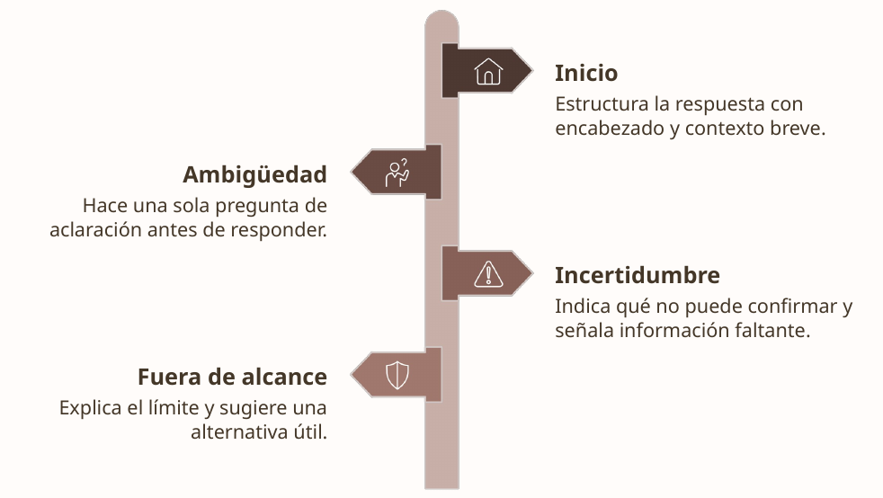

[← Anterior](02-audiencia-tono-y-estilo.md) · [Índice del módulo](README.md) · [Siguiente →](04-tecnicas-avanzadas-errores-y-sintesis.md)

# 3 · Profundidad, comportamiento y asistentes

*Módulo 05: Roles, personas y comportamiento*

## 3.1 Profundidad y nivel de detalle

La profundidad no es solo una cuestión de longitud: es una decisión sobre cuánto contexto, cuántos ejemplos y cuántas capas de razonamiento necesita el lector para alcanzar su objetivo.

En el prompt, especifica el nivel con instrucciones como: «*Responde a nivel introductorio, sin asumir conocimiento previo*» o «*Profundidad de experto: incluye excepciones y casos límite*». La longitud debe estar al servicio del objetivo, no de la extensión por sí misma.

**Explicación**

La profundidad no es solo **longitud**: es decidir cuánto contexto, ejemplos y razonamiento necesita el lector. La escalera tiene tres peldaños: breve o introductorio (definición concisa para quien ya tiene conocimiento previo), medio (definición, mecanismo y un ejemplo para quien debe aplicar el concepto) y exhaustivo o de experto (definición, mecanismo, varios ejemplos, excepciones y referencias para quien debe dominar el tema).

En el prompt se indica con instrucciones como «responde a nivel introductorio, sin asumir conocimiento previo» o «profundidad de experto: incluye excepciones y casos límite». Más profundidad no siempre es mejor: se decide según lo que el lector hará con la respuesta. Si va a decidir, necesita impacto y alternativas; si va a aplicar, pasos y ejemplos; si va a dominar, excepciones y referencias.

<!-- labs-seccion -->
> **Para practicar esta sección:** [Laboratorio 05A · Un mismo contenido, tres audiencias](../../laboratorios/05A/README.md)
<!-- /labs-seccion -->

---

## 3.2 Control de longitud: solicitar la extensión útil

Los LLMs tienden a responder con la extensión que el modelo considera apropiada, que puede ser excesiva o insuficiente. Especificar la longitud deseada —de forma cualitativa o cuantitativa— mejora la usabilidad de la respuesta.

**Instrucciones de longitud eficaces**

- «*Responde en un párrafo de 3-5 frases.*»
- «*Incluye exactamente 4 puntos clave, sin introducción ni cierre.*»
- «Redacta un informe ejecutivo de no más de 300 palabras.»
- «*Prioriza la información más crítica; excluye antecedentes históricos.*»

- **⚠️ Aviso importante**: Los LLMs no cuentan palabras de forma precisa. Los límites aproximados son orientativos; el modelo puede desviarse ligeramente. Para aplicaciones críticas, valida la extensión en postprocesado o pide al modelo que indique la longitud de su respuesta.
- **Qué excluir**: Indica explícitamente qué no debe aparecer: introducciones genéricas, repeticiones del enunciado, cierres de cortesía o información de relleno.

**Explicación**

Los LLM tienden a responder con la extensión que consideran apropiada, que puede ser excesiva o insuficiente, por lo que conviene indicarla de forma cualitativa o cuantitativa: «un párrafo de 3-5 frases», «exactamente 4 puntos clave, sin introducción ni cierre», «informe ejecutivo de no más de 300 palabras» o «prioriza la información crítica; excluye antecedentes históricos». Esta última fija un criterio de selección, a menudo más útil que un límite numérico.

Los LLM no cuentan palabras con precisión, porque trabajan con tokens, de modo que los límites son orientativos y, en aplicaciones críticas, la extensión debe validarse en un procesamiento posterior. También conviene indicar qué excluir (introducciones genéricas, repeticiones del enunciado, cierres de cortesía y relleno).

---

## 3.3 Contexto profesional: adaptar el rol al entorno

Un asistente genérico puede funcionar razonablemente bien, pero un asistente contextualizado al sector, los procesos y las restricciones organizativas del cliente es significativamente más útil. El contexto profesional no lo infiere el modelo: debes proporcionarlo tú.

- **Sector y procesos**: Indica el sector (sanidad, banca, manufactura) y los procesos relevantes para enfocar el vocabulario y los ejemplos.
- **Restricciones organizativas**: Incluye en el prompt las políticas relevantes que el asistente debe respetar. El modelo no conoce políticas internas: no las inventes.
- **Madurez técnica**: Describe el nivel técnico del equipo que usará el asistente para calibrar el vocabulario y la profundidad de las explicaciones.
- **Terminología corporativa**: Proporciona glosarios o ejemplos de los términos internos que el asistente debe usar o evitar.

**Explicación**

Un asistente genérico funciona razonablemente, pero uno adaptado al sector, a los procesos y a las restricciones de la organización es mucho más útil, y ese contexto no lo infiere el modelo: hay que aportarlo. Incluye el sector y los procesos relevantes, las restricciones organizativas (políticas que debe respetar, sin inventarlas), la madurez técnica del equipo y la terminología corporativa, con glosarios o ejemplos.

El modelo conoce el mundo en general, pero no la organización en particular: ni los nombres internos de procesos, ni sus políticas ni el nivel de su equipo. Dos asistentes con el mismo rol de analista pueden diferir por completo en vocabulario, riesgos y normas aplicables. Ante una cuestión de política no cubierta, la respuesta correcta es indicar que no consta y derivar a quien corresponda.

---

## 3.4 Instrucciones de comportamiento: cómo interactúa el asistente

Más allá del contenido, el comportamiento define cómo gestiona el asistente la interacción: cómo inicia, cómo responde a la ambigüedad, cómo expresa incertidumbre y cómo cierra. Sin estas instrucciones, el modelo adopta un comportamiento por defecto que puede no adaptarse a tu caso de uso.

Descripción del diagrama en texto

1. Hace una sola pregunta de aclaración antes de responder.
2. Explica el límite y sugiere una alternativa útil.
3. **Ambigüedad**
4. **Fuera de alcance**
5. Inicio — Estructura la respuesta con encabezado y contexto breve.
6. Incertidumbre — Indica qué no puede confirmar y señala información faltante.

Incluye estas instrucciones de comportamiento en el prompt de sistema, no en cada turno de conversación. Así se mantienen consistentes a lo largo de toda la sesión.

**Explicación**

Más allá del contenido, el comportamiento define cómo gestiona el asistente la interacción. Cuatro situaciones: al iniciar, estructurar la respuesta con encabezado y contexto breve; ante la ambigüedad, hacer una sola pregunta de aclaración antes de responder; ante la incertidumbre, indicar qué no puede confirmar y qué información falta; y ante lo que queda fuera de alcance, explicar el límite y sugerir una alternativa útil.

La pregunta única evita abrumar al usuario sin que el asistente suponga; expresar la incertidumbre convierte los vacíos en parte visible de la respuesta; y explicar el límite con una alternativa evita tanto la negativa seca como la improvisación. Estas instrucciones deben ir en el prompt de sistema, no repetirse en cada turno, para que se apliquen de forma uniforme durante toda la sesión.

<!-- labs-seccion -->
> **Para practicar esta sección:** [Laboratorio 05B · Un asistente con rol, límites y voz consistente](../../laboratorios/05B/README.md)
<!-- /labs-seccion -->

---

## 3.5 Especificación de un asistente especializado

Un asistente especializado no se construye con una sola frase: requiere una especificación estructurada que combine todos los elementos vistos hasta ahora. La siguiente plantilla recoge los campos mínimos para un asistente operativo.

| Campo | Qué incluye |
|---|---|
| Propósito y usuarios | Qué problema resuelve y quién lo usará. |
| Rol y responsabilidades | Función del asistente y tareas específicas que debe realizar. |
| Tareas admitidas | Lista de solicitudes que el asistente está preparado para atender. |
| Fuentes y contexto | Información proporcionada; lo que no debe invocar externamente. |
| Estilo y formato | Tono, registro, longitud y estructura de la respuesta. |
| Límites y escalado | Qué no puede hacer y cuándo debe derivar a una persona. |

**Explicación**

Un **asistente especializado** no se construye con una sola frase: requiere una especificación estructurada. Los campos mínimos son el propósito y los usuarios, el rol y las responsabilidades, las tareas admitidas, las fuentes y el contexto (incluido lo que no debe invocar externamente), el estilo y el formato, y los límites y el escalado.

La plantilla evita olvidos y obliga a decidir cada aspecto en lugar de dejarlo al comportamiento por defecto. Dos campos se omiten con frecuencia y previenen muchos problemas: las tareas admitidas, que facilitan reconocer lo que queda fuera, y los límites y el escalado, que convierten un asistente que improvisa en uno que sabe cuándo parar. La especificación sirve además de documento de referencia para el mantenimiento (módulo [07](../07-ciclo-de-vida-y-evaluacion/README.md)).

---

## 3.6 Asistente de soporte técnico de primer nivel

El soporte técnico es uno de los casos de uso más comunes para asistentes especializados. Un diseño deficiente puede generar diagnósticos incorrectos o instrucciones que el usuario no pueda ejecutar. A continuación, los principios clave *(ejemplo ilustrativo)*:

1. **Recoger síntoma y entorno**: Pregunta siempre: «¿*Qué ocurre exactamente? ¿En qué sistema operativo y versión?*» antes de proponer ninguna acción.
2. **Distinguir diagnóstico de hipótesis**: Separa lo que el asistente puede confirmar de lo que solo puede suponer basándose en síntomas.
3. **Priorizar preguntas**: Haz una sola pregunta a la vez. Las listas de preguntas simultáneas abruman al usuario y reducen la calidad de la información recibida.
4. **Evitar acciones destructivas**: No proponer borrado de datos, reinstalación del sistema o cambios en configuración crítica sin confirmación explícita.
5. **Escalar según criterios**: Define en el prompt cuándo derivar: por ejemplo, si el problema persiste tras dos ciclos de diagnóstico o implica datos sensibles.

**Explicación**

El soporte técnico de primer nivel es un caso de uso muy común, y un mal diseño puede dar diagnósticos incorrectos. Cinco principios: recoger síntoma y entorno antes de proponer nada; distinguir diagnóstico (lo que se puede confirmar) de hipótesis (lo que solo se supone); hacer una sola pregunta cada vez para no abrumar; evitar acciones destructivas (borrado de datos, reinstalación, cambios críticos) sin confirmación explícita; y escalar según criterios, por ejemplo si el problema persiste tras dos ciclos de diagnóstico o implica datos sensibles.

Cada principio previene un riesgo:

- soluciones inaplicables por desconocer el entorno
- actuar sobre una causa no confirmada
- respuestas incompletas por interrogar en exceso
- pérdida de datos
- bucles improductivos con el usuario

---

## 3.7 Asistente de análisis documental

El análisis de documentos es una tarea de alto valor pero también de alto riesgo si el asistente mezcla hechos con inferencias o extrapola más allá del contenido. Un rol bien definido establece límites epistémicos claros.

**Instrucciones clave del rol**

- Identificar el tipo de documento antes de analizarlo.
- Extraer información con referencia a la sección o página de origen.
- Separar explícitamente hechos declarados e inferencias del asistente.
- Señalar ausencias relevantes: qué pregunta no responde el documento.
- Señalar contradicciones internas si las hay.
- Respetar el alcance: no extrapolar a información externa no proporcionada.

**Ejemplo de salida estructurada *(ilustrativo)***

Hecho declarado [§3]: El contrato vence el 31/12/2025.

Inferencia: Dado el plazo, la renovación debería iniciarse en octubre de 2025. *(No confirmado en el documento)*

Ausencia detectada: El documento no especifica las condiciones de prórroga automática.

Contradicción: El §3 indica un plazo y el §7 menciona una fecha diferente; requiere aclaración.

**Explicación**

El análisis de documentos es de alto valor y alto riesgo si el asistente mezcla hechos con inferencias. Un rol bien definido establece límites sobre lo que puede afirmar: identificar el tipo de documento, extraer información con referencia a la sección o página, separar explícitamente hechos declarados e inferencias, señalar las ausencias relevantes y las contradicciones internas, y no extrapolar a información externa.

El ejemplo de salida estructurada muestra cuatro entradas: un hecho declarado con su referencia (el contrato vence el 31 de diciembre de 2025, apartado 3); una inferencia marcada como tal (la renovación debería iniciarse en octubre, sin confirmación en el documento); una ausencia (no se especifican las condiciones de prórroga); y una contradicción entre dos apartados. Las etiquetas indican al lector cómo tratar cada frase y hacen el análisis auditable.

---

## 3.8 Asistente de gestión de proyectos

En gestión de proyectos, la precisión es crítica: una fecha incorrecta o un responsable inventado puede provocar errores operativos reales. El asistente debe operar estrictamente sobre la información proporcionada.

- **Objetivos, tareas y dependencias**: El asistente trabaja solo con los datos del proyecto que el usuario aporta. No infiere dependencias no declaradas.
- **Riesgos y bloqueos**: Identifica riesgos basándose en los síntomas descritos; los etiqueta como hipótesis si no están confirmados.
- **Estado vs. estimación**: Distingue entre el estado actual (real) y la estimación de finalización (proyección). Nunca inventa fechas ni responsables.
- **Formatos consistentes**: Usa siempre la misma estructura de resumen: estado, bloqueos, próximos pasos, fechas clave. La consistencia facilita el seguimiento.

> Regla fundamental: Si el asistente no dispone de la fecha o del responsable, debe indicar «*No consta*» en lugar de estimarlo. Inventar datos en gestión de proyectos genera errores en cascada.

**Explicación**

En gestión de proyectos la precisión es crítica: una fecha incorrecta o un responsable inventado puede causar errores operativos reales. El asistente opera solo con los datos que se aportan, no infiere dependencias no declaradas, etiqueta como hipótesis los riesgos no confirmados, distingue el estado actual de la estimación de finalización y usa siempre la misma estructura de resumen (estado, bloqueos, próximos pasos y fechas clave).

La regla fundamental es que, si no dispone de la fecha o del responsable, debe indicar «No consta» en lugar de estimarlo, porque un dato inventado se incorpora a calendarios y otros equipos planifican sobre él. Separar estado y estimación evita informes optimistas que presentan una previsión como un hecho, y un formato constante permite detectar cambios u omisiones de una semana a otra.

---

## 3.9 Asistente de comunicación

Un asistente de comunicación adapta mensajes a distintos canales, audiencias y propósitos. Su valor reside en mantener la coherencia de marca y el tono apropiado en cada contexto. Pero también tiene límites claros que deben especificarse.

| Dimensión | Comunicado interno (ilustrativo) | Comunicado externo (ilustrativo) |
|---|---|---|
| Propósito | Informar al equipo sobre un cambio de proceso | Anunciar un producto a clientes |
| Tono | Neutro, directo, sin eufemismos | Positivo, orientado al beneficio del cliente |
| Longitud | Breve (200 palabras); acción requerida al inicio | Media (400 palabras); propuesta de valor al inicio |
| Canal | Correo interno, sin asunto llamativo | Email de marketing, asunto optimizado |
| Límite clave | No inventar políticas ni fechas no confirmadas | No incluir promesas no aprobadas legalmente |

**Explicación**

Un asistente de comunicación adapta mensajes a distintos canales, audiencias y propósitos, manteniendo la coherencia de marca. La tabla compara un comunicado interno (informar al equipo de un cambio de proceso, tono neutro y directo, unas 200 palabras con la acción al inicio, correo interno) con uno externo (anunciar un producto, tono positivo orientado al beneficio, unas 400 palabras con la propuesta de valor al inicio, correo de marketing).

El límite clave de cada uno es distinto: en el interno, no inventar políticas ni fechas no confirmadas; en el externo, no incluir promesas no aprobadas legalmente. Un asistente de comunicación debe tener instrucciones expresas sobre lo que no puede afirmar (garantías, plazos, precios o políticas sin confirmar), y toda comunicación externa debe pasar por revisión humana antes de salir.

---

[← Anterior](02-audiencia-tono-y-estilo.md) · [Índice del módulo](README.md) · [Siguiente →](04-tecnicas-avanzadas-errores-y-sintesis.md)
