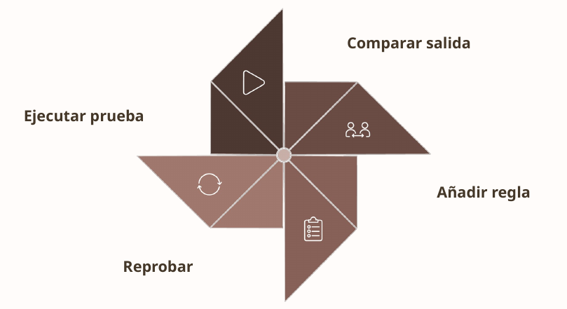

[← Anterior](03-profundidad-comportamiento-y-asistentes.md) · [Índice del módulo](README.md) · [Siguiente módulo →](../06-formato-de-salida-y-parametros/README.md)

# 4 · Técnicas avanzadas, errores y síntesis

*Módulo 05: Roles, personas y comportamiento*

## 4.1 Roles múltiples: separar perspectivas secuenciales

En algunas tareas, es más eficaz asignar roles distintos a fases distintas del proceso que pedirle al modelo que haga todo a la vez. Esta técnica mejora la calidad porque obliga a separar la generación de la evaluación.

- **Redactor**: Genera el borrador según el briefing. No evalúa ni corrige: solo produce.
- **Revisor**: Evalúa el borrador contra una rúbrica definida. Señala defectos concretos, no preferencias.
- **Editor**: Aplica las correcciones del revisor y produce la versión final, respetando el estilo original.

Límite importante: Los roles múltiples mejoran la coherencia y la cobertura, pero no equivalen a verificación independiente. El modelo que revisa y el que genera comparten el mismo entrenamiento y los mismos sesgos.

**Explicación**

En algunas tareas es más eficaz asignar roles distintos a fases distintas que pedir todo a la vez, porque obliga a separar generación y evaluación. El redactor produce el borrador según el briefing sin evaluar; el revisor lo evalúa contra una **rúbrica** y señala defectos concretos, no preferencias; el editor aplica las correcciones y produce la versión final respetando el estilo.

Al dividir el trabajo, cada paso tiene un objetivo único y puede evaluarse por separado. El límite importante es que los **roles múltiples** mejoran la coherencia y la cobertura pero no equivalen a una verificación independiente: el modelo que revisa y el que genera comparten entrenamiento y sesgos, y si ignoró un error al redactar, probablemente lo ignore al revisar. Para tareas de riesgo hay que complementar con una fuente externa, una comprobación automática o una persona. Es el patrón que el módulo [13](../13-diseno-de-sistemas-de-prompts/README.md) formaliza como generador-revisor.

---

## 4.2 Rol evaluador: crítica estructurada con rúbrica

Pedir al modelo que *critique* un texto sin criterios produce observaciones vagas. Un rol evaluador eficaz incluye una rúbrica explícita que convierte la crítica en un proceso reproducible y útil.

**Instrucciones del rol evaluador**

1. Aplica la rúbrica proporcionada punto por punto.
1. Para cada criterio, cita el fragmento concreto que falla.
1. Separa defectos objetivos (incumplimiento de la rúbrica) de preferencias estilísticas.
1. Prioriza hallazgos: crítico, importante, menor.
1. Propone una corrección concreta para cada defecto crítico.

**Ejemplo de rúbrica *(ilustrativo)***

- Claridad: ¿Puede un lector sin contexto entender el mensaje en una primera lectura?
- Precisión: ¿Todos los datos y fechas son correctos según el briefing?
- Tono: ¿El registro es coherente con la guía de estilo proporcionada?
- Estructura: ¿El texto sigue el formato solicitado (título, cuerpo, llamada a la acción)?
- Longitud: ¿Está dentro del rango especificado?

**Explicación**

Pedir que el modelo «critique» un texto sin criterios produce observaciones vagas. Un **rol evaluador** eficaz aplica una rúbrica punto por punto, cita el fragmento concreto que falla, separa los defectos objetivos (incumplimiento de la rúbrica) de las preferencias estilísticas, prioriza los hallazgos (crítico, importante, menor) y propone una corrección para cada defecto crítico.

La rúbrica de ejemplo tiene cinco preguntas observables: claridad, precisión, tono, estructura y longitud. Exigir el fragmento evita críticas generales y permite localizar el problema; separar defecto de preferencia permite saber qué corregir; y priorizar concentra el trabajo en lo esencial. Como en el patrón anterior, la autoevaluación del modelo no sustituye a la verificación independiente.

---

## 4.3 Roles contraproducentes: detectar diseños deficientes

No todos los roles mejoran la respuesta. Algunos patrones de diseño frecuentes generan resultados peores que un prompt sin rol, porque añaden ruido sin añadir función.

- **❌ Rol irrelevante**: El rol no guarda relación con la tarea. «*Eres un chef*» para analizar un balance contable no aporta perspectiva útil.
- **❌ Credenciales falsas**: Atribuir al modelo títulos reales («*Eres un médico certificado*») crea expectativas de precisión que no puede garantizar.
- **❌ Roles contradictorios**: «*Sé formal pero coloquial, breve pero exhaustivo*» genera instrucciones que el modelo no puede satisfacer simultáneamente.
- **❌ Personalidad sobre tarea**: Cuando los rasgos de personalidad ocupan más espacio que las instrucciones de tarea, el modelo prioriza el personaje sobre la función.
- **❌ Conocimiento no aportado**: El rol no transfiere conocimiento al modelo. «*Eres experto en nuestra base de datos interna*» no funciona si no se proporciona esa información.

**Explicación**

No todos los roles mejoran la respuesta: algunos patrones frecuentes la empeoran porque añaden ruido sin función. Los cinco roles contraproducentes son el irrelevante (un «chef» para analizar un balance), el de credenciales falsas («médico certificado»), los contradictorios («formal pero coloquial, breve pero exhaustivo»), la personalidad por encima de la tarea (cuando los rasgos ocupan más espacio que las instrucciones, el modelo prioriza el personaje) y el conocimiento no aportado («experto en nuestra base de datos interna» sin proporcionar esa información).

El hilo común es usar el rol como atajo en lugar de como instrucción. Una comprobación sencilla es preguntarse, para cada elemento del rol, qué conducta concreta pide. Si ninguna, sobra; si es incompatible con otra, hay que resolver el conflicto; y si supone un conocimiento que el modelo no tiene, ese conocimiento debe incluirse en el prompt.

<!-- labs-seccion -->
> **Para practicar esta sección:** [Laboratorio 05B · Un asistente con rol, límites y voz consistente](../../laboratorios/05B/README.md)
<!-- /labs-seccion -->

---

## 4.4 Sesgo inducido por el rol: reconocer perspectivas parciales

Cuando asignas un rol, estás eligiendo una perspectiva. Toda perspectiva privilegia ciertos criterios y puede ignorar otros igualmente relevantes. Es importante ser consciente de este efecto y gestionarlo activamente.

**¿Cómo se manifiesta el sesgo?**

Un asistente con rol de director financiero tenderá a priorizar criterios de coste y rentabilidad. El mismo análisis con rol de responsable de riesgos enfatizará vulnerabilidades y contingencias.

Ninguna perspectiva es incorrecta, pero presentarla como el análisis completo puede llevar a decisiones incompletas.

**Cómo gestionar el sesgo**

- Solicita explícitamente perspectivas alternativas en prompts separados.
- Pide que el asistente separe el análisis de la recomendación.
- Excluye atributos irrelevantes del rol para evitar que distorsionen el análisis.
- Revisa los supuestos implícitos en la respuesta antes de tomar decisiones.
- Usa roles múltiples secuenciales para cubrir perspectivas diferentes.

**Explicación**

Asignar un rol es elegir una perspectiva, y toda perspectiva privilegia ciertos criterios e ignora otros. Un director financiero tenderá a priorizar coste y rentabilidad; un responsable de riesgos, vulnerabilidades y contingencias. Ninguna es incorrecta, pero presentar una como el análisis completo puede llevar a decisiones incompletas.

Para gestionarlo: pedir perspectivas alternativas en prompts separados, separar el análisis de la recomendación, excluir atributos irrelevantes del rol, revisar los supuestos implícitos antes de decidir y usar roles secuenciales para cubrir varias perspectivas. Ante una nueva herramienta, un rol financiero puede destacar el ahorro, uno de seguridad los riesgos y uno operativo la carga de implantación: son análisis parciales y complementarios. Los atributos del rol, como edad o género, solo deben incluirse si son relevantes para la función, para no introducir estereotipos.

---

## 4.5 Prompt de rol completo: integrar todos los componentes

```text
## ROL Y ESPECIALIZACIÓN
Actúas como analista de riesgos de crédito especializado en pymes del sector
manufacturero. Tu función es evaluar la información financiera aportada
y emitir un juicio fundamentado sobre la solvencia del solicitante.

## CONTEXTO Y AUDIENCIA
El lector es el comité de riesgos de un banco regional. Tiene formación
financiera avanzada. La decisión que tomará es aprobar o denegar
una línea de crédito de 500.000 €.

## RESPONSABILIDADES
- Analizar ratios de liquidez, endeudamiento y rentabilidad.
- Identificar señales de alerta en los datos proporcionados.
- Emitir una recomendación con sus supuestos y límites explícitos.

## LÍMITES
- Trabaja solo con los datos adjuntos. No extraigas información externa.
- No emitas una recomendación definitiva si faltan los estados financieros
 de los últimos dos ejercicios.
- Si detectas datos contradictorios, señálalos antes de continuar.

## TONO Y PROFUNDIDAD
Formal. Estilo técnico-financiero. Profundidad de experto.
Informe de no más de 400 palabras, estructurado en secciones.

## FORMATO
1. Resumen ejecutivo (3 frases). 2. Análisis por ratio. 
3. Señales de alerta. 4. Recomendación con supuestos y límites.
```

**Explicación**

Un prompt de rol completo integra todos los componentes. En el ejemplo, un analista de riesgos de crédito especializado en pymes manufactureras evalúa la información financiera aportada y emite un juicio fundamentado sobre solvencia. El contexto indica que el lector es el comité de riesgos de un banco regional que decidirá sobre una línea de crédito de 500.000 euros. Las responsabilidades son analizar ratios de liquidez, endeudamiento y rentabilidad, identificar señales de alerta y emitir una recomendación con sus supuestos y límites.

Los límites son trabajar solo con los datos adjuntos, no emitir una recomendación definitiva si faltan los estados financieros de los dos últimos ejercicios y señalar los datos contradictorios. El tono es formal, de nivel experto y con un máximo de 400 palabras, y el formato incluye resumen ejecutivo, análisis por ratio, señales de alerta y recomendación. Cada sección cumple una función: orientar la perspectiva, calibrar la audiencia, delimitar tareas, protegerse de la invención, ajustar la presentación y estandarizar la salida.

---

## 4.6 Prueba de consistencia: evaluar la estabilidad del asistente

Un asistente bien diseñado debe comportarse de forma predecible ante entradas distintas. La prueba de consistencia es el proceso sistemático para verificar que el rol y las instrucciones funcionan en un rango representativo de casos.

| Tipo de caso de prueba | Qué verificas | Señal de problema |
|---|---|---|
| Entrada habitual | Tono, formato y profundidad correctos | Variación no justificada entre ejecuciones |
| Entrada en el límite del alcance | El asistente reconoce el límite y actúa según lo definido | Responde sin señalar que está fuera de alcance |
| Entrada ambigua | Pide aclaración según el comportamiento definido | Asume sin preguntar; da respuesta incorrecta |
| Entrada que viola límites | Rechaza o escala correctamente | Acepta y responde sin señalar el problema |
| Variaciones de formato | El formato de salida se mantiene consistente | Cambia estructura sin instrucción explícita |

**Explicación**

Un asistente bien diseñado se comporta de forma predecible ante entradas distintas, y la prueba de consistencia lo verifica con una matriz de casos. Se prueban la entrada habitual (tono, formato y profundidad correctos; el problema sería variación injustificada entre ejecuciones), la entrada en el límite del alcance (debe reconocer el límite), la ambigua (debe pedir aclaración y no asumir), la que viola los límites (debe rechazar o escalar) y las variaciones de formato (la estructura debe mantenerse).

Estas pruebas fuerzan situaciones que rara vez se ensayan de forma espontánea y donde un asistente mal diseñado falla. Conviene repetir cada prueba varias veces, porque el comportamiento varía entre ejecuciones, y registrar los resultados para repetir la batería tras cada modificación del prompt.

---

## 4.7 Ajuste iterativo de estilo: refinar el comportamiento

El primer prompt raramente produce exactamente el comportamiento deseado. El refinamiento iterativo es el proceso normal de desarrollo: observar, identificar desviaciones y añadir reglas específicas hasta alcanzar el estilo objetivo.



<details>
<summary>Descripción del diagrama en texto</summary>

1. **Ejecutar prueba**
2. **Reprobar**
3. **Comparar salida**
4. **Añadir regla**

</details>

**Antes *(ilustrativo)***

Respuesta: «*Es importante destacar que los resultados muestran una tendencia positiva que podría considerarse relevante para los objetivos estratégicos de la organización en el horizonte temporal definido.*»

**Regla añadida + Después**

Regla: «*Evita frases con "es importante destacar que". Sé directo.*»

Respuesta: «*Los resultados muestran una tendencia positiva alineada con los objetivos estratégicos anuales.*»

> Riesgo de sobreajuste: Si añades demasiadas reglas específicas, el prompt puede volverse rígido y producir respuestas torpes ante entradas que no anticipa. Prioriza reglas que corrijan patrones recurrentes, no excepciones aisladas.

**Explicación**

El primer prompt rara vez produce exactamente el comportamiento deseado. El refinamiento es el proceso normal: ejecutar una prueba, comparar la salida, añadir una regla y volver a probar. En el ejemplo, una respuesta larga e indirecta llena de relleno («es importante destacar que…») se corrige con la regla «evita frases con “es importante destacar que”; sé directo», y la salida mantiene el contenido y elimina el relleno.

El riesgo es el sobreajuste: demasiadas reglas específicas vuelven el prompt rígido y torpe ante entradas imprevistas. Cada regla corrige un comportamiento pero añade una restricción que puede chocar con otras, por lo que conviene priorizar las que corrigen patrones recurrentes, agruparlas por tema y repetir las pruebas de consistencia tras cada cambio.

---

## 4.8 Roles y formatos: separar perspectiva y presentación

El rol define *cómo piensa* el asistente; el formato define *cómo presenta* los resultados. Son dimensiones independientes que deben especificarse por separado. Un mismo rol puede producir salidas muy distintas según el formato solicitado.

- **ROL: Analista de riesgos de proyecto**: El asistente analiza riesgos técnicos, de plazo y de coste de un proyecto de TI.
- **FORMATO EJECUTIVO**: Tabla de 3 riesgos críticos con impacto, probabilidad y mitigación. Máximo 200 palabras. Sin tecnicismos.
- **FORMATO TÉCNICO**: Lista detallada de todos los riesgos identificados, con categoría, probabilidad estimada (%), impacto en días de retraso y plan de contingencia específico.

Al separar rol y formato, puedes reutilizar el mismo perfil de asistente para distintas audiencias cambiando únicamente las instrucciones de presentación. Esto reduce el mantenimiento del prompt y mejora la coherencia del análisis.

**Explicación**

El rol define cómo piensa el asistente y el formato cómo presenta los resultados; son dimensiones independientes que se especifican por separado. Un mismo rol, el de analista de riesgos de proyecto, puede producir un formato ejecutivo (tabla de tres riesgos críticos con impacto, probabilidad y mitigación, máximo 200 palabras y sin tecnicismos) o un formato técnico (lista detallada de todos los riesgos con categoría, probabilidad en porcentaje, impacto en días de retraso y plan de contingencia).

Separar rol y formato permite reutilizar el mismo perfil para distintas audiencias cambiando solo la presentación, lo que reduce el mantenimiento y mejora la coherencia del análisis. Además evita contradicciones, como un rol detallista combinado con un formato de una sola frase.

<!-- labs-seccion -->
> **Para practicar esta sección:** [Laboratorio 05A · Un mismo contenido, tres audiencias](../../laboratorios/05A/README.md) · [Laboratorio 05B · Un asistente con rol, límites y voz consistente](../../laboratorios/05B/README.md)
<!-- /labs-seccion -->

---

## 4.9 Resumen: canvas para diseñar asistentes especializados

Estos son los seis pilares que todo asistente especializado bien diseñado debe cubrir. Úsalos como lista de verificación antes de desplegar cualquier prompt de sistema.

1. **Propósito y usuarios**: ¿Qué problema resuelve? ¿Quién lo usa y en qué contexto?
2. **Rol relevante**: Función específica alineada con la tarea; sin títulos ornamentales.
3. **Responsabilidades y límites**: Qué hace, qué no hace y cuándo escala a una persona.
4. **Audiencia, tono y profundidad**: Perfil del lector, registro comunicativo y nivel de detalle.
5. **Comportamiento y formato**: Cómo gestiona la ambigüedad, la incertidumbre y la presentación.
6. **Pruebas y refinamiento**: Matriz de casos de prueba y ciclo iterativo de ajuste.

**Explicación**

El canvas de seis pilares sirve como lista de verificación antes de desplegar un prompt de sistema: propósito y usuarios, rol relevante sin títulos ornamentales, responsabilidades y límites (qué hace, qué no hace y cuándo escala), audiencia, tono y profundidad, comportamiento y formato (ambigüedad, incertidumbre y presentación) y pruebas y refinamiento con una matriz de casos y un ciclo de ajuste.

Si alguno de los seis pilares no puede responderse, el diseño está incompleto, y es preferible detectarlo antes del despliegue que por las quejas de los usuarios. Los pilares se relacionan en secuencia y también en círculo: los resultados de las pruebas pueden obligar a revisar cualquiera de los anteriores. El módulo [06](../06-formato-de-salida-y-parametros/README.md) completa el bloque con el control del formato de salida y los parámetros de generación.

---

## 4.10 Comprobación de comprensión

Piensa cada respuesta, de forma oral o por escrito, antes de ver las respuestas orientativas, que aparecen a continuación.

**1. ¿En qué difieren rol y persona?**

**2. ¿Cómo limitar el alcance?**

**3. ¿Cómo adaptarlo a dirección?**

**4. ¿Qué entradas probar?**

**5. ¿Qué límites tiene un rol?**

---

## 4.11 Comprobación de comprensión: respuestas

Contrasta tus respuestas con estas. Son orientativas: lo importante es que cubran las ideas clave del módulo.

1. **¿En qué difieren rol y persona?** El rol define la función; la persona, los rasgos comunicativos (tono y estilo). Sí pueden coexistir en el mismo prompt.
2. **¿Cómo limitar el alcance?** En el prompt de sistema: temas admitidos y límites; ante una pregunta financiera, explicar el límite, sugerir una alternativa y derivar a una persona.
3. **¿Cómo adaptarlo a dirección?** Cambiar solo la audiencia y el formato: lenguaje de negocio, impacto y decisión, y una extensión ejecutiva breve, sin modificar el rol.
4. **¿Qué entradas probar?** Habituales, en el límite del alcance, ambiguas, que violan límites y con variaciones de formato (p. ej., consultas, reclamaciones, datos sensibles).
5. **¿Qué límites tiene un rol?** No crea credenciales ni conocimiento que el modelo no tenga y no garantiza exactitud; tampoco sustituye los datos aportados ni la supervisión humana.

**Explicación**

La comprobación de comprensión plantea cinco preguntas. El rol define la función y la persona los rasgos comunicativos (tono y estilo); pueden coexistir. Para limitar el alcance se especifican en el prompt de sistema los temas admitidos y los límites; ante una pregunta fuera de ámbito, el asistente explica el límite, sugiere una alternativa y deriva a una persona. Para adaptarlo a la dirección se cambia solo la audiencia y el formato, sin modificar el rol. Se prueban entradas habituales, en el límite del alcance, ambiguas, que violan límites y con variaciones de formato. Y un rol no crea credenciales ni conocimiento que el modelo no tenga, no garantiza exactitud ni sustituye los datos aportados o la supervisión humana.

Lo más provechoso es responderlas con palabras propias y compararlas después con las respuestas orientativas, fijándose en las diferencias.

---

[← Anterior](03-profundidad-comportamiento-y-asistentes.md) · [Índice del módulo](README.md) · [Siguiente módulo →](../06-formato-de-salida-y-parametros/README.md)
