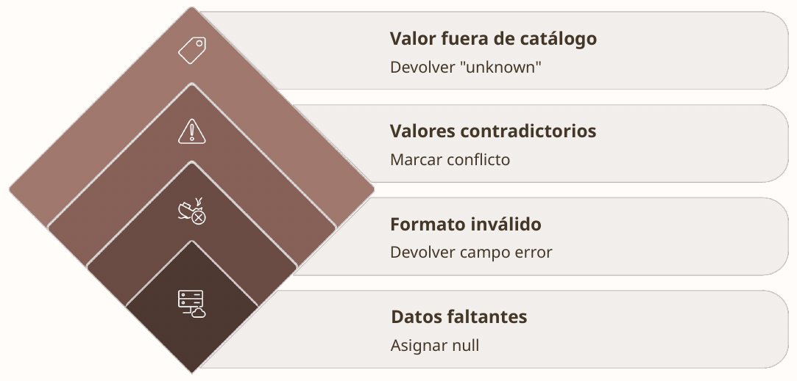

[← Anterior](01-formatos-de-presentacion.md) · [Índice del módulo](README.md) · [Siguiente →](03-parametros-de-generacion-y-cierre.md)

# 2 · Salidas estructuradas

*Módulo 06: Control del formato de salida y parámetros de generación*

## 2.1 Introducción a JSON

JSON (JavaScript Object Notation) es el formato de intercambio de datos más extendido en APIs y servicios web. Su sintaxis es estricta: cualquier desviación produce un documento inválido que no puede parsearse.

**Tipos de datos en JSON**

- String: siempre entre comillas dobles
- Number: sin comillas, entero o decimal
- Boolean: true o false en minúscula
- null: ausencia explícita de valor
- Object: pares clave-valor entre llaves {}
- Array: colección ordenada entre corchetes []

**Ejemplo (ilustrativo)**

```text
{
 "nombre": "Ana López",
 "edad": 32,
 "activo": true,
 "telefono": null,
 "roles": ["admin","editor"]
}
```

**Explicación**

JSON (JavaScript Object Notation) es el formato de intercambio más extendido en APIs y servicios web, y su sintaxis es estricta: cualquier desviación lo hace inválido. Sus tipos son cadena (siempre entre comillas dobles), número (sin comillas), booleano (true o false en minúscula), nulo (null, ausencia explícita de valor), **objeto** (pares clave-valor entre llaves) y **array** (colección ordenada entre corchetes).

El ejemplo describe a una persona con nombre, edad, estado activo, un teléfono nulo (no consta) y una lista de roles, y muestra cómo null permite expresar una ausencia sin inventar un valor. La estrictez es a la vez fortaleza y fragilidad: una comilla simple, una coma sobrante o un comentario introducido por el modelo invalidan todo el documento, de ahí que se insista en esquemas, ejemplos y validación.

<!-- labs-seccion -->
> **Para practicar esta sección:** [Laboratorio 06A · Salida consumible: Markdown, tabla y JSON validado](../../laboratorios/06A/README.md)
<!-- /labs-seccion -->

---

## 2.2 JSON: objetos y arrays

El diseño de la estructura JSON es una decisión de modelado. Elegir bien entre objetos y arrays facilita el consumo y el mantenimiento del esquema.

**Principios de diseño**

- Objeto para representar una entidad con atributos nombrados
- Array para colecciones homogéneas de elementos
- Objetos anidados para relaciones jerárquicas (pedido → líneas)
- Evita profundidad innecesaria: más de 3 niveles dificulta el consumo
- Usa nombres de clave estables: cambiarlos rompe el contrato de la API

**Cliente con pedidos (ilustrativo)**

```text
{
 "cliente": {
 "id": "C-001",
 "nombre": "Carlos Ruiz"
 },
 "pedidos": [
 {
 "id": "P-101",
 "total": 149.99,
 "estado": "enviado"
 },
 {
 "id": "P-102",
 "total": 32.50,
 "estado": "pendiente"
 }
 ]
}
```

**Explicación**

El diseño de una estructura JSON es una decisión de modelado. Un objeto representa una entidad con atributos nombrados; un array, una colección homogénea; los objetos anidados expresan relaciones jerárquicas (un pedido con sus líneas); conviene evitar más de tres niveles de profundidad y usar claves estables, porque cambiarlas rompe el contrato con quien consume los datos.

En el ejemplo, un cliente (objeto) tiene pedidos (array de objetos) con identificador, total y estado. Los importes son números sin comillas y los estados, cadenas, lo que permite sumar totales o filtrar sin conversiones. Si el campo se llama «total» en una ejecución e «importe_total» en otra, el consumidor falla, por lo que la estructura debe fijarse en el prompt con nombres exactos.

---

## 2.3 JSON: tipos y valores — evitar errores de tipado

Los errores de tipado en JSON son la causa más frecuente de fallos de parseo silenciosos. El LLM puede generar JSON aparentemente correcto pero con tipos equivocados.

| Tipo | ✅ Válido | ❌ Inválido |
|---|---|---|
| String | "nombre": "Ana" | "nombre": Ana |
| Number | "precio": 9.99 | "precio": "9.99" |
| Boolean | "activo": true | "activo": "true" |
| Null | "fax": null | "fax": "null" |
| Sin comentarios | { "x": 1 } | { "x": 1 // nota } |
| Sin coma final | ["a", "b"] | ["a", "b",] |

> En el prompt, indica explícitamente el tipo esperado para cada campo y proporciona un ejemplo válido completo. Reduce drásticamente los errores de tipado.

**Explicación**

Los errores de tipado son la causa más frecuente de fallos silenciosos en JSON. La tabla contrasta lo válido y lo inválido: una cadena sin comillas, un número entre comillas (que pasa a ser cadena), un booleano o un nulo entre comillas (son cadenas), un comentario o una coma tras el último elemento de un array.

Los casos más peligrosos son los de tipo equivocado pero sintaxis correcta, como un precio entre comillas: el documento se analiza sin error, pero una suma o comparación posterior puede dar resultados erróneos sin avisar. Lo más eficaz es indicar el tipo de cada campo y dar un ejemplo válido completo, y validar siempre con un analizador y con un esquema en lugar de confiar en que «parece» correcto.

---

## 2.4 Solicitar JSON: definir una salida consumible

**Instrucciones para el prompt**

- Pide exclusivamente JSON si el consumidor es una máquina: «Responde únicamente con JSON válido, sin texto adicional»
- Proporciona un esquema o ejemplo completo en el prompt; si la API ofrece salidas estructuradas con esquema, úsalas
- Define tipos y campos permitidos
- Establece valores permitidos para enumeraciones
- Especifica qué hacer con datos no disponibles: null, cadena vacía u omitir

**Prompt de extracción (ilustrativo)**

```text
Extrae los datos del texto
y devuelve ÚNICAMENTE JSON
con este esquema:
{
 "empresa": string,
 "sector": string | null,
 "empleados": number | null,
 "pais": string
}
Si un campo no está disponible,
usa null. Sin texto extra.
```

**Explicación**

Para obtener JSON consumible por una máquina, el prompt debe pedir exclusivamente JSON («Responde únicamente con JSON válido, sin texto adicional»), porque cualquier frase de cortesía impide analizarlo; proporcionar un esquema o ejemplo completo (o usar **salidas estructuradas** de la API si existen); definir tipos y campos permitidos; fijar valores para las enumeraciones; y especificar qué hacer con los datos no disponibles (null, cadena vacía u omitir).

El prompt de extracción de ejemplo define cuatro campos (empresa, sector, empleados y país), distingue los que siempre existen de los que pueden ser nulos y exige null cuando no hay dato, lo que impide inventar, por ejemplo, un número de empleados. La regla de ausencia debe acordarse con quien consume los datos antes de redactar el prompt.

<!-- labs-seccion -->
> **Para practicar esta sección:** [Laboratorio 06A · Salida consumible: Markdown, tabla y JSON validado](../../laboratorios/06A/README.md) · [Laboratorio 14 · Proyecto integrador: asistente de gestión de reclamaciones de Altanoria](../../laboratorios/14/README.md)
<!-- /labs-seccion -->

---

## 2.5 Salidas estructuradas nativas de la API

Muchas APIs permiten restringir la respuesta a un esquema JSON o a una llamada a herramienta. Cuando el proveedor la ofrece, es la opción preferente en producción frente a pedir el formato solo en el prompt.

- **Qué es**: El proveedor fuerza la salida a un esquema (por ejemplo, JSON Schema) en lugar de confiar únicamente en las instrucciones del prompt.
- **Qué aporta**: Estructura sintácticamente válida y tipos coherentes, con menos reintentos y menos código para reparar el JSON.
- **Qué no resuelve**: No garantiza que el contenido sea verdadero. Mantén la validación semántica y las reglas de ausencia (null).
- **Cómo adoptarla**: Consulta la documentación del proveedor: modelos compatibles, límites del esquema y comportamiento ante truncamiento (max tokens).

**Explicación**

Muchas APIs permiten restringir la respuesta a un esquema JSON o a una llamada a herramienta; cuando existe, es la opción preferente en producción frente a pedir el formato solo en el prompt. El proveedor fuerza la salida a un esquema, lo que da una estructura sintácticamente válida y tipos coherentes, con menos reintentos y menos código para reparar el JSON.

No resuelve que el contenido sea verdadero: el modelo puede rellenar un campo con un valor falso con corrección formal, por lo que hay que mantener la validación semántica y las reglas de ausencia. Tampoco está exenta de límites: modelos compatibles, tipos de esquema y tamaño varían por proveedor, y un truncamiento por límite de tokens puede dejar el documento incompleto. Es la diferencia entre una petición y una restricción técnica.

<!-- labs-seccion -->
> **Para practicar esta sección:** [Laboratorio 06A · Salida consumible: Markdown, tabla y JSON validado](../../laboratorios/06A/README.md)
<!-- /labs-seccion -->

---

## 2.6 Esquemas y validación

Un esquema describe la estructura *esperada* de la salida: campos, tipos, restricciones y obligatoriedad. Validar contra un esquema es el primer nivel de control de calidad, pero no el único.

**Elementos de un esquema**

- Campos y tipos: qué existe y de qué tipo
- Obligatorios: campos que siempre deben aparecer
- Enumeraciones: valores permitidos para campos categóricos
- Restricciones: longitud mínima/máxima, rangos numéricos

**Esquema y objeto válido (ilustrativo)**

```text
Esquema:
{
 "nombre": string (obligatorio),
 "categoria": "A"|"B"|"C",
 "precio": number > 0
}

Objeto válido:
{
 "nombre": "Producto X",
 "categoria": "B",
 "precio": 29.95
}
```

La validación de esquema comprueba estructura y sintaxis. No verifica la veracidad del contenido. Un campo "pais": "Marte" puede ser JSON válido y semánticamente absurdo.

**Explicación**

Un esquema describe la estructura esperada de la salida: campos y tipos, obligatorios, enumeraciones (valores permitidos) y restricciones (longitudes, rangos numéricos). Validar contra él es el primer nivel de control, pero no el único, porque comprueba estructura y sintaxis, no veracidad.

En el ejemplo, el esquema exige un nombre obligatorio, una categoría limitada a A, B o C y un precio numérico mayor que cero; el objeto válido cumple las tres. Para el modelo, el esquema es una especificación precisa; para el sistema, una herramienta de validación automática que rechaza lo que no cumple. Si un objeto no pasa, el sistema puede reintentar señalando el error o derivar el caso a revisión; las reglas de negocio añaden validaciones de contenido, como comprobar que un país exista en un catálogo.

---

## 2.7 Campos obligatorios y opcionales

Distinguir entre campos obligatorios y opcionales es esencial para controlar la completitud de la salida y evitar que el modelo invente datos o omita información crítica.

| Campo | Tipo | Obligatorio | Regla de ausencia |
|---|---|---|---|
| id | string | ✅ Sí | Error si falta |
| nombre | string | ✅ Sí | Error si falta |
| telefono | string | ⬜ No | null si no disponible |
| notas | string | ⬜ No | Omitir o cadena vacía |

Regla fundamental: nunca dejes que el modelo invente un valor para un campo que no puede determinar a partir del contexto. Acuerda las reglas de ausencia con el consumidor antes de diseñar el prompt.

**Explicación**

Distinguir entre campos obligatorios y opcionales es esencial para controlar la completitud y evitar que el modelo invente datos u omita información crítica. En la tabla, «id» y «nombre» son obligatorios y su ausencia es un error; «teléfono» es opcional y devuelve null si no está disponible; y «notas» es opcional y puede omitirse o quedar como cadena vacía.

Lo importante es que la regla esté definida para cada campo y que el consumidor la conozca. La regla fundamental es no permitir nunca que el modelo invente un valor que no puede determinar a partir del contexto: un teléfono inventado es peor que uno ausente porque el sistema lo tratará como válido, mientras que un null es honesto y fácil de detectar.

---

## 2.8 Errores en salidas estructuradas: árbol de decisión

Cuando la entrada es imperfecta o ambigua, el modelo debe seguir un comportamiento predefinido. Diseñar ese comportamiento en el prompt evita errores silenciosos o respuestas inventadas.



<details>
<summary>Descripción del diagrama en texto</summary>

1. Valor fuera de catálogo — Devolver "unknown"
2. Valores contradictorios — Marcar conflicto
3. Formato inválido — Devolver campo error
4. Datos faltantes — Asignar null

</details>

- **Dato ausente**: → null o campo omitido según regla
- **Formato inválido**: → campo "error": "formato"
- **Contradicción**: → marcar conflicto explícitamente
- **Fuera de catálogo**: → "unknown" o valor centinela

**Explicación**

Ante una entrada imperfecta o ambigua, el modelo debe seguir un comportamiento que se haya fijado de antemano. El árbol asigna una conducta a cuatro situaciones: dato ausente (null o campo omitido según la regla), formato inválido (campo de error), contradicción (marcar el conflicto explícitamente) y valor fuera de catálogo («unknown» u otro valor convenido).

Sin ese diseño, el modelo improvisa y cada decisión silenciosa introduce un error invisible: corrige una fecha por su cuenta, elige un valor entre dos contradictorios o asigna la categoría más parecida. Con él, los problemas quedan visibles: los errores se cuentan y revisan, los conflictos pueden enviarse a una persona y los «unknown» indican que la taxonomía necesita ampliarse. Conviene incluir una instrucción y un ejemplo para cada situación.

---

## 2.9 XML: estructura jerárquica y usos

XML (eXtensible Markup Language) es verboso pero expresivo. Su modelo de árbol de nodos lo hace adecuado para documentos complejos, integraciones legacy y ecosistemas que ya lo adoptan.

**Conceptos clave**

- Etiquetas: apertura &lt;tag&gt; y cierre &lt;/tag&gt; siempre en par
- Atributos: metadatos en la etiqueta de apertura
- Jerarquía de nodos: un elemento raíz contiene todo
- Escape de caracteres: &amp;, &lt;, &gt;
- Usos frecuentes: SOAP, RSS, configuración, integraciones B2B

**Árbol XML (ilustrativo)**

```text
<pedido id="P-001">
 <cliente>
  <nombre>Ana López</nombre>
  <email>ana@ejemplo.com</email>
 </cliente>
 <lineas>
   <linea>
     <producto>Teclado</producto>
     <cantidad>2</cantidad>
   </linea>
 </lineas>
</pedido>
```

**Explicación**

XML (eXtensible Markup Language) es verboso pero expresivo. Su modelo de árbol de nodos lo hace adecuado para documentos complejos, integraciones heredadas y ecosistemas que ya lo usan (SOAP, RSS, configuración, intercambio entre empresas). Sus conceptos clave son las etiquetas de apertura y cierre siempre por pares, los atributos como metadatos, un elemento raíz que contiene todo y el escape de caracteres especiales.

El ejemplo representa un pedido con un cliente y líneas de producto, mostrando cómo se organiza la información en niveles. Ofrece más capacidad de descripción que JSON, a costa de más tamaño y complejidad, y por eso se emplea sobre todo donde ya está establecido. Su riesgo al generarlo con un modelo es el mal cierre de etiquetas.

---

## 2.10 Solicitar XML: definir etiquetas y jerarquía

**Instrucciones para el prompt**

- Especifica el elemento raíz que engloba todo el documento
- Lista las etiquetas requeridas y su posición jerárquica
- Define qué información va en atributos vs. en contenido de elemento
- Indica si un elemento puede repetirse (ej. múltiples &lt;linea&gt;)
- Exige XML bien formado: todas las etiquetas cerradas, caracteres escapados

**Prompt de ficha de producto (ilustrativo)**

```text
Genera una ficha de producto en XML bien formado con esta estructura:
<producto>
 <nombre/>
 <precio moneda="EUR"/>
 <descripcion/>
 <caracteristicas>
 <item/> (1 o más)
 </caracteristicas>
</producto>

Sin texto fuera del XML.
```

**Explicación**

Para solicitar XML con fiabilidad hay que definir las etiquetas y la jerarquía: el elemento raíz, las etiquetas requeridas y su posición, qué información va en atributos y cuál en el contenido, qué elementos pueden repetirse y exigir XML bien formado, con todas las etiquetas cerradas y los caracteres escapados.

El ejemplo pide una ficha de producto con nombre, precio con atributo de moneda, descripción y una lista de una o más características, sin texto fuera del XML. La distinción entre atributo y contenido es una decisión de modelado, y indicar la repetición («uno o más») evita que el modelo genere un solo elemento cuando se esperan varios. Como con JSON, hay que validarlo con un analizador antes de usarlo.

---

## 2.11 CSV: datos tabulares planos

CSV (Comma-Separated Values) es el formato más simple para intercambiar datos tabulares. Su simplicidad es también su limitación: no representa bien estructuras anidadas ni tipos de datos complejos.

**Características y consideraciones**

- Filas y columnas: una fila de encabezados, una fila por registro
- Delimitador: coma por defecto, pero puede ser punto y coma o tabulador
- Comillas: campos con comas o saltos de línea deben ir entre comillas dobles
- Fechas y decimales: definir formato explícito (ISO 8601, punto o coma decimal)
- Codificación: UTF-8 para evitar problemas con tildes y caracteres especiales
- No es adecuado para datos con jerarquías o relaciones complejas

**Tabla → CSV (ilustrativo)**

```text
Tabla:
| Producto | Precio | Stock |
|----------|--------|-------|
| Teclado | 49.99 | 120 |
| Ratón | 24.50 | 85 |

CSV resultante:
producto,precio_eur,stock
Teclado,49.99,120
Ratón,24.50,85
```

**Explicación**

CSV (Comma-Separated Values) es el formato más simple para intercambiar datos tabulares, y su simplicidad es su límite: no representa bien estructuras anidadas. Se compone de una fila de encabezados y una fila por registro; el delimitador suele ser la coma, aunque puede ser punto y coma o tabulador; los campos con comas o saltos de línea van entre comillas; fechas y decimales exigen formato explícito; y la codificación recomendada es UTF-8.

El gran riesgo es la ambigüedad: en muchos países la coma es separador decimal y choca con la coma como delimitador, de modo que «49,99» puede partirse en dos columnas al importar. Por eso conviene especificar siempre el delimitador y el formato decimal.

---

## 2.12 Solicitar CSV: evitar ambigüedad

**Checklist para el prompt CSV**

- Especifica los encabezados exactos en el orden deseado
- Declara el delimitador (coma, punto y coma, tabulador)
- Define el formato de fechas (p. ej. YYYY-MM-DD)
- Define el separador decimal (punto o coma)
- Exige una fila por registro, sin filas de totales ni comentarios
- Si el CSV será procesado automáticamente: «*sin texto adicional fuera del CSV*»

**Prompt para inventario (ilustrativo)**

```text
Genera un CSV de inventario con los siguientes encabezados exactos y en este orden:
sku,nombre,precio_eur,stock,fecha_actualizacion

Formato fecha: YYYY-MM-DD
Decimal: punto
Delimitador: coma

Una fila por producto. Sin texto adicional.
```

**Explicación**

Evitar la ambigüedad al pedir CSV exige especificar los encabezados exactos y su orden, declarar el delimitador, definir el formato de fechas y el separador decimal, exigir una fila por registro sin totales ni comentarios y, si se procesará automáticamente, pedir que no haya texto fuera del CSV.

Cada instrucción previene un fallo: sin encabezados exactos, los nombres cambian entre ejecuciones; sin formato de fecha, aparecen «3 de marzo» y «03/03/24» mezclados; sin la prohibición de totales, puede añadirse una línea final que el sistema leerá como un registro más; y sin la exigencia de no añadir texto, puede abrirse con una frase que desplace la cabecera. Tras generarlo, conviene comprobar el número de columnas de cada fila.

---

## 2.13 YAML: configuración legible

YAML (YAML Ain't Markup Language) es el formato preferido para archivos de configuración porque es más legible que JSON para personas. Sin embargo, su indentación significativa lo hace sensible a errores de espaciado.

**Características principales**

- Indentación significativa: los espacios definen la jerarquía (nunca tabuladores)
- Pares clave-valor: clave: valor
- Listas: elementos precedidos de -
- Tipos inferidos: strings, números, booleanos y null sin comillas en la mayoría de casos
- Caracteres especiales: algunos requieren comillas (:, #, |)
- Uso típico: CI/CD (GitHub Actions, GitLab CI), Kubernetes, Docker Compose

**Ejemplo YAML (ilustrativo)**

```text
servicio:
 nombre: api-pedidos
 version: "2.1"
 activo: true
 base_datos:
 host: db.ejemplo.com
 puerto: 5432
 entornos:
 - produccion
 - staging
```

**Explicación**

**YAML** es el formato preferido para configuración porque es más legible que JSON para las personas, pero su indentación significativa lo hace sensible al espaciado. Los espacios definen la jerarquía (nunca tabuladores), los pares son clave y valor, las listas usan guiones, los tipos se infieren y algunos caracteres especiales exigen comillas. Se usa en integración continua, Kubernetes y Docker Compose.

Los riesgos habituales son que un espacio de más o de menos cambie la estructura sin error evidente y que la inferencia convierta valores no deseados (una versión «2.10» leída como el número 2,1). Por eso conviene poner entre comillas los valores que deben conservarse como texto y validar siempre el resultado con un analizador.

---

## 2.14 Comparar JSON, XML, CSV y YAML

No hay un formato superior. La elección correcta depende del ecosistema, la complejidad de los datos y el consumidor final. Usa esta tabla como referencia rápida de decisión.

| Criterio | JSON | XML | CSV | YAML |
|---|---|---|---|---|
| Legibilidad humana | Media | Baja | Alta (tablas) | Alta |
| Datos anidados | ✅ Sí | ✅ Sí | ❌ No | ✅ Sí |
| Ecosistema API | Muy amplio | Legacy / SOAP | Análisis datos | DevOps / config |
| Tipado explícito | ✅ Parcial | ❌ Solo texto | ❌ No | ✅ Inferido |
| Sensibilidad errores | Alta (sintaxis) | Alta (cierre tags) | Media (delimitador) | Alta (indentación) |

> La compatibilidad del formato depende siempre del sistema consumidor. Consulta con el equipo técnico antes de decidir.

**Explicación**

No hay un formato superior: depende del ecosistema, la complejidad de los datos y el consumidor. En legibilidad humana, JSON es media, XML baja, CSV alta como tabla y YAML alta; admiten datos anidados JSON, XML y YAML pero no CSV; el ecosistema es de APIs en JSON, de sistemas heredados en XML, de análisis de datos en CSV y de DevOps en YAML; el tipado es parcial en JSON, solo texto en XML, nulo en CSV e inferido en YAML; y todos son sensibles a errores de formato.

Tres preguntas resumen la decisión: qué espera el sistema consumidor, qué forma tienen los datos y quién los leerá. Ningún formato es a prueba de fallos, por lo que la validación automática es imprescindible con cualquiera, y la compatibilidad debe confirmarse con el equipo técnico.

---

## 2.15 Longitud y límites de salida

**Principios para controlar la extensión**

- Especifica límites aproximados en palabras o número de elementos: «*máximo 200 palabras*» o «*no más de 10 ítems*»
- Indica qué priorizar si no cabe todo el contenido
- Tokens ≠ palabras: una palabra puede ser 1-3 tokens; los caracteres especiales consumen más
- El modelo puede truncar la respuesta si alcanza el límite de tokens de salida
- Siempre valida la integridad: que el JSON esté cerrado, el CSV tenga todas las filas, etc.

**Presupuesto de salida (ilustrativo)**

Contexto total (ejemplo): 128 k tokens

Prompt de sistema: ~500 tokens

Historial de conversación: ~2.000 tokens

Prompt del usuario: ~300 tokens

**Margen para la respuesta: ~125.000 tokens**

Pedir salidas muy largas en un único turno aumenta el riesgo de truncamiento y de pérdida de coherencia estructural.

**Explicación**

La longitud de la salida afecta sobre todo a las respuestas estructuradas, porque un documento cortado a medias es inválido. Hay que especificar límites aproximados (palabras o elementos), indicar qué priorizar si no cabe todo, recordar que los tokens no son palabras (una palabra puede ser de uno a tres tokens), tener presente que el modelo puede truncar al alcanzar el límite de salida y validar siempre la integridad (JSON cerrado, CSV con todas las filas).

En el presupuesto del ejemplo, con 128.000 tokens de contexto, el prompt de sistema, el historial y la consulta ocupan pocos miles y queda un gran margen, pero pedir salidas muy largas en un solo turno aumenta el riesgo de truncamiento y de pérdida de coherencia. Es prudente dividir las salidas extensas en partes y validar cada una.

---

[← Anterior](01-formatos-de-presentacion.md) · [Índice del módulo](README.md) · [Siguiente →](03-parametros-de-generacion-y-cierre.md)
