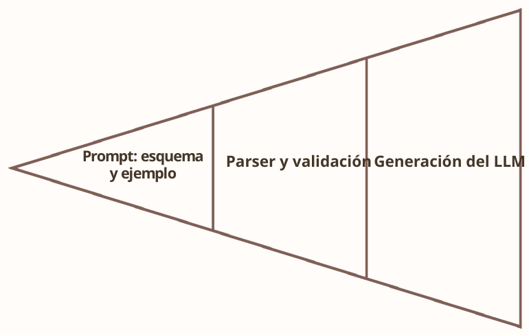

[← Anterior](02-salidas-estructuradas.md) · [Índice del módulo](README.md) · [Siguiente módulo →](../07-ciclo-de-vida-y-evaluacion/README.md)

# 3 · Parámetros de generación y cierre

*Módulo 06: Control del formato de salida y parámetros de generación*

## 3.1 Parámetros de generación

El prompt define *qué* debe hacer el modelo. Los parámetros de generación influyen en *cómo* selecciona los tokens que forman la respuesta. Son mecanismos distintos y complementarios.

- **Temperature**: Controla la «amplitud» de la distribución de probabilidad sobre tokens candidatos.
- **Top-p**: Limita la selección al conjunto de tokens que acumulan una probabilidad dada.
- **Max tokens**: Establece el límite máximo de tokens que puede generar la respuesta.

Cadenas que, al aparecer, detienen la generación de forma configurable.

**Stop sequences**

La disponibilidad y el comportamiento exacto de cada parámetro varía por modelo y API. Consulta siempre la documentación oficial del proveedor. Algunos modelos limitan o fijan Temperature y Top-p.

**Explicación**

El prompt define qué debe hacer el modelo; los parámetros de generación influyen en cómo selecciona los tokens. Son mecanismos distintos y complementarios. La temperatura controla la amplitud de la distribución de probabilidad; top-p limita la elección a los tokens que acumulan cierta probabilidad; max tokens fija el máximo de tokens de la respuesta; y las secuencias de parada detienen la generación al aparecer una cadena.

Su disponibilidad y comportamiento varían por modelo y API, y algunos modelos limitan o fijan temperature y top-p. No deben confundirse los planos: si una respuesta es incorrecta por una instrucción ambigua, ningún parámetro lo arregla. La regla es mejorar primero el prompt y reservar los parámetros para el ajuste fino.

<!-- labs-seccion -->
> **Para practicar esta sección:** [Laboratorio 06B · Temperatura y top-p: un experimento controlado](../../laboratorios/06B/README.md)
<!-- /labs-seccion -->

---

## 3.2 Temperature: variabilidad en la selección de tokens

**Efecto conceptual**

- Modifica la distribución de probabilidad sobre los tokens candidatos en sistemas compatibles
- Temperatura baja → distribución más concentrada → respuestas más predecibles y consistentes
- Temperatura alta → distribución más plana → mayor diversidad y creatividad
- Una temperatura baja no garantiza exactitud; solo reduce variabilidad
- El rango válido y el comportamiento dependen de la implementación del modelo

**Orientación práctica (conceptual)**

Temperatura baja → extracción de datos, clasificación, respuestas factuales, código

Temperatura media → resúmenes, respuestas conversacionales, análisis

Temperatura alta → lluvia de ideas, escritura creativa, generación de variantes

Distribuciones ilustrativas; los valores concretos varían por modelo. No extrapoles rangos de un proveedor a otro.

**Explicación**

La temperatura modifica la variabilidad en la selección de tokens. Una temperatura baja concentra la distribución y da respuestas más predecibles y consistentes; una alta la aplana y produce más diversidad y creatividad. El rango válido y el comportamiento dependen de cada modelo. Con temperatura baja se trabaja en extracción, clasificación, respuestas factuales y código; con media, en resúmenes, conversación y análisis; con alta, en lluvia de ideas, escritura creativa y variantes.

Los valores concretos varían entre proveedores y no deben extrapolarse: un 0,7 puede significar cosas distintas en dos sistemas. Lo más malinterpretado es que bajar la temperatura no hace al modelo más verdadero, solo más repetible; un error sistemático sigue siéndolo. Para extracción conviene reducir la variabilidad y validar el contenido; para ideas, subir la temperatura y filtrar después.

---

## 3.3 Top-p: muestreo por núcleo

Top-p (también llamado *nucleus sampling*) es un mecanismo alternativo y complementario a Temperature para controlar la diversidad de la selección de tokens.

**Cómo funciona**

- En lugar de escalar toda la distribución, limita el conjunto de candidatos a los tokens cuya probabilidad acumulada alcanza el umbral *p*
- Un Top-p bajo restringe la selección a los tokens más probables → menor diversidad
- Un Top-p alto amplía el conjunto de candidatos → mayor variedad
- No es equivalente a Temperature: actúan sobre aspectos distintos de la distribución
- Su disponibilidad e interpretación varía según el modelo y la API

**Acumulación de probabilidad (ilustrativo)**

```text
Tokens candidatos ordenados por probabilidad:

Token A → 45 % (acum. 45 %)
Token B → 30 % (acum. 75 %)
Token C → 15 % (acum. 90 %) ← p=0.9
Token D → 8 % (acum. 98 %)
Token E → 2 % (acum. 100%)

Con p=0.9: solo A, B y C pueden ser seleccionados.
```

**Explicación**

Top-p (muestreo por núcleo) controla la diversidad limitando el conjunto de candidatos a los tokens cuya probabilidad acumulada alcanza un umbral p. Un top-p bajo restringe la selección a los más probables y da menos diversidad; uno alto amplía los candidatos y da más variedad. No es equivalente a la temperatura, porque actúan sobre aspectos distintos de la distribución.

En el ejemplo, con probabilidades de 45, 30, 15, 8 y 2 %, un top-p de 0,9 permite elegir solo entre los tres primeros, que acumulan el 90 %; los otros dos quedan descartados. Top-p corta la cola de opciones improbables, mientras que la temperatura reescala todas. Muchos proveedores recomiendan ajustar solo uno de los dos a la vez, y su interpretación depende de la API.

---

## 3.4 Max tokens y límites de generación

**Conceptos clave**

- max\_tokens (o equivalente) limita el número de tokens de salida que el modelo puede generar
- Token ≠ palabra: una palabra suele ocupar entre 1 y 3 tokens según idioma y tokenizador; los caracteres especiales pueden consumir más
- Si la respuesta alcanza el límite, puede truncarse en mitad de una oración o de un bloque JSON
- El contexto total (prompt + historial + respuesta) no puede superar la ventana de contexto del modelo
- La semántica exacta del parámetro depende de la API del proveedor

**Presupuesto de tokens (ilustrativo)**

```text
Ventana total: 128.000 tokens

Entrada (prompt + historial):
  ~3.000 tokens usados

Margen para salida:
  ~125.000 tokens disponibles

max_tokens configurado: 1.000

→ La respuesta se cortará   si supera 1.000 tokens,   aunque haya contexto libre.
```

Valida siempre que las respuestas estructuradas (JSON, XML) estén completas y bien cerradas.

**Explicación**

El parámetro max tokens limita el número de tokens de salida. Un token no es una palabra (suele ser de uno a tres por palabra), una respuesta que alcance el límite puede truncarse en mitad de una frase o de un JSON, el contexto total no puede superar la ventana del modelo y la semántica exacta depende de la API.

En el ejemplo la ventana es de 128.000 tokens, la entrada usa unos 3.000 y quedan unos 125.000 libres, pero si max tokens está en 1.000 la respuesta se cortará al superarlos. Es frecuente confundir el máximo teórico con el límite configurado: demasiado bajo trunca; demasiado alto sin necesidad arriesga gasto. En salidas estructuradas hay que validar que estén completas y bien cerradas, porque un JSON truncado es inservible y no siempre hay aviso.

Con los modelos de razonamiento hay una interacción más: el límite de salida suele incluir los tokens de razonamiento que el modelo gasta antes de contestar. Si el límite es bajo, se agota «pensando» y la respuesta llega vacía o cortada aunque el prompt sea correcto. Conviene dejar margen para el razonamiento o ajustar su esfuerzo (véase [§2.4 CoT en modelos de razonamiento](../04-tecnicas-avanzadas-de-prompting/02-razonamiento-y-descomposicion.md#24-cot-en-modelos-de-razonamiento)) y revisar si hay respuestas vacías antes de culpar al prompt.

---

## 3.5 Stop sequences: terminación configurable

**Qué son y para qué sirven**

- Una stop sequence es una cadena de texto que, al ser generada, detiene la producción de tokens de forma inmediata
- Útil en protocolos concretos: delimitar secciones, marcar el final de una respuesta en un pipeline
- Riesgo: puede cortar contenido legítimo si la secuencia aparece antes de completar la respuesta
- No está disponible en todas las interfaces de usuario; es principalmente una función de API
- Siempre prueba y valida antes de usar en producción

**Marcador de terminación (ilustrativo)**

```text
Stop sequence: "###FIN###"

Prompt:
"Genera una ficha de producto. Al terminar, escribe ###FIN###"

Salida esperada:
Producto: Auriculares BT-500
Precio: 79,99 €
Descripción: ...
###FIN###
← La generación se detiene aquí
```

**Explicación**

Una **secuencia de parada** es una cadena que, al generarse, detiene de inmediato la producción de tokens, y sirve para controlar dónde termina la respuesta. Es útil en protocolos concretos (delimitar secciones o marcar el final en un proceso automático), no está disponible en todas las interfaces y exige probar antes de producción, porque puede cortar contenido legítimo si la secuencia aparece antes de lo previsto.

En el ejemplo se usa «###FIN###»: el prompt pide escribirla al terminar y la generación se detiene ahí, sin incluir la marca en el resultado. Conviene elegir cadenas poco habituales; una secuencia como un punto o un salto de línea cortaría la respuesta demasiado pronto. Evita además que el modelo añada comentarios finales tras un bloque de datos.

---

## 3.6 Reproducibilidad y variabilidad

Los LLMs son sistemas estocásticos: el mismo prompt con los mismos parámetros puede producir respuestas distintas. Comprender las fuentes de variabilidad es esencial para diseñar sistemas robustos.

- **Muestreo y parámetros**: Temperature y Top-p introducen aleatoriedad deliberada en la selección de tokens. Incluso con Temperature=0, algunos modelos no son completamente deterministas.
- **Cambios de versión**: Las actualizaciones del modelo pueden cambiar el comportamiento sin previo aviso. Una respuesta reproducible hoy puede variar tras una actualización silenciosa.
- **Contexto e historial**: El historial de conversación forma parte del contexto y condiciona las respuestas. Diferentes conversaciones con el mismo prompt final producen resultados distintos.
- **Registrar configuración**: No asumas reproducibilidad perfecta. Documenta versión del modelo, parámetros usados y fecha para poder diagnosticar variaciones en el futuro.

**Explicación**

Los LLM son estocásticos: el mismo prompt con los mismos parámetros puede dar respuestas distintas. Las fuentes de variabilidad son el muestreo y los parámetros (incluso con temperatura cero algunos modelos no son del todo deterministas), los cambios de versión del modelo, que pueden alterar el comportamiento sin aviso, y el contexto y el historial de la conversación. Por eso hay que documentar versión del modelo, parámetros y fecha.

La **reproducibilidad** exacta es un objetivo que se persigue, no un supuesto: fijar parámetros, usar una versión concreta si el proveedor lo permite, controlar el contexto y registrar cada ejecución reduce la variabilidad sin eliminarla. En producción conviene evaluar con varias ejecuciones y repetir la batería de pruebas cuando cambie el modelo (módulo [07](../07-ciclo-de-vida-y-evaluacion/README.md)).

---

## 3.7 Buenas prácticas de salidas estructuradas

Integrar formato, esquema y validación en un único flujo de trabajo reduce errores y hace las salidas del LLM confiables y mantenibles en entornos de producción.



<details>
<summary>Descripción del diagrama en texto</summary>

1. **Prompt: esquema y ejemplo**
2. **Parser y validación**
3. **Generación del LLM**

</details>

- **Definir formato y esquema**: Antes de escribir el prompt, decide el formato y documenta el esquema completo.
- **Dar ejemplo válido**: Incluye un ejemplo completo y correcto en el prompt como referencia para el modelo.
- **Especificar ausencias y errores**: Declara explícitamente qué hacer con datos no disponibles o entradas ambiguas.
- **Validar sintaxis y semántica**: Separa la validación estructural de la validación de contenido. Ambas son necesarias.

**Explicación**

Integrar formato, esquema y validación en un único flujo reduce errores. El flujo tiene tres etapas: el prompt con esquema y ejemplo, la generación y un analizador con validación. Cuatro prácticas lo sostienen: decidir el formato y documentar el esquema antes del prompt, incluir un ejemplo válido completo, especificar las ausencias y errores y validar por separado sintaxis y semántica.

El orden importa: primero el contrato (qué formato y qué esquema, según lo que espera el consumidor), después el prompt que lo cumple y, al final, la validación automática. Cuando falla, el sistema debe tener una conducta prevista (reintentar con el mensaje de error, usar un valor por defecto, escalar a revisión o registrar). El diseño correcto asume que el modelo fallará a veces, idea que se desarrolla con las puertas de validación del módulo [13](../13-diseno-de-sistemas-de-prompts/README.md).

<!-- labs-seccion -->
> **Para practicar esta sección:** [Laboratorio 06A · Salida consumible: Markdown, tabla y JSON validado](../../laboratorios/06A/README.md)
<!-- /labs-seccion -->

---

## 3.8 Errores frecuentes y diagnóstico

Identificar el patrón de error acelera el diagnóstico y la corrección. La siguiente tabla recoge los fallos más habituales al solicitar salidas estructuradas y parámetros de generación.

| Error frecuente | Síntoma | Solución |
|---|---|---|
| JSON con comillas incorrectas | Parseo falla; comillas simples o sin comillas | Exigir comillas dobles y dar ejemplo |
| Campos o tipos inconsistentes | Campo espera número, recibe string | Declarar tipo por campo en el esquema |
| CSV con separadores ambiguos | Columnas desalineadas al importar | Especificar delimitador y formato decimal |
| XML mal cerrado | Parseo falla; etiqueta sin cierre | Exigir XML bien formado y validar |
| Confundir parámetros con instrucciones | Cambiar Temperature en vez de reformular | Mejorar el prompt; los parámetros son complementarios |
| Atribuir valores universales a parámetros | Asumir que Temperature 0.7 es igual en todos los modelos | Consultar la documentación oficial del proveedor |

**Explicación**

Conviene identificar el patrón de error para diagnosticar con rapidez. Seis casos: JSON con comillas incorrectas (exigir comillas dobles y dar un ejemplo); campos o tipos inconsistentes (declarar el tipo por campo); CSV con separadores ambiguos (especificar delimitador y formato decimal); XML mal cerrado (exigir XML bien formado y validarlo); confundir parámetros con instrucciones (mejorar el prompt, porque los parámetros son complementarios); y atribuir valores universales a los parámetros (consultar la documentación del proveedor).

Los cuatro primeros son de formato y se corrigen con especificaciones precisas y validación; los dos últimos, de comprensión de parámetros. Ante una salida defectuosa conviene revisar primero si la causa es una instrucción ambigua, una regla de ausencia no definida o un esquema incompleto, antes de tocar parámetros: la mayoría de los fallos de formato se resuelven en el prompt.

---

## 3.9 Resumen y comprobación

Repasa estos seis controles antes de dar por completado cualquier prompt que requiera salida estructurada o parámetros de generación configurados.

1. **Formato según consumidor**: ¿Has elegido el formato más adecuado — Markdown, JSON, CSV, XML o YAML — para quien va a usar la salida?
2. **Estructura y tipos**: ¿Has definido los campos, sus tipos y has proporcionado un ejemplo válido completo en el prompt?
3. **Tratamiento de ausencias**: ¿Has especificado qué hacer cuando un dato no está disponible? ¿null, vacío u omitir?
4. **Validación de contenido y sintaxis**: ¿Tienes un proceso para validar tanto la estructura formal como la coherencia semántica de la salida?
5. **Parámetros comprendidos**: ¿Entiendes el efecto conceptual de Temperature, Top-p, Max tokens y Stop sequences en tu caso de uso?
6. **Documentación verificada**: ¿Has consultado la documentación oficial del proveedor para confirmar el comportamiento de los parámetros en el modelo que usas?

**Explicación**

El resumen propone seis controles antes de dar por terminado un prompt con salida estructurada o parámetros configurados: si el formato es el adecuado para quien usará la salida, si están definidos campos, tipos y un ejemplo válido, si se ha especificado qué hacer con los datos no disponibles, si existe un proceso para validar estructura y contenido, si se comprende el efecto de temperature, top-p, max tokens y secuencias de parada, y si se ha consultado la documentación del proveedor.

Pueden agruparse en diseño del contrato (los dos primeros), robustez (los dos siguientes) y comprensión técnica y verificación de la plataforma (los dos últimos). Con este módulo concluye el bloque dedicado a técnicas, roles y control de la salida; el siguiente se dedica a evaluar, mejorar y proteger lo construido, empezando por el ciclo de vida de los prompts.

---

[← Anterior](02-salidas-estructuradas.md) · [Índice del módulo](README.md) · [Siguiente módulo →](../07-ciclo-de-vida-y-evaluacion/README.md)
