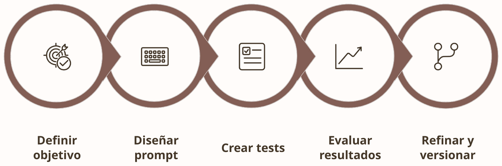

[Índice del módulo](README.md) · [Siguiente →](01-diseno-y-pruebas.md)

# Objetivos del módulo

*Módulo 07: Ciclo de vida, evaluación y optimización de prompts*

## Objetivos y mapa del módulo

OBJETIVOS DEL MÓDULO

El módulo recorre el ciclo de vida completo de un prompt profesional, desde la definición del problema hasta el mantenimiento en producción. Al finalizar, podrás identificar las fases clave y aplicar criterios objetivos en cada una.

Descripción del diagrama en texto

1. **Definir objetivo**
2. **Diseñar prompt**
3. **Crear tests**
4. **Evaluar resultados**
5. **Refinar y versionar**

**Explicación**

El módulo recorre el ciclo de vida completo de un prompt profesional, desde definir el problema hasta mantenerlo en producción. Al terminar se deben poder identificar las fases clave y aplicar criterios objetivos en cada una. Las etapas son definir el objetivo, diseñar el prompt, crear pruebas, evaluar los resultados y refinar y versionar.

El orden tiene lógica: no se diseña bien sin saber qué se persigue, no se evalúa sin pruebas y no se refina sin evaluación. Las pruebas se conciben junto con el diseño, y no después, para que el criterio de éxito no se adapte a lo que el prompt ya produce. Los contenidos se agrupan en diseño y prueba, evaluación, optimización y mantenimiento, y el módulo cierra con un caso integrado.

---

[Índice del módulo](README.md) · [Siguiente →](01-diseno-y-pruebas.md)
