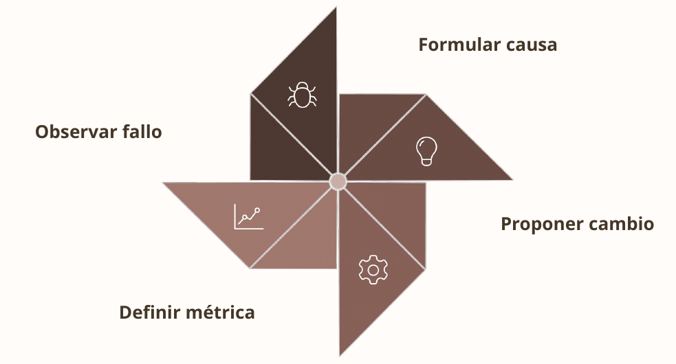

[← Anterior](00-objetivos-del-modulo.md) · [Índice del módulo](README.md) · [Siguiente →](02-evaluacion.md)

# 1 · Diseño y pruebas

*Módulo 07: Ciclo de vida, evaluación y optimización de prompts*

## 1.1 El prompt como artefacto de ingeniería

Un prompt no es solo texto: es una especificación funcional que puede fallar de formas predecibles. Tratarlo como un artefacto de ingeniería implica aplicar disciplina de desarrollo de software al diseño y mantenimiento de instrucciones para LLMs.

**Proceso ad hoc**

- Cambios intuitivos sin registro
- Pruebas con un solo ejemplo
- Sin criterios de aceptación
- Versión única, sin historial

**Proceso controlado**

- Hipótesis antes de cada cambio
- Suite de pruebas representativa
- Criterios definidos y medibles
- Versionado con trazabilidad

**Explicación**

Un prompt no es solo texto: es una especificación funcional que puede fallar de formas predecibles, y tratarlo como un **artefacto de ingeniería** implica aplicar disciplina de desarrollo de software. El proceso ad hoc se caracteriza por cambios intuitivos sin registro, pruebas con un solo ejemplo, ausencia de **criterios de aceptación** y una única versión sin historial. El proceso controlado parte de hipótesis antes de cada cambio, usa una suite de pruebas representativa, define criterios medibles y versiona con trazabilidad.

En el primero, si algo falla más tarde, no se sabe qué cambió, cuándo ni por qué. En el segundo, cada cambio responde a una hipótesis, se prueba, se mide y se registra. No es burocracia, sino fiabilidad: el comportamiento de un modelo no es del todo determinista, y solo un proceso sistemático permite detectar variaciones.

<!-- labs-seccion -->
> **Para practicar esta sección:** [Laboratorio 07A · Contrato, suite de pruebas y línea base](../../laboratorios/07A/README.md)
<!-- /labs-seccion -->

---

## 1.2 Identificar el problema antes de redactar

Uno de los errores más frecuentes es comenzar a redactar el prompt antes de haber definido con precisión el caso de uso. Sin esta base, es imposible saber si el prompt funciona correctamente. La ficha de caso de uso es la herramienta de partida.

1. **Usuario y necesidad**: ¿Quién usa el sistema y qué necesita conseguir?
2. **Tarea y frecuencia**: ¿Qué acción concreta realiza el modelo y con qué periodicidad?
3. **Impacto del error**: ¿Qué consecuencias tiene un fallo? ¿Es reversible?
4. **Datos y restricciones**: ¿Qué información está disponible? ¿Qué limitaciones técnicas u organizativas existen?
5. **Definición de éxito**: ¿Cómo se mide que el resultado es aceptable?

**Explicación**

Uno de los errores más frecuentes es empezar a redactar antes de definir el caso de uso. La ficha de caso de uso responde a cinco preguntas: quién usa el sistema y qué necesita conseguir, qué acción realiza el modelo y con qué frecuencia, qué consecuencias tiene un fallo y si es reversible, qué datos y restricciones existen y cómo se medirá que el resultado es aceptable.

La tercera es la que más condiciona el rigor. Un prompt que sugiere títulos para un blog se evalúa de forma ligera porque un error es trivial; uno que clasifica reclamaciones exige una evaluación mucho más estricta. La frecuencia también cuenta, porque una tarea que se ejecuta miles de veces multiplica cualquier error. Responder estas preguntas lleva pocos minutos y evita semanas de ajustes en la dirección equivocada.

---

## 1.3 Definir entradas y salidas: el contrato de tarea

Antes de escribir una sola instrucción, el diseñador debe especificar con precisión qué entra al sistema y qué debe producir. Este contrato evita ambigüedades y sirve de base para el conjunto de pruebas.

**Entradas**

- Fuentes y formatos: texto libre, JSON, PDF, HTML…
- Campos obligatorios: qué información debe estar siempre presente
- Condiciones de ausencia: qué ocurre si falta un campo
- Casos no soportados: entradas fuera del alcance definido

**Salidas**

- Formato de salida: JSON, Markdown, prosa, lista…
- Consumidor de resultados: persona, API, base de datos
- Restricciones de contenido: longitud, idioma, tono
- Comportamiento ante error: mensaje, rechazo, valor nulo

> El diagrama entrada-proceso-salida (IPO) es una herramienta ilustrativa sencilla para validar el contrato con todas las partes implicadas antes de comenzar el desarrollo.

**Explicación**

Antes de escribir una sola instrucción hay que especificar qué entra al sistema y qué debe producir. Para las entradas: fuentes y formatos, campos obligatorios, condiciones de ausencia y casos no soportados. Para las salidas: formato, consumidor de los resultados, restricciones de contenido (longitud, idioma, tono) y comportamiento ante error.

El diagrama de entrada, proceso y salida (IPO) es una herramienta sencilla para validar el contrato con todas las partes antes de empezar; el consumidor de los resultados puede confirmar si el formato y los campos son los que necesita. Los casos no soportados y el comportamiento ante error se olvidan con frecuencia: definirlos permite probar que el sistema rechaza correctamente lo que no debe atender y que su sistema consumidor reconoce un error en lugar de confundirlo con un resultado válido.

---

## 1.4 Criterios de aceptación: de expectativas a condiciones verificables

Los criterios de aceptación transforman una expectativa vaga ("que la respuesta sea buena") en una condición que puede comprobarse sistemáticamente. Sin ellos, la evaluación es subjetiva e inconsistente.

| Criterio | Descripción | Ejemplo de rúbrica |
|---|---|---|
| Precisión | ¿Es correcta la información proporcionada? | Sin datos falsos ni inventados |
| Completitud | ¿Responde a todos los elementos solicitados? | Todos los campos requeridos presentes |
| Relevancia | ¿Es pertinente respecto a la consulta? | Sin contenido irrelevante o tangencial |
| Consistencia | ¿Es coherente a lo largo de la respuesta? | Sin contradicciones internas |
| Formato | ¿Cumple el esquema de salida definido? | JSON válido, longitud dentro del límite |
| Incertidumbre | ¿Reconoce correctamente lo que no sabe? | Expresa duda en lugar de inventar |

**Explicación**

Los criterios de aceptación transforman una expectativa vaga («que sea buena») en una condición comprobable. La tabla propone seis: precisión (sin datos falsos o inventados), completitud (todos los campos requeridos), relevancia (sin contenido tangencial), consistencia (sin contradicciones internas), formato (JSON válido, longitud dentro del límite) e incertidumbre (expresa duda en lugar de inventar).

El último es el menos habitual y de los más valiosos: un sistema que reconoce los límites de lo que sabe es más fiable que uno que responde siempre con seguridad, y evaluarlo exige incluir casos donde la respuesta correcta es «no consta». No todos los criterios pesan igual en todos los casos: un extractor prioriza precisión y formato; un asistente de redacción, relevancia y consistencia. Lo esencial es que se definan antes de evaluar y que dos evaluadores lleguen a la misma conclusión.

---

## 1.5 Diseñar la primera versión: el baseline medible

La primera versión del prompt no pretende ser perfecta. Su función es establecer un punto de partida medible contra el que comparar todas las mejoras posteriores. La prematura optimización antes de tener datos es uno de los errores más habituales.

1. **Estructura clara**: Separar rol, tarea, contexto, formato de salida e instrucciones adicionales en secciones diferenciadas.
2. **No optimizar prematuramente**: El objetivo es tener un baseline funcional, no un prompt perfecto. La optimización llega después de la evaluación.
3. **Registrar modelo y configuración**: Anotar el modelo, la temperatura y los parámetros utilizados. El mismo prompt puede comportarse de forma diferente con distintos valores.
4. **Identificar versión y guardar entradas**: Etiquetar como v0.1 y conservar las entradas de referencia utilizadas en la primera evaluación.

**Explicación**

La primera versión no pretende ser perfecta: su función es establecer un punto de partida medible para comparar todas las mejoras. Debe tener una estructura clara con secciones diferenciadas, no optimizarse prematuramente, registrar modelo y configuración (el mismo prompt puede comportarse distinto con otros parámetros) y etiquetarse, por ejemplo como v0.1, conservando las entradas de referencia de la primera evaluación.

El **baseline** (la línea base) es la línea de partida sin la cual no se sabe si un cambio mejora o empeora. Pulir el texto antes de saber dónde falla es tentador pero poco útil, porque un ajuste de estilo puede ser irrelevante si el problema real es la falta de un ejemplo. Y sin guardar las entradas de la primera evaluación no puede repetirse en las mismas condiciones.

---

## 1.6 Hipótesis de mejora: cambios comprobables

Cada modificación del prompt debe partir de una hipótesis explícita: "*creo que este fallo ocurre porque X, y si cambio Y debería mejorar Z*". Cambiar múltiples variables simultáneamente impide saber qué funcionó.

Descripción del diagrama en texto

1. **Observar fallo**
2. **Definir métrica**
3. **Formular causa**
4. **Proponer cambio**

> Regla clave: una hipótesis, un cambio, una prueba. Si se modifican instrucciones, ejemplos y formato a la vez, el resultado no enseña nada sobre qué variable fue determinante.

**Explicación**

Cada modificación del prompt debe partir de una hipótesis explícita: «creo que el fallo ocurre por X, y si cambio Y debería mejorar Z». Los pasos son observar el fallo, formular la causa, proponer el cambio y definir la métrica con la que se comprobará. La regla clave es una hipótesis, un cambio, una prueba: si se modifican instrucciones, ejemplos y formato a la vez, no se aprende qué variable fue determinante.

Por ejemplo, si un clasificador falla con los tickets de facturación porque las definiciones son ambiguas, se añade una definición precisa de cada categoría y se mide solo la exactitud en esos tickets. Parece lento, pero resulta más rápido en la práctica, porque cada experimento produce conocimiento, incluso el negativo: descartar una hipótesis reduce el espacio de búsqueda.

<!-- labs-seccion -->
> **Para practicar esta sección:** [Laboratorio 07B · Iterar con hipótesis, regresiones y evaluación final](../../laboratorios/07B/README.md)
<!-- /labs-seccion -->

---

## 1.7 Diseñar el conjunto de pruebas

El conjunto de pruebas debe representar el uso real del sistema, no solo los casos más fáciles. Un prompt que funciona bien en condiciones ideales pero falla en entradas ambiguas no está listo para producción.

- **Casos frecuentes**: Entradas típicas que el sistema procesará la mayoría del tiempo. Son la base de la suite.
- **Casos infrecuentes importantes**: Poco comunes pero con alto impacto si el modelo falla. Deben estar siempre representados.
- **Entradas ambiguas**: Solicitudes con múltiples interpretaciones posibles. Prueban si el modelo pide aclaración o asume.
- **Datos incompletos**: Entradas con campos faltantes o parciales. Verifican el comportamiento ante información insuficiente.
- **Casos límite y adversariales**: Valores extremos, formatos inusuales e intentos de manipulación controlados del prompt.

**Explicación**

El **conjunto de pruebas** debe representar el uso real, no solo los casos fáciles. Se compone de casos frecuentes (la base de la suite), infrecuentes pero importantes (poco comunes y de alto impacto si fallan), entradas ambiguas (prueban si el modelo pide aclaración o asume), datos incompletos y **casos límite** y adversariales (valores extremos, formatos inusuales e intentos controlados de manipulación).

Solo con casos frecuentes el prompt parecerá excelente; los otros cuatro tipos revelan los fallos que importan. Conviene partir de datos reales anonimizados y completarlos con casos sintéticos para lo raro. Los casos infrecuentes importantes merecen atención especial: en sistemas médicos, jurídicos o financieros, lo que ocurre una vez entre mil es lo que no puede fallar, y la suite debe reflejar tanto la frecuencia como el impacto.

<!-- labs-seccion -->
> **Para practicar esta sección:** [Laboratorio 07A · Contrato, suite de pruebas y línea base](../../laboratorios/07A/README.md) · [Laboratorio 14 · Proyecto integrador: asistente de gestión de reclamaciones de Altanoria](../../laboratorios/14/README.md)
<!-- /labs-seccion -->

---

## 1.8 Cobertura y representatividad: evitar conjuntos sesgados

Un conjunto de pruebas puede ser extenso y aun así estar sesgado si todos los casos provienen del mismo tipo de usuario o del mismo formato de entrada. La diversidad del conjunto determina la validez de la evaluación.

**Qué incluir**

- Variedad de usuarios y perfiles de entrada
- Distintos tamaños de texto (corto, medio, largo)
- Formatos variados (prosa, listas, tablas, JSON)
- Excepciones y casos raros conocidos
- Casos actualizados al evolucionar el proceso

**Qué evitar**

- Duplicados excesivos que inflan el recuento
- Casos construidos a medida del prompt existente
- Conjuntos que no incluyen ningún caso difícil
- Suites que no se actualizan tras cambios de negocio

La matriz de cobertura es un recurso ilustrativo para visualizar qué dimensiones están representadas y cuáles faltan.

**Explicación**

Un conjunto de pruebas puede ser extenso y estar sesgado si todos los casos proceden del mismo tipo de usuario o formato. La diversidad determina la validez de la evaluación. Conviene incluir variedad de usuarios, tamaños de texto, formatos (prosa, listas, tablas, JSON), excepciones conocidas y casos actualizados con el proceso. Hay que evitar duplicados que inflan el recuento, casos construidos a medida del prompt existente, suites sin casos difíciles y suites que no se actualizan.

Un riesgo sutil es que quien redacta el prompt también redacte los casos y, sin querer, elija los que su prompt resuelve, lo que da una falsa seguridad. Es mejor que provengan de fuentes independientes o incluyan casos reales. La matriz de **cobertura** ayuda a ver qué dimensiones están representadas: cruza variables como tipo de usuario, longitud y formato, y las celdas vacías señalan los huecos.

<!-- labs-seccion -->
> **Para practicar esta sección:** [Laboratorio 07A · Contrato, suite de pruebas y línea base](../../laboratorios/07A/README.md)
<!-- /labs-seccion -->

---

## 1.9 Pruebas normales y casos límite: evaluar las fronteras

Los casos límite son aquellos que se encuentran en los extremos del espacio de entrada. Los modelos suelen comportarse de forma predecible en el centro, pero revelan sus debilidades en los bordes.

| Tipo de caso | Descripción | Propósito |
|---|---|---|
| Entrada típica | Caso representativo del uso habitual | Verificar funcionamiento base |
| Texto muy corto | Una sola palabra o frase mínima | Comprobar si el modelo pide más contexto |
| Texto muy largo | Entrada que se acerca al límite de contexto | Detectar truncamiento o pérdida de instrucción |
| Campos vacíos | Campos obligatorios ausentes | Comprobar manejo de ausencia |
| Información contradictoria | Datos que se contradicen entre sí | Verificar comportamiento ante conflicto |
| Caracteres inusuales | Emojis, HTML, caracteres especiales | Detectar fallos de parsing o formato |

**Explicación**

Los casos límite están en los extremos del espacio de entrada: los modelos suelen ser predecibles en el centro y revelan sus debilidades en los bordes. La tabla recoge seis: entrada típica (comprueba el funcionamiento base), texto muy corto (si pide más contexto), texto muy largo cercano al límite de contexto (truncamiento o pérdida de instrucciones), campos vacíos (manejo de ausencias), información contradictoria (comportamiento ante conflicto) y caracteres inusuales como emojis o HTML (fallos de análisis o formato).

Cada uno ataca una debilidad distinta, enlazadas con lo visto sobre ventana de contexto y tokenización. Un buen método es construirlos sistemáticamente a partir del **contrato de tarea**: para cada campo de entrada, preguntar por sus valores extremos (vacío, muy corto, muy largo, mal formado, ambiguo) y, para cada regla de salida, qué condiciones podrían violarla.

---

## 1.10 Pruebas negativas y robustez

Las pruebas negativas verifican cómo responde el prompt ante entradas que están fuera de su alcance, que son inválidas o que intentan manipular el comportamiento del modelo. Un prompt robusto no falla silenciosamente: rechaza, aclara o escala de forma controlada.

- **Datos malformados**: JSON roto, HTML sin cerrar, campos con tipos incorrectos.
- **Solicitudes fuera de alcance**: Peticiones que el prompt no está diseñado para atender.
- **Instrucciones contradictorias**: El usuario pide algo que choca con las instrucciones del sistema.
- **Contenido no confiable**: Datos de usuario que intentan sobrescribir instrucciones del sistema (inyección de prompts).
- **Respuesta esperada**: Rechazo explícito, solicitud de aclaración o mensaje de error controlado.

**Explicación**

Las **pruebas negativas** verifican cómo responde el prompt ante entradas inválidas, fuera de alcance o que intentan manipularlo. Se prueban datos malformados (JSON roto, HTML sin cerrar, tipos incorrectos), solicitudes fuera de alcance, instrucciones contradictorias con el sistema y contenido no confiable que intenta sobrescribir instrucciones (inyección de prompts). La respuesta esperada es un rechazo explícito, una solicitud de aclaración o un error controlado.

Un prompt robusto no falla silenciosamente. El peor escenario es que ante una entrada inválida el sistema invente un resultado: parece funcionar y el error se descubre mucho después. Las pruebas de inyección se desarrollan en el módulo [09](../09-seguridad-privacidad-y-uso-responsable/README.md); basta con incluir casos controlados en los que los datos contengan instrucciones y comprobar que se tratan como contenido, siempre en entornos seguros.

---

[← Anterior](00-objetivos-del-modulo.md) · [Índice del módulo](README.md) · [Siguiente →](02-evaluacion.md)
