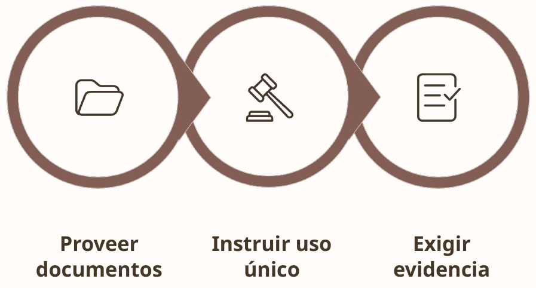
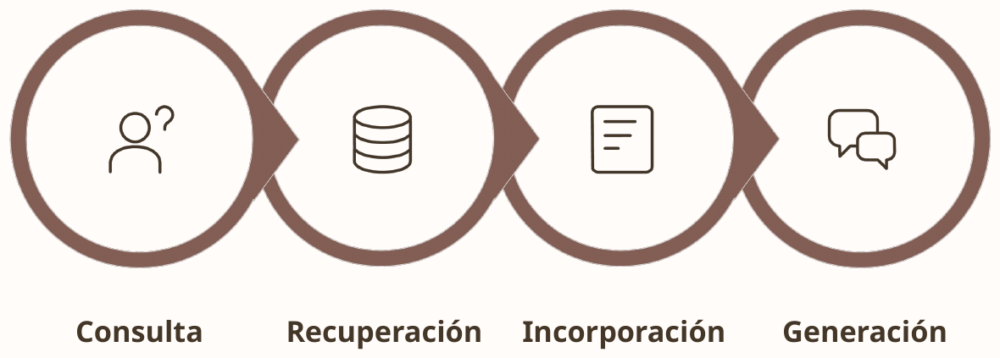

[← Anterior](01-alucinaciones-concepto-y-causas.md) · [Índice del módulo](README.md) · [Siguiente →](03-sesgos.md)

# 2 · Mitigación de alucinaciones

*Módulo 08: Fiabilidad, alucinaciones y sesgos*

## 2.1 Respuestas basadas en fuentes documentales

La técnica más directa para reducir alucinaciones es limitar el universo de información del que el modelo puede extraer. Si el modelo solo puede responder sobre lo que está en el documento aportado, el margen de invención se reduce sustancialmente.

Descripción del diagrama en texto

1. **Proveer documentos**
2. **Instruir uso único**
3. **Exigir evidencia**

**Instrucciones clave en el prompt**

- «*Responde únicamente con información de los documentos adjuntos.*»
- «*Si el dato no aparece en el documento, indícalo explícitamente.*»
- «*Cita el párrafo o sección que respalda cada afirmación.*»

**Errores frecuentes**

- Asumir que el modelo no añadirá datos externos sin instrucción explícita.
- No verificar que las citas correspondan al documento real.
- Aceptar respuestas cuando el documento no contiene el dato solicitado.

**Explicación**

La técnica más directa para reducir alucinaciones es limitar el universo de información del que el modelo puede extraer: se proporcionan documentos, se indica que se use solo esa información y se exige evidencia. Instrucciones clave son «responde únicamente con información de los documentos adjuntos», «si el dato no aparece, indícalo» y «cita el párrafo o sección que respalda cada afirmación».

Los errores frecuentes son asumir que el modelo no añadirá datos externos sin una instrucción expresa (por defecto completará con su conocimiento), no verificar que las citas correspondan al documento real y aceptar respuestas cuando el documento no contiene el dato. Si el documento no tiene la respuesta, lo correcto es decirlo: una respuesta detallada a algo que el documento no cubre debería activar la sospecha, no la satisfacción.

<!-- labs-seccion -->
> **Para practicar esta sección:** [Laboratorio 08B · Responder solo con fuentes, admitir lo que no consta y medir el sesgo](../../laboratorios/08B/README.md) · [Laboratorio 14 · Proyecto integrador: asistente de gestión de reclamaciones de Altanoria](../../laboratorios/14/README.md)
<!-- /labs-seccion -->

---

## 2.2 Diseño para la incertidumbre

Uno de los errores más comunes en el diseño de prompts es obligar al modelo a responder siempre. Si el sistema no tiene opción de declarar desconocimiento o pedir aclaraciones, generará respuestas aunque no tenga base suficiente.

- **Declarar desconocimiento**: Instrucción: «*Si no tienes información suficiente, indica explícitamente que no puedes responder con los datos disponibles.*»
- **Preguntar ante ambigüedad**: Instrucción: «*Si necesitas un dato esencial que no está en el prompt, pregunta antes de generar la respuesta.*»
- **Permitir respuesta parcial**: Instrucción: «*Puedes ofrecer una respuesta parcial e indicar qué parte no puedes confirmar.*»
- **Separar conclusión de observación**: Instrucción: «*Distingue entre lo que observas en los datos y la conclusión que extraes de ellos.*»

> Árbol de decisión: ¿Tengo información suficiente? → Responder. ¿Falta un dato esencial? → Preguntar. ¿No existe la información? → Declarar desconocimiento.

**Explicación**

Un error común es obligar al modelo a responder siempre. Si no tiene opción de declarar desconocimiento o pedir aclaraciones, generará respuestas sin base. Cuatro instrucciones le dan salida: declarar que no puede responder con los datos disponibles, preguntar antes de generar si falta un dato esencial, ofrecer una respuesta parcial indicando qué parte no puede confirmar y distinguir lo que observa en los datos de la conclusión que extrae.

El árbol de decisión es sencillo: si hay información suficiente, se responde; si falta un dato esencial, se pregunta; si la información no existe, se declara el desconocimiento. Un modelo ajustado para ser servicial interpreta una negativa como un fallo; dar permiso explícito para decir «no sé» cambia el equilibrio. La respuesta parcial es especialmente útil: ahorra trabajo y evita los vacíos rellenados con suposiciones.

Esta capacidad se llama abstención: el sistema se abstiene de responder cuando no hay base, y lo dice («no consta en los documentos») en lugar de rellenar el hueco. Medirla es tan importante como medir los aciertos, porque un sistema que contesta siempre nunca se abstiene cuando debe.

<!-- labs-seccion -->
> **Para practicar esta sección:** [Laboratorio 08B · Responder solo con fuentes, admitir lo que no consta y medir el sesgo](../../laboratorios/08B/README.md)
<!-- /labs-seccion -->

---

## 2.3 Preguntas aclaratorias para resolver ambigüedad

Cuando un prompt es ambiguo, el modelo asume valores implícitos que pueden no coincidir con la intención real del usuario. Diseñar el sistema para que pregunte (de forma acotada y justificada) es más seguro que permitir suposiciones silenciosas.

**Principios de las preguntas aclaratorias**

- Identificar exactamente qué dato ausente bloquea una respuesta precisa.
- Preguntar solo lo estrictamente necesario, no solicitar toda la información posible.
- Explicar al usuario por qué ese dato cambia la respuesta.
- No asumir valores ocultos ni completar con la opción más frecuente.
- Continuar cuando la información sea suficiente, aunque no sea perfecta.

**Diálogo ilustrativo**

*Usuario:* «Resume el contrato.»

*Modelo (sin aclaración):* Asume tipo, extensión y partes. Alta probabilidad de error.

*Modelo (con aclaración):* «¿Quieres un resumen ejecutivo de las cláusulas principales o un análisis detallado de obligaciones y penalizaciones? El enfoque cambia significativamente el resultado.»

Una sola pregunta bien formulada puede eliminar múltiples supuestos incorrectos.

**Explicación**

Cuando un prompt es ambiguo, el modelo asume valores implícitos que pueden no coincidir con la intención, y es más seguro que el sistema pregunte, de forma acotada y justificada, que permitir suposiciones silenciosas. Los principios son identificar el dato ausente que bloquea una respuesta precisa, preguntar solo lo estrictamente necesario, explicar por qué ese dato cambia la respuesta, no completar con la opción más frecuente y continuar cuando la información sea suficiente aunque no sea perfecta.

En el diálogo de ejemplo, ante «Resume el contrato», el modelo sin aclaración asume tipo, extensión y partes; el que aclara pregunta si se desea un resumen ejecutivo de las cláusulas principales o un análisis de obligaciones y penalizaciones. Una sola pregunta bien formulada elimina varios supuestos erróneos. Para dudas menores es preferible declarar el supuesto adoptado y continuar, para que el usuario pueda corregirlo.

---

## 2.4 Citas y trazabilidad: vincular afirmación con evidencia

Solicitar citas no es suficiente por sí solo: el modelo puede generar referencias con aspecto legítimo que no existen o citar un documento real de forma incorrecta. La trazabilidad real requiere un proceso de verificación activo.

| Afirmación del modelo | Evidencia solicitada | Verificación necesaria |
|---|---|---|
| «Según el informe X, el 40 % de...» | Fragmento textual del documento. | Comprobar que el informe X existe y contiene ese dato. |
| «El artículo 12 establece que...» | Cita textual del artículo 12. | Localizar el artículo en el documento original y comparar. |
| «Estudios recientes muestran...» | Nombre, año y DOI del estudio. | Verificar que el estudio existe y que concluye lo afirmado. |

- **Cita textual vs. paráfrasis**: Pedir cita textual reduce la posibilidad de interpretación libre, pero no elimina el riesgo de fabricación. Verificar siempre en la fuente original.
- **Referencias inventadas**: No aceptar ninguna referencia sin verificar su existencia. Buscar el título exacto en bases de datos especializadas antes de usar la cita.

**Explicación**

Pedir citas no basta: el modelo puede generar referencias con aspecto legítimo que no existen o citar un documento real de forma incorrecta. La **trazabilidad** real exige verificación activa. Para «según el informe X, el 40 %…» hay que pedir el fragmento textual y comprobar que existe y contiene el dato; para «el artículo 12 establece…», la cita literal y su localización en el original; y para «estudios recientes muestran…», nombre, año e identificador y comprobar que el estudio existe y concluye lo afirmado.

La cita textual reduce la interpretación libre pero no elimina la fabricación; no debe aceptarse ninguna referencia sin verificar su existencia buscando el título exacto en bases especializadas. «Estudios recientes muestran…» es una vaguedad que debe generar desconfianza: exigir datos concretos convierte una vaguedad en algo comprobable. Parte de la verificación puede automatizarse, aunque la lectura en contexto requiere juicio humano.

---

## 2.5 Contraste de fuentes: corroborar información

La triangulación es una práctica establecida en investigación y periodismo que se aplica igualmente a las salidas de LLMs. Una única fuente —aunque parezca autorizada— no es suficiente para afianzar afirmaciones de alto impacto.

- **Priorizar fuentes primarias**: Ir al documento original: norma, estudio, contrato o declaración. Evitar cadenas de citas de segunda o tercera mano.
- **Comprobar fecha y vigencia**: Verificar que la información sigue siendo válida. Regulaciones, estadísticas y guías técnicas se actualizan con frecuencia.
- **Buscar confirmación independiente**: Al menos dos fuentes que no deriven la una de la otra. Las copias de un mismo artículo no constituyen fuentes independientes.
- **Identificar discrepancias**: Cuando las fuentes difieren, registrar la discrepancia y no resolver artificialmente la contradicción en la salida generada.

**Explicación**

La triangulación, práctica propia de la investigación y el periodismo, se aplica igualmente a las salidas de un LLM: una sola fuente, por autorizada que parezca, no basta para afirmaciones de alto impacto. Las cuatro prácticas son priorizar las fuentes primarias, comprobar la fecha y la vigencia, buscar confirmación independiente (al menos dos fuentes que no deriven una de otra; las copias de un mismo artículo no cuentan) e identificar y registrar las discrepancias sin resolverlas artificialmente.

Cada práctica ataca un riesgo: las fuentes primarias evitan errores acumulados por transmisión, la vigencia evita usar normas u cifras obsoletas, la independencia evita la falsa corroboración y el registro de discrepancias impide que el modelo, que tiende a armonizar, oculte un desacuerdo real. Un informe que diga «las fuentes A y B discrepan en este punto» es más útil y honesto que uno que presente una cifra intermedia sin explicar de dónde sale.

<!-- labs-seccion -->
> **Para practicar esta sección:** [Laboratorio 08A · Cazar alucinaciones](../../laboratorios/08A/README.md)
<!-- /labs-seccion -->

---

## 2.6 Recuperación documental (RAG): apoyo de fuentes externas

Los sistemas de Retrieval-Augmented Generation (RAG) recuperan fragmentos relevantes de una base de conocimiento y los incorporan al contexto del modelo antes de generar la respuesta. Esto reduce —pero no elimina— el riesgo de alucinación.

Descripción del diagrama en texto

1. **Consulta**
2. **Recuperación**
3. **Incorporación**
4. **Generación**

**Ventajas**

- Ancla la respuesta en documentos reales y actualizables.
- Permite trazabilidad a fragmentos específicos.
- Funciona con conocimiento posterior al entrenamiento.

**Limitaciones importantes**

- La calidad depende de la búsqueda y la indexación.
- Fragmentos recuperados pueden estar incompletos o fuera de contexto.
- No garantiza una respuesta correcta: el modelo puede seguir malinterpretando el fragmento.

**Explicación**

Los sistemas de generación aumentada por recuperación (**RAG**) recuperan fragmentos de una base de conocimiento y los incorporan al contexto antes de generar la respuesta. El flujo es consulta, recuperación, incorporación y generación. Ventajas: ancla la respuesta en documentos reales y actualizables, permite trazabilidad a fragmentos y funciona con conocimiento posterior al entrenamiento. Limitaciones: la calidad depende de la búsqueda y la indexación, los fragmentos pueden estar incompletos o fuera de contexto y el modelo puede interpretarlos mal.

Reduce, pero no elimina, el riesgo de alucinación: lo desplaza. Antes el riesgo era que el modelo inventara; ahora es que recupere o interprete mal. Por eso la evaluación debe medir por separado la recuperación (si se encuentran los fragmentos correctos) y la generación (si la respuesta es fiel a ellos). El módulo [13](../13-diseno-de-sistemas-de-prompts/README.md) lo estudia dentro de los sistemas de prompts.

---

## 2.7 Límites de las instrucciones anti-alucinación

**«*No inventes*» no es una solución completa.**

Incluir instrucciones como «*no inventes*», «*solo usa hechos verificados*» o «*cita siempre las fuentes*» reduce el problema pero no lo elimina. El modelo puede no reconocer que está inventando porque no tiene acceso a su propio nivel de incertidumbre de forma fiable.

- **El modelo puede no reconocer su desconocimiento**: No tiene un mecanismo interno garantizado para distinguir entre «*sé esto*» y «*estoy generando algo plausible*».
- **Las citas pueden ser erróneas aunque parezcan reales**: Una instrucción de citar no impide que la referencia sea fabricada con aspecto legítimo.
- **Se necesitan controles externos**: Verificación humana, búsqueda en fuentes primarias y sistemas de validación automática complementan —no sustituyen— las instrucciones de prompt.
- **Diseñar según el impacto**: Cuanto mayor sea el impacto de un error, más capas de control son necesarias. Las instrucciones son la primera capa, no la única.

**Explicación**

Instrucciones como «no inventes», «usa solo hechos verificados» o «cita siempre las fuentes» reducen el problema pero no lo eliminan, porque el modelo puede no reconocer que está inventando: no tiene un mecanismo fiable para distinguir «sé esto» de «estoy generando algo plausible». Las citas pueden ser erróneas aunque parezcan reales, y hacen falta controles externos (verificación humana, búsqueda en fuentes primarias y validación automática) que complementan, sin sustituir, las instrucciones.

Es como pedir a alguien que «no se equivoque»: la intención ayuda, pero el error ocurre cuando no se percibe. Conviene pensar en capas de control: diseño del prompt, datos aportados, validación automática, revisión humana y gobernanza. A mayor impacto del error, más capas son necesarias; las instrucciones son la primera, no la única.

<!-- labs-seccion -->
> **Para practicar esta sección:** [Laboratorio 08B · Responder solo con fuentes, admitir lo que no consta y medir el sesgo](../../laboratorios/08B/README.md)
<!-- /labs-seccion -->

---

[← Anterior](01-alucinaciones-concepto-y-causas.md) · [Índice del módulo](README.md) · [Siguiente →](03-sesgos.md)
