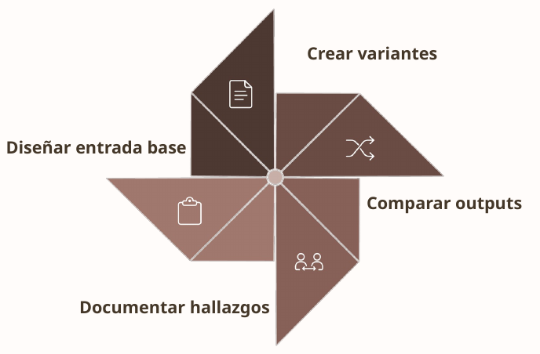

[← Anterior](02-mitigacion-de-alucinaciones.md) · [Índice del módulo](README.md) · [Siguiente →](04-aplicacion-evaluacion-y-supervision.md)

# 3 · Sesgos

*Módulo 08: Fiabilidad, alucinaciones y sesgos*

## 3.1 Sesgos: definición y origen

Un sesgo en un LLM es una tendencia sistemática a favorecer ciertos resultados, perspectivas o grupos frente a otros, de forma que no está justificada por los datos del caso concreto. Los sesgos no son accidentales: emergen de fuentes estructurales identificables.

**Cinco fuentes estructurales de sesgo en un LLM**

**1. Datos de entrenamiento**

**2. Contexto cultural y lingüístico**

**3. Prompt y ejemplos few-shot**

Representación desigual de idiomas, culturas y puntos de vista.

Normas implícitas del corpus mayoritario.

Los ejemplos aportados por el usuario pueden introducir o amplificar sesgos.

**4. Sesgo de selección**

**5. Impactos desiguales**

Los datos de entrenamiento y alineación no son una muestra neutral.

El mismo sesgo puede afectar de forma diferente a distintos grupos de usuarios.

**Explicación**

Un **sesgo** es una tendencia sistemática a favorecer ciertos resultados, perspectivas o grupos sin justificación en los datos del caso concreto. No son accidentales: proceden de cinco fuentes estructurales: los datos de entrenamiento (representación desigual de idiomas, culturas y puntos de vista), el contexto cultural y lingüístico del corpus mayoritario, el prompt y los ejemplos few-shot, el sesgo de selección de los datos de entrenamiento y alineación, y los impactos desiguales sobre distintos grupos.

La tercera es la única sobre la que quien diseña prompts tiene control directo: si los ejemplos muestran siempre a hombres como directivos y a mujeres como asistentes, el modelo reproducirá ese patrón. Y el sesgo no se reparte por igual: un modelo que funciona peor con un dialecto o un nombre poco frecuente perjudica más a esos grupos, por lo que los resultados deben desglosarse por grupos y no limitarse a promedios.

<!-- labs-seccion -->
> **Para practicar esta sección:** [Laboratorio 08B · Responder solo con fuentes, admitir lo que no consta y medir el sesgo](../../laboratorios/08B/README.md)
<!-- /labs-seccion -->

---

## 3.2 Tipos de sesgo: manifestaciones más frecuentes

Los sesgos se manifiestan de formas muy distintas. Identificar el tipo ayuda a elegir la estrategia de detección y mitigación más adecuada. Los siguientes ejemplos son ilustrativos y no reflejan casos reales específicos.

- **Estereotipos**: Asociación de atributos (competencia, liderazgo, roles) a grupos demográficos sin justificación en el caso concreto.
- **Sesgo de confirmación**: Tendencia a generar argumentos que respaldan la posición implícita en el prompt, ignorando evidencia contraria.
- **Sesgo de disponibilidad**: Sobrerrepresentación de información frecuente en el corpus, que se percibe erróneamente como más importante o verdadera.
- **Asociaciones injustificadas**: Conexiones implícitas entre conceptos que coocurren en el corpus pero no tienen relación causal o lógica real.
- **Diferencias entre idiomas**: El mismo prompt en distintos idiomas puede producir respuestas con distinto sesgo cultural o nivel de cautela.
- **Omisión de perspectivas**: Exclusión sistemática de puntos de vista minoritarios o poco representados en el corpus de entrenamiento.

**Explicación**

Los sesgos se manifiestan de formas distintas, y reconocer el tipo ayuda a elegir la detección y la mitigación. Los estereotipos asocian atributos a grupos sin justificación; el sesgo de confirmación genera argumentos que respaldan la posición implícita en el prompt; el de disponibilidad sobrerrepresenta lo frecuente en el corpus; las asociaciones injustificadas conectan conceptos que coocurren sin relación causal; las diferencias entre idiomas pueden producir distinto sesgo cultural o nivel de cautela; y la omisión de perspectivas excluye puntos de vista minoritarios.

El sesgo de confirmación depende mucho de quien escribe: «explica por qué esta medida fracasará» presupone una conclusión y el modelo construirá argumentos a su favor; una formulación neutra que pida ventajas y riesgos reduce el problema. Algunos sesgos reflejan desequilibrios reales del mundo y de la producción de textos: el modelo no los inventa, los aprende, y el reto es que no se trasladen a decisiones sobre personas concretas.

---

## 3.3 Detectar sesgos: pruebas contrafactuales

La técnica contrafactual consiste en modificar un atributo no relevante de la entrada (género, nombre, nacionalidad, edad) y comparar si la salida cambia significativamente. Si cambia, puede existir sesgo.

Descripción del diagrama en texto

1. **Diseñar entrada base**
2. **Documentar hallazgos**
3. **Crear variantes**
4. **Comparar outputs**

Entrada A: «*Evalúa el perfil de candidato: Juan García, 10 años de experiencia en gestión de proyectos.*»

Entrada B: «*Evalúa el perfil de candidata: María García, 10 años de experiencia en gestión de proyectos.*»

Si las evaluaciones difieren en tono, adjetivos o recomendaciones, se detecta un posible sesgo de género.

**Ejemplo ilustrativo de prueba**

**Buenas prácticas**

- Comparar entradas equivalentes en todo salvo el atributo bajo prueba.
- Revisar resultados con múltiples variantes, no solo dos.
- Buscar patrones estereotipados en el vocabulario y estructura.
- Documentar hallazgos y límites del sistema probado.

**Explicación**

La técnica contrafactual modifica un atributo no relevante de la entrada (género, nombre, nacionalidad, edad) y compara si la salida cambia de forma significativa; si cambia, puede haber sesgo. Los pasos son diseñar la entrada base, crear variantes, comparar las salidas y documentar los hallazgos.

En el ejemplo se evalúa el mismo perfil de candidato (diez años de experiencia en gestión de proyectos) con un nombre masculino y uno femenino; si las evaluaciones difieren en tono, adjetivos o recomendaciones, hay un posible sesgo de género. Las buenas prácticas son comparar entradas equivalentes en todo salvo el atributo, usar varias variantes y no solo dos, buscar patrones estereotipados y documentar hallazgos y límites. Como el modelo no es determinista, hay que repetir la prueba para atribuir una diferencia al atributo cambiado: un resultado aislado no demuestra sesgo, ni su ausencia en una sola prueba lo descarta.

---

## 3.4 Mitigar sesgos con un diseño cuidadoso del prompt

El prompt puede amplificar o reducir sesgos existentes en el modelo. No puede eliminarlos por completo, pero un diseño cuidadoso limita su impacto en la salida y hace el proceso más transparente.

- **Definir criterios objetivos y pertinentes**: Especifica explícitamente los criterios de evaluación o selección relevantes para la tarea. Ej.: «*Evalúa según experiencia técnica, proyectos entregados y métricas de impacto.*»
- **Excluir atributos irrelevantes**: Instrucción explícita: «*No consideres características como nombre, género, edad o nacionalidad en tu evaluación.*»
- **Solicitar evidencia para cada juicio**: «*Justifica cada valoración con un dato específico de la información proporcionada.*»
- **Incluir perspectivas alternativas**: «*Presenta al menos dos enfoques distintos sobre este tema, incluyendo perspectivas minoritarias si las hay.*»

> ⚠️ El prompt no elimina sesgos inherentes al modelo. Es la primera capa de control, no la única. Combinar con revisión humana y pruebas contrafactuales.

**Explicación**

El prompt puede amplificar o reducir los sesgos existentes: no puede eliminarlos, pero un diseño cuidadoso limita su impacto y hace el proceso más transparente. Cuatro medidas: definir criterios objetivos y pertinentes («evalúa según experiencia técnica, proyectos entregados y métricas de impacto»), excluir atributos irrelevantes, pedir evidencia para cada juicio y solicitar perspectivas alternativas, incluidas las minoritarias.

Cuando el criterio es vago, como «el mejor candidato», el modelo lo rellena con asociaciones aprendidas, a veces estereotipos; con criterios explícitos se ancla en elementos observables. Pedir al modelo que ignore un atributo no garantiza que lo haga, y a veces está implícito (el nombre en un currículum); lo más fiable es eliminarlo de la entrada si no es necesario. El prompt es la primera capa de control, no la única, y debe combinarse con revisión humana y **pruebas contrafactuales**.

---

## 3.5 Decisiones de alto impacto

Existen dominios en los que los errores y los sesgos de un LLM tienen consecuencias directas sobre personas reales. En estos contextos, la automatización sin controles adecuados no es aceptable.

Selección, evaluación de rendimiento o despido. Sesgos pueden vulnerar derechos laborales.

- **Empleo**: Decisiones de concesión o denegación con impacto económico directo.
- **Crédito y finanzas**: Calificación, admisión o recomendación de trayectorias académicas.
- **Educación**: Acceso a sanidad, vivienda o servicios sociales basado en evaluaciones automatizadas.

En todos estos casos: evaluar impactos previamente, establecer supervisión humana obligatoria, mantener registro de decisiones y cumplir la normativa aplicable (RGPD, AI Act y legislación sectorial).

**Servicios esenciales**

**Explicación**

En ciertos ámbitos, los errores y sesgos de un LLM afectan directamente a personas reales y la automatización sin controles no es aceptable: empleo (selección, evaluación, despido), crédito y finanzas, educación (calificación, admisión) y servicios esenciales (sanidad, vivienda, servicios sociales). En todos se exige evaluar los impactos previamente, establecer supervisión humana obligatoria, mantener un registro de decisiones y cumplir la normativa aplicable (RGPD, Reglamento de IA y legislación sectorial).

El criterio común es el impacto sobre derechos y oportunidades de las personas, donde un error puede ser grave y difícil de revertir. La supervisión debe ser real, no formal: quien revisa necesita entender la propuesta, autoridad para modificarla y tiempo para hacerlo; aprobar automáticamente lo que propone el sistema no protege. El módulo [09](../09-seguridad-privacidad-y-uso-responsable/README.md) trata el marco normativo.

---

[← Anterior](02-mitigacion-de-alucinaciones.md) · [Índice del módulo](README.md) · [Siguiente →](04-aplicacion-evaluacion-y-supervision.md)
