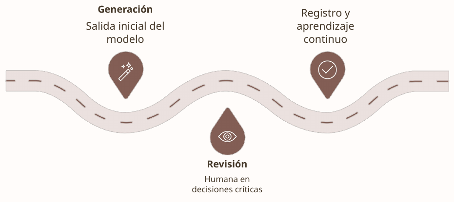

[← Anterior](03-sesgos.md) · [Índice del módulo](README.md) · [Siguiente módulo →](../09-seguridad-privacidad-y-uso-responsable/README.md)

# 4 · Aplicación, evaluación y supervisión

*Módulo 08: Fiabilidad, alucinaciones y sesgos*

## 4.1 Calibración de confianza: interpretar expresiones de certeza

Cuando un LLM afirma «*estoy seguro*», «*con alta probabilidad*» o «*es muy probable que*», estas expresiones no corresponden a probabilidades estadísticas calibradas. Son patrones lingüísticos aprendidos del corpus, no métricas internas verificadas.

**Qué significa la calibración**

Un modelo bien calibrado debería acertar aproximadamente el 70 % de las veces cuando dice «*tengo un 70 % de confianza*». Los LLMs generativos no garantizan esta relación.

- Solicitar evidencia y supuestos explícitos junto con la respuesta.
- Cuando exista referencia, comparar confianza declarada con acierto real.
- No solicitar porcentajes de confianza arbitrarios sin referencia externa.

**Ejemplo ilustrativo**

Pregunta: «*¿Cuántos usuarios activos tiene la plataforma X?*»

Respuesta del modelo: «*Con alta seguridad, aproximadamente 50 millones de usuarios activos mensuales.*»

Realidad: El modelo no tiene acceso a datos actualizados. La expresión de confianza es estilística, no estadística. Verificar en la fuente oficial.

**Explicación**

Cuando un modelo dice «estoy seguro» o «es muy probable», esas expresiones no son probabilidades estadísticas calibradas, sino patrones lingüísticos aprendidos. Un modelo bien calibrado acertaría aproximadamente el 70 % de las veces cuando dice «tengo un 70 % de confianza», y los LLM generativos no garantizan esa relación. Conviene pedir evidencia y supuestos junto con la respuesta, comparar la confianza declarada con el acierto real cuando exista referencia y no solicitar porcentajes de confianza sin referencia externa.

En el ejemplo, ante «¿cuántos usuarios activos tiene la plataforma X?», el modelo responde «con alta seguridad, unos 50 millones», pero no tiene acceso a datos actualizados: la seguridad es estilística. Un sistema que muestre al usuario estas expresiones como medida de fiabilidad induce a error; es preferible estimar la fiabilidad con métodos externos (referencia, número de fuentes, acuerdo entre ejecuciones).

<!-- labs-seccion -->
> **Para practicar esta sección:** [Laboratorio 08A · Cazar alucinaciones](../../laboratorios/08A/README.md)
<!-- /labs-seccion -->

---

## 4.2 Alucinaciones en tareas de extracción

Las tareas de extracción de datos de documentos son especialmente vulnerables: el modelo puede completar campos con datos plausibles pero no presentes en el documento original. Cada campo extraído debe poder localizarse en la fuente.

| Campo extraído | ¿Aparece en el documento? | Acción recomendada |
|---|---|---|
| Fecha de firma del contrato | ✅ Sí, página 1, párrafo 2 | Verificar que la fecha coincide textualmente. |
| Importe de penalización | ❌ No aparece en el documento | El campo debe quedar vacío o marcado como «no consta». |
| Nombre del responsable | ⚠️ Aparece un nombre similar pero diferente | Registrar discrepancia; no normalizar sin confirmación. |

- **Instrucción clave**: «*Para cada campo, indica la ubicación exacta (página y párrafo) donde encontraste el dato. Si no aparece, deja el campo vacío y no completes con estimaciones.*»
- **Validación posterior**: Verificar tipos de dato (formatos de fecha, rangos numéricos) y realizar muestreo aleatorio sobre las extracciones para detectar patrones de error.

**Explicación**

La extracción de datos es especialmente vulnerable: el modelo puede completar campos con datos plausibles que no están en el documento. Cada campo extraído debe poder localizarse en la fuente. En la tabla de ejemplo, la fecha de firma aparece (página 1, párrafo 2) y se verifica que coincide literalmente; el importe de penalización no aparece y el campo debe quedar vacío o marcado «no consta»; y el nombre del responsable aparece en forma parecida pero distinta, por lo que se registra la discrepancia sin normalizar sin confirmación.

La instrucción clave es indicar para cada campo la ubicación exacta (página y párrafo) y dejarlo vacío si no aparece, sin estimaciones. Posteriormente se verifican tipos de dato (formatos de fecha, rangos) y se hace un muestreo aleatorio de las extracciones. Un nombre ligeramente distinto no debe «corregirse» por iniciativa del modelo: puede ser otra persona, una errata o una variante legítima.

---

## 4.3 Alucinaciones en tareas de análisis

El análisis es el contexto donde las alucinaciones son más difíciles de detectar: el modelo puede presentar conclusiones no soportadas con una lógica aparentemente coherente. La distinción entre observación y conclusión debe ser explícita.

- **Correlación ≠ causalidad**: El modelo puede describir una correlación en los datos y afirmar implícitamente que existe una relación causal. Instruir para distinguir explícitamente.
- **No extrapolar fuera de muestra**: Los patrones observados en un conjunto de datos no se trasladan automáticamente a otros contextos o poblaciones diferentes.
- **Señalar limitaciones**: «*Indica las limitaciones de este análisis: qué datos faltan, qué supuestos se asumen y qué conclusiones no están respaldadas.*»
- **Dato observado (aceptable)**: «*En el periodo analizado, las ventas aumentaron un 12 % en los meses en que se ejecutaron campañas de email marketing.*»
- **Inferencia no soportada (problemática)**: «*Las campañas de email marketing causaron el aumento del 12 % en ventas.*» — Sin análisis causal riguroso, esta conclusión es una alucinación analítica.

**Explicación**

En el análisis, las alucinaciones son más difíciles de detectar, porque el modelo puede presentar conclusiones no soportadas con una lógica aparentemente coherente. Hay que distinguir explícitamente observación y conclusión, tener presente que correlación no es causalidad, no extrapolar fuera de la muestra y pedir que señale las limitaciones (qué datos faltan, qué supuestos se asumen y qué conclusiones no están respaldadas).

Un dato observado aceptable es «en el periodo, las ventas aumentaron un 12 % en los meses en que hubo campañas de email»; la inferencia no soportada es «las campañas causaron el aumento del 12 %». La diferencia es una palabra: la primera describe una coincidencia y la segunda afirma un mecanismo, y puede haber factores comunes, como una temporada de mayor demanda. Conviene pedir una salida en dos secciones, lo observado y las posibles interpretaciones con sus condiciones.

---

## 4.4 Evaluación de respuestas fundamentadas: rúbrica de criterios

Aplicar criterios explícitos de evaluación permite comparar respuestas de forma sistemática y detectar debilidades concretas, ya sea en entornos de desarrollo o en revisión de outputs en producción.

| Criterio | Pregunta de evaluación | Escala sugerida |
|---|---|---|
| Fidelidad a fuente | ¿Cada afirmación está respaldada por el documento aportado? | 0–2 (ninguna / parcial / completa) |
| Cobertura | ¿Se han abordado todos los aspectos relevantes de la consulta? | 0–2 (mínima / adecuada / completa) |
| Ausencia de afirmaciones sin soporte | ¿Hay datos en la respuesta que no aparecen en las fuentes? | 0–2 (varias / alguna / ninguna) |
| Precisión de citas | ¿Las referencias son exactas y verificables? | 0–2 (incorrectas / aproximadas / exactas) |
| Incertidumbre adecuada | ¿El modelo reconoce los límites de su información? | 0–2 (oculta / parcial / explícita) |
| Consistencia | ¿La respuesta es coherente internamente y con respuestas anteriores? | 0–2 (contradictoria / mayormente / consistente) |

**Explicación**

Aplicar criterios explícitos permite comparar respuestas de forma sistemática y detectar debilidades. La rúbrica propone seis criterios con escala de 0 a 2: fidelidad a la fuente, cobertura, ausencia de afirmaciones sin soporte, precisión de las citas, incertidumbre adecuada y consistencia. La escala de tres niveles es simple para que los evaluadores coincidan con facilidad, y puede ampliarse con descriptores si se necesita más precisión (módulo [07](../07-ciclo-de-vida-y-evaluacion/README.md)).

Sirve en desarrollo, para comparar versiones de un prompt, y en producción, para revisar una muestra y detectar degradaciones. Los criterios de fidelidad y de ausencia de afirmaciones sin soporte parecen cercanos pero miden cosas distintas: el primero valora si lo afirmado está respaldado y el segundo si hay algo afirmado que no figura en las fuentes.

<!-- labs-seccion -->
> **Para practicar esta sección:** [Laboratorio 08A · Cazar alucinaciones](../../laboratorios/08A/README.md) · [Laboratorio 08B · Responder solo con fuentes, admitir lo que no consta y medir el sesgo](../../laboratorios/08B/README.md)
<!-- /labs-seccion -->

---

## 4.5 Human-in-the-loop: supervisión humana estructurada

El modelo *human-in-the-loop* (HITL) incorpora revisión humana en puntos críticos del proceso automatizado. No implica revisar todo manualmente, sino identificar dónde la intervención humana añade el mayor valor de control.

Establecer qué tipos de output requieren revisión humana obligatoria antes de actuar sobre ellos.

**Revisar decisiones de impacto**

Descripción del diagrama en texto

1. Generación — Salida inicial del modelo
2. Revisión — Humana en decisiones críticas
3. Registro y aprendizaje continuo

**Decisión**

**Escalar casos ambiguos**

Definir criterios claros para identificar cuándo un output es demasiado incierto para usarse sin revisión.

El sistema debe permitir que el revisor corrija, complete o rechace la salida del modelo.

**Permitir corrección y anulación**

**Registrar y aprender**

Documentar las correcciones realizadas para identificar patrones de error y mejorar prompts y procesos.

**Explicación**

El modelo **human-in-the-loop** (HITL) incorpora revisión humana en puntos críticos del proceso automatizado. No implica revisar todo, sino identificar dónde la intervención humana añade más valor de control. El flujo es generación, revisión humana en decisiones críticas y decisión con registro y aprendizaje continuo.

Cuatro prácticas: revisar las decisiones de impacto (definir qué salidas requieren revisión obligatoria), escalar los casos ambiguos con criterios claros, permitir corregir y anular la salida y registrar las correcciones para detectar patrones y mejorar prompts y procesos. El equilibrio se logra con criterios: revisión obligatoria en alto impacto, por muestreo en impacto medio y seguimiento estadístico en bajo impacto. El registro de correcciones cierra el círculo del módulo [07](../07-ciclo-de-vida-y-evaluacion/README.md): sin él, la supervisión corrige errores pero no mejora el sistema.

<!-- labs-seccion -->
> **Para practicar esta sección:** [Laboratorio 08B · Responder solo con fuentes, admitir lo que no consta y medir el sesgo](../../laboratorios/08B/README.md)
<!-- /labs-seccion -->

---

## 4.6 Políticas y gobernanza: integrar fiabilidad en la organización

La fiabilidad no depende únicamente de los prompts: requiere un marco organizativo que defina responsabilidades, límites de uso, fuentes autorizadas y mecanismos de control. Sin este marco, las buenas prácticas individuales son insuficientes.

**1. Usos permitidos y prohibidos**

**2. Fuentes autorizadas**

**3. Responsables**

**4. Riesgos y controles**

**5. Revisión ante cambios**

Definir qué tareas pueden realizarse con LLM y cuáles no.

Documentos y bases de conocimiento que el sistema puede usar.

Quién valida, quién corrige y quién escala.

Mapa de riesgos con medidas de mitigación por nivel de impacto.

Proceso para actualizar las políticas cuando cambian el modelo, el uso o la normativa.

**Explicación**

La fiabilidad no depende solo de los prompts: requiere un marco organizativo con responsabilidades, límites de uso, fuentes autorizadas y mecanismos de control. Se componen cinco elementos: usos permitidos y prohibidos, fuentes autorizadas, responsables (quién valida, corrige y escala), mapa de riesgos con controles por nivel de impacto y un proceso de revisión ante cambios de modelo, de uso o de normativa.

Sin marco, cada persona decide qué tareas encomienda al modelo, qué datos le entrega y cuánto verifica, y la organización no conoce los riesgos que asume. Declarar prohibidos ciertos usos (por ejemplo decidir despidos o conceder créditos sin revisión) protege a las personas y a la organización, y declarar otros permitidos con condiciones da claridad. Y el marco no es estático: se revisa periódicamente.

---

## 4.7 Caso: construcción de una respuesta fundamentada

*Este es un caso documental ficticio con fines ilustrativos.* Se muestra el proceso completo de mitigación, desde el aporte del documento hasta la corrección final de la respuesta.

1. **1. Aportar documento**: Se sube el informe interno ficticio «*Análisis de satisfacción Q3-2024*» como contexto exclusivo.
2. **2. Formular pregunta acotada**: «*Basándote solo en el documento adjunto, ¿cuál es el NPS reportado y en qué sección aparece?*»
3. **3. Solicitar evidencia y ausencias**: «*Cita el párrafo exacto. Si el NPS no aparece en el documento, indícalo.*»
4. **4. Separar inferencias**: «*Distingue entre lo que dice el documento y cualquier conclusión que añadas.*»
5. **5. Contrastar y corregir**: El revisor localiza el párrafo en el documento original. Si hay discrepancia, corrige antes de usar la información.

> Este proceso convierte una consulta abierta en un flujo trazable y verificable, reduciendo significativamente el riesgo de alucinación en contextos de uso real.

**Explicación**

El caso documental ficticio muestra el proceso completo de mitigación. Se aporta el informe «Análisis de satisfacción Q3-2024» como contexto exclusivo; se formula una pregunta acotada («basándote solo en el documento, ¿cuál es el NPS reportado y en qué sección aparece?»); se solicita evidencia y ausencias («cita el párrafo exacto; si el NPS no aparece, indícalo»); se separan inferencias de lo que dice el documento; y un revisor localiza el párrafo en el original y corrige si hay discrepancia.

El documento limita el universo, la pregunta es acotada, la evidencia permite comprobar, la ausencia tiene salida, las inferencias se separan y la revisión humana cierra el círculo. Convierte una consulta abierta en un flujo trazable y verificable, reduciendo, aunque no eliminando, el riesgo de alucinación. Sin la comprobación contra el original, todo lo anterior descansaría en la confianza en que el modelo ha citado bien.

---

## 4.8 Resumen: la fiabilidad como proceso continuo

La fiabilidad no se logra con una única instrucción ni con una sola revisión. Es un proceso que combina diseño de prompts, herramientas técnicas, supervisión humana y gobernanza organizativa.

- **✅ Fuentes pertinentes**: Aportar documentos autorizados y limitar el universo de información disponible para el modelo.
- **✅ Hechos e inferencias separados**: Instruir al modelo para etiquetar cada afirmación con su categoría epistémica.
- **✅ Incertidumbre explícita**: Permitir y pedir que el modelo declare sus límites en lugar de obligarlo a responder siempre.
- **✅ Citas verificadas**: Comprobar toda referencia en la fuente original antes de usar la información.
- **✅ Pruebas de sesgo**: Aplicar pruebas contrafactuales y revisar outputs por grupos para detectar disparidades.
- **✅ Supervisión según riesgo**: Implementar revisión humana proporcional al impacto de cada uso y cumplir la normativa aplicable.

**Explicación**

La fiabilidad no se logra con una sola instrucción ni con una revisión: es un proceso que combina diseño de prompts, herramientas, supervisión humana y gobernanza. Seis prácticas lo resumen: fuentes pertinentes que limiten el universo de información, hechos e inferencias separados y etiquetados, incertidumbre explícita permitida y pedida, citas verificadas en la fuente original, pruebas de sesgo contrafactuales con revisión de salidas por grupos y supervisión proporcional al riesgo con cumplimiento normativo.

Cubren las capas de control del módulo: las tres primeras actúan sobre el prompt y los datos, la cuarta añade verificación externa, la quinta aborda los sesgos y la sexta incorpora supervisión y marco normativo. La fiabilidad se mantiene, no se alcanza de una vez: modelos, datos y usos cambian, y el ciclo del módulo [07](../07-ciclo-de-vida-y-evaluacion/README.md) debe repetirse. El módulo [09](../09-seguridad-privacidad-y-uso-responsable/README.md) complementa con privacidad y seguridad.

---

## 4.9 Comprobación de comprensión

Piensa cada respuesta, de forma oral o por escrito, antes de ver las respuestas orientativas, que aparecen a continuación.

**1. ¿Qué es una alucinación?**

**2. ¿Por qué la fluidez no demuestra exactitud?**

**3. ¿Cómo tratar las ausencias de información?**

**4. ¿Qué pruebas detectan sesgos?**

**5. ¿Qué límites tiene la instrucción «no inventes»?**

---

## 4.10 Comprobación de comprensión: respuestas

Contrasta tus respuestas con estas. Son orientativas: lo importante es que cubran las ideas clave del módulo.

1. **¿Qué es una alucinación?** Una afirmación falsa o no sustentada presentada con apariencia de plausibilidad. No es un error de sintaxis, sino de contenido factual.
2. **¿Por qué la fluidez no demuestra exactitud?** El modelo genera continuaciones estadísticamente plausibles, no verdades verificadas. Tono seguro y exactitud son métricas independientes.
3. **¿Cómo tratar las ausencias de información?** Instruir al modelo para declarar explícitamente qué información no está disponible, en lugar de completar con estimaciones.
4. **¿Qué pruebas detectan sesgos?** Las pruebas contrafactuales: modificar atributos no relevantes y comparar si la salida cambia de forma injustificada.

**5. ¿Qué límites tiene la instrucción «*no inventes*»?**

El modelo puede no reconocer que está inventando. Las instrucciones son la primera capa de control, no la única: se necesitan verificación externa y supervisión humana.

**Explicación**

La comprobación plantea cinco preguntas. Una alucinación es una afirmación falsa o no sustentada con apariencia de plausibilidad, un error de contenido y no de sintaxis. La **fluidez** no demuestra exactitud porque el modelo genera continuaciones estadísticamente plausibles y el tono seguro y la exactitud son independientes. Las ausencias se tratan instruyendo al modelo a declarar qué información no está disponible en lugar de estimarla. Los sesgos se detectan con pruebas contrafactuales: modificar atributos no relevantes y comparar la salida. Y «no inventes» tiene límites: el modelo puede no reconocer que inventa, por lo que las instrucciones son la primera capa y se necesitan verificación externa y supervisión humana.

Los hábitos que resumen el módulo son fundamentar, separar tipos de afirmación, admitir la incertidumbre, verificar referencias, probar los sesgos y mantener una supervisión proporcional al impacto, con lo que el riesgo se reduce a un nivel gestionable.

---

[← Anterior](03-sesgos.md) · [Índice del módulo](README.md) · [Siguiente módulo →](../09-seguridad-privacidad-y-uso-responsable/README.md)
