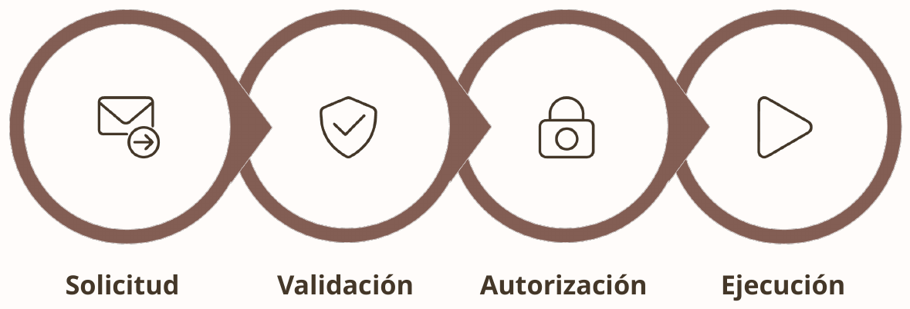
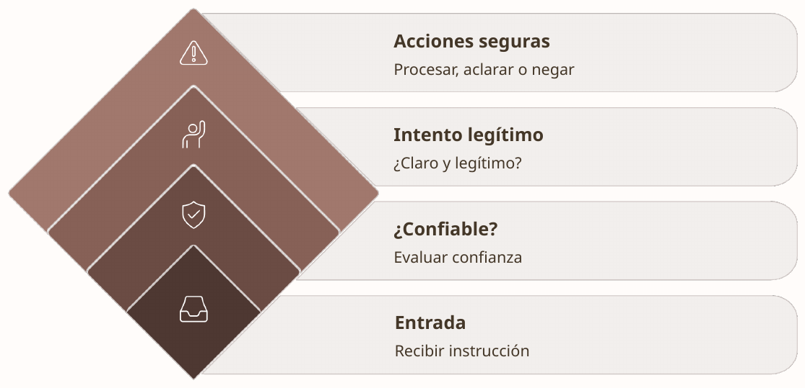

[← Anterior](02-inyeccion-de-prompts-y-jailbreaking.md) · [Índice del módulo](README.md) · [Siguiente →](04-responsabilidad-normativa-y-cierre.md)

# 3 · Fugas, permisos y pruebas de seguridad

*Módulo 09: Seguridad, privacidad y uso responsable*

## 3.1 Fugas de información

Las fugas ocurren cuando datos confidenciales presentes en el contexto del modelo llegan a usuarios no autorizados, ya sea a través de las respuestas generadas, los logs del sistema o las herramientas conectadas.

- **Datos en contexto**: Información confidencial incluida en el prompt de sistema o en documentos recuperados puede ser extraída mediante preguntas elaboradas.
- **Herramientas con permisos excesivos**: Una herramienta que puede leer cualquier archivo o base de datos puede devolver información a la que el usuario no debería tener acceso.
- **Historial y memoria**: La memoria compartida entre sesiones o usuarios puede filtrar información de conversaciones anteriores si no se gestiona correctamente.
- **Logs con secretos**: Los registros de llamadas a la API pueden contener prompts de sistema, tokens, claves o datos personales si no se redactan adecuadamente antes del almacenamiento.

**Explicación**

Las fugas ocurren cuando datos confidenciales presentes en el contexto del modelo llegan a usuarios no autorizados, por las respuestas, los registros o las herramientas conectadas. Cuatro vías: los datos en el contexto (información confidencial del prompt de sistema o de documentos recuperados puede extraerse con preguntas elaboradas), las herramientas con permisos excesivos (una que lee cualquier archivo puede devolver lo que el usuario no debería ver), el historial y la memoria compartida entre sesiones o usuarios, y los registros que contengan prompts de sistema, tokens, claves o datos personales.

El principio común es que todo lo que está en el contexto es potencialmente recuperable, por lo que el diseño seguro no incluye en él nada que el usuario no deba ver. Los registros son una vía menos evidente pero igual de importante: se consultan con otros permisos y se conservan durante años, y necesitan enmascaramiento y minimización de retención. La memoria entre sesiones requiere una separación estricta por usuario y organización.

<!-- labs-seccion -->
> **Para practicar esta sección:** [Laboratorio 09A · Minimizar y anonimizar antes de enviar datos a un modelo](../../laboratorios/09A/README.md)
<!-- /labs-seccion -->

---

## 3.2 Instrucciones internas y secretos

Un error de diseño frecuente es colocar secretos —claves de API, contraseñas, tokens— directamente en el prompt de sistema, asumiendo que la instrucción "no reveles esto" es suficiente protección. No lo es.

**❌ Patrón inseguro — Ilustrativo**

```text
SYSTEM: Tu clave de API es: sk-prod-abc123xyz789.
No compartas esta clave con ningún usuario bajo ninguna circunstancia.
```

La clave está accesible al modelo y puede extraerse con la técnica adecuada.

**✅ Arquitectura segura**

- Almacenar secretos en gestores de secretos (AWS Secrets Manager, HashiCorp Vault, etc.)
- El LLM nunca recibe el secreto directamente
- Las herramientas se autentican con el almacén en la capa de aplicación
- Controlar qué herramientas puede invocar el modelo
- Revisar periódicamente los logs y salidas en busca de filtraciones accidentales

**Explicación**

Un error frecuente es poner secretos (claves de API, contraseñas, tokens) en el prompt de sistema y creer que la instrucción «no lo reveles» basta. No es así: la clave está accesible al modelo y puede extraerse con la técnica adecuada.

La arquitectura segura almacena los secretos en gestores específicos, de modo que el LLM nunca los recibe; las herramientas se autentican contra el almacén en la capa de aplicación; se controla qué herramientas puede invocar el modelo; y se revisan periódicamente registros y salidas en busca de filtraciones. La lógica es separar quien decide de quien posee la credencial: el modelo puede decidir llamar a una herramienta, pero es la aplicación la que se autentica. Así, aunque el modelo sea manipulado, no tiene nada que revelar porque nunca vio la clave. La regla general es que lo que no deba llegar a un usuario no debe estar en el contexto.

<!-- labs-seccion -->
> **Para practicar esta sección:** [Laboratorio 09B · Red team de un asistente de buzón](../../laboratorios/09B/README.md)
<!-- /labs-seccion -->

---

## 3.3 Principio de mínimo privilegio

Aplicado a sistemas LLM, el principio de mínimo privilegio implica que el modelo y las herramientas que controla deben tener únicamente los permisos estrictamente necesarios para completar la tarea prevista (OWASP LLM lo trata como «*agencia excesiva*»).

| Herramienta / Acción | Permiso mínimo | Permiso excesivo | Control adicional |
|---|---|---|---|
| Consulta de base de datos | Solo lectura, tablas específicas | Lectura/escritura de toda la BD | Auditar consultas realizadas |
| Envío de correo | Solo destinatarios pre-aprobados | Cualquier destinatario | Confirmación humana antes de enviar |
| Acceso a archivos | Carpeta de proyecto actual | Sistema de archivos completo | Registro de archivos accedidos |
| Llamadas a API externas | Endpoints autorizados | Cualquier URL | Lista blanca y validación de argumentos |

Las acciones irreversibles —eliminar, publicar, transferir— siempre deben requerir confirmación explícita fuera del flujo del LLM.

**Explicación**

El **mínimo privilegio** implica que el modelo y las herramientas que controla tengan solo los permisos estrictamente necesarios; el estándar OWASP para aplicaciones LLM lo trata como «agencia excesiva». La tabla lo ilustra: en una consulta a base de datos, el mínimo es solo lectura de tablas concretas (y el exceso, lectura y escritura de toda la base), con auditoría de consultas; en el envío de correo, solo destinatarios preaprobados y confirmación humana antes de enviar; en el acceso a archivos, la carpeta del proyecto, no todo el sistema, con registro de accesos; y en las llamadas a APIs externas, endpoints autorizados con lista blanca y validación de argumentos.

El criterio es reducir el daño posible: si el modelo es engañado y solo tiene lectura sobre unas tablas, lo peor es una lectura indebida de ellas; si tiene escritura sobre toda la base, lo peor es destruir datos. Las acciones irreversibles (eliminar, publicar, transferir) deben requerir confirmación explícita fuera del flujo del LLM, mediante un canal que el modelo no controle.

<!-- labs-seccion -->
> **Para practicar esta sección:** [Laboratorio 09B · Red team de un asistente de buzón](../../laboratorios/09B/README.md) · [Laboratorio 14 · Proyecto integrador: asistente de gestión de reclamaciones de Altanoria](../../laboratorios/14/README.md)
<!-- /labs-seccion -->

---

## 3.4 Seguridad en asistentes con herramientas

Cuando un LLM puede invocar herramientas externas, la superficie de ataque se amplía significativamente. La autorización y validación no pueden delegarse al modelo: deben implementarse en la capa de aplicación de forma independiente.



<details>
<summary>Descripción del diagrama en texto</summary>

1. **Solicitud**
2. **Validación**
3. **Autorización**
4. **Ejecución**

</details>

- **Autorizar en capa de app**: La autorización no puede basarse en el texto generado por el modelo.
- **Registrar resultados**: Toda invocación de herramienta debe quedar auditada con entrada y salida.

**Explicación**

Cuando un LLM puede invocar herramientas, la superficie de ataque crece y la autorización y validación no pueden delegarse en el modelo: deben implementarse en la capa de aplicación. El flujo es solicitud, validación, autorización y ejecución: el modelo propone y la aplicación valida los argumentos (tipos, rangos y formatos), comprueba la autorización y solo entonces ejecuta, con confirmación humana para las operaciones críticas y registro de entrada y salida de cada invocación.

La autorización no puede basarse en el texto generado por el modelo: si dependiera de que el modelo afirme que el usuario es administrador, bastaría manipularlo para obtener permisos. Debe basarse en la identidad real del usuario, comprobada por la aplicación con sus propios mecanismos. La validación frena valores peligrosos o absurdos (un importe desproporcionado, un destinatario inesperado, una ruta fuera del directorio) y el registro permite reconstruir qué ocurrió.

<!-- labs-seccion -->
> **Para practicar esta sección:** [Laboratorio 09B · Red team de un asistente de buzón](../../laboratorios/09B/README.md)
<!-- /labs-seccion -->

---

## 3.5 Seguridad en recuperación documental

Los sistemas RAG (Retrieval-Augmented Generation) incorporan documentos externos al contexto del modelo. Cada documento recuperado es una fuente no confiable que puede contener instrucciones inyectadas o datos de otros usuarios.

**Aplicar permisos en recuperación**

**Evitar acceso cruzado**

**Controlar fragmentos y metadatos**

El sistema de recuperación debe filtrar documentos según el nivel de acceso del usuario actual. Un usuario no debe poder recuperar documentos de otra organización o proyecto.

La recuperación vectorial no debe cruzar barreras entre usuarios o tenants. Implementar segmentación por namespace o metadatos de acceso en el índice vectorial.

Los fragmentos recuperados no deben incluir metadatos sensibles (autores, fechas, rutas de sistema). Verificar que las salidas no filtren información de los documentos más allá de lo necesario.

> Tratar todos los documentos recuperados como datos no confiables: nunca como instrucciones del sistema.

**Explicación**

Los sistemas de recuperación documental incorporan documentos externos al contexto, y cada uno es una fuente no confiable que puede contener instrucciones inyectadas o datos de otros usuarios. Tres medidas: aplicar permisos en la recuperación, filtrando los documentos según el acceso del usuario; evitar el acceso cruzado entre usuarios o inquilinos, segmentando el índice por espacio de nombres o metadatos de acceso; y controlar fragmentos y metadatos (autores, fechas, rutas) para que las salidas no filtren más de lo necesario.

El filtrado debe hacerse en la recuperación y no en la respuesta: si el sistema recupera un documento al que el usuario no tiene acceso y se lo entrega al modelo, ya ha ocurrido el fallo, porque el contenido está en el contexto y puede filtrarse. En una plataforma con varios clientes, un índice compartido sin control permitiría que uno accediera, con una pregunta bien formulada, a documentos de otro. Y todos los documentos recuperados son datos no confiables, nunca instrucciones.

---

## 3.6 Pruebas de seguridad

Un sistema LLM seguro se prueba activamente antes de producción y de forma continua. Las pruebas adversariales no son opcionales: son parte del proceso de desarrollo responsable. Referencia útil: OWASP Top 10 para aplicaciones LLM.

| Tipo de prueba | Qué se verifica | Resultado esperado |
|---|---|---|
| Inyección directa | Intentos de anular el prompt de sistema desde la entrada de usuario | El modelo rechaza o ignora la instrucción maliciosa |
| Inyección indirecta | Documentos con instrucciones embebidas | El modelo trata el contenido como dato, no como orden |
| Extracción de datos | Solicitudes de datos del prompt de sistema o de otros usuarios | El modelo no revela información protegida |
| Pruebas de permisos | Intentos de invocar herramientas o acciones no autorizadas | La capa de aplicación bloquea la acción |
| Entradas fuera de alcance | Solicitudes de temas o tareas fuera del diseño previsto | El modelo declina o redirige adecuadamente |

Registrar todos los resultados, incluyendo los negativos. Los fallos deben documentarse como incidencias y resolverse antes del despliegue.

**Explicación**

Un sistema LLM seguro se prueba activamente antes de producción y de forma continua; las pruebas adversariales forman parte del desarrollo responsable, con el Top 10 de OWASP para aplicaciones LLM como referencia. La tabla propone cinco tipos: inyección directa (el modelo rechaza o ignora la instrucción maliciosa), inyección indirecta (trata el contenido como dato), extracción de datos (no revela información protegida), permisos (la capa de aplicación bloquea la acción no autorizada) y entradas fuera de alcance (declina o redirige adecuadamente).

En las pruebas de permisos, el resultado esperado no es que el modelo rechace, sino que la aplicación bloquee la acción, incluso si el modelo hubiera sido engañado. Hay que registrar todos los resultados, también los negativos, y documentar los fallos como incidencias que deben resolverse antes del despliegue; un fallo conocido que no se resuelve es un riesgo aceptado, y debe serlo de forma consciente. Estas pruebas se integran en la suite de regresión del módulo [07](../07-ciclo-de-vida-y-evaluacion/README.md).

Una forma sencilla de medir las fugas es sembrar un **canario**: un dato secreto de prueba (por ejemplo, un código inventado que solo aparece en las instrucciones internas) que el sistema no debe revelar nunca. Si aparece en una respuesta, el ataque ha tenido éxito, y el criterio no depende de interpretar la respuesta. Es un dato de prueba, no un secreto real; el laboratorio 09B lo usa para contar los ataques que consiguen una fuga.

---

## 3.7 Respuesta segura y escalado

El sistema debe tener un protocolo definido para actuar ante situaciones de riesgo. La respuesta ante amenazas no puede dejarse a la improvisación del modelo ni del operador.



<details>
<summary>Descripción del diagrama en texto</summary>

1. Acciones seguras — Procesar, aclarar o negar
2. Intento legítimo — ¿Claro y legítimo?
3. ¿Confiable? — Evaluar confianza
4. Entrada — Recibir instrucción

</details>

- **Ignorar instrucciones no confiables según el diseño**: Definir en el prompt de sistema cómo actuar ante instrucciones que contradigan las reglas establecidas.
- **Escalar incidentes**: Los intentos de manipulación deben registrarse y escalarse al equipo de seguridad, no simplemente ignorarse.

**Explicación**

El sistema debe tener un protocolo definido para actuar ante riesgos, y no dejarlo a la improvisación del modelo ni del operador. El árbol de decisión parte de una instrucción recibida, evalúa la confianza de la fuente y si es clara y legítima, y decide entre procesar, aclarar o negar. Se definen en el prompt de sistema cómo actuar ante instrucciones que contradigan las reglas y, además, los intentos de manipulación deben registrarse y escalarse al equipo de seguridad, no simplemente ignorarse.

Un intento de ataque es información: si el sistema lo rechaza y lo olvida, la organización no sabe que es objetivo ni de qué tipo ni con qué frecuencia. El protocolo debe definirse de antemano: qué se considera sospechoso, cómo se responde al usuario, qué se registra, a quién se notifica y en qué plazo.

---

[← Anterior](02-inyeccion-de-prompts-y-jailbreaking.md) · [Índice del módulo](README.md) · [Siguiente →](04-responsabilidad-normativa-y-cierre.md)
