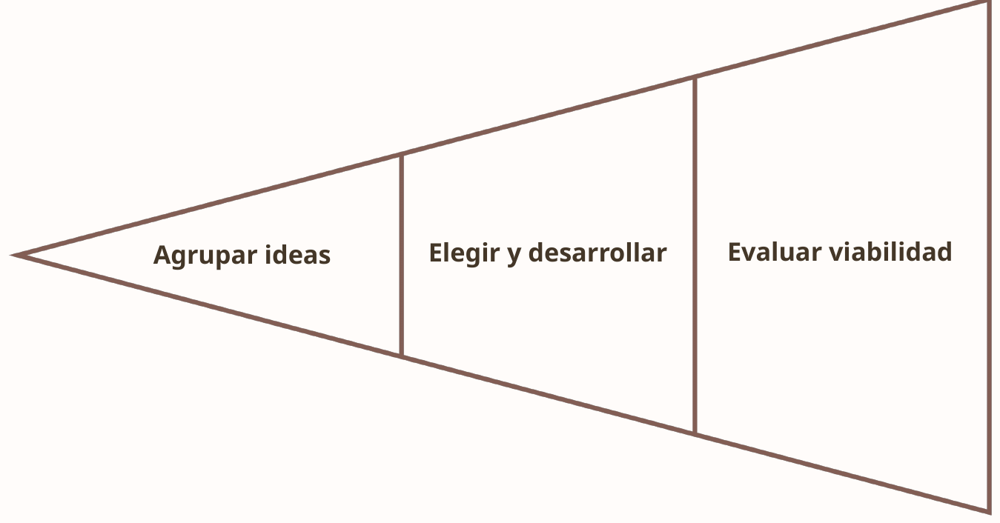

[← Anterior](00-objetivos-del-modulo.md) · [Índice del módulo](README.md) · [Siguiente →](02-redaccion-edicion-y-evaluacion.md)

# 1 · Ideación y briefing

*Módulo 10: Generación creativa y producción de contenidos*

## 1.1 El LLM como colaborador creativo

El modelo amplía el espacio de alternativas y acelera la generación de borradores, pero no sustituye el conocimiento profundo de tu audiencia ni la experiencia de marca del equipo humano.

- **Rol del modelo**: Explorar, generar y proponer variantes a alta velocidad.
- **Rol humano**: Dirección creativa, selección, edición y validación final.
- **Criterio de calidad**: Evaluar novedad, pertinencia y alineación con el objetivo antes de usar cualquier salida.

**Explicación**

El modelo amplía el espacio de alternativas y acelera los borradores, pero no sustituye el conocimiento de la audiencia ni la experiencia de marca del equipo. El reparto es claro: el modelo explora, genera y propone variantes a gran velocidad; las personas aportan dirección creativa, selección, **edición** y validación final; y todo resultado se juzga por su novedad, pertinencia y alineación con el objetivo antes de usarlo.

El modelo es excelente produciendo volumen y variedad, y las personas saben qué encaja con la marca, el momento y el público. Si se invierten los papeles y se deja que el modelo decida qué se publica, el contenido tiende a ser genérico o incoherente; si no se aprovecha para ampliar opciones, se desperdicia su mayor ventaja. La clave es la complementariedad, y que ninguna salida se use sin pasar por un filtro explícito.

<!-- labs-seccion -->
> **Para practicar esta sección:** [Laboratorio 10A · Briefing, ideación y selección](../../laboratorios/10A/README.md)
<!-- /labs-seccion -->

---

## 1.2 Definir un briefing creativo

Un briefing bien estructurado es el mejor prompt de partida. Sin él, el modelo genera contenido genérico que no sirve a ningún objetivo real. Usa esta plantilla como punto de entrada obligatorio.

| Campo | Descripción |
|---|---|
| Objetivo de comunicación | ¿Qué acción o percepción quieres generar? |
| Audiencia | Perfil, conocimiento previo y motivaciones del lector. |
| Mensaje principal | Una frase que resuma la idea central de la pieza. |
| Canal y formato | Web, correo, LinkedIn, vídeo, podcast… |
| Tono | Formal, conversacional, técnico, inspirador… |
| Restricciones | Marca, legales, longitud, elementos prohibidos. |

> Un briefing completo suele reducir las iteraciones necesarias para obtener una pieza utilizable.

**Explicación**

Un **briefing** bien estructurado es el mejor prompt de partida; sin él, el modelo genera contenido genérico que no sirve a un objetivo real. Se compone de seis campos: objetivo de comunicación (qué acción o percepción se busca), audiencia (perfil, conocimiento previo y motivaciones), mensaje principal en una frase, canal y formato, tono y restricciones (marca, legales, longitud, elementos prohibidos).

Es la adaptación al mundo creativo de lo ya visto: contexto, audiencia, restricciones y formato. Obliga a tomar decisiones antes de escribir, porque cada campo en blanco es una decisión que tomará el modelo, probablemente por la vía más habitual. Si cuesta resumir el mensaje en una frase, la idea aún no está madura y conviene resolverlo antes de pedir nada. Un briefing completo reduce las iteraciones necesarias.

---

## 1.3 Brainstorming divergente

La fase divergente busca cantidad antes que calidad. El objetivo es ampliar el espacio de posibilidades, no filtrar todavía. Instruye al modelo para que se aleje de las respuestas obvias.

- **Solicitar variedad real**: Pide enfoques estratégicamente distintos, no paráfrasis del mismo concepto.
- **Explorar perspectivas**: Instruye al modelo para adoptar el punto de vista del cliente, el escéptico o el experto.
- **Pedir enfoques no obvios**: Añade «*evita las primeras cinco ideas que se te ocurran*» para forzar originalidad.
- **Evitar juicio prematuro**: No evalúes las ideas durante la generación; recoge todo y filtra después.

**Explicación**

La fase divergente del brainstorming busca cantidad antes que calidad y exige instruir al modelo para que se aleje de lo obvio. Cuatro principios: pedir variedad real (enfoques estratégicamente distintos, no paráfrasis), explorar perspectivas (cliente, escéptico, experto), pedir enfoques no obvios (por ejemplo «evita las primeras cinco ideas que se te ocurran») y no juzgar durante la generación, filtrando después.

Sin estas indicaciones el modelo ofrece las ideas más frecuentes, que son las más previsibles porque representan mejor los patrones de su entrenamiento. Y si se mezclan generación y evaluación, se autocensura y propone ideas seguras. La variedad se logra variando el punto de vista, no solo la redacción: diez ideas «desde un cliente escéptico» y otras diez «desde un directivo preocupado por el coste» son genuinamente diferentes.

Un riesgo de pedir ideas sin cuidado es la homogeneidad: varias ideas distintas en apariencia que, agrupadas, resultan ser la misma con otras palabras. Se detecta agrupando las ideas por familia temática y contando cuántas familias distintas hay; las técnicas de este apartado (restricciones, inversión, analogías) sirven precisamente para romperla.

---

## 1.4 Técnicas de ideación

Combinadas en el prompt, estas técnicas permiten salir del pensamiento lineal y explorar territorios creativos inesperados.

- **Analogías**: «*¿Cómo lo haría un chef Michelin si tuviera que vender este software?*»
- **Inversión del problema**: «*¿Qué haría un competidor para arruinar esta campaña? Ahora evítalo.*»
- **Perspectivas de usuarios**: Genera ideas desde el punto de vista de distintos perfiles de cliente.
- **Combinación de conceptos**: Une dos dominios aparentemente ajenos para encontrar metáforas frescas.
- **Escenarios extremos**: «*¿Y si el presupuesto fuera 10× mayor? ¿Y si fuera cero?*» Acota después.

**Explicación**

Combinadas en el prompt, estas técnicas sacan del pensamiento lineal. Las analogías piden mirar el producto desde otro dominio («¿cómo lo haría un chef con estrella para vender este software?»); la inversión del problema pregunta qué haría un competidor para arruinar la campaña, para evitarlo después; las perspectivas de usuarios generan ideas según distintos perfiles de cliente; la combinación de conceptos une dos dominios ajenos para encontrar metáforas frescas; y los escenarios extremos (presupuesto diez veces mayor, o cero) desbloquean el pensamiento y se acotan después.

Son recursos clásicos de la creatividad humana; el modelo los aplica deprisa y en muchas variantes. Conviene combinar dos o tres en un mismo prompt, generar primero y juzgar después: las mejores ideas suelen aparecer en las combinaciones inesperadas.

---

## 1.5 Convergencia y selección

Tras la fase divergente, el volumen de ideas puede ser abrumador. La convergencia consiste en aplicar criterios explícitos para pasar de opciones brutas a propuestas desarrollables.

Descripción del diagrama en texto

1. **Agrupar ideas**
2. **Elegir y desarrollar**
3. **Evaluar viabilidad**

Define los criterios de selección *antes* de evaluar: originalidad, alineación con el briefing, viabilidad de producción y tolerancia al riesgo de marca son los cuatro ejes recomendados.

**Explicación**

Tras la fase divergente, el volumen de ideas puede abrumar. La **convergencia** aplica criterios explícitos para pasar de opciones brutas a propuestas desarrollables en tres pasos: agrupar ideas, evaluar viabilidad y elegir y desarrollar. La indicación clave es definir los criterios antes de evaluar: originalidad, alineación con el briefing, viabilidad de producción y tolerancia al riesgo de marca.

Si los criterios se fijan después de ver las ideas, es fácil elegir la que más gusta y no la que mejor cumple el objetivo. El modelo puede ayudar a agrupar y puntuar con los criterios que se le den, pero la decisión es humana. Una tabla con las ideas en filas y los criterios en columnas hace explícito por qué una idea gana a otra y facilita la discusión en equipo.

---

## 1.6 Generación de alternativas estratégicas

El error más común es pedir «tres versiones» y recibir el mismo texto con sinónimos distintos. Para obtener alternativas genuinas, define los ejes de variación explícitamente en el prompt.

**Ejes de variación recomendados**

- Concepto creativo central
- Ángulo del mensaje
- Mecanismo de ejecución
- Tono o registro

**Instrucciones al modelo**

«*Genera tres propuestas que difieran en concepto, no solo en palabras. Para cada una, indica su ventaja principal y su principal limitación.*»

Este tipo de instrucción fuerza al modelo a articular la lógica detrás de cada opción, facilitando la comparación y la selección informada.

**Explicación**

El error más común al generar alternativas es pedir «tres versiones» y recibir el mismo texto con sinónimos. Para obtener alternativas genuinas hay que definir los ejes de variación en el prompt: el concepto creativo central, el ángulo del mensaje, el mecanismo de ejecución y el tono o registro. Sin ellos, el modelo cambia palabras, no ideas.

La instrucción propuesta es «genera tres propuestas que difieran en concepto, no solo en palabras; para cada una, indica su ventaja principal y su principal limitación». Pedir ventaja y limitación obliga a articular la lógica de cada opción y facilita decidir: una alternativa cuya limitación no se puede asumir se descarta pronto. Por ejemplo, tres eslóganes basados en tranquilidad, control y logro de metas son enfoques emocionales distintos, mientras que tres eslóganes «de ahorro» suelen ser variaciones de uno.

---

[← Anterior](00-objetivos-del-modulo.md) · [Índice del módulo](README.md) · [Siguiente →](02-redaccion-edicion-y-evaluacion.md)
