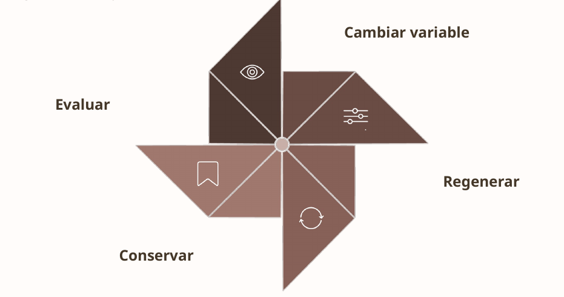

[← Anterior](02-redaccion-edicion-y-evaluacion.md) · [Índice del módulo](README.md) · [Siguiente →](04-caso-practico-errores-y-cierre.md)

# 3 · Producción multimedia y derechos

*Módulo 10: Generación creativa y producción de contenidos*

## 3.1 Anatomía de un prompt de imagen

Generar una imagen útil requiere describir la escena con la misma precisión con la que un director de arte briefiaría a un fotógrafo o ilustrador. Cada capa del prompt controla un aspecto visual diferente.

1. **Sujeto y acción**: Quién o qué aparece y qué está haciendo. Sé específico: «*una arquitecta revisando planos sobre una mesa de luz*» es mejor que «*una mujer trabajando*».
2. **Entorno y contexto**: El espacio, la época y las condiciones atmosféricas que rodean al sujeto.
3. **Composición y encuadre**: Plano (general, medio, detalle), ángulo (cenital, contrapicado) y regla de composición.
4. **Iluminación y paleta**: Tipo de luz (natural, artificial, hora dorada) y gama cromática predominante.
5. **Estilo visual**: Fotografía realista, ilustración vectorial, acuarela, render 3D, etc.
6. **Relación de aspecto y restricciones**: Formato (16:9, 1:1, 9:16) y elementos que deben aparecer o excluirse.

**Explicación**

Generar una imagen útil exige describir la escena con la precisión con la que un director de arte daría instrucciones a un fotógrafo. Cada capa del prompt controla un aspecto: el sujeto y la acción (específicos: «una arquitecta revisando planos sobre una mesa de luz» mejor que «una mujer trabajando»), el entorno y el contexto, la **composición** y el encuadre (plano, ángulo y regla de composición), la iluminación y la paleta, el estilo visual (fotografía realista, ilustración vectorial, acuarela, render 3D) y la relación de aspecto y las restricciones (16:9, 1:1, 9:16, elementos a incluir o excluir).

La estructura se parece a la del prompt de texto: unas capas definen el qué, otras el cómo y otras los límites. La precisión en el sujeto evita imágenes genéricas, la composición y la luz fijan el carácter, y la relación de aspecto garantiza que la pieza sirva para su canal sin recortes posteriores.

<!-- labs-seccion -->
> **Para practicar esta sección:** [Laboratorio 10C · Prompts visuales: de la descripción al guion gráfico](../../laboratorios/10C/README.md)
<!-- /labs-seccion -->

---

## 3.2 Composición y lenguaje visual

La **composición** es la gramática de la imagen. Describirla correctamente en el prompt determina cómo la herramienta organiza los elementos dentro del encuadre y dónde dirige la atención del espectador.

**Explicación**

La **composición** es la gramática de la imagen: describirla en el prompt determina cómo se organizan los elementos y dónde se dirige la atención. El lenguaje visual básico incluye el plano y la perspectiva (primer plano, plano general, cenital, contrapicado), la posición del sujeto (regla de tercios, centrado, desplazado), la profundidad y las capas, el fondo (neutro, desenfocado o narrativo), la dirección de la luz y la jerarquía visual entre un elemento dominante y los de apoyo.

No hace falta ser fotógrafo: basta aprender los términos que las herramientas entienden mejor y aplicarlos con intención. Cada uno produce un efecto reconocible: el plano cenital suele transmitir orden y análisis, el contrapicado fuerza o autoridad, el fondo desenfocado centra la atención y la luz lateral crea volumen. La pregunta guía es qué debe ver o sentir primero el espectador, y la jerarquía visual evita imágenes recargadas.

---

## 3.3 Estilos y referencias visuales

Describir el estilo visual con precisión es lo que diferencia una imagen genérica de una pieza coherente con la identidad de marca o el proyecto creativo.

**Dimensiones estéticas a especificar**

- Medio: fotografía, ilustración digital, pintura al óleo, render 3D fotorrealista, pixel art…
- Textura y detalle: grano de película, trazo de pincel, acabado liso, alta definición.
- Paleta y contraste: cálida/fría, monocromática, saturada, desaturada vintage.
- Época o movimiento: solo cuando sea pertinente y no contradiga otros atributos.

**Error frecuente**

Mezclar referencias contradictorias: «*estilo minimalista japonés con detalle hiperrealista barroco*» produce resultados incoherentes. Define un estilo dominante y añade modificadores coherentes con él.

**Ejemplo ilustrativo**

*«Ilustración vectorial plana, paleta de tres colores (azul marino, blanco y terracota), líneas limpias, sin sombras, estilo infografía editorial moderna.»*

**Explicación**

El estilo visual es lo que distingue una imagen genérica de una pieza coherente con la identidad de marca. Se especifican cuatro dimensiones: el medio (fotografía, ilustración digital, óleo, render 3D, pixel art), la textura y el detalle, la paleta y el contraste y, solo cuando sea pertinente, la época o el movimiento.

El error frecuente es mezclar referencias contradictorias («minimalista japonés con detalle hiperrealista barroco» produce resultados incoherentes). Se define un estilo dominante y se añaden modificadores coherentes con él, como en el ejemplo: «ilustración vectorial plana, paleta de tres colores (azul marino, blanco y terracota), líneas limpias, sin sombras, estilo de infografía editorial». Las restricciones ayudan tanto como las descripciones positivas. Para una identidad de marca conviene guardar el estilo en un bloque reutilizable con valores precisos de paleta. Pedir un estilo «a la manera de» un artista vivo plantea cuestiones éticas y de **derechos**: es preferible describir las características.

---

## 3.4 Iteración de prompts visuales

La generación de imagen rara vez produce el resultado exacto en el primer intento. La iteración sistemática, cambiando una sola variable por ciclo, es la estrategia más eficiente para converger hacia el objetivo visual.

Descripción del diagrama en texto

1. **Evaluar**
2. **Conservar**
3. **Cambiar variable**
4. **Regenerar**

- **Aclarar composición**: Si el encuadre es incorrecto, especifica el plano y la posición del sujeto con más detalle antes de modificar nada más.
- **Eliminar contradicciones**: Revisa el prompt buscando instrucciones que se anulen mutuamente (ej.: «*desenfocado*» y «*máximo detalle*»).
- **Reconocer límites de la herramienta**: Algunas composiciones o elementos (texto legible, anatomía compleja) superan las capacidades actuales del modelo. Ajusta el objetivo en lugar de iterar indefinidamente.

**Explicación**

La generación de imágenes rara vez da el resultado exacto a la primera. La estrategia más eficiente es iterar de forma sistemática, cambiando una sola variable por ciclo: evaluar, cambiar una variable, regenerar y conservar lo que funciona. Es la lógica del módulo [07](../07-ciclo-de-vida-y-evaluacion/README.md): una hipótesis, un cambio, una prueba; si se cambian cinco cosas, no se sabe cuál mejoró el resultado.

Tres consejos: aclarar la composición antes de tocar nada más si el encuadre falla, eliminar contradicciones del prompt (por ejemplo «desenfocado» y «máximo detalle») y reconocer los límites de la herramienta, como el texto legible o la anatomía compleja, ajustando el objetivo en lugar de iterar sin fin. Si tras varios intentos no hay mejora, probablemente el problema no es el prompt. Conviene guardar prompts y resultados intermedios para poder volver a la versión anterior.

---

## 3.5 Consistencia visual entre piezas

Cuando produces una serie de imágenes para una campaña o proyecto, la coherencia visual es tan importante como la calidad individual de cada pieza. El modelo no «recuerda» iteraciones anteriores a menos que lo instruyas explícitamente.

- **Atributos persistentes**: Define en un bloque de texto fijo los atributos que deben aparecer en *todos* los prompts de la serie: paleta, estilo, iluminación, relación de aspecto.
- **Descripciones de referencia**: Para personajes recurrentes, describe su apariencia con el mismo texto en cada prompt. Algunas herramientas admiten imágenes de referencia (image-to-image o seed fijo): úsalas cuando estén disponibles.
- **Control entre escenas**: Verifica que los elementos de continuidad (ropa, accesorios, fondo) se mantienen entre planos antes de cerrar la producción.
- **Verificar capacidades**: La coherencia de personajes entre imágenes varía mucho según la herramienta. Consulta la documentación oficial antes de asumir que una función está disponible.

**Explicación**

En una serie de imágenes para una campaña, la coherencia visual importa tanto como la calidad individual, y el modelo no recuerda iteraciones anteriores salvo que se le indique. Cuatro prácticas: definir en un bloque de texto fijo los atributos persistentes (paleta, estilo, iluminación y relación de aspecto), describir con el mismo texto los personajes recurrentes y usar imágenes de referencia o semilla fija si la herramienta lo permite, verificar entre planos la continuidad de ropa, accesorios y fondo y consultar la documentación para confirmar qué funciones están disponibles.

El bloque fijo equivale a una guía de estilo visual: una ficha que se pega en cada prompt para que todas las piezas pertenezcan a la misma familia. La coherencia de personajes es uno de los mayores retos; aun con la misma descripción el aspecto puede variar, sobre todo en rasgos faciales y manos, por lo que conviene revisar la serie como conjunto.

---

## 3.6 Prompts para vídeo

El vídeo añade una dimensión que la imagen estática no tiene: el tiempo. El prompt de vídeo debe describir no solo cómo se ve la escena, sino cómo evoluciona, qué se mueve y a qué ritmo.

| Elemento | Descripción en el prompt |
|---|---|
| Sujeto y acción | Quién actúa y qué hace a lo largo del clip. |
| Entorno y cámara | Escenario, tipo de lente y posición inicial de cámara. |
| Movimiento | Movimiento de cámara (dolly, paneo, zoom) y duración estimada. |
| Ritmo y transición | Velocidad del corte, fundidos, cambios de plano. |
| Continuidad temporal | Inicio y fin del clip para encadenar con otros planos. |
| Restricciones | Elementos que no deben aparecer; límites de la herramienta. |

**Explicación**

El vídeo añade el tiempo: el prompt debe describir no solo cómo se ve la escena, sino cómo evoluciona, qué se mueve y a qué ritmo. Los seis elementos son el sujeto y la acción a lo largo del clip, el entorno y la cámara (escenario, lente y posición inicial), el movimiento (travelling, paneo o zoom, y duración), el ritmo y la transición, la continuidad temporal (inicio y fin del clip para encadenarlo) y las restricciones.

Una escena puede ser preciosa en un fotograma y fallar en movimiento, por lo que conviene describir la acción como una secuencia con principio y final. Los clips cortos son más controlables y fáciles de encadenar que uno largo con varias acciones, donde se multiplican los fallos de coherencia. Si el final de un clip coincide en posición, luz y encuadre con el inicio del siguiente, el montaje resulta natural.

---

## 3.7 Storyboard y planificación

El storyboard convierte una idea narrativa en una secuencia de planos concretos antes de generar ninguna imagen o vídeo. Es el puente entre el guion y la producción multimedia.

El LLM puede generar el storyboard en texto estructurado; a partir de ahí, cada descripción de plano se convierte en un prompt independiente de imagen o vídeo.

**Explicación**

El storyboard convierte una idea narrativa en una secuencia de planos concretos antes de generar imágenes o vídeo; es el puente entre el guion y la producción. Los seis pasos son dividir en planos, estimar la duración de cada uno, describir la acción visual por plano, mantener la continuidad de personajes con una descripción consistente, definir las transiciones (corte, fundido, disolvencia, cortinilla) y regular el ritmo alternando planos dinámicos y de pausa.

El modelo puede generar el storyboard en texto estructurado, y cada descripción de plano se convierte en un prompt independiente de imagen o vídeo. Es otra aplicación de la descomposición: en lugar de pedir «hazme un vídeo de un minuto», se planifica y se genera plano a plano. Los problemas de narrativa se detectan en el storyboard, cuando corregir es barato, y cada plano puede repetirse sin rehacer el conjunto.

<!-- labs-seccion -->
> **Para practicar esta sección:** [Laboratorio 10B · Campaña multicanal con voz de marca](../../laboratorios/10B/README.md) · [Laboratorio 10C · Prompts visuales: de la descripción al guion gráfico](../../laboratorios/10C/README.md)
<!-- /labs-seccion -->

---

## 3.8 Campañas visuales integradas

Una campaña no es una suma de piezas independientes: es un sistema coherente en el que concepto, mensajes y formatos trabajan juntos hacia un mismo objetivo de comunicación.

1. **Objetivo y público**: Define KPIs de campaña y el perfil exacto del destinatario antes de crear nada.
2. **Concepto central**: Una idea que pueda expresarse en una frase y que funcione en todos los formatos.
3. **Mensajes y variaciones**: El mensaje principal y sus adaptaciones por canal, manteniendo el hilo conceptual.
4. **Formatos y canales**: Qué piezas se necesitan y en qué orden se producen (texto → imagen → vídeo).
5. **Revisión de coherencia**: Verifica que todas las piezas comparten paleta, tono, tipografía y CTA antes de publicar.

**Explicación**

Una campaña es un sistema coherente en el que concepto, mensajes y formatos trabajan hacia un mismo objetivo. Cinco pasos: objetivo y público (con indicadores y perfil exacto antes de crear nada), concepto central expresable en una frase y válido en todos los formatos, mensajes y variaciones por canal manteniendo el hilo conceptual, formatos y canales con su orden de producción (por ejemplo texto, imagen y vídeo) y revisión de coherencia de paleta, tono, tipografía y llamada a la acción antes de publicar.

Producir primero el texto y derivar de él la imagen y el vídeo asegura que todo parte del mismo concepto. Un buen concepto es el que sobrevive a todos los formatos sin perder su esencia. La revisión final evita piezas bonitas pero desconectadas entre sí, y los indicadores del primer paso permiten evaluar luego si la campaña funcionó con datos y no con impresiones.

<!-- labs-seccion -->
> **Para practicar esta sección:** [Laboratorio 10C · Prompts visuales: de la descripción al guion gráfico](../../laboratorios/10C/README.md)
<!-- /labs-seccion -->

---

## 3.9 Limitaciones multimedia

Conocer los límites actuales de las herramientas es tan importante como saber usarlas. Publicar una pieza con artefactos o inconsistencias daña la credibilidad de la marca.

- **Texto en imágenes**: Según la herramienta y su versión, puede haber dificultades para generar texto legible y bien ortografiado dentro de imágenes; compruébalo antes de publicar. Si falla, añade el texto en postproducción.
- **Consistencia de sujetos**: El aspecto de personajes puede variar entre generaciones aunque el prompt sea idéntico, especialmente en detalles como manos y rasgos faciales.
- **Artefactos en vídeo**: Las herramientas de vídeo generativo pueden producir distorsiones temporales, flickering o anatomías incoherentes en movimiento. Siempre previsualizas antes de integrar.
- **Derechos de referencia**: Usar obras con copyright como referencia estilística puede generar problemas legales. Revisa las condiciones de uso de cada herramienta.
- **Composición no garantizada**: Un prompt detallado aumenta las probabilidades de éxito, pero no garantiza la composición exacta. Itera y, si es necesario, ajusta el objetivo.

**Explicación**

Conocer los límites actuales de las herramientas es tan importante como saber usarlas, porque publicar piezas con artefactos o inconsistencias daña la credibilidad de la marca. Cinco limitaciones: el texto dentro de las imágenes puede salir ilegible o con faltas, y si falla se añade en posproducción; los personajes pueden variar entre generaciones aunque el prompt sea idéntico; el vídeo generativo puede producir distorsiones temporales, parpadeos o anatomías incoherentes, por lo que se previsualiza siempre; usar obras con derechos de autor como referencia estilística puede dar problemas legales; y un prompt detallado aumenta, pero no garantiza, la composición exacta.

Estas herramientas evolucionan muy deprisa: lo que hoy es una limitación puede dejar de serlo, y una función que funcionaba puede cambiar. La regla es comprobar siempre con la versión que se use. Para el texto, lo más fiable es componerlo aparte con herramientas de edición, lo que además permite controlar la tipografía de marca.

---

## 3.10 Derechos y uso responsable

Antes de publicar cualquier pieza generada por IA, es obligatorio revisar los aspectos legales y éticos. Las herramientas de generación no eliminan las responsabilidades del publicador.

**Checklist de publicación**

- Verificar derechos de los materiales de entrada (textos, imágenes, datos) proporcionados al modelo.

- Revisar las condiciones de licencia de la herramienta generativa (uso comercial, atribución).

- Comprobar que no se reproducen marcas, logotipos o elementos identificables sin autorización.

- Asegurarse de que el contenido cumple las políticas de uso aceptable de la plataforma.

- Validar que no existe riesgo de difamación, desinformación o sesgo dañino en el contenido generado.

**Principio clave**

La responsabilidad editorial siempre recae en el equipo humano que publica, no en la herramienta que genera. El modelo no firma la pieza: tú sí.

Documenta qué herramienta usaste, con qué prompt y en qué fecha: esto facilita la auditoría futura y el cumplimiento normativo.

**Explicación**

Antes de publicar cualquier pieza generada por IA hay que revisar los aspectos legales y éticos, porque las herramientas no eliminan las responsabilidades de quien publica. La lista de comprobación: verificar los derechos de los materiales de entrada, revisar las licencias de la herramienta (uso comercial y atribución), comprobar que no se reproducen marcas o elementos identificables sin autorización, asegurarse de que se cumplen las políticas de uso de la plataforma y validar que no hay riesgo de difamación, desinformación o sesgo dañino.

La responsabilidad editorial recae siempre en el equipo humano que publica: el modelo no firma la pieza. Conviene documentar qué herramienta se usó, con qué prompt y en qué fecha, lo que facilita la auditoría y el cumplimiento y permite reconstruir cómo se creó ante una reclamación. En contenidos visuales realistas que puedan confundirse con reales, hay que valorar su etiquetado como generados por IA (módulo [09](../09-seguridad-privacidad-y-uso-responsable/README.md)).

<!-- labs-seccion -->
> **Para practicar esta sección:** [Laboratorio 10B · Campaña multicanal con voz de marca](../../laboratorios/10B/README.md) · [Laboratorio 10C · Prompts visuales: de la descripción al guion gráfico](../../laboratorios/10C/README.md)
<!-- /labs-seccion -->

---

[← Anterior](02-redaccion-edicion-y-evaluacion.md) · [Índice del módulo](README.md) · [Siguiente →](04-caso-practico-errores-y-cierre.md)
