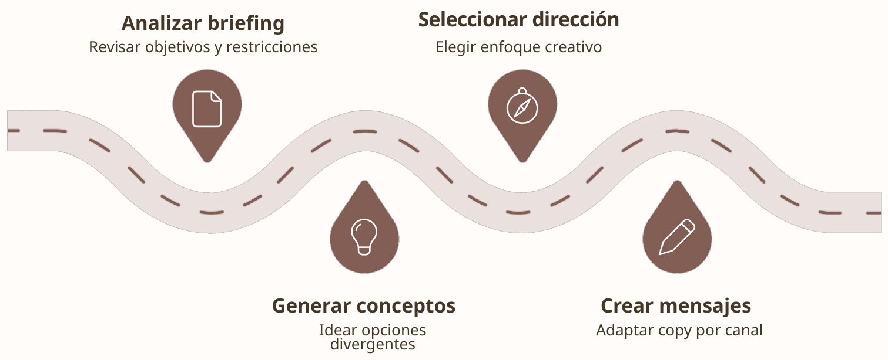

[← Anterior](03-produccion-multimedia-y-derechos.md) · [Índice del módulo](README.md) · [Siguiente módulo →](../11-desarrollo-de-software/README.md)

# 4 · Caso práctico, errores y cierre

*Módulo 10: Generación creativa y producción de contenidos*

## 4.1 Caso práctico: campaña desde briefing

Recorramos el proceso completo de creación asistida por LLM, desde el briefing inicial hasta la revisión final de coherencia, aplicando cada técnica del módulo de forma encadenada.

Descripción del diagrama en texto

1. Revisar objetivos y restricciones
2. **Analizar briefing**
3. Generar conceptos — Idear opciones divergentes
4. Seleccionar dirección — Elegir enfoque creativo
5. Crear mensajes — Adaptar copy por canal

**Briefing del ejemplo ilustrativo**

*Producto: app de gestión de hábitos. Audiencia: profesionales 28-40 años. Objetivo: 500 descargas en 30 días. Canal: Instagram + newsletter + web. Tono: motivador y directo.*

**Qué aplica el equipo**

Brainstorming divergente → matriz de alternativas → adaptación multicanal → prompt visual con atributos persistentes → checklist de derechos.

**Explicación**

El caso recorre el proceso completo, de briefing a revisión final de coherencia. Primero se analiza el briefing (objetivos y restricciones), se generan conceptos divergentes, se selecciona la dirección y se crean los mensajes adaptados por canal. El briefing de ejemplo es una aplicación de gestión de hábitos, para profesionales de 28 a 40 años, con el objetivo de 500 descargas en 30 días, canales Instagram, boletín y web, y tono motivador y directo.

El equipo aplica un brainstorming divergente, una matriz de alternativas, la **adaptación multicanal**, un prompt visual con atributos persistentes y la lista de derechos. Cada paso produce un resultado que alimenta el siguiente y, al final, hay una comprobación antes de publicar: el prompting creativo profesional no es un prompt genial, sino un proceso con etapas. El objetivo cuantificable permite además evaluar con datos y ajustar la campaña.

<!-- labs-seccion -->
> **Para practicar esta sección:** [Laboratorio 10B · Campaña multicanal con voz de marca](../../laboratorios/10B/README.md)
<!-- /labs-seccion -->

---

## 4.2 Errores frecuentes en prompting creativo

Conocer los errores más habituales permite detectarlos antes de que afecten a la calidad del output o al proceso de producción.

| Error | Cómo evitarlo |
|---|---|
| Briefing insuficiente o ausente | Usa la plantilla de 6 campos antes de escribir el primer prompt. |
| Instrucciones incompatibles en el mismo prompt | Lee el prompt en voz alta: si dos frases se contradicen, elimina una. |
| Audiencia no definida | Especifica perfil, conocimiento previo y motivación del destinatario. |
| Pedir originalidad sin criterio | Define qué significa «original» para tu proyecto: ángulo, formato, tono… |
| No separar ideación de selección | Genera primero, filtra después. Nunca evalúes durante el brainstorming. |
| No revisar derechos antes de publicar | Aplica el checklist de publicación en cada pieza, sin excepciones. |

**Explicación**

Los errores más habituales y su corrección son: briefing insuficiente o ausente (usar la plantilla de seis campos antes del primer prompt), instrucciones incompatibles en el mismo prompt (leerlo en voz alta y eliminar una de dos frases que se contradigan), audiencia no definida (especificar perfil, conocimiento previo y motivación), pedir originalidad sin criterio (definir qué significa «original»: ángulo, formato o tono), no separar **ideación** y selección (generar primero y filtrar después) y no revisar derechos antes de publicar (aplicar la lista en cada pieza, sin excepciones).

Pedir originalidad sin definirla es como pedir «algo diferente» sin decir de qué: el modelo no sabe si se quiere un ángulo insólito, un formato nuevo o un tono inesperado. La tabla sirve como lista de comprobación antes de enviar un prompt creativo importante.

<!-- labs-seccion -->
> **Para practicar esta sección:** [Laboratorio 10A · Briefing, ideación y selección](../../laboratorios/10A/README.md)
<!-- /labs-seccion -->

---

## 4.3 Plantillas creativas reutilizables

Estas estructuras de prompt funcionan como puntos de partida que el equipo puede adaptar a cada proyecto sin partir de cero. Sustituye los campos entre corchetes por los valores del briefing.

**1. Brainstorming**

*«Genera 10 ideas para [objetivo] dirigidas a [audiencia]. Cada idea debe partir de un enfoque distinto. Evita las primeras respuestas obvias. Incluye ventaja y riesgo de cada una.»*

**2. Artículo**

*«Escribe un artículo de [N] palabras sobre [tema] para [audiencia]. Estructura: introducción, 3 secciones con subtítulo, conclusión. Tono: [tono]. No inventar datos.»*

**3. Guión**

*«Escribe un guion de [duración] para [formato]. Personajes: [A] y [B]. Incluye indicaciones de pausa y énfasis. Formato: turnos etiquetados.»*

**4. Imagen**

*«[Sujeto] [acción] en [entorno]. Plano [tipo]. Iluminación [tipo]. Estilo: [estilo]. Paleta: [colores]. Relación de aspecto: [ratio].»*

**5. Vídeo**

*«Clip de [duración]s. Sujeto: [descripción]. Acción: [acción]. Cámara: [movimiento]. Transición de entrada/salida: [tipo]. Restricciones: [elementos a excluir].»*

**Explicación**

Las plantillas son puntos de partida reutilizables en los que se sustituyen los campos entre corchetes por los valores del briefing. Hay cinco: brainstorming (diez ideas para un objetivo y audiencia, cada una con un enfoque distinto, evitando lo obvio e indicando ventaja y riesgo), artículo (extensión, tema, audiencia, estructura de introducción, tres secciones con subtítulo y conclusión, tono y sin inventar datos), guion (duración, formato, personajes, pausas, énfasis y turnos), imagen (sujeto, acción, entorno, plano, iluminación, estilo, paleta y relación de aspecto) y vídeo (duración, sujeto, acción, cámara, transiciones y restricciones).

Todas incorporan variedad, estructura, restricciones y control de la invención, y los campos obligan a tomar las decisiones que el briefing ya contiene. Conviene guardarlas en una biblioteca del equipo y mejorarlas con el uso, con el versionado del módulo [07](../07-ciclo-de-vida-y-evaluacion/README.md).

---

## 4.4 Resumen del proceso creativo

El pipeline creativo asistido por LLM sigue una secuencia lógica que combina divergencia, convergencia, producción y validación. Ninguna fase puede saltarse sin comprometer el resultado.

1. **Briefing**: Objetivo, audiencia, mensaje, canal, tono y restricciones.
2. **Ideación divergente**: Brainstorming con técnicas de analogía, inversión y perspectivas.
3. **Selección**: Criterios explícitos: originalidad, viabilidad y alineación.
4. **Producción**: Texto, imagen, vídeo y adaptación multicanal.
5. **Refinamiento**: Edición quirúrgica, rúbrica editorial y voz de marca.
6. **Publicación responsable**: Checklist de derechos, coherencia visual y aprobación humana.

> El valor del LLM está en acelerar cada etapa, pero la dirección creativa y la validación final siempre son responsabilidad humana.

**Explicación**

El proceso creativo asistido combina divergencia, convergencia, producción y validación, y ninguna fase puede saltarse sin comprometer el resultado: briefing, ideación divergente, selección con criterios explícitos, producción (texto, imagen, vídeo y adaptación), refinamiento (edición, rúbrica y **voz de marca**) y publicación responsable (derechos, coherencia visual y aprobación humana).

El valor del modelo está en acelerar cada etapa, pero la dirección creativa y la validación final son responsabilidad humana: se usa para multiplicar la capacidad de explorar y producir, y se reservan las decisiones que requieren criterio, sensibilidad y responsabilidad. El proceso alterna expansión y reducción, y saltarse una fase no ahorra trabajo, lo traslada a etapas posteriores donde corregir cuesta más.

---

## 4.5 Comprobación de comprensión

Piensa cada respuesta, de forma oral o por escrito, antes de ver las respuestas orientativas, que aparecen a continuación.

**1. ¿Qué incluye un briefing creativo completo?**

**2. ¿Cómo se evita la repetición en alternativas?**

**3. ¿Qué describe un prompt de imagen?**

**4. ¿Qué necesita un prompt de vídeo que no necesita el de imagen?**

**5. ¿Qué revisar antes de publicar cualquier pieza generada?**

---

## 4.6 Comprobación de comprensión: respuestas

Contrasta tus respuestas con estas. Son orientativas: lo importante es que cubran las ideas clave del módulo.

1. **¿Qué incluye un briefing creativo completo?** Objetivo, audiencia, mensaje principal, canal y formato, tono y restricciones de marca y legales.
2. **¿Cómo se evita la repetición en alternativas?** Definiendo ejes de variación explícitos (concepto, ángulo, ejecución, tono) y pidiendo ventajas y límites de cada opción.
3. **¿Qué describe un prompt de imagen?** Sujeto y acción, entorno, composición, iluminación, estilo visual y relación de aspecto.
4. **¿Qué necesita un prompt de vídeo que no necesita el de imagen?** La descripción del movimiento (sujeto y cámara), la duración, el ritmo de transición y la continuidad temporal entre planos.
5. **¿Qué revisar antes de publicar cualquier pieza generada?** Derechos de materiales de entrada, licencias de la herramienta, marcas identificables, políticas de uso y ausencia de sesgos dañinos.

**Explicación**

La comprobación plantea cinco preguntas. Un briefing completo incluye objetivo, audiencia, mensaje principal, canal y formato, tono y restricciones de marca y legales. La repetición en alternativas se evita definiendo ejes de variación explícitos (concepto, ángulo, ejecución y tono) y pidiendo ventajas y límites. Un prompt de imagen describe sujeto y acción, entorno, composición, iluminación, estilo y relación de aspecto. El de vídeo necesita además el movimiento (del sujeto y de la cámara), la duración, el ritmo y la continuidad entre planos. Y antes de publicar se revisan los derechos, las licencias de la herramienta, las marcas identificables, las políticas de uso y la ausencia de sesgos dañinos.

Con ello se tiene una base sólida para aplicar prompting profesional a la creación de contenidos. El siguiente módulo traslada el prompt engineering al desarrollo de software, donde la exigencia de precisión y verificación es aún mayor.

---

[← Anterior](03-produccion-multimedia-y-derechos.md) · [Índice del módulo](README.md) · [Siguiente módulo →](../11-desarrollo-de-software/README.md)
