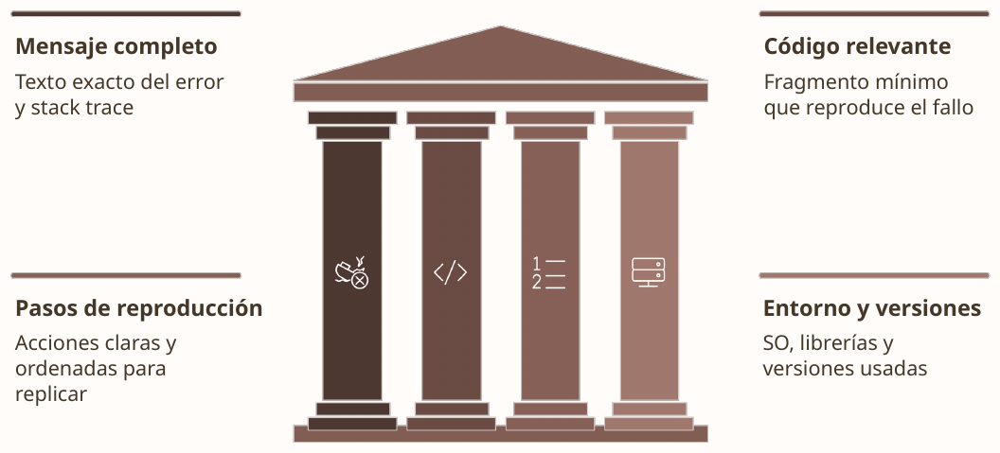

[← Anterior](01-generacion-de-codigo.md) · [Índice del módulo](README.md) · [Siguiente →](03-traduccion-pruebas-y-seguridad.md)

# 2 · Análisis y depuración

*Módulo 11: Prompt Engineering aplicado al desarrollo de software*

## 2.1 Explicación de código: comprender código existente

Pedir al LLM que explique código desconocido es una de las aplicaciones más productivas. Para obtener respuestas útiles y fiables, el prompt debe delimitar claramente el alcance del análisis.

- **Objetivo del análisis**: ¿Qué quieres entender: flujo, rendimiento, efectos secundarios?
- **Fragmentos relevantes**: Proporciona solo el código relacionado, no archivos completos innecesarios

Ejemplo ilustrativo de prompt: «*Analiza el siguiente fragmento de Python. Explica qué hace cada bloque, identifica efectos secundarios y señala qué inferencias son hipótesis tuyas vs. hechos del código.*»

- **Explicación por bloques**: Pide que comente cada sección lógica de forma independiente
- **Entradas, salidas y efectos**: Solicita identificar mutaciones de estado, llamadas a red o I/O
- **Separar hechos e hipótesis**: Instruye al modelo para que distinga lo que es explícito de lo que infiere

**Explicación**

Pedir al modelo que explique código desconocido es de los usos más productivos, y requiere delimitar el alcance: qué se quiere entender (flujo, rendimiento, efectos secundarios), proporcionar solo los fragmentos relevantes, pedir una explicación por bloques, solicitar que identifique mutaciones de estado, llamadas a red y entrada o salida de datos, y que distinga hechos de hipótesis.

El ejemplo pide explicar cada bloque de un fragmento de Python, identificar efectos secundarios y señalar qué inferencias son hipótesis y cuáles hechos del código. Cuando el modelo marca algo como suposición, se sabe dónde comprobar. Su comprensión es una hipótesis hasta contrastarla con el código, la documentación o la ejecución. Aportar solo lo relevante mejora la precisión y limita el código que sale del entorno.

<!-- labs-seccion -->
> **Para practicar esta sección:** [Laboratorio 11B · Depurar con evidencia y revisar código sin delegar el criterio](../../laboratorios/11B/README.md)
<!-- /labs-seccion -->

---

## 2.2 Análisis de arquitectura: examinar componentes

El LLM puede ayudar a mapear la arquitectura de un sistema a partir de código fuente, diagramas textuales o descripciones. Es fundamental indicarle qué información tiene disponible y pedirle que no infiera elementos que no ha visto.

> ⚠️ No pedir al LLM que infiera módulos que no forman parte del código compartido. El análisis debe basarse exclusivamente en la evidencia proporcionada.

**Explicación**

El modelo puede ayudar a mapear la arquitectura de un sistema a partir de código, diagramas textuales o descripciones, siempre que se le indique qué información tiene y se le pida no inferir elementos que no ha visto. El análisis tiene cinco dimensiones: módulos y responsabilidades, dependencias y flujos, acoplamiento, puntos críticos (cuellos de botella o módulos muy dependientes) y solo lo visible.

Si el modelo ve una llamada a un servicio y no ve su código, puede imaginar cómo funciona y presentarlo como un hecho; la respuesta correcta ante lo no visto es «no consta en el código aportado». Es útil para obtener una visión inicial de un sistema desconocido o localizar dónde hacer un cambio, pero su fiabilidad depende del código proporcionado. Conviene pedirle que liste los elementos referenciados pero no definidos, para saber qué falta por examinar.

---

## 2.3 Identificar dependencias: comprender librerías

Analizar las dependencias de un proyecto permite detectar versiones obsoletas, conflictos y posibles vulnerabilidades. El LLM puede asistir, pero con limitaciones importantes que el desarrollador debe conocer.

- **Imports y manifiestos**: Proporcionar requirements.txt, package.json o pom.xml como contexto
- **Dependencias directas e indirectas**: Solo analizables si se aportan los datos; no pedir inferencias sin base
- **Versiones**: Pedir análisis de compatibilidad entre versiones declaradas y versiones del runtime
- **Compatibilidad**: Detectar conflictos de versiones entre dependencias que comparten una transitividad
- **Vulnerabilidades**: Solo con fuentes verificadas; usar herramientas como npm audit, pip-audit o Dependabot
- **No inventar paquetes**: Prohibir explícitamente que el LLM sugiera librerías que no existan en el ecosistema

**Explicación**

Analizar las dependencias permite detectar versiones obsoletas, conflictos y posibles vulnerabilidades, con limitaciones que hay que conocer. Se aportan los manifiestos (requirements.txt, package.json, pom.xml) como contexto; las dependencias directas e indirectas solo son analizables con datos; se pide compatibilidad entre versiones declaradas y las del entorno; se detectan conflictos por dependencias transitivas; las vulnerabilidades se comprueban con herramientas como npm audit, pip-audit o Dependabot; y se prohíbe sugerir paquetes inexistentes.

El conocimiento del modelo tiene fecha de corte y no sustituye a las bases de vulnerabilidades actualizadas. Los paquetes inventados son un riesgo real: un atacante puede registrar un paquete con el nombre que el modelo suele alucinar, y quien confíe en la sugerencia lo instalaría. Antes de instalar hay que verificar que existe, que es el correcto y que tiene un mantenimiento razonable.

---

## 2.4 Depuración: aportar evidencia del fallo

La calidad del diagnóstico del LLM depende directamente de la completitud de la evidencia aportada. Un prompt de debugging bien construido incluye todos los elementos que un desarrollador senior necesitaría para reproducir y analizar el problema.

Descripción del diagrama en texto

1. Mensaje completo — Texto exacto del error y stack trace
2. Pasos de reproducción — Acciones claras y ordenadas para replicar
3. Entorno y versiones — SO, librerías y versiones usadas
4. Código relevante — Fragmento mínimo que reproduce el fallo

**Qué incluir siempre**

- Stack trace completo sin truncar
- Código mínimo que reproduce el error
- Versión del lenguaje, framework y SO

**Qué evitar siempre**

- Pegar tokens, contraseñas o datos personales
- Código de producción sin anonimizar
- Descripciones vagas («no funciona»)

**Explicación**

La calidad del diagnóstico depende de la evidencia aportada. Un prompt de **depuración** incluye el mensaje completo (texto exacto del error y traza de pila), el código mínimo que reproduce el fallo, los pasos de reproducción y el entorno con sus versiones. Hay que incluir siempre la traza completa sin truncar, el código mínimo y las versiones; y evitar pegar tokens, contraseñas o datos personales, código de producción sin anonimizar y descripciones vagas como «no funciona».

Esta última es el error más habitual y el que peor resultado da: con «da un error», el modelo imagina uno, normalmente el más frecuente, que puede no tener relación con el real. Lo que se pega sale del entorno propio, y las trazas suelen contener rutas, usuarios, direcciones internas y a veces datos, por lo que hay que revisarlas y anonimizarlas (módulo [09](../09-seguridad-privacidad-y-uso-responsable/README.md)). Construir el código mínimo reproductor suele revelar la causa al propio desarrollador.

---

## 2.5 Trazas y excepciones: interpretar evidencia

El stack trace es la fuente de verdad más valiosa en un proceso de depuración. Pedir al LLM que lo analice de forma estructurada produce diagnósticos más fiables que una petición genérica de «*busca el bug*».

- **Tipo de excepción**: Identificar la clase exacta del error: NullPointerException, KeyError, TimeoutError, etc.
- **Archivo y línea**: Localizar el origen exacto en el código propio, distinguiéndolo de librerías de terceros
- **Cadena causal con cautela**: Reconstruir la secuencia de llamadas que llevó al fallo, señalando qué es hecho y qué es hipótesis
- **Causa raíz vs. síntoma**: Distinguir el origen real del problema del lugar donde se manifiesta
- **Comprobaciones reproducibles**: Pedir pasos concretos para verificar la hipótesis antes de aplicar cualquier corrección

**Explicación**

La traza de pila es la fuente de verdad más valiosa al depurar, y pedir al modelo que la analice de forma estructurada da diagnósticos más fiables que un «busca el error». Los pasos son identificar el tipo exacto de excepción, localizar archivo y línea en el código propio (distinguiéndolo de librerías), reconstruir con cautela la cadena causal separando hechos de hipótesis, distinguir causa raíz de síntoma y pedir comprobaciones reproducibles antes de corregir.

La distinción entre causa y síntoma es la que más tiempo ahorra: el error salta en una línea, pero la causa puede estar tres llamadas antes, en un dato mal formado, y corregir el síntoma (por ejemplo añadiendo una comprobación de nulo) hace desaparecer el error sin resolver el problema. Pedir comprobaciones evita aplicar parches a ciegas hasta que «parece que funciona».

---

## 2.6 Validar correcciones: no aceptar parches sin pruebas

Recibir una corrección del LLM es solo el comienzo. El ciclo de validación completo es obligatorio antes de integrar cualquier cambio en la base de código.

- **Hipótesis y cambio mínimo**: Pedir el cambio más pequeño que resuelva el problema sin efectos colaterales
- **Explicar el efecto**: El LLM debe justificar por qué el parche resuelve la causa raíz
- **Prueba de reproducción**: Escribir un test que falle antes del parche y pase después
- **Ejecutar pruebas**: Correr la suite completa para detectar regresiones introducidas

> ⚠️ El LLM no ejecuta código. Nunca afirmes que una corrección funciona sin haberla ejecutado tú en el entorno real.

**Explicación**

Recibir una corrección es solo el comienzo: el ciclo de validación completo es obligatorio antes de integrar. Los cuatro pasos son pedir el cambio mínimo que resuelva el problema sin efectos colaterales, que el modelo explique por qué el parche resuelve la causa raíz, escribir un test que falle antes del parche y pase después y ejecutar la suite completa para detectar regresiones.

El modelo no ejecuta código: no debe afirmarse que una corrección funciona sin haberla ejecutado en el entorno real, incluso cuando el modelo diga «esto debería funcionar» con seguridad, porque la confianza del tono no es evidencia. Si el test pasa también antes del parche, no prueba el defecto. Un cambio pequeño se revisa en un minuto, mientras que reescribir una función entera dificulta revisar y aumenta el riesgo de efectos no deseados.

<!-- labs-seccion -->
> **Para practicar esta sección:** [Laboratorio 11A · Especificar y generar una función con pruebas](../../laboratorios/11A/README.md) · [Laboratorio 11B · Depurar con evidencia y revisar código sin delegar el criterio](../../laboratorios/11B/README.md)
<!-- /labs-seccion -->

---

## 2.7 Refactorización: mejorar estructura preservando comportamiento

La refactorización asistida por LLM es potente pero delicada: el modelo puede introducir cambios funcionales no solicitados si el prompt no delimita claramente el alcance. La regla de oro es conservar las interfaces existentes.

**Principios de un prompt de refactorización**

- Definir el objetivo: legibilidad, reducción de duplicación, desacoplamiento
- Prohibir cambios de comportamiento observable
- Conservar firmas de funciones públicas
- Pedir pruebas de regresión que validen la equivalencia

**Ejemplo ilustrativo**

*Antes:* función de 80 líneas con lógica de negocio y acceso a BD mezclados

*Prompt:* «*Refactoriza separando la lógica de negocio del acceso a datos. Conserva la firma pública. No cambies el comportamiento observable. Genera tests de regresión.*»

*Después:* dos funciones con responsabilidad única, misma interfaz externa

Siempre compara la salida antes/después con un diff antes de aceptar el cambio.

**Explicación**

La **refactorización** asistida es potente pero delicada: el modelo puede introducir cambios funcionales no solicitados si el prompt no delimita el alcance, y la regla de oro es conservar las interfaces. Principios: definir el objetivo (legibilidad, duplicación, desacoplamiento), prohibir cambios de comportamiento observable, conservar las firmas públicas y pedir pruebas de regresión que validen la equivalencia.

En el ejemplo, una función de 80 líneas que mezcla lógica de negocio y acceso a la base de datos se separa en dos con responsabilidad única y la misma interfaz. Debe compararse siempre el antes y el después con un diff, porque el modelo puede «mejorar» algo no pedido (un orden, un redondeo, un mensaje de error). Si el código original no tiene pruebas, conviene generar primero pruebas que fijen el comportamiento actual y refactorizar con esa red. El objetivo debe ser único, para saber qué cambio produjo qué efecto.

<!-- labs-seccion -->
> **Para practicar esta sección:** [Laboratorio 11B · Depurar con evidencia y revisar código sin delegar el criterio](../../laboratorios/11B/README.md)
<!-- /labs-seccion -->

---

## 2.8 Optimización de rendimiento: basar mejoras en evidencia

Optimizar sin medir es uno de los errores más costosos en ingeniería de software. El LLM puede proponer alternativas eficientes, pero debe conocer los datos de profiling reales para evitar optimizaciones prematuras o irrelevantes.

1. **Cuello de botella medido**: Proporcionar datos de profiler: función, tiempo de ejecución, número de llamadas
2. **Volumen y patrón de uso**: Indicar el tamaño típico de entrada y la frecuencia de invocación en producción
3. **Complejidad y recursos**: Pedir análisis de complejidad temporal y espacial del código actual y de la alternativa
4. **Alternativas**: Solicitar varias opciones con sus trade-offs: velocidad vs. memoria vs. legibilidad
5. **Medición antes/después**: Exigir que la mejora sea verificable con el mismo benchmark usado para detectar el problema
6. **Evitar optimización prematura**: No solicitar optimizaciones sin datos: el código legible tiene valor propio

**Explicación**

Optimizar sin medir es uno de los errores más costosos. El modelo propone alternativas eficientes, pero necesita datos reales de perfilado. Seis pasos: aportar el cuello de botella medido (función, tiempo, número de llamadas), el volumen y patrón de uso, pedir análisis de complejidad temporal y espacial, solicitar varias alternativas con sus compromisos, exigir medición antes y después con el mismo benchmark y evitar la optimización prematura, porque el código legible tiene valor propio.

El principio es el de toda la ingeniería: medir, cambiar y medir de nuevo. Una versión «más rápida» puede no mejorar nada si el cuello de botella estaba en otra parte, o empeorar la legibilidad sin ganancia medible. La complejidad teórica sirve para razonar, pero un algoritmo con mejor complejidad asintótica puede ser más lento para los tamaños reales; la prueba final es el benchmark en condiciones comparables.

---

[← Anterior](01-generacion-de-codigo.md) · [Índice del módulo](README.md) · [Siguiente →](03-traduccion-pruebas-y-seguridad.md)
