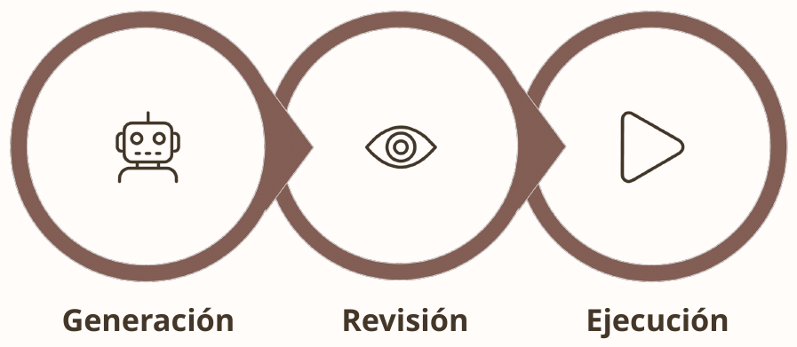

[← Anterior](02-analisis-y-depuracion.md) · [Índice del módulo](README.md) · [Siguiente →](04-prompts-completos-flujo-y-cierre.md)

# 3 · Traducción, pruebas y seguridad

*Módulo 11: Prompt Engineering aplicado al desarrollo de software*

## 3.1 Traducción entre lenguajes: convertir preservando semántica

Traducir código entre lenguajes de programación es una tarea donde los LLM añaden valor real, pero los errores semánticos sutiles son frecuentes. El prompt debe especificar mucho más que origen y destino.

- **Lenguaje origen y destino**: Con sus versiones específicas: «*De Python 3.9 a Go 1.22*»
- **Comportamiento y errores**: El código traducido debe replicar exactamente el comportamiento de errores del original

Ejemplo ilustrativo: «*Traduce la siguiente función de Python 3.9 a TypeScript 5.2. Preserva el manejo de errores. Usa solo la librería estándar. Genera tests Jest equivalentes.*»

- **Diferencias de paradigma**: Indicar cómo gestionar OOP vs. funcional, tipado dinámico vs. estático
- **Pruebas equivalentes**: Pedir una suite de tests que valide la equivalencia funcional del código traducido
- **Dependencias**: Especificar librerías disponibles en el lenguaje destino o pedir equivalentes

**Explicación**

Traducir código entre lenguajes es una tarea donde los modelos aportan valor, pero los errores semánticos sutiles son frecuentes, de modo que el prompt debe especificar mucho más que origen y destino: lenguajes con versiones (por ejemplo, de Python 3.9 a Go 1.22), el comportamiento de errores, las diferencias de paradigma (orientado a objetos frente a funcional, tipado dinámico frente a estático), una suite de pruebas equivalentes y las dependencias disponibles en destino.

División entera, redondeo, cadenas, fechas o desbordamientos pueden diferir entre lenguajes: el código compila y da otro resultado, por lo que las pruebas equivalentes son la salvaguarda principal, ejecutando las mismas entradas en ambas versiones. También cambia la gestión de errores (excepciones o valores de error), y conviene indicar cómo traducir cada tipo para evitar pérdidas silenciosas.

<!-- labs-seccion -->
> **Para practicar esta sección:** [Laboratorio 11C · Traducir y documentar código sin perder el comportamiento](../../laboratorios/11C/README.md)
<!-- /labs-seccion -->

---

## 3.2 Equivalencia de librerías: controlar sustituciones

Al traducir código o migrar entre ecosistemas, el LLM debe proponer librerías equivalentes verificables. Las sustituciones inventadas son un riesgo real: métodos que el modelo afirma que existen pero no están en la documentación oficial.

| API original | Lenguaje origen | Equivalente sugerido | Acción requerida |
|---|---|---|---|
| requests.get() | Python | fetch() / axios | Verificar en docs MDN / npm |
| pandas.DataFrame | Python | data.table (R) | Comprobar diferencias de índice |
| datetime.now() | Python | LocalDateTime.now() | Revisar zonas horarias en Java |

> ⚠️ Nunca aceptes métodos sugeridos por el LLM sin verificarlos en la documentación oficial del paquete. Los «*métodos inventados*» son la causa más frecuente de errores en traducción asistida.

**Explicación**

Al migrar entre ecosistemas, el modelo debe proponer librerías equivalentes verificables, porque las sustituciones inventadas son un riesgo real: métodos que afirma que existen pero no están en la documentación. La tabla da tres ejemplos: requests.get de Python a fetch o axios (verificar en MDN o npm), el DataFrame de pandas a data.table de R (comprobar diferencias de índice) y datetime.now a LocalDateTime.now de Java (revisar zonas horarias).

La última columna nunca dice «aceptar», sino «verificar», «comprobar» o «revisar»: una equivalencia sugerida es una hipótesis que se confirma en la documentación oficial. Los métodos inventados son la causa más frecuente de errores en la traducción asistida; si una función suena bien pero no aparece en la documentación, probablemente no existe. Y las equivalencias no siempre son exactas: dos funciones parecidas pueden diferir en los casos límite, que se confirman con pruebas.

---

## 3.3 Pruebas unitarias: generar pruebas de comportamiento

El LLM puede generar suites de pruebas unitarias completas, pero el prompt debe especificar el contrato de comportamiento, no la implementación. Probar solo la implementación produce tests frágiles que se rompen con cada refactorización.

- **Contrato de función**: Qué promete la función: precondiciones, postcondiciones e invariantes
- **Casos normales**: Entradas válidas representativas del uso habitual y resultado esperado
- **Límites e inválidos**: Valores en los bordes del rango aceptable y entradas que deben rechazarse
- **Resultados y excepciones**: Especificar qué se verifica: valor de retorno, excepción lanzada, estado mutado
- **Framework indicado**: Especificar pytest, JUnit 5, Jest, etc. con su versión para evitar incompatibilidades
- **Evitar probar implementación**: Los tests deben romper si el comportamiento cambia, no si el código interno cambia

**Explicación**

El modelo puede generar suites completas de **pruebas unitarias**, pero el prompt debe especificar el contrato de comportamiento, no la implementación; probar solo la implementación produce tests frágiles que se rompen con cada refactorización. Seis puntos: el contrato de la función (precondiciones, postcondiciones, invariantes), casos normales, límites e inválidos, qué se verifica (valor, excepción, estado), el framework con su versión y evitar probar la implementación.

Un test debe romperse si cambia el comportamiento, no si cambia el código interno: si cada refactorización rompe decenas de tests aunque el resultado externo sea el mismo, están acoplados a la implementación. Y si el mismo modelo escribe código y pruebas, estas pueden reflejar el comportamiento del código en lugar de la especificación, por lo que conviene derivarlas de los criterios de aceptación y que una persona las revise.

<!-- labs-seccion -->
> **Para practicar esta sección:** [Laboratorio 11A · Especificar y generar una función con pruebas](../../laboratorios/11A/README.md)
<!-- /labs-seccion -->

---

## 3.4 Casos límite y pruebas negativas: ampliar cobertura

Las pruebas generadas por defecto tienden a cubrir el camino feliz. Para obtener cobertura real, el prompt debe listar explícitamente las categorías de casos límite y negativos que el LLM debe contemplar.

**Explicación**

Las pruebas generadas por defecto tienden a cubrir el camino feliz; para una cobertura real hay que listar las categorías de casos límite y negativos. Son seis: nulos y vacíos, límites numéricos (cero, negativos, máximos, NaN, infinito), formatos incorrectos (fechas inválidas, correos malformados, JSON roto), entradas grandes, caracteres especiales (Unicode, emojis, inyección SQL, XSS) y dependencias no disponibles (servicio caído, tiempo agotado, respuesta malformada).

Funciona como lista reutilizable: pegarla en el prompt y pedir al menos un test por categoría aumenta mucho la cobertura efectiva. Es en estos casos, los que no se piensan al escribir el código, donde se esconden la mayoría de los fallos reales. Si una categoría no es aplicable, el modelo debe indicarlo en lugar de inventar casos irrelevantes.

---

## 3.5 Pruebas de integración: probar interacción entre componentes

Las pruebas de integración verifican que varios componentes funcionan correctamente juntos. Son más complejas que las unitarias y requieren un prompt más detallado que describa los contratos de comunicación entre los sistemas involucrados.

- **1. Componentes participantes**: Listar qué módulos o servicios intervienen y cuál es el flujo entre ellos
- **Errores y timeouts**: Pedir pruebas que simulen fallos de red, respuestas lentas y errores HTTP
- **2. Contrato de entrada/salida**: Definir el formato exacto de los mensajes entre componentes
- **Distinguir tipos de prueba**: Las pruebas de integración no reemplazan a las unitarias: cada nivel tiene su propósito

Ejemplo ilustrativo: «*Genera tests de integración con pytest para el flujo usuario→API→BD. Simula la BD con SQLite en memoria. Incluye casos de timeout y respuesta 500.*»

**3. Simular dependencias**

Indicar si se deben usar mocks, stubs o testcontainers para servicios externos

**Explicación**

Las **pruebas de integración** verifican que varios componentes funcionan juntos y requieren un prompt más detallado. Se indican los componentes y el flujo entre ellos, el contrato de entrada y salida con el formato exacto de los mensajes, si se simulan dependencias (mocks, stubs o contenedores de prueba), las pruebas de errores y tiempos de espera (fallos de red, respuestas lentas, errores HTTP) y se recuerda que no reemplazan a las unitarias.

El ejemplo pide pruebas con pytest para el flujo usuario, API y base de datos, simulando la base con SQLite en memoria e incluyendo casos de timeout y de error 500. Un test de integración que solo prueba el caso feliz aporta poco. Su valor está en los puntos de encuentro: formatos de datos, orden de las llamadas, gestión de errores entre capas y comportamiento ante fallos del vecino. Las simulaciones deben ser fieles, no devolver siempre éxitos inmediatos.

---

## 3.6 Documentación de código: generar documentación fiel

El LLM puede generar docstrings, READMEs y comentarios inline de forma eficiente, pero la documentación generada debe reflejar el comportamiento real del código, no el comportamiento que el modelo supone que debería tener.

- **Propósito y uso**: Describir para qué sirve la función o módulo y cuándo debe usarse, con un ejemplo de llamada
- **Parámetros y retornos**: Documentar tipos, valores por defecto, unidades y restricciones de cada argumento
- **Excepciones y efectos secundarios**: Listar qué excepciones puede lanzar y qué estado externo modifica (ficheros, BD, red)
- **Ejemplos verificables**: Incluir ejemplos de código que realmente funcionen, no pseudocódigo ilustrativo
- **No documentar lo inexistente**: Prohibir que el LLM documente comportamiento que el código no implementa realmente

**Explicación**

El modelo genera docstrings, READMEs y comentarios con eficiencia, pero la documentación debe reflejar el comportamiento real del código, no el que el modelo supone. Se pide propósito y uso con un ejemplo de llamada, parámetros y retornos (tipos, valores por defecto, unidades y restricciones), excepciones y efectos secundarios, ejemplos que realmente funcionen y que no se documente lo que el código no implementa.

Un docstring que describe una validación inexistente es peor que no tener documentación, porque induce a error con apariencia de autoridad. Se recomienda generarla a partir del código ya verificado y ejecutar los ejemplos. También es útil pedir al modelo que señale discrepancias entre lo que sugieren nombres o comentarios y lo que el código hace, lo que ayuda a detectar errores antiguos y comentarios obsoletos.

<!-- labs-seccion -->
> **Para practicar esta sección:** [Laboratorio 11A · Especificar y generar una función con pruebas](../../laboratorios/11A/README.md) · [Laboratorio 11C · Traducir y documentar código sin perder el comportamiento](../../laboratorios/11C/README.md)
<!-- /labs-seccion -->

---

## 3.7 Revisión de código: evaluar con criterios explícitos

Pedir al LLM una revisión genérica («¿está bien este código?») produce feedback superficial. Una rúbrica de criterios explícita fuerza un análisis estructurado y priorizado por severidad.

| Criterio | Qué evaluar | Prioridad |
|---|---|---|
| Correctitud | ¿El código hace lo que se supone que debe hacer? | 🔴 Crítica |
| Seguridad | Validación de entradas, secretos, inyección, permisos | 🔴 Crítica |
| Mantenibilidad | Complejidad ciclomática, duplicación, nombrado | 🟡 Alta |
| Legibilidad | Claridad de intención sin comentarios adicionales | 🟡 Alta |
| Convenciones | Estilo del equipo, linting, formateo | 🟢 Media |
| Evidencia concreta | Cada observación debe citar línea o fragmento específico | 🟢 Media |

**Explicación**

Una revisión genérica («¿está bien este código?») da una retroalimentación superficial; una rúbrica explícita fuerza un análisis estructurado y priorizado. Los seis criterios, con su prioridad: correctitud (crítica), seguridad (validación de entradas, secretos, inyección y permisos; crítica), mantenibilidad (complejidad, duplicación, nombrado; alta), legibilidad (alta), convenciones (estilo, análisis de estilo y formateo; media) y evidencia concreta (cada observación cita línea o fragmento; media).

Exigir la cita evita comentarios vagos o inventados y permite comprobar si el problema es real: «hay un posible problema de seguridad» no sirve, pero «en la línea 42 la consulta concatena la entrada del usuario» es verificable y accionable. La jerarquía evita dedicar tiempo al estilo mientras queda un problema de seguridad sin resolver. La revisión del modelo complementa a la de personas y a la de herramientas, no las sustituye.

<!-- labs-seccion -->
> **Para practicar esta sección:** [Laboratorio 11B · Depurar con evidencia y revisar código sin delegar el criterio](../../laboratorios/11B/README.md)
<!-- /labs-seccion -->

---

## 3.8 Seguridad del código generado: reconocer riesgos

- **Validación de entradas**: Todo dato externo debe validarse antes de procesarse; pedir que el LLM incluya sanitización explícita
- **Gestión de secretos**: Prohibir hardcoding de tokens, contraseñas o claves API; usar variables de entorno o vaults
- **Inyección y consultas inseguras**: Exigir consultas parametrizadas; detectar concatenación de cadenas en SQL o comandos shell
- **Permisos**: Verificar principio de mínimo privilegio en accesos a ficheros, red y recursos del sistema
- **Dependencias**: Auditar paquetes con herramientas especializadas; no confiar en la evaluación del LLM
- **Revisión y análisis estático**: Complementar la revisión del LLM con herramientas como Bandit, Semgrep o SonarQube

**Explicación**

El modelo puede producir código con vulnerabilidades, igual que una persona y a menudo con la misma apariencia de corrección. Las seis áreas de control son: validación de entradas con sanitización explícita, gestión de secretos con variables de entorno o gestores, consultas parametrizadas y detección de concatenación en SQL o comandos, mínimo privilegio en archivos, red y recursos, auditoría de dependencias con herramientas especializadas y análisis estático con Bandit, Semgrep o SonarQube.

El modelo es un revisor más, no el único. Las herramientas estáticas son deterministas y detectan lo que un modelo puede pasar por alto; lo ideal es combinar ambos. La concatenación de cadenas en consultas es muy frecuente en el código de ejemplo público y, por tanto, probable en la salida de un modelo; sin una instrucción expresa de usar consultas parametrizadas puede aparecer una inyección SQL en un código por lo demás correcto. Enlaza con el módulo [09](../09-seguridad-privacidad-y-uso-responsable/README.md) y con las guías OWASP.

---

## 3.9 Regla fundamental: no confiar en código sin ejecutar

Esta es la regla más importante del módulo. El LLM no ejecuta código: simula texto que parece código. Los errores más peligrosos son los silenciosos, aquellos que no producen excepción pero hacen algo incorrecto.

- **Errores sintácticos y lógicos**: El modelo puede generar código sintácticamente correcto pero lógicamente erróneo
- **APIs inexistentes**: El LLM puede inventar métodos plausibles que no existen en la versión actual de la librería
- **Casos límite omitidos**: El código puede parecer correcto pero no manejar entradas que el modelo no anticipó

Descripción del diagrama en texto

1. **Generación**
2. **Revisión**
3. **Ejecución**

> Las pruebas generadas por el LLM no garantizan ausencia de defectos. Son un punto de partida, no un certificado de calidad.

**Explicación**

La regla más importante del módulo es no confiar en código sin ejecutar. El modelo no ejecuta código: simula texto que parece código, y los errores más peligrosos son los silenciosos, que no producen excepción pero hacen algo incorrecto. Son tres tipos de problemas: errores sintácticos y lógicos (código sintácticamente correcto y lógicamente erróneo), APIs inexistentes y casos límite omitidos.

El esquema de generación, revisión y ejecución recuerda que la ejecución da la verdad. Un código que se lee bien puede fallar al ejecutarse, y uno que se ejecuta sin errores puede dar un resultado incorrecto, por lo que debe acompañarse de comprobaciones del resultado. Las pruebas generadas por el modelo son un punto de partida, no un certificado de calidad: pueden compartir los errores de comprensión del código, y los errores silenciosos solo se detectan comparando con valores esperados independientes.

<!-- labs-seccion -->
> **Para practicar esta sección:** [Laboratorio 11A · Especificar y generar una función con pruebas](../../laboratorios/11A/README.md) · [Laboratorio 11B · Depurar con evidencia y revisar código sin delegar el criterio](../../laboratorios/11B/README.md)
<!-- /labs-seccion -->

---

[← Anterior](02-analisis-y-depuracion.md) · [Índice del módulo](README.md) · [Siguiente →](04-prompts-completos-flujo-y-cierre.md)
