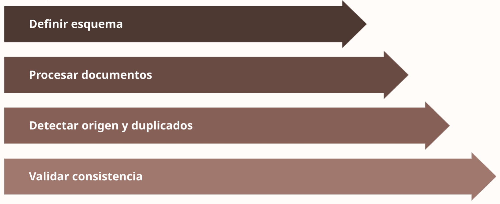

[← Anterior](00-objetivos-del-modulo.md) · [Índice del módulo](README.md) · [Siguiente →](02-sintesis-y-toma-de-decisiones.md)

# 1 · Extracción y estructuración

*Módulo 12: Prompt Engineering para análisis de información y datos*

## 1.1 El LLM como asistente de análisis

Un modelo de lenguaje es un colaborador poderoso pero imperfecto. Comprender sus capacidades reales y sus límites concretos es el punto de partida para usarlo con rigor profesional.

**✅ Qué hace bien**

- Estructurar preguntas analíticas complejas
- Extraer y resumir contenido extenso
- Generar código analítico de partida
- Proponer hipótesis y marcos de comparación

**⚠️ Dónde puede fallar**

- Cálculos numéricos exactos: puede errar sin advertirlo
- Interpretaciones que requieren contexto de negocio
- Datos actualizados más allá de su fecha de corte
- Resultados no verificados nunca deben darse por buenos

Siempre ejecuta y contrasta el código y los datos generados por el LLM antes de usarlos en decisiones reales.

**Explicación**

El modelo es un colaborador poderoso pero imperfecto. Hace bien estructurar preguntas analíticas complejas, extraer y resumir contenido extenso, generar código analítico de partida y proponer hipótesis y marcos de comparación, todo tareas de lenguaje y estructuración. Puede fallar en cálculos numéricos exactos (puede errar sin advertirlo), en interpretaciones que requieren contexto de negocio, en datos posteriores a su fecha de corte, y los resultados no verificados nunca deben darse por buenos.

De ahí una división del trabajo: el modelo estructura, extrae y propone; Python calcula; el criterio humano decide. Pedir a un modelo un porcentaje produce un número con aspecto de cálculo, pero es texto generado; pedirle el código que lo calcula y ejecutarlo garantiza que el resultado procede de una operación real. Lo mismo vale para la actualidad de los datos y el contexto del negocio: si importan, deben aportarse.

<!-- labs-seccion -->
> **Para practicar esta sección:** [Laboratorio 12A · Extracción estructurada de correos de clientes](../../laboratorios/12A/README.md)
<!-- /labs-seccion -->

---

## 1.2 Fuentes no estructuradas

El punto de partida de cualquier pipeline de extracción es reconocer qué tipos de documentos alimentarán el proceso. Cada fuente tiene sus propias convenciones, vocabulario y estructura implícita. Antes de enviarlas al modelo, minimiza y anonimiza los datos personales (módulo [09](../09-seguridad-privacidad-y-uso-responsable/README.md)).

- **Correos electrónicos**: Contienen remitente, fecha, hilo de respuestas y texto libre mezclado con datos.
- **Informes y contratos**: Documentos largos con secciones, cláusulas, fechas y partes firmantes.
- **Transcripciones**: Reuniones y entrevistas con turnos de palabra, decisiones y compromisos.
- **Documentación técnica**: Manuales, especificaciones y registros de incidencias con terminología especializada.
- **Texto libre**: Formularios abiertos, comentarios y notas sin estructura predefinida.

**Explicación**

El punto de partida de cualquier proceso de extracción es reconocer los tipos de documento que lo alimentan, cada uno con convenciones, vocabulario y estructura implícita: correos (remitente, fecha, hilo y texto libre), informes y contratos (secciones, cláusulas, fechas y partes), transcripciones (turnos, decisiones y compromisos), documentación técnica (terminología especializada) y texto libre sin estructura.

Antes de enviar estas fuentes al modelo hay que minimizar y anonimizar los datos personales (módulo [09](../09-seguridad-privacidad-y-uso-responsable/README.md)): suelen contener nombres, importes y datos sensibles, y la tentación de saltarse este paso porque el documento está a mano es precisamente el riesgo. Conocer el tipo condiciona el prompt: un correo exige distinguir lo nuevo de lo citado, un contrato atender cláusulas y definiciones y una transcripción separar lo dicho por cada participante.

---

## 1.3 Diseñar un esquema de extracción

Antes de escribir un prompt de extracción, define con precisión qué quieres obtener. Un esquema bien diseñado reduce la ambigüedad y hace que los resultados sean reproducibles y comparables entre documentos.

- **1 · Objetivo y entidad objetivo**: ¿Qué tipo de documento es y qué entidad principal se extrae? (p. ej. «contrato de servicios» → «proveedor»)
- **2 · Campos esperados**: Lista exhaustiva de los atributos a extraer: nombre, fecha de inicio, importe, vigencia, penalización, etc.
- **3 · Tipos y formatos**: Especifica el formato de salida de cada campo: ISO 8601 para fechas, número decimal con dos decimales para importes.
- **4 · Evidencia textual**: Pide al modelo que cite el fragmento original que justifica cada valor extraído.
- **5 · Tratamiento de ausencias**: Define qué devolver cuando un campo no aparece: null (valor por defecto del módulo) y, solo si el consumidor lo exige, un flag explícito como "no\_encontrado".

**Explicación**

Antes de redactar un prompt de extracción hay que definir qué se quiere obtener; un esquema bien diseñado reduce la ambigüedad y hace los resultados reproducibles y comparables. Cinco elementos: objetivo y entidad objetivo (por ejemplo, un contrato de servicios y su proveedor), campos esperados (nombre, fecha de inicio, importe, vigencia, penalización), tipos y formatos (ISO 8601 para fechas, decimales con dos cifras para importes), evidencia textual (que el modelo cite el fragmento que justifica cada valor) y tratamiento de ausencias.

Para las ausencias el valor por defecto es null y solo si el consumidor lo exige se añade un indicador explícito como «no_encontrado»; lo importante es que se represente siempre igual y nunca con un valor inventado. El esquema actúa como contrato, igual que el del módulo [07](../07-ciclo-de-vida-y-evaluacion/README.md), y permite validar el resultado automáticamente. La evidencia textual orienta al modelo y permite al revisor comprobar cada valor sin releer el documento.

<!-- labs-seccion -->
> **Para practicar esta sección:** [Laboratorio 12A · Extracción estructurada de correos de clientes](../../laboratorios/12A/README.md) · [Laboratorio 14 · Proyecto integrador: asistente de gestión de reclamaciones de Altanoria](../../laboratorios/14/README.md)
<!-- /labs-seccion -->

---

## 1.4 Extracción de entidades

La extracción de entidades (named entity recognition, NER) aplicada con prompts permite recuperar de forma sistemática los elementos clave de cualquier texto. La clave está en distinguir lo que el texto afirma explícitamente de lo que el modelo infiere.

**Tipos de entidades habituales**

- Personas y organizaciones: firmantes, departamentos, proveedores
- Fechas e importes: plazos contractuales, montos, penalizaciones
- Productos y conceptos: SKUs, servicios, tecnologías mencionadas
- Relaciones explícitas: «*A factura a B*», «*C depende de D*»

**⚠️ Mención vs. inferencia**

Instrucción crítica en el prompt:

```text
Extrae solo lo que el texto afirma explícitamente. Si una relación o valor no aparece literalmente, devuelve null y NO lo infieras.
```

La confusión entre mención e inferencia es la fuente de error más frecuente en extracción con LLMs.

**Explicación**

La extracción de entidades (NER) con prompts recupera de forma sistemática los elementos clave de un texto: personas y organizaciones, fechas e importes, productos y conceptos y relaciones explícitas («A factura a B»). Lo esencial es distinguir lo que el texto afirma de lo que el modelo infiere, con una instrucción crítica: extraer solo lo que el texto afirma explícitamente y devolver null si una relación o valor no aparece literalmente, sin inferirlo.

La confusión entre mención e inferencia es la fuente de error más frecuente en la extracción: si un contrato menciona dos empresas y el modelo deduce que una es filial de la otra porque suena razonable, aparece una relación que el documento no afirma, con riesgo para análisis jurídicos o financieros. Como el modelo tiende a completar, la instrucción debe ser tajante y acompañarse de la exigencia de cita textual.

<!-- labs-seccion -->
> **Para practicar esta sección:** [Laboratorio 12A · Extracción estructurada de correos de clientes](../../laboratorios/12A/README.md)
<!-- /labs-seccion -->

---

## 1.5 Normalización de valores extraídos

Extraer un valor no es suficiente: documentos distintos expresan la misma información de formas diferentes. La normalización convierte variantes heterogéneas en un formato canónico homogéneo que permite comparar y agregar datos con fiabilidad.

- **Fechas**: «*3 de marzo de 2024*», «*03/03/24*», «*March 3rd*» → 2024-03-03
- **Unidades**: « *€1.200*», «*1200 EUR*», «*mil doscientos euros*» → 1200.00 + moneda: EUR

**Nombres y categorías**

«*IBM*», «*I.B.M.*», «*International Business Machines*» 
→ entidad canónica (tabla maestra verificada)

**Valores no normalizables**

Si la equivalencia es dudosa, conserva el original y registra un flag normalización\_manual\_requerida: true

> Instrucción clave en el prompt: «*Si no puedes normalizar con certeza, conserva el valor original y no asumas equivalencias.*»

**Explicación**

Extraer un valor no basta: los documentos expresan lo mismo de formas diferentes y la **normalización** lo convierte a un formato canónico para comparar y agregar con fiabilidad. Las fechas «3 de marzo de 2024», «03/03/24» y «March 3rd» pasan a 2024-03-03; «€1.200», «1200 EUR» y «mil doscientos euros» pasan a 1200,00 con moneda EUR; «IBM», «I.B.M.» e «International Business Machines» pasan a una entidad canónica apoyada en una tabla maestra verificada.

Si la equivalencia es dudosa, se conserva el valor original y se marca con un indicador de normalización manual requerida: mejor un dato sin normalizar y marcado que normalizado mal y sin aviso. El modelo no debe suponer, por ejemplo, ante una fecha ambigua entre formato europeo y americano. Una división eficaz asigna al código las equivalencias que siguen reglas (formatos de fecha, tipos de cambio) y reserva el modelo para las que requieren interpretar el lenguaje.

---

## 1.6 Estructuración en JSON

JSON es el formato de salida más útil para integrar los resultados de extracción en pipelines de datos. Para obtener JSON válido y consistente, el prompt debe incluir el esquema completo de antemano.

**Elementos del esquema en el prompt**

- Definir cada campo con nombre y tipo (string, number, date)
- Marcar cuáles son obligatorios y cuáles opcionales
- Representar ausencias siempre con null, nunca con cadena vacía
- Pedir que la salida sea solo el JSON, sin texto adicional

**Ejemplo de prompt (ilustrativo)**

```text
Extrae del contrato adjunto los siguientes campos como JSON:
{
  "proveedor": string,
  "fecha_inicio": "YYYY-MM-DD",
  "importe_anual": number,
  "vigencia_meses": number,
  "penalizacion": number | null
}
Devuelve solo el JSON.
```

Tras recibir la salida, valida la sintaxis con un parser y compara cada valor con el fragmento original del documento para detectar errores silenciosos.

**Explicación**

JSON es el formato más útil para integrar los resultados de extracción en procesos de datos, y para obtenerlo válido el prompt debe incluir el esquema completo: cada campo con nombre y tipo, obligatorios y opcionales, ausencias siempre con null (nunca con cadena vacía) y la petición de devolver solo el JSON sin texto adicional.

El ejemplo extrae del contrato adjunto proveedor, fecha de inicio (año-mes-día), importe anual, vigencia en meses y penalización (número o null). Tras recibir la salida se valida la sintaxis con un analizador y se compara cada valor con el fragmento original: un JSON bien formado no es necesariamente correcto. La distinción entre cero y null es relevante: una penalización de cero significa que no hay, y null que no se sabe. Estas ideas se amplían en el módulo [06](../06-formato-de-salida-y-parametros/README.md).

---

## 1.7 Extracción por lotes

Cuando el volumen de documentos es elevado, la extracción debe organizarse como un pipeline repetible. La consistencia del esquema y el control de errores son esenciales para obtener un dataset final de calidad.



<details>
<summary>Descripción del diagrama en texto</summary>

1. **Definir esquema**
2. **Procesar documentos**
3. **Detectar origen y duplicados**
4. **Validar consistencia**

</details>

- **Control de errores parciales**: Un documento con fallo no debe detener el pipeline. Registra el error, incluye el ID del documento y continúa con los demás.
- **Trazabilidad de origen**: Cada fila del dataset final debe llevar el identificador del documento fuente para poder auditar cualquier valor.

**Explicación**

Con muchos documentos, la extracción se organiza como proceso repetible: se define un esquema único, se procesan los documentos con el mismo prompt, se detectan origen y duplicados y se valida la consistencia del conjunto. Dos prácticas son fundamentales: un documento con fallo no detiene el proceso (se registra el error con su identificador y se continúa) y cada fila del conjunto final lleva el identificador de su documento fuente para poder auditar cualquier valor.

La trazabilidad permite responder meses después de dónde salió un importe; sin ella, un dato sospechoso solo puede descartarse, no comprobarse. En un lote hay que fijar y registrar la versión del prompt y del modelo (módulo [07](../07-ciclo-de-vida-y-evaluacion/README.md)), porque si cambian a mitad los resultados dejan de ser comparables, y detectar duplicados evita contar dos veces el mismo documento.

---

## 1.8 Calidad de la extracción

Extraer datos con un LLM no garantiza fidelidad automática. Es imprescindible medir la calidad de la extracción con criterios objetivos antes de usar los datos en análisis o decisiones.

**1. Exactitud por campo**

**2. Completitud**

**3. Valores ausentes**

**4. Consistencia de formato**

**5. Trazabilidad**

**6. Revisión de muestras**

El valor extraído coincide con el original

Todos los campos esperados están presentes

*null* en lugar de invención

Fechas, números y unidades uniformes

Referencia al fragmento fuente

Validación manual de un subconjunto

> 💡 Establece un umbral mínimo de exactitud por campo según el impacto del error (p. ej. ≥ 95 %) antes de pasar a producción.

**Explicación**

Extraer con un modelo no garantiza fidelidad automática, y su calidad se mide con criterios objetivos antes de usar los datos: exactitud por campo, completitud, valores ausentes como null en lugar de invención, consistencia de formato, trazabilidad al fragmento fuente y revisión manual de muestras. Conviene fijar un umbral mínimo de exactitud por campo según el impacto del error, por ejemplo del 95 %, antes de pasar a producción.

La exactitud y la completitud se miden por separado: un campo puede estar presente en el 100 % de los registros y ser incorrecto en el 20 %, o ser siempre correcto cuando aparece pero faltar con frecuencia. No todos los campos exigen el mismo rigor: un importe contractual más que una descripción. La revisión manual de una muestra da el dato real de exactitud y decide si el proceso es apto, necesita ajustes o requiere revisión humana de todos los casos.

---

[← Anterior](00-objetivos-del-modulo.md) · [Índice del módulo](README.md) · [Siguiente →](02-sintesis-y-toma-de-decisiones.md)
