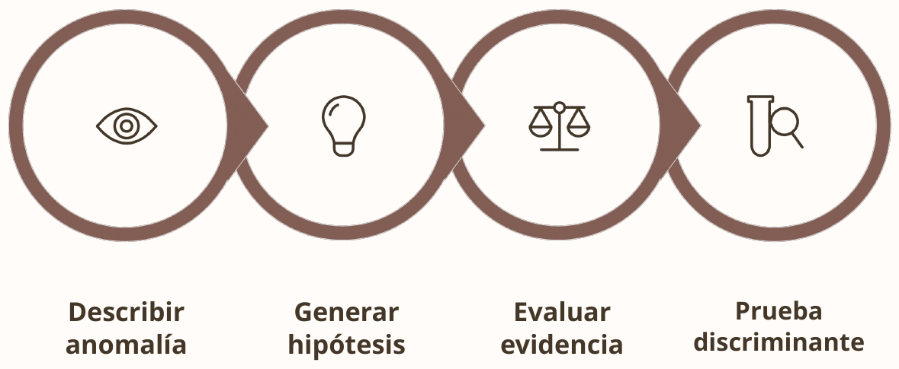

[← Anterior](01-extraccion-y-estructuracion.md) · [Índice del módulo](README.md) · [Siguiente →](03-analisis-con-python.md)

# 2 · Síntesis y toma de decisiones

*Módulo 12: Prompt Engineering para análisis de información y datos*

## 2.1 Resumen ejecutivo

El resumen ejecutivo no es una versión corta del documento: es una síntesis orientada a una decisión concreta. El prompt debe especificar la audiencia, el objetivo y la separación explícita entre evidencia y recomendación.

1. **Audiencia directiva**: Sin jerga técnica. Lenguaje de negocio orientado a impacto y riesgo.
2. **Objetivo de decisión**: Especifica en el prompt qué decisión debe facilitar el resumen.
3. **Hallazgos clave**: Máximo 3-5 puntos con evidencia directa del documento fuente.
4. **Riesgos y dependencias**: Lo que puede fallar y de qué depende el éxito de cada opción.
5. **Decisiones y acciones**: Qué debe decidirse y qué pasos concretos siguen a cada opción.
6. **Separar evidencia y recomendación**: El LLM debe etiquetar explícitamente qué es un hecho del texto y qué es una sugerencia inferida.

**Explicación**

El **resumen ejecutivo** no es una versión corta del documento, sino una síntesis orientada a una decisión concreta, y el prompt debe especificar audiencia, objetivo y separación entre evidencia y recomendación. Sus seis elementos son audiencia directiva (lenguaje de negocio, impacto y riesgo), objetivo de decisión, tres a cinco hallazgos con evidencia directa, riesgos y dependencias, decisiones y acciones y separación de evidencia y recomendación.

El último protege la integridad del resumen: el modelo etiqueta qué es un hecho del texto y qué es una sugerencia inferida, de modo que el directivo sabe qué tiene respaldo documental y qué requiere su juicio. El objetivo de decisión es lo que distingue un resumen ejecutivo de un acortamiento: el resumen de un contrato para renovarlo selecciona información distinta del mismo contrato para archivarlo. Limitar a tres o cinco hallazgos obliga a priorizar lo que cambia la decisión.

<!-- labs-seccion -->
> **Para practicar esta sección:** [Laboratorio 12B · Síntesis multidocumento para un decisor](../../laboratorios/12B/README.md)
<!-- /labs-seccion -->

---

## 2.2 Resumen técnico

A diferencia del resumen ejecutivo, el resumen técnico preserva la precisión terminológica y el detalle de implementación. Va dirigido a equipos que necesitan reproducir, mantener o auditar lo descrito.

**Elementos que el prompt debe solicitar**

- Terminología exacta del documento (sin parafrasear)
- Arquitectura, procedimientos y secuencias de pasos
- Parámetros críticos y límites operativos
- Incidencias registradas y dependencias externas
- Referencias a secciones o páginas fuente
- Advertencias técnicas y condiciones de uso

**Fragmento de prompt (ilustrativo)**

```text
Resume el documento adjunto para un equipo de ingeniería. Preserva la terminología original. Incluye: arquitectura, parámetros clave, dependencias, incidencias abiertas y referencias a sección fuente. No parafrasees términos técnicos.
```

Si el modelo parafrasea un término técnico, corrígelo explícitamente en un prompt de seguimiento.

**Explicación**

El **resumen técnico** conserva la precisión terminológica y el detalle de implementación, y se dirige a equipos que necesitan reproducir, mantener o auditar. El prompt pide la terminología exacta sin parafrasear, la arquitectura, procedimientos y secuencias, los parámetros críticos y límites operativos, las incidencias y dependencias externas, las referencias a secciones o páginas fuente y las advertencias técnicas.

Frente al resumen ejecutivo, que elimina la jerga y recorta detalles, este conserva todo lo que permite reproducir: un mismo documento da dos resúmenes distintos porque los lectores hacen cosas diferentes con ellos (decidir o implementar). Si el modelo parafrasea un término técnico (por ejemplo, cambia «latencia de cola» por «tiempo de espera largo»), se corrige explícitamente en un prompt de seguimiento. Las referencias a secciones permiten acudir al original cuando el resumen no basta.

---

## 2.3 Síntesis multidocumento

Combinar varias fuentes en una síntesis coherente es una de las tareas más valiosas y más arriesgadas del análisis asistido por LLM. El riesgo principal es que el modelo homogeneice lo que en realidad son versiones contradictorias.

- **Identificar documentos y fechas**: Numera cada fuente y especifica su fecha de publicación para mantener la trazabilidad cronológica.
- **Temas comunes**: Qué afirman todos los documentos de forma consistente — base de consenso.
- **Contradicciones explícitas**: Qué afirma cada fuente de forma distinta o incompatible. No las ocultes ni promedies.
- **Información única**: Qué aparece solo en un documento y puede ser relevante o incompleto.
- **Procedencia siempre visible**: Cada afirmación de la síntesis debe poder rastrearse a su fuente original.

> ⚠️ Instrucción clave: «*Si los documentos se contradicen en un punto, señálalo explícitamente. No elijas una versión sin justificación.*»

**Explicación**

Combinar varias fuentes en una síntesis coherente es de las tareas más valiosas y más arriesgadas, porque el modelo puede homogeneizar versiones que en realidad se contradicen. El prompt debe identificar y fechar cada fuente numerada, recoger los temas comunes (base de consenso), señalar las contradicciones explícitas sin ocultarlas ni promediarlas, indicar la información única y mantener visible la procedencia de cada afirmación. La instrucción clave es señalar los puntos en que los documentos se contradicen y no elegir una versión sin justificación.

Con dos informes de ventas distintos, un resumen fluido puede dar una cifra intermedia o escoger una sin avisar. Pedir las contradicciones convierte una debilidad del modelo (suavizar diferencias) en un resultado útil. La fecha de cada fuente es esencial para distinguir una contradicción de una evolución, y la información que aparece en un solo documento no es necesariamente errónea, pero tampoco está corroborada.

---

## 2.4 Comparación documental

Comparar versiones de un mismo documento —contratos, políticas, especificaciones— es una tarea donde el LLM aporta velocidad, pero la verificación humana sigue siendo imprescindible para los cambios de alto impacto.


Detecta los cambios literales con una herramienta de diff y usa el LLM para el análisis semántico. El prompt debe pedir una tabla con columnas: sección, texto en V1, texto en V2, tipo de cambio (textual/semántico) y nivel de impacto (alto/medio/bajo). Verifica siempre los fragmentos señalados contra los documentos originales.

**Explicación**

Comparar versiones de un documento (contratos, políticas, especificaciones) es una tarea donde el modelo aporta velocidad, pero la verificación humana es imprescindible para los cambios de alto impacto. Seis pasos: definir las versiones V1 y V2 con sus metadatos, comparar secciones equivalentes, identificar los cambios textuales literales, identificar los cambios semánticos (texto parecido con distinto significado), clasificar el impacto como alto, medio o bajo y señalar ambigüedades verificando contra los originales.

Se recomienda detectar los cambios literales con una herramienta de comparación de texto, que es exacta y no inventa, y usar el modelo para el análisis semántico. El prompt pide una tabla con sección, texto en V1, texto en V2, tipo de cambio e impacto. Un cambio de «podrá» a «deberá» parece mínimo y puede ser esencial, y clasificar el impacto concentra la revisión humana en lo que importa.

---

## 2.5 Análisis de transcripciones

Las transcripciones de reuniones contienen decisiones, compromisos y preguntas abiertas mezclados con debate, digresiones y contexto implícito. El prompt debe separar con precisión qué se acordó de qué se propuso o se debatió.

**Qué extraer**

- Participantes, si constan con nombre
- Decisiones tomadas (con evidencia textual)
- Compromisos explícitos y responsables
- Fechas y plazos solo si aparecen literalmente
- Preguntas abiertas sin resolver
- Acuerdos vs. propuestas no aprobadas

**Fragmento de prompt (ilustrativo)**

```text
Analiza la transcripción adjunta. Genera una tabla con columnas:
Tipo (Decisión | Compromiso | Pregunta abierta), Descripción, Responsable (si consta), Plazo (si consta), Evidencia textual.
No infieras responsables ni plazos.
```

Si el responsable o el plazo no aparecen explícitamente, el campo debe ser *null*.

**Explicación**

Las transcripciones mezclan decisiones, compromisos y preguntas abiertas con debate y digresiones, y el prompt debe separar qué se acordó de qué se propuso o debatió. Se extraen los participantes si constan, las decisiones con evidencia textual, los compromisos y responsables, las fechas solo si aparecen literalmente, las preguntas abiertas y los acuerdos frente a las propuestas no aprobadas, en una tabla con tipo, descripción, responsable, plazo y evidencia.

Si el responsable o el plazo no aparecen explícitamente, el campo debe ser null: el modelo tiende a asignar la tarea a quien parecía encargado o a poner una fecha razonable, y un acta con responsables inventados genera conflictos reales. Distinguir lo acordado de lo propuesto es donde más errores comete un lector apresurado, y las preguntas abiertas documentan lo pendiente para la siguiente reunión.

---

## 2.6 Generación de hipótesis

Cuando los datos muestran un fenómeno inesperado, el LLM puede actuar como un interlocutor socrático que ayuda a generar y estructurar hipótesis alternativas antes de invertir recursos en una investigación.



<details>
<summary>Descripción del diagrama en texto</summary>

1. **Describir anomalía**
2. **Generar hipótesis**
3. **Evaluar evidencia**
4. **Prueba discriminante**

</details>

- **Instrucción crítica en el prompt**: «*Genera al menos tres hipótesis alternativas y para cada una indica: evidencia disponible a favor, evidencia en contra y qué dato adicional permitiría descartarla o confirmarla.*»
- **Límite importante**: Las hipótesis generadas por el LLM son puntos de partida para investigar, no conclusiones. Nunca las presentes como hechos establecidos sin validación empírica.

**Explicación**

Ante un fenómeno inesperado en los datos, el modelo puede actuar como interlocutor socrático que ayuda a generar y estructurar hipótesis alternativas antes de invertir en investigar. El proceso es describir la anomalía, generar hipótesis, evaluar la evidencia y plantear una prueba discriminante que permita decidir entre hipótesis rivales.

La instrucción crítica es generar al menos tres hipótesis alternativas y, para cada una, la evidencia a favor, la evidencia en contra y el dato que permitiría descartarla o confirmarla. Pedir tres evita quedarse con la primera explicación plausible, y la evidencia en contra frena el sesgo de confirmación. Las hipótesis son puntos de partida para investigar, no conclusiones: el valor del modelo es ampliar el abanico de explicaciones, y la decisión la dan los datos. La prueba discriminante orienta hacia las comprobaciones más informativas.

---

## 2.7 Análisis de causas

El análisis de causas raíz es una de las aplicaciones más potentes del prompting analítico. El LLM ayuda a estructurar la investigación, pero la causalidad real solo puede establecerse con evidencia empírica, nunca por inferencia del modelo.

**Estructura del prompt de análisis causal**

- Problema observado: descripción precisa con datos
- Síntomas: manifestaciones observables del problema
- Causas candidatas: factores que podrían explicarlo
- Factores contribuyentes: condiciones que amplifican el efecto
- Evidencia necesaria: qué datos confirmarían cada causa
- Prioridad de comprobación: cuál investigar primero

**Ejemplo de instrucción (ilustrativo)**

```text
Dado el siguiente problema:
[descripción]
y los siguientes síntomas:
[lista]
Genera un diagrama de causas estructurado. Para cada causa, indica: plausibilidad (alta/media/baja), evidencia requerida para confirmarla y dependencias con otras causas.
```

El LLM puede proponer causas plausibles pero no verificadas. Establece siempre qué evidencia concreta las confirmaría.

**Explicación**

El **análisis de causas** raíz es una de las aplicaciones más potentes: el modelo ayuda a estructurar la investigación, pero la causalidad solo se establece con evidencia empírica, nunca por inferencia del modelo. El prompt tiene seis partes: problema observado con datos, síntomas, causas candidatas, factores contribuyentes, evidencia necesaria para confirmar cada causa y prioridad de comprobación.

Para cada causa se pide plausibilidad (alta, media o baja), evidencia requerida y dependencias con otras causas. Una causa muy plausible es una prioridad de investigación, no un diagnóstico. La prioridad permite empezar por lo más probable o más barato de verificar, y la distinción entre causas y factores contribuyentes evita buscar una causa única: muchos problemas reales resultan de la combinación de varias condiciones.

---

## 2.8 Tendencias y patrones

El LLM puede ayudar a explorar series temporales y datos agregados, pero su análisis cuantitativo tiene limitaciones serias. Los cálculos numéricos deben verificarse siempre en el entorno de ejecución.

- **Variables y periodo**: Especifica qué métricas analizar y el rango temporal exacto.
- **Tendencia vs. fluctuación**: Pide que distinga el comportamiento de largo plazo del ruido a corto plazo.
- **Segmentos**: Solicita el análisis desglosado por categoría, región o grupo relevante.
- **Estacionalidad y muestra**: Indica si hay ciclos conocidos y si el dataset es completo o una muestra.
- **Validar cálculos**: Nunca confíes en un porcentaje o variación calculado por el LLM sin verificarlo.
- **No extrapolar sin fundamento**: Las proyecciones requieren un modelo estadístico explícito, no intuición del LLM.

**Explicación**

El modelo puede ayudar a explorar series temporales y datos agregados, pero su análisis cuantitativo tiene limitaciones serias y los cálculos deben verificarse siempre en el entorno de ejecución. Se especifican variables y periodo, se pide distinguir tendencia de fluctuación, se solicita desglose por segmentos, se indica la estacionalidad y si los datos son completos o una muestra, no se confía en porcentajes calculados por el modelo sin verificarlos y no se extrapola sin fundamento.

Un modelo puede calcular mal un porcentaje y presentarlo con seguridad, y una proyección «a ojo» que ignora estacionalidad o tamaño de muestra produce cifras razonables pero infundadas. Lo correcto es pedir el código que calcula y proyecta y ejecutarlo. El desglose por segmentos revela patrones que el total oculta: una tendencia global estable puede esconder crecimiento en un segmento y caída en otro.

---

## 2.9 Análisis What-if y escenarios

El análisis de escenarios permite explorar cómo cambiaría una situación si se modificara una variable clave. Es una herramienta de pensamiento estructurado, no una predicción: los resultados valen lo que valen los supuestos explicitados.

- **Variable modificada**: La variable que cambia en cada escenario
- **Escenario base**: Situación actual
- **Escenario pesimista**: Variable adversa
- **Variables constantes**: Ceteris paribus: el resto permanece igual
- **Escenario optimista**: Variable favorable
- **Supuestos y límites**: Validez de cada escenario

1

2

3

4

5

6

> Instrucción clave: «*Define los supuestos de cada escenario de forma explícita. La simulación no es una predicción: es un ejercicio condicional basado en los supuestos indicados.*»

**Explicación**

El análisis de escenarios explora cómo cambiaría una situación si se modificara una variable clave; es una herramienta de pensamiento estructurado, no una predicción, y sus resultados valen lo que valen los supuestos. Sus elementos son la variable modificada, las variables constantes (ceteris paribus), el escenario base, el optimista, el pesimista y los supuestos y límites de cada uno. La simulación es un ejercicio condicional basado en los supuestos indicados.

Un escenario dice que, si ocurre esto y todo lo demás se mantiene, el resultado sería aquello; no que ocurrirá. Si no se explicitan los supuestos, el lector tiende a leer los números como pronósticos. El modelo ayuda a pensar escenarios no considerados, pero las cifras conviene calcularlas con código a partir de los supuestos declarados, e incluir la advertencia sobre su validez: hasta qué punto son razonables y qué pasaría si no se cumplieran.

---

## 2.10 Análisis de decisiones

El LLM puede ayudar a estructurar una decisión compleja mediante una matriz de alternativas y criterios ponderados. El valor de esta herramienta reside en hacer explícitos los supuestos y los datos faltantes, no en que el modelo «elija» por ti.

| Criterio | Peso | Opción A | Opción B | Opción C | Notas |
|---|---|---|---|---|---|
| Coste total | 30 % | Alto | Medio | Bajo | Verificar TCO |
| Tiempo de implantación | 25 % | 6 m | 3 m | 12 m | Supuesto |
| Riesgo técnico | 25 % | Bajo | Medio | Alto | Pendiente |
| Escalabilidad | 20 % | Alta | Media | Alta | Confirmar |

*Tabla ilustrativa.* El prompt debe incluir opciones, criterios y pesos reales. Pide siempre un análisis de sensibilidad: ¿cambia la decisión si un peso varía en ±10 puntos?

**Explicación**

El modelo puede ayudar a estructurar una decisión compleja con una matriz de alternativas y criterios ponderados; su valor es hacer explícitos los supuestos y los datos faltantes, no que el modelo elija. La tabla de ejemplo compara tres opciones según coste total (30 %), tiempo de implantación (25 %), riesgo técnico (25 %) y escalabilidad (20 %), con una columna de notas que marca qué datos son dudosos o están pendientes.

El prompt debe incluir las opciones, los criterios y los pesos reales, y conviene pedir un análisis de sensibilidad: ¿cambia la decisión si un peso varía en diez puntos? Si la opción ganadora cambia por un pequeño ajuste, la decisión no es robusta y conviene discutir los pesos antes de elegir. Los pesos son una decisión de valor, no un dato técnico, y corresponde a quienes deciden fijarlos; el modelo aplica la matriz y muestra cómo cambia el resultado.

---

## 2.11 Límites del análisis textual con LLMs

Conocer los límites del análisis con LLMs no es un freno a su uso: es el requisito para usarlos de forma profesionalmente responsable. Cada límite tiene una práctica de mitigación concreta.

- **Texto incompleto**: El documento puede omitir datos relevantes. El LLM analizará lo que tiene, no lo que falta.
- **Relaciones inventadas**: El modelo puede conectar entidades que el texto no relaciona. Pide siempre la cita textual.
- **Causalidad sin prueba**: El LLM puede proponer causas plausibles, pero la causalidad requiere diseño experimental o evidencia robusta.
- **Cálculos no fiables**: Los cálculos numéricos del LLM deben ejecutarse y verificarse en Python u otra herramienta.
- **Recomendaciones sin contexto**: Las recomendaciones del LLM no incorporan el contexto organizativo, regulatorio o estratégico real.

**Explicación**

Conocer los límites del análisis con LLM es el requisito para usarlos de forma responsable, y cada límite tiene una mitigación. Con texto incompleto, el modelo analiza lo que tiene, no lo que falta. Con relaciones inventadas, conecta entidades que el texto no relaciona, por lo que se exige la cita textual. Con causalidad sin prueba, propone causas plausibles, pero la causalidad requiere diseño experimental o evidencia robusta. Con cálculos no fiables, deben ejecutarse y verificarse en Python u otra herramienta. Y con recomendaciones sin contexto, no incorpora el contexto organizativo, regulatorio o estratégico real.

El modelo analiza lo que se le da, y su capacidad de sonar convincente supera con frecuencia a su fiabilidad. El primer límite es fácil de pasar por alto: un análisis perfecto sobre un documento incompleto produce conclusiones incompletas con apariencia de rigor, por lo que conviene preguntarse qué información relevante podría faltar.

<!-- labs-seccion -->
> **Para practicar esta sección:** [Laboratorio 12A · Extracción estructurada de correos de clientes](../../laboratorios/12A/README.md) · [Laboratorio 12B · Síntesis multidocumento para un decisor](../../laboratorios/12B/README.md)
<!-- /labs-seccion -->

---

[← Anterior](01-extraccion-y-estructuracion.md) · [Índice del módulo](README.md) · [Siguiente →](03-analisis-con-python.md)
