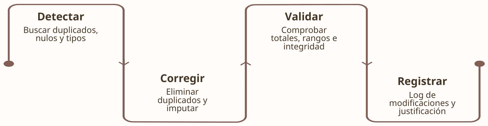

[← Anterior](02-sintesis-y-toma-de-decisiones.md) · [Índice del módulo](README.md) · [Siguiente módulo →](../13-diseno-de-sistemas-de-prompts/README.md)

# 3 · Análisis con Python

*Módulo 12: Prompt Engineering para análisis de información y datos*

## 3.1 Python para análisis asistido por LLM

El flujo de trabajo recomendado combina el LLM como generador de código y el entorno Python como ejecutor y validador. El modelo propone; el notebook ejecuta y el profesional interpreta.

- **LLM propone código**: Genera scripts de Pandas, Matplotlib u otras librerías a partir de un prompt preciso.
- **Notebook ejecuta**: Jupyter o Google Colab ejecutan el código celda a celda con los datos reales.
- **Profesional valida**: Verifica resultados, ajusta el código y itera el prompt si los resultados no son correctos.

> 💡 Entornos recomendados: Jupyter Notebook, JupyterLab, Google Colab o VS Code con extensión Python. Todos permiten ejecutar celdas de forma interactiva e inspeccionar los datos en cada paso. Si usas la herramienta de análisis del asistente, exige ver y guardar el código ejecutado para poder reproducirlo.

**Explicación**

El flujo recomendado combina el modelo como generador de código y el entorno Python como ejecutor y validador: el modelo propone, el cuaderno ejecuta y el profesional interpreta. Se generan scripts de Pandas, Matplotlib u otras librerías a partir de un prompt preciso, se ejecutan celda a celda en Jupyter o Google Colab con los datos reales y se verifican y ajustan los resultados, iterando el prompt si hace falta. Los entornos habituales son Jupyter Notebook, JupyterLab, Google Colab o VS Code con la extensión de Python.

Si se usa la herramienta de análisis integrada en un asistente, hay que exigir ver y guardar el código ejecutado, porque si solo se conserva el resultado no podrá auditarse cómo se obtuvo y se pierde la reproducibilidad. El cuaderno combina código, resultados y comentarios, lo que facilita la revisión, y su ejecución sobre datos reales convierte una propuesta en un resultado, aplicando el principio visto en el módulo [11](../11-desarrollo-de-software/README.md).

<!-- labs-seccion -->
> **Para practicar esta sección:** [Laboratorio 12C · Análisis de datos con Python asistido por un modelo](../../laboratorios/12C/README.md)
<!-- /labs-seccion -->

---

## 3.2 Pandas y DataFrames

**Pandas** es la librería central para el análisis tabular en Python. El LLM puede generar código Pandas funcional, pero el prompt debe incluir el nombre exacto de las columnas y los tipos de datos para evitar errores.

**Operaciones esenciales a solicitar**

- pd.read\_csv() — cargar datos desde archivo
- df.head() / df.info() — inspección inicial
- df.dtypes — verificar tipos de cada columna
- df[condición] — filtrado por criterios
- df.groupby().agg() — agrupación y agregación
- df.isnull().sum() — detección de valores ausentes

**Ejemplo de prompt (ilustrativo)**

```text
Tengo un DataFrame df con columnas: fecha (datetime), region (string), ventas (float), unidades (int).
Escribe código Pandas para:
1. Filtrar filas de 2024.
2. Agrupar por region.
3. Calcular suma de ventas y  media de unidades por region.
4. Mostrar el resultado ordenado  de mayor a menor ventas.
```

**Explicación**

**Pandas** es la librería central del análisis tabular en Python, y el modelo puede generar código funcional si el prompt incluye los nombres exactos de las columnas y los tipos de datos. Las operaciones esenciales son cargar con read_csv, inspeccionar con head e info, verificar tipos con dtypes, filtrar por condición, agrupar y agregar con groupby y agg y detectar ausentes con isnull y sum.

El ejemplo describe un DataFrame con fecha, región, ventas y unidades y pide cuatro pasos numerados: filtrar 2024, agrupar por región, calcular suma de ventas y media de unidades y ordenar de mayor a menor ventas. Sin los nombres de columna, el modelo inventará los suyos y el código fallará o funcionará con otra columna. Inspeccionar al principio tipos y valores ausentes revela problemas de calidad que contaminarían todo el análisis, y los tipos importan sobre todo en fechas y números leídos como texto.

---

## 3.3 Limpieza y transformación de datos

El código de limpieza generado por el LLM debe ejecutarse paso a paso. Cada transformación debe registrarse para garantizar la reproducibilidad y permitir auditar cualquier decisión tomada sobre los datos.



<details>
<summary>Descripción del diagrama en texto</summary>

1. Detectar — Buscar duplicados, nulos y tipos
2. Corregir — Eliminar duplicados y imputar
3. Validar — Comprobar totales, rangos e integridad
4. Registrar — Log de modificaciones y justificación

</details>

- **Instrucción de trazabilidad en el prompt**: «*Añade un comentario en cada línea de transformación explicando por qué se aplica. Registra en un log el número de filas eliminadas en cada paso y el motivo.*»
- **Validar totales**: Antes y después de la limpieza, compara el número de filas, la suma de columnas clave y el número de valores únicos en campos de categoría para detectar pérdidas inesperadas.

**Explicación**

El código de limpieza generado debe ejecutarse paso a paso, registrando cada transformación para garantizar la reproducibilidad y poder auditar las decisiones. El ciclo es detectar (duplicados, nulos, tipos incorrectos), corregir (eliminar duplicados e imputar), registrar (qué se modificó y por qué) y validar (totales, rangos e integridad). El prompt pide un comentario en cada línea de transformación y un registro del número de filas eliminadas en cada paso con su motivo.

Antes y después de la limpieza se comparan filas, sumas de columnas clave y valores únicos de las categorías para detectar pérdidas inesperadas; por ejemplo, un criterio de duplicados demasiado amplio puede descartar registros legítimos. La imputación, como sustituir ausentes por la media, tiene consecuencias (reduce la variabilidad y puede distorsionar), y su criterio debe decidirlo quien conoce los datos y quedar registrado, no dejarse a la elección automática del modelo.

---

## 3.4 Estadística descriptiva

El análisis descriptivo es el primer paso de cualquier exploración de datos. El LLM puede generar el código para calcularlo, pero la interpretación de los resultados debe hacerla el profesional con conocimiento del dominio.

**Qué solicitar al LLM**

- Conteos y frecuencias: distribución de categorías
- Media y mediana: para detectar asimetrías
- Desviación típica y percentiles: P25, P75, P95
- Segmentación: estadísticos por grupo o categoría
- Valores extremos: identificar con cautela, no eliminar automáticamente

**Ejemplo de prompt (ilustrativo)**

```text
Genera código Python con Pandas para calcular estadísticos
descriptivos del DataFrame df:
- Columnas numéricas: media, mediana, std, P25, P75, máx.
- Columnas categóricas: frecuencia y porcentaje.
- Segmenta por la columna 'region'.
Muestra el resultado como tabla.
```

> ⚠️ Media y desviación no son robustas ante outliers. Siempre contrasta con mediana y percentiles antes de concluir.

**Explicación**

El análisis descriptivo es el primer paso de cualquier exploración. El modelo puede generar el código, pero la interpretación la hace el profesional con conocimiento del dominio. Se piden conteos y frecuencias, media y mediana (para detectar asimetrías), desviación típica y percentiles (P25, P75, P95), segmentación por grupos y valores extremos identificados con cautela, sin eliminarlos automáticamente.

La media y la desviación no son robustas ante valores atípicos, por lo que se contrastan siempre con la mediana y los percentiles: si la media es mucho mayor que la mediana, hay valores extremos que tiran de ella. Los extremos no se eliminan por defecto, porque pueden ser errores pero también el hallazgo más importante, y decidirlo exige conocimiento del negocio. La segmentación evita analizar el conjunto como si fuera homogéneo.

---

## 3.5 Visualización con Matplotlib

El gráfico correcto depende de la pregunta analítica, no de la estética. Un buen prompt de visualización especifica el tipo de gráfico, las variables, las unidades y los requisitos de legibilidad antes de pedir el código.


- **Requisitos mínimos de calidad visual**: El prompt debe solicitar: título descriptivo, etiquetas en ambos ejes con unidades, leyenda si hay varias series, y escala del eje Y desde cero en gráficos de barras (en otros tipos, indica el rango y justifícalo).
- **Interpretar respecto a los datos**: Pide al LLM que incluya una celda adicional con la interpretación del gráfico en texto. Verifica que la interpretación corresponda a lo que el gráfico realmente muestra.

**Explicación**

El gráfico correcto depende de la pregunta analítica, no de la estética, y el prompt de visualización indica tipo de gráfico, variables, unidades y requisitos de legibilidad. La comparación entre categorías pide barras; la evolución temporal, líneas con la fecha en el eje horizontal; la distribución, histograma o diagrama de caja; la correlación, diagrama de dispersión; y la composición, barras apiladas o tarta con un máximo de cinco categorías.

Los requisitos mínimos son título descriptivo, etiquetas en ambos ejes con unidades, leyenda si hay varias series y eje vertical desde cero en gráficos de barras (en otros tipos, indicar y justificar el rango). Conviene pedir una celda con la interpretación del gráfico en texto y verificar que corresponde a lo que muestra: es habitual que el texto describa una tendencia que el gráfico no tiene. Un eje truncado exagera diferencias pequeñas, y una tarta con muchas categorías resulta ilegible.

---

## 3.6 Prompt para código analítico

La calidad del código Python generado por el LLM es directamente proporcional a la precisión del prompt. Un prompt incompleto produce código que compila pero no responde la pregunta correcta.

**Checklist del prompt de código**

- ✅ Nombre y estructura del DataFrame o CSV
- ✅ Nombre exacto de cada columna y su tipo
- ✅ Pregunta analítica específica a responder
- ✅ Librerías permitidas (Pandas, NumPy, Matplotlib…)
- ✅ Instrucción de reproducibilidad (random\_state, semillas)
- ✅ Manejo de nulos y errores
- ✅ Supuestos y restricciones del negocio

**Prompt completo (ilustrativo)**

```text
Entorno: Python 3.11, Pandas 2.x, Matplotlib 3.x.
DataFrame df: columnas fecha (datetime64), producto (str),
ventas (float), region (str).

Sin valores nulos en fecha ni
producto. ventas puede tener nulos.

Tarea: Calcula ventas totales por producto y region en 2024. Excluye filas con ventas nulas. Genera un gráfico de barras agrupadas por region (x) y producto (barras). Etiqueta ejes, añade título y leyenda. Código reproducible.
```

**Explicación**

La calidad del código Python generado es proporcional a la precisión del prompt; uno incompleto produce código que compila pero no responde a la pregunta correcta. La lista de comprobación incluye nombre y estructura del DataFrame o CSV, nombre exacto y tipo de cada columna, la pregunta analítica específica, las librerías permitidas, la reproducibilidad (estado aleatorio o semillas), el manejo de nulos y errores y los supuestos y restricciones del negocio.

El prompt completo del ejemplo indica el entorno (Python 3.11, Pandas 2, Matplotlib 3), describe el DataFrame con sus columnas y tipos, aclara que ventas puede tener nulos pero fecha y producto no, y pide las ventas totales por producto y región en 2024, excluyendo filas sin ventas, en un gráfico de barras agrupadas con ejes, título y leyenda, y código reproducible. Es largo, pero cada elemento evita una suposición, y el manejo de nulos fija una decisión de análisis que, si no se indica, tomaría el modelo por su cuenta.

---

## 3.7 Validar código y resultados

La ejecución del código es necesaria pero no suficiente. Un script que corre sin errores puede producir resultados incorrectos si los filtros son erróneos, los tipos no coinciden o la lógica no responde la pregunta original.

1. **Ejecutar el código**: Nunca confíes en el código sin ejecutarlo. Los errores de sintaxis son los más fáciles de detectar; los lógicos, los más peligrosos.
2. **Comprobar dimensiones**: Verifica que el número de filas y columnas del resultado es coherente con los datos de entrada.
3. **Contrastar cálculos**: Recalcula manualmente dos o tres filas para confirmar que las fórmulas son correctas.
4. **Verificar filtros y escalas**: Confirma que los filtros aplicados incluyen y excluyen exactamente los registros esperados.
5. **Revisar interpretaciones**: La interpretación en texto que genera el LLM debe concordar con los valores numéricos del gráfico o la tabla.
6. **Reproducir**: Ejecuta el notebook desde cero en un entorno limpio para garantizar que los resultados son reproducibles sin dependencias ocultas.

**Explicación**

Ejecutar el código es necesario pero no suficiente: un script puede correr sin errores y dar resultados incorrectos si los filtros son erróneos, los tipos no coinciden o la lógica no responde a la pregunta. Seis pasos: ejecutar el código (los errores lógicos son los más peligrosos), comprobar las dimensiones del resultado frente a la entrada, recalcular manualmente dos o tres filas, verificar que los filtros incluyen y excluyen exactamente lo esperado, revisar que la interpretación en texto concuerda con los valores del gráfico o la tabla y reproducir el cuaderno desde cero en un entorno limpio.

Recalcular a mano dos o tres filas detecta la mayoría de los errores de fórmula, y ejecutar desde cero evita el «a mí me funciona» causado por celdas ejecutadas fuera de orden. Los errores lógicos no producen mensajes: un filtro que excluye un mes por una comparación mal escrita genera resultados plausibles y solo se detecta contrastando con una expectativa independiente. Es la misma disciplina de los módulos [07](../07-ciclo-de-vida-y-evaluacion/README.md) y [11](../11-desarrollo-de-software/README.md) aplicada al análisis de datos.

---

## 3.8 Caso completo: de documentos a indicadores

Este caso integra todas las técnicas del módulo en un pipeline de extremo a extremo. *Ejemplo ilustrativo.* El flujo combina extracción textual, normalización, análisis con Python y visualización de resultados.

- **1 · Extraer campos clave**: Prompt de extracción sobre cada contrato: proveedor, importe, fecha de inicio, vigencia y penalización → salida JSON.
- **2 · Normalizar y consolidar**: Normalizar con código (fechas ISO 8601; importes a EUR con tipo de cambio y fecha de referencia) y usar el LLM solo en casos dudosos. Consolidar los JSON en un CSV.
- **3 · Cargar en Pandas**: Prompt de código: leer CSV, verificar tipos, detectar nulos, limpiar y validar totales.
- **4 · Calcular indicadores**: Gasto total por proveedor, contratos próximos a vencer, distribución de importes por categoría.
- **5 · Visualizar patrones**: Gráfico de barras por proveedor y línea temporal de vencimientos. Verificar escalas e interpretaciones.
- **6 · Documentar límites**: Registrar supuestos, campos con extracción incierta y decisiones de normalización para auditoría futura.

**Explicación**

El caso integra todas las técnicas en un proceso de extremo a extremo. Seis pasos: extraer los campos clave de cada contrato (proveedor, importe, fecha de inicio, vigencia y penalización) en JSON; normalizar con código (fechas ISO 8601, importes a euros con tipo de cambio y fecha de referencia) usando el modelo solo en los casos dudosos y consolidar en un CSV; cargar en Pandas, verificar tipos, detectar nulos, limpiar y validar totales; calcular indicadores (gasto por proveedor, contratos próximos a vencer y distribución de importes); visualizar con barras por proveedor y línea temporal de vencimientos verificando escalas e interpretaciones; y documentar supuestos, campos inciertos y decisiones de normalización.

El modelo se usa donde es fuerte (leer texto) y el código determinista donde hace falta exactitud (normalizar y calcular). Cada paso produce un artefacto comprobable, y el último da valor duradero: un análisis que documenta sus supuestos e incertidumbres puede auditarse, repetirse y mejorarse.

<!-- labs-seccion -->
> **Para practicar esta sección:** [Laboratorio 12B · Síntesis multidocumento para un decisor](../../laboratorios/12B/README.md) · [Laboratorio 12C · Análisis de datos con Python asistido por un modelo](../../laboratorios/12C/README.md)
<!-- /labs-seccion -->

---

## 3.9 Errores frecuentes y buenas prácticas

Estos son los antipatrones más comunes detectados en el uso de LLMs para análisis. Reconocerlos es el primer paso para evitarlos sistemáticamente en proyectos reales.

| Antipatrón | Riesgo | Buena práctica |
|---|---|---|
| No contrastar la extracción con el texto original | Datos incorrectos en el dataset | Pedir cita textual siempre |
| Confundir inferencia del modelo con dato del documento | Conclusiones sin evidencia | Distinguir mención e inferencia en el prompt |
| Omitir la procedencia de cada afirmación | Imposible auditar resultados | Registrar ID de documento fuente |
| No ejecutar el código generado | Errores silenciosos en producción | Ejecutar siempre en entorno real |
| Elegir el gráfico por estética, no por pregunta | Visualización engañosa o irrelevante | Seleccionar según tipo de análisis |
| Confundir correlación con causalidad | Decisiones basadas en espurios | Pedir evidencia discriminante |
| No documentar supuestos del análisis | Resultados no reproducibles | Registrar supuestos en el notebook |

> Principio de cierre del módulo: el LLM acelera el análisis, pero la responsabilidad de la calidad, la trazabilidad y la interpretación correcta siempre recae en el profesional.

**Explicación**

Los antipatrones más comunes son siete, y cada uno se corrige con una práctica: no contrastar la extracción con el texto original (pedir siempre la cita textual), confundir inferencia con dato del documento (distinguir mención e inferencia en el prompt), omitir la procedencia (registrar el identificador del documento fuente), no ejecutar el código generado (ejecutar siempre en un entorno real), elegir el gráfico por estética (seleccionarlo según el análisis), confundir correlación con causalidad (pedir evidencia discriminante) y no documentar los supuestos (registrarlos en el cuaderno).

Son siete maneras de perder el control sobre el origen y la validez de los resultados, y las prácticas son siete maneras de recuperarlo. El principio de cierre es que el modelo acelera el análisis, pero la responsabilidad de la calidad, la trazabilidad y la interpretación correcta siempre recae en el profesional. Con este módulo concluye el bloque de aplicaciones; el último módulo integra todo en el diseño de sistemas de prompts.

<!-- labs-seccion -->
> **Para practicar esta sección:** [Laboratorio 12A · Extracción estructurada de correos de clientes](../../laboratorios/12A/README.md) · [Laboratorio 12B · Síntesis multidocumento para un decisor](../../laboratorios/12B/README.md) · [Laboratorio 12C · Análisis de datos con Python asistido por un modelo](../../laboratorios/12C/README.md)
<!-- /labs-seccion -->

---

## 3.10 Resumen

Este módulo ha mostrado cómo usar un LLM para convertir texto libre en datos, sintetizar varias fuentes sin perder la trazabilidad y analizar datos con código validado.

**Ideas clave del módulo**

1. Extraer con un esquema explícito y usar null cuando un dato no consta.
1. Normalizar fechas, importes e identificadores con reglas escritas en el prompt.
1. Medir la extracción campo a campo y contar los valores inventados aparte: son los más peligrosos.
1. Sintetizar manteniendo la fuente de cada cifra y distinguir contradicciones reales de diferencias de definición.
1. No promediar ni «resolver» cifras de fuentes distintas: se presentan con su método.
1. Validar el código analítico y sus resultados antes de usarlos: el modelo acelera el análisis, no lo sustituye.

**Explicación**

El resumen reúne seis ideas que recorren el módulo: extraer con un esquema explícito y null cuando un dato no consta, normalizar fechas, importes e identificadores con reglas escritas, medir la extracción campo a campo contando aparte los valores inventados, sintetizar manteniendo la fuente de cada cifra, no mezclar cifras de fuentes distintas y validar el código analítico antes de usarlo.

Sirve como lista de comprobación antes de dar por bueno cualquier análisis hecho con ayuda de un modelo: el modelo acelera el trabajo, pero el control sobre el origen y la validez de los resultados sigue siendo de la persona.

---

## 3.11 Comprobación de comprensión

Piensa cada respuesta, de forma oral o por escrito, antes de ver las respuestas orientativas, que aparecen a continuación.

**Preguntas de comprobación**

1. ¿Por qué un valor inventado es peor que un campo vacío?
1. ¿Cómo se resuelve una fecha relativa como «el martes pasado»?
1. ¿Qué diferencia hay entre una contradicción real y una diferencia de definición?
1. ¿Por qué no se promedian las cifras de fuentes distintas?
1. ¿Qué hay que hacer antes de fiarse de código de análisis generado por un modelo?

**Explicación**

La comprobación de comprensión propone cinco preguntas sobre los errores más costosos en análisis con LLM: por qué un valor inventado es peor que un campo vacío, cómo se resuelve una fecha relativa, cuándo una diferencia entre cifras es una contradicción real y cuándo solo de definición, por qué no se promedian cifras de fuentes distintas y qué hay que hacer antes de fiarse de código generado. Conviene responder antes de ver las respuestas de la diapositiva siguiente.

Las preguntas se practican en los laboratorios 12A, de extracción estructurada, y 12B, de **síntesis multidocumento**.

---

## 3.12 Comprobación de comprensión: respuestas

Contrasta tus respuestas con estas. Son orientativas: lo importante es que cubran las ideas clave del módulo.

**Preguntas de comprobación y respuestas orientativas**

1. ¿Por qué un valor inventado es peor que un campo vacío?

Un campo vacío se ve y se completa; uno inventado parece real, contamina los datos y nadie sabe que está mal.

1. ¿Cómo se resuelve una fecha relativa como «el martes pasado»?

Dándole al modelo la fecha del documento y una regla de cálculo; si no hay un momento concreto, el valor es null.

1. ¿Qué diferencia hay entre una contradicción real y una diferencia de definición?

En la real, dos fuentes miden lo mismo de la misma forma y discrepan; en la de definición miden cosas distintas (población, método o periodo) y no se contradicen.

1. ¿Por qué no se promedian las cifras de fuentes distintas?

Porque el promedio no mide nada y se pierde la trazabilidad. Cada cifra se presenta con su fuente, su método y su población.

1. ¿Qué hay que hacer antes de fiarse de código de análisis generado por un modelo?

Ejecutarlo, comprobar el resultado con casos de respuesta conocida y revisar los supuestos: nulos, tipos, unidades y filtros.

**Explicación**

Las respuestas orientativas coinciden en una regla: ninguna cifra debe llegar a un informe sin que se pueda rastrear su origen. Un valor inventado parece real y contamina los datos; una fecha relativa necesita la fecha del documento y una regla de cálculo, o null; una contradicción real se da entre fuentes que miden lo mismo de la misma forma; el promedio de cifras de fuentes distintas no mide nada; y el código analítico se ejecuta y se contrasta con casos de respuesta conocida, revisando nulos, tipos, unidades y filtros.

Con este módulo se completan las aplicaciones: el siguiente reúne todo lo anterior en el diseño de sistemas de prompts con varias etapas.

---

[← Anterior](02-sintesis-y-toma-de-decisiones.md) · [Índice del módulo](README.md) · [Siguiente módulo →](../13-diseno-de-sistemas-de-prompts/README.md)
