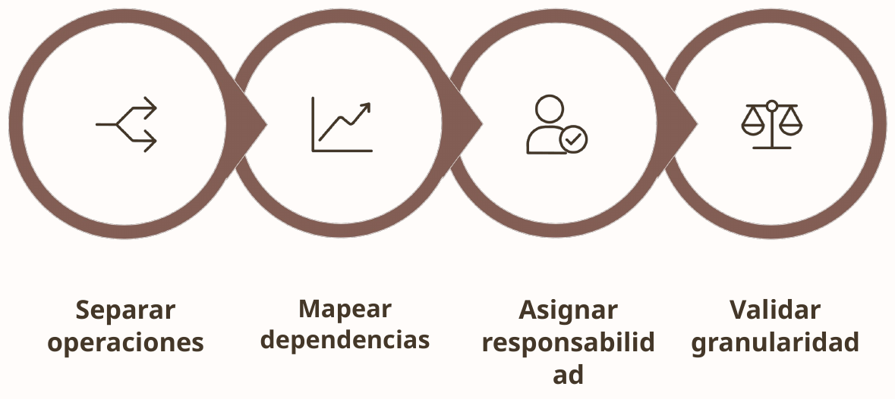
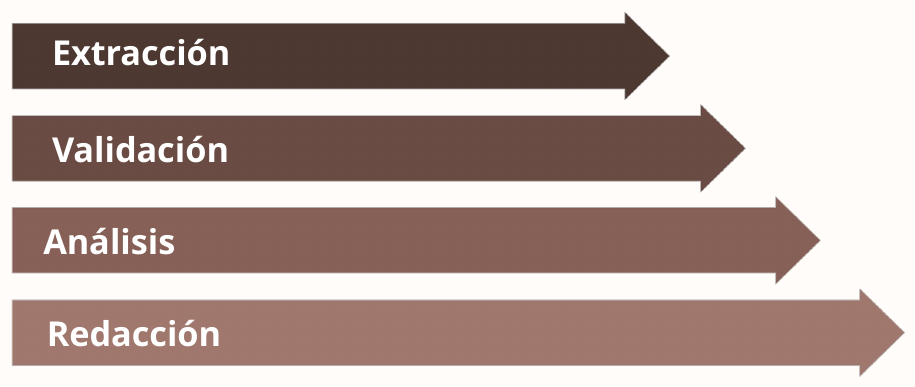
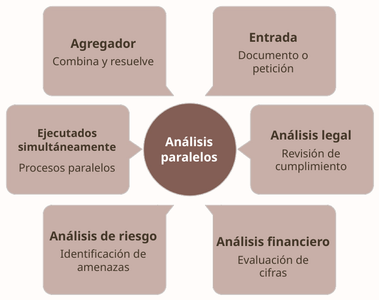

[← Anterior](00-objetivos-del-modulo.md) · [Índice del módulo](README.md) · [Siguiente →](02-conversaciones-contexto-y-estado.md)

# 1 · De prompt individual a sistema

*Módulo 13: Diseño de sistemas de prompts*

## 1.1 De prompt individual a sistema

**Un solo prompt**

Las tareas simples, acotadas y sin dependencias pueden resolverse con un único prompt bien diseñado. Es la opción más económica, rápida y fácil de mantener.

- Tarea atómica y sin ramas
- Entrada y salida bien definidas
- Sin necesidad de historial

**Cuándo un prompt no basta**

Los procesos complejos exigen fases porque los resultados intermedios necesitan validación, la lógica de negocio tiene ramas y los errores deben contenerse. La arquitectura aporta modularidad, pero también añade puntos de fallo que hay que gestionar.

- Proceso con varias etapas dependientes
- Resultados que alimentan pasos posteriores
- Necesidad de validación y recuperación
- Coste de error alto si no se aíslan fallos

> Regla práctica: empieza siempre con el prompt más simple posible. Añade complejidad arquitectónica solo cuando el caso lo justifique.

**Explicación**

Las tareas simples, acotadas y sin dependencias se resuelven con un único prompt bien diseñado, que es la opción más económica, rápida y fácil de mantener. Se reconocen porque la tarea es atómica y sin ramas, la entrada y la salida están bien definidas y no hace falta historial. Los procesos complejos exigen fases: hay varias etapas dependientes, los resultados intermedios alimentan pasos posteriores y necesitan validación, y un error cuesta caro si no se aíslan los fallos.

La arquitectura aporta modularidad, pero también puntos de fallo: cada etapa es una llamada más, con su coste, latencia y posibilidad de error, y cada conexión es un lugar donde los datos pueden perder formato o significado. Por eso la regla práctica es empezar con el prompt más simple posible y añadir complejidad solo cuando el caso lo justifique. Muchos sistemas se diseñan como cadenas cuando un buen prompt habría bastado.

<!-- labs-seccion -->
> **Para practicar esta sección:** [Laboratorio 13A · Cadena de tres etapas con contratos y puertas de validación](../../laboratorios/13A/README.md)
<!-- /labs-seccion -->

---

## 1.2 Identificar el proceso de negocio

Antes de diseñar cualquier sistema de prompts, es imprescindible comprender el proceso real que se va a automatizar o asistir. Este mapa de proceso debe responder a seis preguntas clave:

- **Usuario y objetivo**: ¿Quién usa el sistema y qué resultado necesita obtener?
- **Evento de inicio**: ¿Qué desencadena el proceso? Un mensaje, un fichero, un evento de sistema.
- **Entradas y fuentes**: ¿Qué datos se necesitan y de dónde provienen?
- **Decisiones y excepciones**: ¿Dónde hay ramas, casos especiales o errores esperables?
- **Resultado final**: ¿Cuál es la salida esperada y quién la consume?
- **Impacto y riesgo**: ¿Qué consecuencias tiene un error? ¿Qué controles son obligatorios?

**Explicación**

Antes de diseñar un sistema hay que comprender el proceso real que se va a automatizar o asistir; el error más común es escribir prompts sin haberlo entendido. El mapa responde a seis preguntas: quién usa el sistema y qué necesita, qué desencadena el proceso (un mensaje, un fichero o un evento), qué datos se necesitan y de dónde vienen, dónde hay ramas, excepciones o errores esperables, cuál es la salida y quién la consume y qué consecuencias tiene un error y qué controles son obligatorios.

Las dos últimas condicionan el diseño: quién consume la salida determina su formato (texto si lo lee una persona, estructurada si la consume otro sistema) y el impacto del error decide cuánta validación y supervisión hace falta; no es lo mismo clasificar correos que aprobar pagos. Las excepciones son fuente de muchas sorpresas: los procesos reales tienen casos especiales que no aparecen en la descripción oficial, y entrevistar a quienes los realizan suele revelar más que cualquier documento.

---

## 1.3 Descomposición en subtareas

Convertir un proceso en unidades manejables es el primer paso de diseño arquitectónico. Una buena descomposición facilita la asignación de responsabilidades, la prueba independiente y la reutilización de componentes.

Descripción del diagrama en texto

1. **Separar operaciones**
2. **Mapear dependencias**
3. **Asignar responsabilidad**
4. **Validar granularidad**

**✓ Buenas prácticas**

- Cada subtarea tiene una responsabilidad clara
- Las dependencias están explícitas
- Las tareas paralelas se identifican para optimizar latencia

**✗ Errores frecuentes**

- Mezclar lógica de negocio y generación en un prompt
- Fragmentar en exceso cuando un prompt único basta
- No documentar dependencias entre pasos

**Explicación**

Convertir un proceso en unidades manejables es el primer paso de diseño y facilita asignar responsabilidades, probar por separado y reutilizar. Se separan las operaciones, se mapean las dependencias, se asigna responsabilidad a cada componente y se valida la granularidad. Las buenas prácticas son que cada subtarea tenga una responsabilidad clara, que las dependencias estén explícitas y que se identifiquen las tareas paralelas para optimizar la latencia.

Los errores frecuentes son mezclar lógica de negocio y generación en un prompt, fragmentar en exceso cuando un prompt único basta y no documentar las dependencias. La granularidad es un equilibrio: demasiado gruesa y el prompt vuelve a ser inmanejable, demasiado fina y se multiplican coste, latencia y fallos. Que un mismo prompt decida la categoría de una solicitud y redacte la respuesta impide saber, si falla, qué falló; separarlos permite probar con criterios distintos (exactitud para la decisión, estilo para la redacción).

---

## 1.4 Contratos entre etapas

Un **contrato de etapa** es el acuerdo formal que define qué espera recibir una etapa y qué se compromete a devolver. Sin contratos explícitos, las cadenas se vuelven frágiles y los errores se propagan sin control.

- **Entrada esperada**: Tipo de datos, campos obligatorios y opcionales, restricciones de formato y longitud máxima permitida.
- **Salida esperada**: Estructura de respuesta, tipos de campo, formato de serialización (JSON, Markdown, texto libre).
- **Errores y ausencias**: Qué devolver cuando falta información, cómo señalar un fallo sin romper el flujo.
- **Criterios de aceptación**: Condiciones mínimas que debe cumplir la salida para que la siguiente etapa la acepte.
- **Versión del contrato**: Identificador de versión para detectar incompatibilidades cuando se actualiza un prompt.

> 💡 Ejemplo ilustrativo: Etapa 1 → {"resumen": string, "palabras\_clave": string[], "fragmentos\_fuente": string[]} · Si algún dato clave no tiene un fragmento fuente localizable, la etapa 2 solicita revisión humana.

**Explicación**

Un **contrato de etapa** es el acuerdo que define qué espera recibir una etapa y qué se compromete a devolver; sin contratos explícitos, las cadenas son frágiles y los errores se propagan. Tiene cinco elementos: entrada esperada (tipos, campos obligatorios y opcionales, formato y longitud), salida esperada (estructura, tipos y serialización), errores y ausencias (qué devolver cuando falta información y cómo señalar un fallo sin romper el flujo), criterios de aceptación para que la siguiente etapa acepte la salida y versión del contrato.

En el ejemplo, la etapa 1 devuelve resumen, palabras clave y fragmentos fuente, y si algún dato clave no tiene fragmento localizable, la etapa 2 solicita revisión humana: el contrato incluye qué ocurre cuando algo falla. La versión avisa de que cambiar un prompt rompe a quien lo consume, aplicando el versionado del módulo [07](../07-ciclo-de-vida-y-evaluacion/README.md) a las interfaces, y es la base de las **puertas de validación**: sin contrato no hay nada contra qué validar.

<!-- labs-seccion -->
> **Para practicar esta sección:** [Laboratorio 13A · Cadena de tres etapas con contratos y puertas de validación](../../laboratorios/13A/README.md) · [Laboratorio 14 · Proyecto integrador: asistente de gestión de reclamaciones de Altanoria](../../laboratorios/14/README.md)
<!-- /labs-seccion -->

---

## 1.5 Arquitectura secuencial

En una arquitectura secuencial, la salida de cada etapa alimenta directamente la siguiente. Es el patrón más común y el punto de partida para cualquier sistema de prompts.

Descripción del diagrama en texto

1. **Extracción**
2. **Validación**
3. **Análisis**
4. **Redacción**

- **Función única**: Cada prompt tiene una responsabilidad clara y acotada.
- **Validar antes de continuar**: Nunca pasar datos inválidos a la siguiente etapa.
- **Registrar estado**: Guardar resultado y causa de cada transición para trazabilidad.
- **Controlar contexto**: Pasar solo la información necesaria a cada etapa.

**Explicación**

En la **arquitectura secuencial** la salida de cada etapa alimenta la siguiente; es el patrón más común y el punto de partida. El ejemplo clásico son cuatro eslabones: extracción, análisis, redacción y validación. Cuatro principios: función única por prompt, validar antes de continuar sin pasar datos inválidos, registrar el estado con el resultado y la causa de cada transición y controlar el contexto pasando a cada etapa solo lo necesario.

El último se olvida con frecuencia: pasar todo el historial «por si acaso» aumenta coste y ruido y puede exponer datos sensibles a etapas que no los necesitan. Cada etapa debe recibir lo mínimo para su trabajo, un mínimo privilegio informativo. Es la más fácil de razonar y depurar, porque el flujo es lineal y se examinan las etapas en orden hasta localizar el fallo; su límite es que no aprovecha la ejecución paralela ni gestiona bifurcaciones por sí sola.

<!-- labs-seccion -->
> **Para practicar esta sección:** [Laboratorio 13A · Cadena de tres etapas con contratos y puertas de validación](../../laboratorios/13A/README.md)
<!-- /labs-seccion -->

---

## 1.6 Arquitectura ramificada

Cuando el flujo debe tomar caminos distintos según una condición, se utiliza una arquitectura ramificada. Un prompt clasificador evalúa la condición y selecciona la rama adecuada; al final, los resultados se unifican en una salida coherente.

- **Evaluar condición**: Usar temperatura baja, salidas acotadas y auditar el clasificador.
- **Definir excepciones**: Siempre incluir una rama para casos no previstos.
- **Unificar resultados**: El formato de salida debe ser homogéneo en todas las ramas.
- **No inventar estado**: El modelo no debe decidir rutas que dependen de datos externos sin verificar.

**Explicación**

Cuando el flujo debe tomar caminos distintos según una condición, se usa una **arquitectura ramificada**: un prompt clasificador evalúa la condición y deriva a una rama (estándar, compleja o excepción), y un unificador combina los resultados en una salida coherente. Se debe evaluar la condición con temperatura baja y salidas acotadas y auditar el clasificador, incluir siempre una rama para los casos no previstos, unificar el formato de salida de todas las ramas y no dejar que el modelo decida rutas que dependen de datos externos sin verificarlos.

La rama de excepciones distingue un sistema maduro: si el clasificador solo conoce dos categorías, un caso imprevisto se fuerza hacia una con apariencia de seguridad; con una tercera rama, el sistema puede reconocer lo que no entiende y escalarlo. El clasificador es un punto único de decisión, así que conviene evaluarlo por separado con casos de respuesta conocida y definir qué hacer cuando su confianza es baja.

<!-- labs-seccion -->
> **Para practicar esta sección:** [Laboratorio 13B · Sistema ramificado con recuperación de documentos y evaluación extremo a extremo](../../laboratorios/13B/README.md)
<!-- /labs-seccion -->

---

## 1.7 Arquitectura paralela

Cuando varias perspectivas o análisis son independientes entre sí, se pueden ejecutar en paralelo y combinar sus resultados. Esto reduce latencia total, pero requiere reglas claras de agregación y resolución de contradicciones.

Descripción del diagrama en texto

1. Ejecutados simultáneamente — Procesos paralelos
2. Agregador — Combina y resuelve
3. Análisis de riesgo — Identificación de amenazas
4. **Análisis paralelos**
5. Entrada — Documento o petición
6. Análisis financiero — Evaluación de cifras
7. Análisis legal — Revisión de cumplimiento

**Consideraciones clave**

- Dividir perspectivas: cada rama analiza una dimensión diferente del mismo problema.
- Reglas de combinación: definir cómo se pondera o prioriza cada resultado parcial.
- Resolver contradicciones: establecer un mecanismo de desempate cuando las ramas discrepan.
- Coste y latencia: el coste total es la suma de todas las llamadas; la latencia es la del más lento.

**Explicación**

Cuando varios análisis son independientes entre sí, pueden ejecutarse en paralelo y combinar sus resultados: se reduce la latencia total, pero hacen falta reglas de agregación y de resolución de contradicciones. En el ejemplo, un documento se reparte en un análisis de riesgo, uno financiero y uno legal que se ejecutan a la vez y un agregador combina los resultados.

Las consideraciones son dividir las perspectivas por dimensión, definir cómo se pondera cada resultado parcial, fijar un mecanismo de desempate cuando discrepan y tener en cuenta que el coste total es la suma de las llamadas y la latencia es la del más lento. Se gana tiempo, pero no se ahorra dinero. Las perspectivas deben ser genuinamente independientes (si una necesita el resultado de otra, no pueden ejecutarse a la vez) y un buen agregador no oculta los desacuerdos, los presenta.

<!-- labs-seccion -->
> **Para practicar esta sección:** [Laboratorio 13A · Cadena de tres etapas con contratos y puertas de validación](../../laboratorios/13A/README.md)
<!-- /labs-seccion -->

---

[← Anterior](00-objetivos-del-modulo.md) · [Índice del módulo](README.md) · [Siguiente →](02-conversaciones-contexto-y-estado.md)
