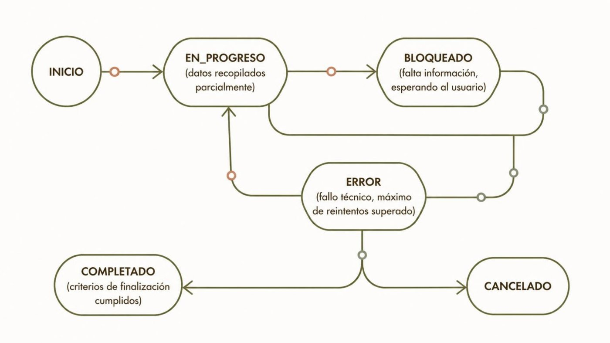
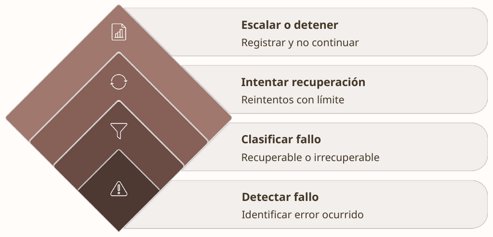

[← Anterior](01-de-prompt-individual-a-sistema.md) · [Índice del módulo](README.md) · [Siguiente →](03-encadenamiento-y-roles.md)

# 2 · Conversaciones, contexto y estado

*Módulo 13: Diseño de sistemas de prompts*

## 2.1 Conversaciones multi-turn

En un sistema multi-turn, cada turno del diálogo aporta información nueva o solicita una acción concreta. El sistema debe mantener el objetivo general mientras gestiona cambios de intención y evita repetir preguntas ya respondidas.

1. **Turno 1**: Usuario expresa necesidad. Sistema identifica objetivo y datos faltantes.
2. **Turno 2–N**: Intercambio de información. Sistema actualiza contexto y avanza hacia el objetivo.
3. **Gestión de cambios**: Si el usuario cambia de intención, el sistema reconoce el cambio y adapta el estado.
4. **Cierre**: Criterio explícito de finalización: objetivo cumplido, cancelación o tiempo agotado.

Diseña siempre un criterio de cierre. Las conversaciones sin condición de fin pueden generar bucles infinitos o contextos desbordados.

**Explicación**

En un sistema de varios turnos, cada turno aporta información nueva o pide una acción concreta, y el sistema debe mantener el objetivo general mientras gestiona los cambios de intención y evita repetir preguntas ya respondidas. El turno 1 identifica la necesidad y los datos que faltan; los turnos 2 a N intercambian información y actualizan el contexto; si el usuario cambia de intención, el sistema lo reconoce y adapta el estado; y el cierre tiene un criterio explícito (objetivo cumplido, cancelación o tiempo agotado).

Hay que diseñar siempre un criterio de cierre, porque las conversaciones sin condición de fin pueden generar bucles infinitos o contextos desbordados, como un asistente que sigue pidiendo datos que ya tiene. El criterio puede ser objetivo (todos los campos validados), subjetivo (confirmación del usuario) o por límite (turnos o inactividad). La gestión de cambios es delicada: quien pregunta otra cosa a mitad de una reserva no la está cancelando, y el sistema debe atender la consulta y retomar el objetivo.

---

## 2.2 Gestión del contexto

El contexto es el conjunto de información que el sistema mantiene activa para generar respuestas coherentes. Una gestión deficiente provoca respuestas inconsistentes, pérdida de información crítica o desbordamiento de la ventana de contexto del modelo.

- **Identificar datos persistentes**: ¿Qué información debe estar disponible en todos los turnos? (nombre, objetivo, restricciones del usuario).
- **Resumir historial**: En conversaciones largas, comprimir turnos anteriores para liberar espacio de contexto sin perder información clave.
- **Separar hechos y supuestos**: Marcar claramente qué es dato verificado y qué es inferencia del modelo.
- **Actualizar y limpiar**: Sobrescribir datos modificados y eliminar contexto irrelevante para reducir ruido.

> 💡 Ejemplo ilustrativo: Contexto completo (5 000 tokens de historial) vs. resumen estructurado (200 tokens con datos esenciales). El resumen mantiene coherencia y reduce coste.

**Explicación**

El contexto es la información que el sistema mantiene activa para generar respuestas coherentes, y su mala gestión provoca respuestas inconsistentes, pérdida de datos críticos o desbordamiento de la ventana. Cuatro prácticas: identificar los datos persistentes (nombre, objetivo, restricciones), resumir el historial para liberar espacio sin perder lo clave, separar hechos verificados de inferencias y actualizar y limpiar sobrescribiendo lo modificado y eliminando lo irrelevante.

El ejemplo compara 5.000 tokens de historial completo con un resumen estructurado de 200 con los datos esenciales: mantiene la coherencia y reduce el coste. Además, un contexto largo y desordenado puede degradar la calidad porque lo relevante se diluye. Separar hechos y supuestos evita que una suposición del modelo se convierta, a fuerza de repetirse, en un hecho aceptado, y los datos críticos conviene guardarlos en campos estructurados en lugar de depender de que sobrevivan a un resumen.

<!-- labs-seccion -->
> **Para practicar esta sección:** [Laboratorio 13B · Sistema ramificado con recuperación de documentos y evaluación extremo a extremo](../../laboratorios/13B/README.md)
<!-- /labs-seccion -->

---

## 2.3 Ingeniería de contexto en agentes

En un agente, el contexto se construye en cada paso: qué se incluye, en qué orden y cuándo se retira determina la calidad y el coste de cada decisión.

- **Instrucciones estables**: Reglas, rol y límites al principio y sin contradicciones; lo que cambia, después.
- **Recuperación selectiva**: Traer solo los fragmentos relevantes para el paso actual, no todo el repositorio.
- **Resultados de herramientas**: Recortar y resumir lo devuelto; tratarlo como dato no confiable.
- **Memoria y limpieza**: Guardar hechos y decisiones en notas externas y retirar el contexto que ya no sirve.

> 💡 Ejemplo ilustrativo: un agente de soporte conserva el ticket y las decisiones tomadas, y descarta el texto bruto de las consultas ya resueltas.

**Explicación**

En un agente, el contexto se reconstruye en cada paso: qué se incluye, en qué orden y cuándo se retira determina la calidad y el coste de cada decisión. Cuatro prácticas: instrucciones estables al principio (reglas, rol y límites sin contradicciones, con lo cambiante después), recuperación selectiva (solo los fragmentos relevantes para el paso actual), resultados de herramientas recortados y resumidos y tratados como datos no confiables, y **memoria** y limpieza (guardar hechos y decisiones en notas externas y retirar lo que ya no sirve).

Un agente de soporte conserva el ticket y las decisiones y descarta el texto bruto de las consultas resueltas. Todas se resumen en que el contexto es un recurso limitado y cada elemento debe justificar su presencia: uno breve y organizado suele rendir más que uno extenso y desordenado. Mantener estable el prefijo puede además abaratar las llamadas en algunos servicios.

---

## 2.4 Memoria y persistencia

El contexto de sesión y la memoria persistente son conceptos distintos que a menudo se confunden. Comprenderlos es esencial para diseñar sistemas que respetan la privacidad y cumplen con los controles de gobernanza.

- **Capa 1 · Contexto de llamada**: Tokens activos en la ventana del modelo; dura lo que dura la llamada.
- **Capa 2 · Contexto de sesión**: Historial de la conversación actual; se borra al cerrar la sesión.
- **Capa 3 · Memoria persistente**: Almacén externo de preferencias y hechos clave, controlado por la aplicación y sujeto a la política de privacidad.
- **Capa 4 · Memoria a largo plazo**: Base de conocimiento corporativa, con permisos estrictos.

<!-- -->

- **Qué conservar**: Solo lo necesario para cumplir el objetivo. Menos datos = menos riesgo.
- **Privacidad**: Respetar regulaciones (RGPD) y políticas internas sobre datos personales.
- **Corrección**: Permitir que el usuario corrija o elimine información almacenada según política.

**Explicación**

El contexto de sesión y la memoria persistente son conceptos distintos que se confunden con frecuencia. Hay cuatro capas: el contexto de llamada (tokens activos en la ventana, mientras dura la llamada), el contexto de sesión (historial de la conversación, hasta cerrar la sesión), la memoria persistente (almacén externo de preferencias y hechos clave, controlado por la aplicación y sujeto a la política de privacidad) y la memoria a largo plazo (base de conocimiento corporativa con permisos estrictos).

Los principios son conservar solo lo necesario, respetar el RGPD y las políticas internas y permitir al usuario corregir o eliminar lo almacenado. El modelo no recuerda nada entre llamadas: la memoria es siempre función de la aplicación, que decide qué se guarda, dónde y cuánto tiempo y responde ante la normativa. Un asistente que parece recordar al usuario lo hace porque la aplicación recupera información de un almacén y la incluye en el contexto, y cada capa tiene su ciclo de vida, permisos y riesgos.

---

## 2.5 Estado de tarea

Representar el progreso de una tarea como una máquina de estados permite saber en cada momento qué se ha completado, qué está bloqueado y qué condiciones deben cumplirse para avanzar o finalizar.

- **Estados posibles**: Inicio, en progreso, bloqueado, error, completado, cancelado.
- **Transiciones**: Condiciones explícitas para cada cambio de estado.
- **Reintentos**: Número máximo definido para evitar bucles infinitos.
- **Criterios de fin**: El estado COMPLETADO requiere que todos los campos requeridos estén validados.

**Explicación**

Representar el progreso de una tarea como una máquina de estados permite saber qué se ha completado, qué está bloqueado y qué condiciones deben cumplirse para avanzar. Los estados son inicio, en progreso, bloqueado (falta información), error (fallo técnico o reintentos agotados), completado (criterios cumplidos) y cancelado; hacen falta transiciones con condiciones explícitas, un máximo de reintentos y criterios de fin (completado exige todos los campos requeridos validados).

La ventaja es que la lógica de control no queda escondida en el texto de un prompt, sino en el sistema que lo rodea: no se le pide al modelo que se acuerde de cómo va la tarea, la aplicación guarda el estado y se lo pasa en cada turno, y el comportamiento es predecible, comprobable y depurable. Con transiciones explícitas (por ejemplo, solo se pasa a «completado» si todos los campos obligatorios están validados), el sistema puede razonar sobre su propia situación.

<!-- labs-seccion -->
> **Para practicar esta sección:** [Laboratorio 13A · Cadena de tres etapas con contratos y puertas de validación](../../laboratorios/13A/README.md)
<!-- /labs-seccion -->

---

## 2.6 Recuperación ante errores

Un sistema robusto no es el que nunca falla, sino el que gestiona los fallos de forma controlada. Diseñar la recuperación es tan importante como diseñar el flujo feliz.

Descripción del diagrama en texto

1. Escalar o detener — Registrar y no continuar
2. Intentar recuperación — Reintentos con límite
3. Clasificar fallo — Recuperable o irrecuperable
4. Detectar fallo — Identificar error ocurrido

- **Detectar y clasificar**: ¿Es un fallo de formato, de red, de lógica o de contenido? Cada tipo tiene un tratamiento diferente.
- **Reintentar con límites**: Máximo 2–3 reintentos con backoff. Sin límite, el sistema puede entrar en bucle.
- **Escalar o aclarar**: Si el modelo no puede resolver, pedir más información o derivar a un humano.
- **Registrar causa**: Siempre guardar el motivo del fallo para diagnóstico y mejora continua.

**Explicación**

Un sistema robusto no es el que nunca falla, sino el que gestiona los fallos de forma controlada, y diseñar la recuperación es tan importante como diseñar el flujo feliz. La secuencia es detectar el fallo, clasificarlo como recuperable o no, reintentar con límites y, si no se resuelve, escalar o detener registrando el motivo. La clasificación distingue fallos de formato, de red, de lógica o de contenido, cada uno con su tratamiento; los reintentos son dos o tres como máximo y con espera creciente; y si el modelo no puede resolver, pide información o deriva a una persona.

No todos los errores se arreglan igual: un fallo de red transitorio se resuelve reintentando, un formato roto puede requerir reformular y un contenido que el modelo no debe procesar requiere escalar. Reintentar a ciegas un error irrecuperable solo gasta dinero y tiempo. La espera creciente evita saturar un servicio en dificultades, y el registro de la causa alimenta el análisis de errores del módulo [07](../07-ciclo-de-vida-y-evaluacion/README.md).

---

[← Anterior](01-de-prompt-individual-a-sistema.md) · [Índice del módulo](README.md) · [Siguiente →](03-encadenamiento-y-roles.md)
