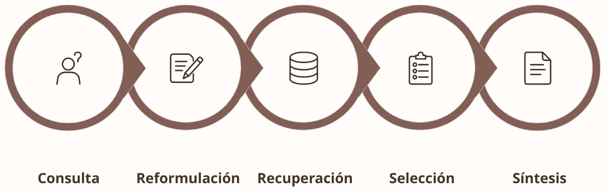
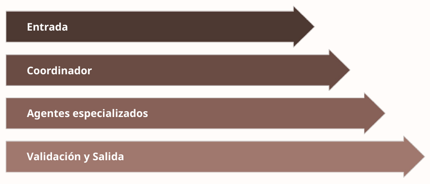

[← Anterior](02-conversaciones-contexto-y-estado.md) · [Índice del módulo](README.md) · [Siguiente →](04-herramientas-integracion-y-evaluacion.md)

# 3 · Encadenamiento y roles

*Módulo 13: Diseño de sistemas de prompts*

## 3.1 Prompt Chaining: concepto

El **prompt chaining** consiste en conectar prompts de forma que la salida de uno se convierte en la entrada del siguiente. Cada eslabón tiene una responsabilidad acotada, lo que mejora la modularidad y la reutilización, pero también puede aumentar la latencia y propagar errores si no se validan las transiciones.

- **Extracción**: Identifica entidades y datos relevantes del input bruto.
- **Análisis**: Aplica lógica de negocio sobre los datos estructurados.
- **Respuesta**: Genera la salida final orientada al usuario o sistema destino.

Los errores en etapas tempranas se amplifican en las siguientes. Valida siempre antes de pasar al siguiente eslabón.

**Explicación**

El prompt chaining conecta prompts de modo que la salida de uno es la entrada del siguiente. Cada eslabón tiene una responsabilidad acotada, lo que mejora la modularidad y la reutilización, pero puede aumentar la latencia y propagar errores si no se validan las transiciones. El ejemplo básico tiene extracción, análisis y respuesta.

Los errores de etapas tempranas se amplifican en las siguientes: si la extracción se equivoca en un importe, el análisis trabajará con él y la respuesta lo presentará con naturalidad, de modo que hay que validar siempre antes de pasar al siguiente eslabón. La cadena es la implementación práctica de la arquitectura secuencial; su ventaja es la especialización (cada prompt puede optimizarse con su formato, ejemplos y temperatura) y su coste el de las llamadas adicionales y la coordinación, por lo que se aplica solo cuando el proceso lo justifica.

<!-- labs-seccion -->
> **Para practicar esta sección:** [Laboratorio 13A · Cadena de tres etapas con contratos y puertas de validación](../../laboratorios/13A/README.md)
<!-- /labs-seccion -->

---

## 3.2 Diseñar una cadena de prompts

Construir una cadena de prompts de forma sistemática garantiza que cada etapa sea probada de forma independiente y que el flujo completo funcione de extremo a extremo.

1. **Definir objetivo final**: ¿Qué salida necesita el sistema o usuario al terminar la cadena? Trabaja hacia atrás desde ese objetivo.
2. **Diseñar prompts por etapa**: Cada prompt tiene una sola responsabilidad. Incluye instrucciones de formato de salida en cada uno.
3. **Estandarizar salidas**: Usa formatos consistentes (preferiblemente JSON estructurado) para facilitar el parsing entre etapas.
4. **Añadir validación**: Implementa una puerta de validación entre cada par de etapas antes de continuar.
5. **Probar flujo completo**: Prueba cada etapa por separado y luego el pipeline completo con casos reales y casos límite.

**Explicación**

Construir una cadena de forma sistemática garantiza que cada etapa se pruebe por separado y que el conjunto funcione de extremo a extremo. Cinco pasos: definir el objetivo final, trabajando hacia atrás desde él; diseñar un prompt por etapa con una sola responsabilidad y su formato de salida; estandarizar las salidas, preferiblemente en JSON estructurado; añadir una puerta de validación entre cada par de etapas; y probar el flujo completo con casos reales y límite.

Trabajar hacia atrás evita diseñar etapas que luego no sirven y permite saber qué debe producir cada eslabón: si el resultado final necesita un importe validado, la extracción debe producirlo con esa calidad. Los casos límite son donde suelen romperse las cadenas: entradas vacías, malformadas o inesperadas. Un JSON con campos fijos puede validarse automáticamente, mientras que un texto libre exige interpretación y es fuente de ambigüedad entre etapas.

---

## 3.3 Validación entre etapas

Una **puerta de validación** es un componente que verifica que la salida de una etapa cumple los requisitos del contrato antes de pasarla a la siguiente. Es la principal defensa contra la propagación de errores en una cadena.


- **Comprobar formato**: ¿Es parseable? ¿Respeta el esquema acordado en el contrato?
- **Campos requeridos**: ¿Están presentes todos los campos obligatorios con tipos correctos?
- **Consistencia semántica**: ¿Los valores son coherentes entre sí? ¿Dentro de rangos esperados?
- **Registrar decisión**: Guardar si se aprobó o rechazó, y por qué motivo, para trazabilidad.

**Explicación**

Una puerta de validación verifica que la salida de una etapa cumple el contrato antes de pasarla a la siguiente, y es la principal defensa contra la propagación de errores. Comprueba el formato (¿es un JSON válido y respeta el esquema?), los campos requeridos con sus tipos y la consistencia semántica (¿los valores son coherentes entre sí y están en rangos esperados?). Si todo es correcto, pasa a la etapa siguiente; si no, rechaza, registra la decisión y activa la recuperación.

Las dos primeras comprobaciones se resuelven con código determinista, barato y fiable. La tercera es más difícil y se apoya en reglas de negocio o, en casos concretos, en otro modelo revisor; una fecha de fin anterior a la de inicio es una incoherencia que una regla sencilla detecta sin modelo. Se aplica a las cadenas lo visto en los módulos [06](../06-formato-de-salida-y-parametros/README.md) y [07](../07-ciclo-de-vida-y-evaluacion/README.md): validar por separado estructura y contenido y definir de antemano qué ocurre si la validación falla. Sin puertas, una cadena es una sucesión de actos de fe.

<!-- labs-seccion -->
> **Para practicar esta sección:** [Laboratorio 13A · Cadena de tres etapas con contratos y puertas de validación](../../laboratorios/13A/README.md) · [Laboratorio 14 · Proyecto integrador: asistente de gestión de reclamaciones de Altanoria](../../laboratorios/14/README.md)
<!-- /labs-seccion -->

---

## 3.4 Ejemplo resuelto: contrato y puerta entre dos etapas

Un contrato concreto y una puerta de validación sencilla impiden que un error de la etapa 1 llegue a la etapa 2.

**Contrato de la etapa 1 *(ilustrativo)***

```text
{ "version": "extraccion-v1.2",
  "resumen": string,
  "palabras_clave": [string],
  "fragmentos_fuente": [string],
  "estado": "ok" | "revisar" }
Sin fragmento fuente para un dato clave:
estado = "revisar" (revisión humana).
```

**Puerta de validación**

- Formato: JSON válido y versión de contrato esperada
- Campos: resumen, palabras clave y fragmentos presentes
- Semántica: cada palabra clave aparece en un fragmento
- Decisión: aprobar, reintentar (máx. 2) o escalar
- Registro: versión, causa del rechazo y fecha

**Explicación**

Este ejemplo concreta el contrato y la puerta con un caso sencillo para mostrar cómo se evita que un error de la etapa 1 llegue a la etapa 2. El contrato de la etapa 1 es un objeto JSON con una versión («extraccion-v1.2»), un resumen, una lista de palabras clave, una lista de fragmentos fuente y un estado que solo puede ser «ok» o «revisar»; si un dato clave no tiene fragmento fuente, el estado debe ser «revisar», lo que desencadena la revisión humana.

La puerta comprueba el formato (JSON válido y versión esperada), los campos (resumen, palabras clave y fragmentos presentes), la semántica (cada palabra clave aparece en algún fragmento), la decisión (aprobar, reintentar hasta dos veces o escalar) y el registro (versión, causa del rechazo y fecha). Las dos primeras se resuelven con código y la tercera con una regla de negocio sencilla: un resumen que menciona un dato sin respaldo no avanza silenciosamente, se detiene, se registra el motivo y se decide qué hacer. Ninguna etapa debe recibir datos no validados.

<!-- labs-seccion -->
> **Para practicar esta sección:** [Laboratorio 13A · Cadena de tres etapas con contratos y puertas de validación](../../laboratorios/13A/README.md)
<!-- /labs-seccion -->

---

## 3.5 Encadenamiento con fuentes documentales

Cuando el sistema necesita fundamentar sus respuestas en documentos autorizados, se utiliza un patrón de Recuperación-Aumentada-Generación (RAG). Este flujo garantiza que la respuesta esté grounded en evidencia verificable.



<details>
<summary>Descripción del diagrama en texto</summary>

1. **Consulta**
2. **Reformulación**
3. **Recuperación**
4. **Selección**
5. **Síntesis**

</details>

- **Recuperar con precisión**: Un mal retrieval propaga información incorrecta. Evalúa siempre la relevancia de los fragmentos.
- **Comprobar permisos**: ¿Tiene el usuario derecho a acceder a los documentos recuperados?
- **Tratar ausencia**: Si no hay evidencia suficiente, el sistema debe decirlo, no inventar.

**Explicación**

Cuando el sistema debe fundamentar sus respuestas en documentos autorizados, se usa la generación aumentada por recuperación (**RAG**), que ancla la respuesta en evidencia verificable. El flujo es la consulta del usuario, su reformulación para buscar mejor, la recuperación de fragmentos, la selección de los más pertinentes y la síntesis de la respuesta.

Tres cuidados: recuperar con precisión (un mal retrieval propaga información incorrecta, por lo que hay que evaluar la relevancia), comprobar los permisos (si el usuario puede acceder a los documentos recuperados, filtrando en la recuperación antes de que lleguen al modelo, como se vio en el módulo [09](../09-seguridad-privacidad-y-uso-responsable/README.md)) y tratar la ausencia (si no hay evidencia suficiente, el sistema debe decirlo y no inventar). Es la esencia del patrón: si el documento correcto no se recupera, el modelo puede completar el hueco con información plausible pero falsa, por lo que conviene una instrucción de responder solo con lo que aparezca en los fragmentos. Los fragmentos recuperados son datos no confiables, nunca instrucciones.

<!-- labs-seccion -->
> **Para practicar esta sección:** [Laboratorio 13B · Sistema ramificado con recuperación de documentos y evaluación extremo a extremo](../../laboratorios/13B/README.md)
<!-- /labs-seccion -->

---

## 3.6 Sistemas con múltiples roles

En sistemas complejos, distintos prompts asumen distintos roles funcionales. Separar responsabilidades reduce la complejidad de cada componente, facilita el mantenimiento y permite reutilizar roles en diferentes contextos.

**Generador**

**Revisor**

Produce el contenido o la respuesta inicial a partir de las instrucciones y el contexto.

Evalúa la salida del generador contra una rúbrica y señala defectos específicos.

**Especialista**

**Coordinador**

Aporta conocimiento de dominio en una fase concreta (legal, médico, financiero).

Orquesta la secuencia, asigna tareas a otros roles y agrega resultados finales.

> Define contratos de entrada y salida para cada rol. Evita redundancias: si dos roles hacen lo mismo, uno sobra.

**Explicación**

En sistemas complejos, distintos prompts asumen distintos roles funcionales; separar responsabilidades reduce la complejidad de cada componente, facilita el mantenimiento y permite reutilizar roles. Son habituales el generador (produce la respuesta inicial), el revisor (evalúa contra una rúbrica y señala defectos), el especialista (aporta conocimiento de dominio en una fase concreta, como legal, médico o financiero) y el coordinador (orquesta la secuencia, asigna tareas y agrega resultados).

Se definen contratos de entrada y salida para cada rol y se evitan redundancias: si dos roles hacen lo mismo, uno sobra. «Rol» no significa necesariamente un modelo distinto: puede ser el mismo modelo con instrucciones diferentes, y separar el que genera del que revisa es valioso porque cada uno trabaja con un objetivo distinto. Retoma los roles múltiples secuenciales del módulo [05](../05-roles-personas-y-comportamiento/README.md), con las mismas cautelas: un rol decorativo no aporta valor y los roles no sustituyen a los datos.

---

## 3.7 Patrón generador-revisor

El patrón generador-revisor introduce un ciclo de mejora estructurada: un componente genera un borrador y otro lo evalúa contra criterios explícitos, señalando defectos con evidencia. Los ciclos se limitan para evitar bucles infinitos.


- **Rúbrica explícita**: El revisor evalúa contra criterios concretos: precisión, formato, tono, completitud.
- **Señalar con evidencia**: El revisor indica exactamente qué falla y por qué, no solo "incorrecto".
- **Ciclos y parada**: Define un número máximo de iteraciones (típicamente 2–3). Sin límite, el sistema puede no converger.

**Explicación**

El patrón **generador-revisor** introduce un ciclo de mejora estructurada: un componente genera un borrador y otro lo evalúa contra criterios explícitos, señalando defectos con evidencia, con ciclos limitados para evitar bucles infinitos. La entrada llega al generador, que produce la versión 1; el revisor aplica la rúbrica y detecta defectos; si aprueba, sale la salida final; si no, el generador corrige los puntos concretos (versión 2) y el revisor vuelve a evaluar; si se supera el máximo de ciclos, se escala a revisión humana.

Tres claves: una rúbrica explícita (precisión, formato, tono, completitud), señalar con evidencia qué falla y por qué, y definir un máximo de iteraciones, típicamente dos o tres. El escalado indica que el sistema reconoce sus límites: un revisor automático puede compartir los sesgos del generador, por lo que en tareas de alto impacto la última palabra es humana. Es frecuente la oscilación (corregir un defecto introduce otro), y el límite de ciclos y el escalado evitan gastar recursos en un bucle sin salida.

<!-- labs-seccion -->
> **Para practicar esta sección:** [Laboratorio 13A · Cadena de tres etapas con contratos y puertas de validación](../../laboratorios/13A/README.md)
<!-- /labs-seccion -->

---

## 3.8 Coordinación multiagente

En un sistema multiagente, varios componentes especializados trabajan de forma coordinada bajo la supervisión de un orquestador. Cada agente tiene capacidades y responsabilidades acotadas; el coordinador distribuye tareas y agrega resultados.



<details>
<summary>Descripción del diagrama en texto</summary>

1. **Entrada**
2. **Coordinador**
3. **Agentes especializados**
4. **Validación y Salida**

</details>

- **Especialización**: Cada agente domina un área concreta. No solapar capacidades.
- **Comunicación definida**: Protocolo claro para cómo los agentes intercambian información.
- **Control de conflictos**: Mecanismo explícito para resolver cuando dos agentes discrepan.
- **Coste y complejidad**: Cada agente adicional suma coste, latencia y superficie de fallo.

**Explicación**

En un sistema **multiagente**, varios componentes especializados trabajan de forma coordinada bajo un orquestador: cada agente tiene capacidades y responsabilidades acotadas y el coordinador distribuye tareas y agrega resultados. Se tiene en cuenta que cada agente domine un área sin solapar capacidades, que exista un protocolo claro de comunicación, un mecanismo explícito para resolver discrepancias y que cada agente adicional suma coste, latencia y superficie de fallo.

Hay que mirar con espíritu crítico: la tendencia a entusiasmarse con los agentes lleva a veces a construir sistemas con cinco o seis para tareas que un flujo secuencial resolvería, y la pregunta es qué aporta un agente que no pudiera hacer una etapa de una cadena. La diferencia está en la autonomía: en una cadena el flujo está fijado de antemano, y en un sistema multiagente el coordinador decide dinámicamente, lo que da flexibilidad pero reduce la previsibilidad y exige más controles: validación entre agentes, registro de las decisiones del coordinador y límites claros (mínimo privilegio, módulos [04](../04-tecnicas-avanzadas-de-prompting/README.md) y [09](../09-seguridad-privacidad-y-uso-responsable/README.md)).

---

## 3.9 Riesgos en sistemas multiagente

Los sistemas multiagente amplifican tanto las capacidades como los riesgos. Antes de adoptar esta arquitectura, es imprescindible evaluar y mitigar los siguientes riesgos:

**Propagación de errores**

**Consenso incorrecto**

Un fallo en un agente puede contaminar a los demás si no hay puertas de validación.

Varios agentes pueden coincidir en una respuesta equivocada, dando apariencia de fiabilidad falsa.

**Conflicto de responsabilidades**

**Coste y latencia**

Ambigüedad sobre qué agente tiene autoridad final en caso de discrepancia.

Múltiples llamadas paralelas o en cadena multiplican el coste y el tiempo de respuesta.

**Observabilidad compleja**

**Evaluación global**

Rastrear qué agente generó qué parte de la respuesta es difícil sin trazabilidad explícita.

Evaluar el sistema en su conjunto requiere métricas de extremo a extremo, no solo por agente.

**Explicación**

Los sistemas multiagente amplifican capacidades y riesgos, y hay seis que evaluar y mitigar antes de adoptarlos: la propagación de errores (un fallo en un agente contamina a los demás sin puertas de validación), el consenso incorrecto (varios agentes coinciden en una respuesta equivocada y dan una falsa apariencia de fiabilidad), el conflicto de responsabilidades (no está claro qué agente decide ante una discrepancia), el coste y la latencia multiplicados, la **observabilidad** compleja (difícil rastrear qué agente generó qué sin trazabilidad explícita) y la evaluación global, que requiere métricas de extremo a extremo.

El segundo es especialmente engañoso: que tres agentes coincidan no significa que acierten, porque si comparten el modelo base y la información, pueden compartir el error; el acuerdo no es verificación independiente. La mitigación pasa por fuentes distintas, comprobaciones externas y, cuando importa, supervisión humana. El conflicto de responsabilidades se resuelve diseñando una jerarquía de decisión, y los dos últimos conectan con el módulo [07](../07-ciclo-de-vida-y-evaluacion/README.md): sin registros que indiquen quién hizo qué, depurar es casi imposible.

---

[← Anterior](02-conversaciones-contexto-y-estado.md) · [Índice del módulo](README.md) · [Siguiente →](04-herramientas-integracion-y-evaluacion.md)
