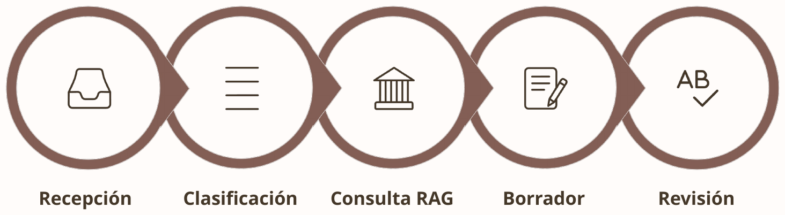

[← Anterior](04-herramientas-integracion-y-evaluacion.md) · [Índice del módulo](README.md) · [Siguiente →](06-anexos-chuleta-glosario-y-vigencia.md)

# 5 · Ejemplos, errores y proyecto práctico

*Módulo 13: Diseño de sistemas de prompts*

## 5.1 Ejemplo: asistente de soporte técnico

Este ejemplo ilustrativo muestra cómo aplicar una arquitectura de sistema de prompts a un caso de soporte técnico real. Cada etapa tiene un propósito claro y contratos definidos.

Descripción del diagrama en texto

1. **Recepción**
2. **Clasificación**
3. **Consulta RAG**
4. **Borrador**
5. **Revisión**

- **Extracción**: Datos estructurados del ticket de entrada.
- **Clasificación**: Prioridad y tipo determinan la rama del flujo.
- **Conocimiento**: Solo respuestas fundamentadas en documentación autorizada.
- **Revisión**: El revisor garantiza calidad antes de enviar.

**Explicación**

El primer ejemplo aplica una arquitectura de sistema de prompts a un asistente de soporte técnico. El flujo tiene seis pasos: recepción, extracción, clasificación, consulta RAG, borrador y revisión. La extracción obtiene datos estructurados del ticket, la clasificación determina por prioridad y tipo la rama a seguir (arquitectura ramificada), el conocimiento restringe las respuestas a documentación autorizada mediante RAG y la revisión garantiza la calidad antes de enviar.

Combina una cadena secuencial, un clasificador que ramifica, una etapa de recuperación y un patrón generador-revisor: no hay un patrón único, sino elegir los adecuados y conectarlos con contratos y validación. El principio de no inventar se aplica en la etapa de conocimiento: si la documentación no cubre la consulta, el sistema lo reconoce y escala a una persona. La clasificación permite tratar distinto un acceso bloqueado y una duda funcional, y la extracción inicial hace que las etapas posteriores trabajen con información limpia.

<!-- labs-seccion -->
> **Para practicar esta sección:** [Laboratorio 13B · Sistema ramificado con recuperación de documentos y evaluación extremo a extremo](../../laboratorios/13B/README.md)
<!-- /labs-seccion -->

---

## 5.2 Ejemplo: sistema de gestión documental

Un sistema documental automatizado aplica varios de los patrones vistos en este módulo:

- clasificación
- extracción estructurada
- validación
- síntesis con revisión humana final

- **Clasificar antes de extraer**: El tipo de documento determina qué campos se extraen. No uses un extractor genérico.
- **Validar siempre**: Una extracción incompleta es más peligrosa que no extraer. Mejor rechazar que archivar mal.
- **Humano en el bucle (HITL)**: Para documentos con consecuencias legales o financieras, la revisión humana no es opcional.

**Explicación**

El segundo ejemplo, un sistema de gestión documental, aplica clasificación, extracción estructurada, validación y síntesis con revisión humana final. Seis etapas: recepción del documento (correo, portal o API), clasificación por tipo (contrato, factura o informe), extracción de campos clave según el tipo, validación con una puerta que comprueba campos requeridos y coherencia, síntesis e informe con un resumen ejecutivo y hallazgos y revisión humana en la que el especialista aprueba o corrige antes de archivar.

Tres lecciones: clasificar antes de extraer, porque el tipo determina los campos y no sirve un extractor genérico; validar siempre, porque una extracción incompleta es más peligrosa que no extraer y es mejor rechazar que archivar mal; y mantener a una persona en el circuito en documentos con consecuencias legales o financieras. Rechazar un documento que no supera la validación y enviarlo a revisión no es un fallo, sino el funcionamiento correcto. Reúne lo visto en el módulo [12](../12-analisis-de-informacion-y-datos/README.md) con esta arquitectura y es un buen modelo para el proyecto práctico.

---

## 5.3 Errores frecuentes y anti-patrones

Estos son los errores más comunes al diseñar sistemas de prompts. Reconocerlos evita costosas revisiones posteriores:

| Anti-patrón | Consecuencia | Solución |
|---|---|---|
| Encadenar sin necesidad | Coste y latencia innecesarios | Comprobar si un único prompt bien diseñado basta |
| No validar entre etapas | Los errores se propagan y amplifican | Implementar puertas de validación en cada transición |
| Arrastrar historial completo | Desbordamiento de contexto y coste elevado | Resumir y filtrar el contexto en cada turno |
| Permisos excesivos en herramientas | Riesgo de acción no autorizada | Aplicar mínimo privilegio y confirmar acciones sensibles |
| No gestionar fallos | El sistema se cuelga o produce resultados inválidos | Diseñar flujo de recuperación con reintentos y escalado |
| No medir extremo a extremo | Problemas de calidad invisibles hasta producción | Añadir evaluación end-to-end además de por etapa |

**Explicación**

Los errores más comunes al diseñar sistemas de prompts y su solución son seis. Encadenar sin necesidad genera coste y latencia innecesarios (comprobar si un prompt bien diseñado basta). No validar entre etapas hace que los errores se propaguen (puertas de validación en cada transición). Arrastrar el historial completo desborda el contexto y encarece (resumir y filtrar). Los permisos excesivos en herramientas permiten acciones no autorizadas (mínimo privilegio y confirmación de las sensibles). No gestionar los fallos deja el sistema colgado o con resultados inválidos (recuperación con reintentos y escalado). Y no medir de extremo a extremo oculta los problemas de calidad hasta producción (evaluación global además de la de cada etapa).

Comparten una raíz: suponer que el sistema funciona porque cada pieza parece funcionar. El buen diseño parte de lo contrario: asume que algo va a fallar y prepara el sistema para detectarlo, contenerlo y recuperarse. Cada fila remite a una sección del módulo, y la tabla sirve como lista de revisión de un diseño.

<!-- labs-seccion -->
> **Para practicar esta sección:** [Laboratorio 13A · Cadena de tres etapas con contratos y puertas de validación](../../laboratorios/13A/README.md) · [Laboratorio 13B · Sistema ramificado con recuperación de documentos y evaluación extremo a extremo](../../laboratorios/13B/README.md)
<!-- /labs-seccion -->

---

## 5.4 Resumen y preparación del proyecto práctico

En la sesión práctica aplicarás directamente los conceptos de este módulo diseñando un sistema de prompts completo para un caso de tu elección. No se requiere memoria ni entrega posterior: todo el trabajo se realiza durante la sesión práctica.

1. **Definir caso y alcance**: Elige un proceso de negocio real o realista. Define el objetivo final, el usuario y los límites del sistema.
2. **Descomponer tareas**: Identifica las subtareas, sus dependencias y si son secuenciales o paralelas.
3. **Diseñar contratos y secuencia**: Define el contrato de entrada/salida de cada etapa y el orden del flujo.
4. **Construir los prompts**: Redacta un prompt por etapa con instrucciones de formato de salida y gestión de errores.
5. **Probar y demostrar**: Ejecuta el flujo completo con al menos un caso normal y un caso límite. Presenta los resultados.

**Explicación**

La última sección prepara el proyecto práctico: se diseñará un sistema de prompts completo para un caso a elección, sin memoria ni entrega posterior, ya que todo el trabajo se realiza durante la sesión. Cinco pasos: definir caso y alcance (un **proceso de negocio** real o realista, con objetivo final, usuario y límites), descomponer las tareas con sus dependencias y su carácter secuencial o paralelo, diseñar los contratos de entrada y salida y la secuencia, construir un prompt por etapa con formato de salida y gestión de errores y probar y demostrar con al menos un caso normal y uno límite.

Conviene ser modesto en el alcance: un caso pequeño, bien descompuesto, con contratos claros y un caso límite probado vale más que un sistema ambicioso sin validar. Y recordar el hilo del curso: empezar simple, validar cada paso, medir y mantener siempre a una persona responsable de lo que el sistema produce. Los fundamentos, las técnicas, la evaluación, la seguridad y las aplicaciones convergen en una forma de trabajar: diseñar con intención, comprobar con evidencia y asumir la responsabilidad del resultado.

---

## 5.5 Comprobación de comprensión

Piensa cada respuesta, de forma oral o por escrito, antes de ver las respuestas orientativas, que aparecen a continuación.

**Preguntas de comprobación**

1. ¿Qué es un contrato entre etapas y qué debe incluir?
1. ¿Qué es una puerta de validación y por qué no basta con comprobar el esquema?
1. ¿Cuándo se reintenta y cuándo se escala a una persona?
1. ¿Por qué se evalúan por separado la recuperación, la clasificación y la respuesta?
1. ¿Qué cautelas se aplican al diseñar las herramientas de un sistema?

**Explicación**

La comprobación de comprensión propone cinco preguntas sobre las ideas centrales del diseño de sistemas de prompts: qué incluye un contrato entre etapas, qué es una puerta de validación y por qué no basta con el esquema, cuándo se reintenta y cuándo se escala a una persona, por qué se evalúan por separado la recuperación, la clasificación y la respuesta y qué cautelas se aplican a las herramientas. Conviene responderlas antes de ver las respuestas de la diapositiva siguiente.

Son también el repaso previo al proyecto práctico (laboratorio 14), que reúne todas estas piezas en un único sistema.

---

## 5.6 Comprobación de comprensión: respuestas

Contrasta tus respuestas con estas. Son orientativas: lo importante es que cubran las ideas clave del módulo.

**Preguntas de comprobación y respuestas orientativas**

1. ¿Qué es un contrato entre etapas y qué debe incluir?

Qué entra y qué sale (campos, tipos y valores permitidos), su versión y qué ocurre si falta un dato o hay un error.

1. ¿Qué es una puerta de validación y por qué no basta con comprobar el esquema?

Una comprobación objetiva entre etapas que frena los errores. Debe cubrir formato, esquema y semántica: por ejemplo, que una cita exista literalmente en el original.

1. ¿Cuándo se reintenta y cuándo se escala a una persona?

Se reintenta, con el motivo del rechazo y un máximo de intentos, cuando el fallo es corregible; se escala cuando se agotan, el caso es ambiguo o la decisión tiene impacto.

1. ¿Por qué se evalúan por separado la recuperación, la clasificación y la respuesta?

Para saber dónde falla el sistema: una cifra global no distingue entre un fragmento no recuperado, una ruta mal elegida y una respuesta mal redactada.

1. ¿Qué cautelas se aplican al diseñar las herramientas de un sistema?

La descripción de una herramienta es un prompt y debe ser precisa; además se aplica el mínimo privilegio, se validan los parámetros y se registra cada llamada.

**Explicación**

Las respuestas orientativas fijan los criterios de diseño. Un contrato declara qué entra, qué sale, su versión y qué ocurre ante un dato ausente o un error. Una puerta comprueba formato, esquema y semántica, y rechaza con un motivo que el reintento puede usar. Se reintenta un número limitado de veces y se escala cuando el fallo no es corregible, el caso es ambiguo o la decisión tiene impacto. La evaluación por etapas permite saber si el fallo está en la recuperación, en la ruta o en la respuesta. Y las herramientas se diseñan con descripciones precisas, mínimo privilegio, validación de parámetros y registro de cada llamada.

---

[← Anterior](04-herramientas-integracion-y-evaluacion.md) · [Índice del módulo](README.md) · [Siguiente →](06-anexos-chuleta-glosario-y-vigencia.md)
